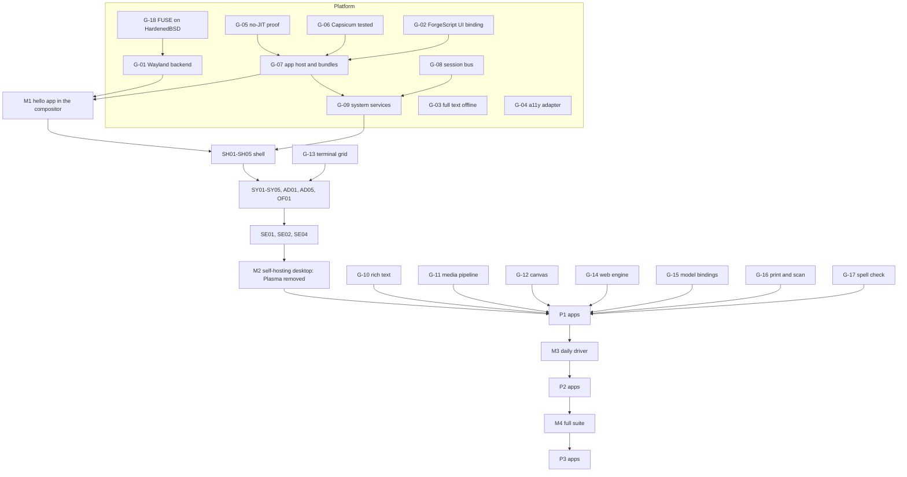

<!-- SPDX-License-Identifier: AGPL-3.0-or-later -->
# Suite roadmap

By Odin Loch

The order to build the platform and the 78 apps. Everything here is Proposed. Each app's own phases and work items are in its `SPEC.md` section 12; this file orders the apps against each other and against the platform gaps in [PLATFORM.md](PLATFORM.md) section 13 and [GAPS.md](GAPS.md).

## 1. Dependency shape

## 2. Milestones

| Milestone | Contains | Exit test |
|---|---|---|
| M0 Foundations | G-18, G-05, G-06, G-03 | FUSE UI gates and ForgeScript tests run on HardenedBSD in CI with no network; a recorded result shows no executable page is ever writable in the script host. |
| M1 Hello app | G-01, G-02, G-07, G-08 | A signed bundle with an empty capability list opens a window in the PBSD compositor, survives its own crash, and is refused when one byte of the bundle changes. |
| M2 Self-hosting desktop | G-09, G-04, G-13; SH01–SH05; SY01–SY05; AD01, AD05; SE01, SE02, SE04; OF01 | Install from media, log in, manage files, settings, software and permissions with no Qt or KDE process running. `kde/` leaves the default build. |
| M3 Daily driver | G-10, G-11, G-12, G-14, G-15, G-16, G-17; every P1 app | A person can do a working week on it: mail, browser, documents, media, chat, backup. |
| M4 Full suite | every P2 app | All 78 specs at Phase 2 or later. |
| M5 Extras | P3 apps, Phase 3 features everywhere | — |

## 3. Build order inside each milestone

### M2 (P0)

1. SH04 Portals and SH03 Login/Lock first: every other app needs the trusted prompts and a session.
2. SH05 Window Management, SH01 Desktop Shell, SH02 Notifications.
3. SY03 Terminal and OF01 Text Editor (they make the system developable from inside).
4. SY02 Files, SY01 Settings, AD05 Permissions.
5. SY05 Software, SY04 System Monitor, AD01 Installer.
6. SE04 Passwords and Keys (owns the keyring UI), SE02 Firewall, SE01 Security Centre.

### M3 (P1)

| Track | Apps | Blocking gaps |
|---|---|---|
| Admin | AD02 Disks, AD03 Backup, AD04 Logs, VM05 Devices, VM01 Virtual Machines | — |
| Security | SE03 Anonymity, SE05 Vault | — |
| Documents | OF02 Notes, OF03 Document Viewer, OF04 Writer, OF05 Sheets, OF07 Calculator, UT01 Archives, UT05 Help | G-10, G-12, G-16, G-17 |
| Communication | CO01 Mail, CO02 Calendar, CO03 Contacts, CO05 Messenger | G-10, G-14 (or the restricted HTML renderer) |
| Internet | IN01 Web Browser | G-14 |
| Media | ME01 Photos, ME02 Music, ME03 Video, ME05 Screen Capture | G-11 |
| Development | DV01 IDE, DV06 Proof Workbench | G-13 |
| AI | AI02 Model Manager, then AI01 Assistant | G-15 |
| Accessibility | AX01 Screen Reader, AX02 Magnifier, AX04 Input Methods | G-04, G-03 |

Tracks are independent after M2 and can run in parallel.

### M4 (P2) and M5 (P3)

P2: VM02, VM03, VM04, OF06, OF08, OF09, CO04, IN02, IN03, IN04, ME04, ME06, CR01, CR02, CR04, DV02, DV03, DV04, DV05, DV07, AI03, AI04, UT02, UT03, UT04, UT06, AX03, AX05.
P3: IN05, CR03, AX06, GM01.

## 4. Shared engines to build once

Several apps need the same engine. Build each once as a helper library or service, owned by one app's team:

| Engine | Owner | Also used by |
|---|---|---|
| Code editor core (piece table, grammars, multi-cursor) | OF01 | DV01, DV02, OF02, OF09, AI04, DV06 |
| Rich text and page layout (G-10) | OF04 | OF02, OF06, CO01, CO05 |
| Canvas (G-12) | OF08 | CR01, OF03, IN04, ME05, OF06 |
| Media pipeline (G-11) | ME03 | ME02, ME04, ME05, ME06, CR02, CR03, CO05, IN02 |
| Chart and plot library | OF05 | OF07, AI03, AI04, SY04, OF09 |
| Formula and maths engine (MathScript) | OF07 | OF05, AI04, OF04 |
| Document parsers in sandboxes (PDF, ODF, OOXML) | OF03, OF04 | OF05, OF06, CO01, SY02 preview |
| Image codecs in sandboxes | ME01 | every app that shows images, svc.thumbnail |
| Archive engine | UT01 | SY02, SY05, IN03 |
| Git engine | DV03 | DV01, CR04 |
| Terminal grid (G-13) | SY03 | DV01, VM01, VM02, VM04 |
| Web content engine (G-14) | IN01 | CO01, IN02, UT05 |
| OCR, speech, vision models through svc.model | AI02 | ME05, OF03, ME04, ME06, AX01, AX06, ME01 |
| OpenPGP, S/MIME, age, signing | SE04 | CO01, SE05, DV03, SY05, CO05 |
| Sync between own devices (no server account) | OF02 | IN01, AX05, CO04, SE04 |

## 5. Relation to the existing OS plan

- `docs/plan/PBSD_PLAN.md` package P5-02 ships Plasma 6 on the new graphics stack. This suite replaces Plasma at milestone M2. Until then Plasma remains the working desktop, so the kernel work is never blocked on the apps.
- The compositor in `pbsd/compositor` stays. The shell apps are its clients; the KDE bridge modules there are retired at M2.
- This folder does not change `docs/plan`. When the apps plan is accepted, P5-02 should be split into "P5-02a Plasma (interim)" and "P5-02b Qt-free shell and apps", with the work items from the specs fed into `tasks.yaml`.

## 6. Proof and test policy for the suite

- App logic in ForgeScript: memory safety comes from the interpreter. The interpreter and app host are the trusted base and are the priority for T1/T2 work.
- Helpers that parse hostile bytes (documents, images, media, fonts, archives, packets, network protocols): T2 targets (PRISM bounded checks at every entry point) plus fuzzing, and they run with no capabilities so a failure is contained.
- Trusted-path UI (prompts, lock screen, portals), the manifest-to-policy compiler, the signature check, and the keyring: T1 targets for their core state machines.
- A tier is a target until PRISM has run and the output is stored beside the code. No spec in this folder records a passing result, because nothing has been built.
