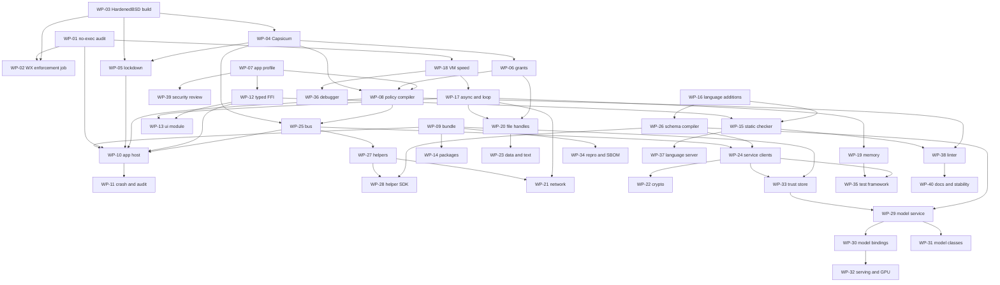

<!-- SPDX-License-Identifier: AGPL-3.0-or-later -->
# FORGE build plan for the ParanoidBSD app suite

By Odin Loch

Everything that must be built in the FORGE repo so that ParanoidBSD (on HardenedBSD 15-STABLE) can run its 78 apps with all app logic in ForgeScript and on-device AI on FORGE. **Status: plan only. Nothing in this file has been built, run, tested or proved.**

## 1. Purpose and scope

| Item | Statement |
|---|---|
| Purpose | One ordered list of work for the FORGE repo, traced to the platform gaps in [PLATFORM.md](../PLATFORM.md) section 13, the apps in [CATALOGUE.md](../CATALOGUE.md) and the milestones in [ROADMAP.md](../ROADMAP.md). |
| In scope | ForgeScript language, runtime and tools; the FORGE security module (FSS); the FORGE OS layer on HardenedBSD; the app run-time library and app host core; the session bus and schema compiler; the helper framework; the model service; signing and packaging. |
| Out of scope | FUSE UI widgets, text shaping, the Wayland backend, the compositor, the kernel, the content of each app. Where FORGE work meets FUSE work the split is stated in the work package. |
| Labels | **Verified** = read in a repo on 12 Nov 2026; cited as `FORGE:path` (with `:line` where useful) or as a repo path in ParanoidBSD. **Proposed** = design in this plan; nothing exists. **Unverified** = could not be read or run here; must be confirmed before work starts. |
| FORGE revision read | `main` at `b135941` (commit dated 2026-11-07), read-only clone. |
| Observation | Observed 12 Nov 2026, Linux, not HardenedBSD: FORGE's README states CI ran FreeBSD 14.3 in a VM (60/60 tests) and that only the Linux OS-sandbox mechanism has an automated test; nothing was built or tested in this session. |
| App specs read | Four specs existed and each stopped inside section 4 (features): AX01, ME03, OF01, SH01. No spec had sections 6, 7, 11, 12 or 13 yet. Requirements taken from them are cited by feature ID. Spec gap IDs found: AX01-GAP-1, ME03-GAP-1 to ME03-GAP-4, SH01-GAP-1, SH01-GAP-2. `Apps/00-foundation/GAPS.md` is linked from ROADMAP.md but did not exist. |
| Proof tiers | T1 proof of correctness; T2 proved absence of runtime errors; T3 safe subset plus sanitizers and fuzzing; T4 none. A tier is a target until PRISM has run and the output is stored beside the code. |

## 2. Baseline: what FORGE provides today

### 2.1 ForgeScript (Verified)

| Area | What exists | Source |
|---|---|---|
| Language | Interpreted, memory-safe subset of C++23. Parser rejects raw pointers, `new`/`delete`, address-of, casts, pointer arithmetic. Classes, lambdas, exceptions, namespaces, enums, templates (type-erased). | `FORGE:docs/scripting.md:46-68` |
| Not in the language | No `finally`. `goto`, `asm`, `union`, `co_await`, `co_return`, `co_yield` are rejected by the parser. | `FORGE:docs/scripting.md:60`, `FORGE:script/src/parser.cpp:815-816` |
| Scope guard | The tree-walker has an internal `Defer` node. User syntax is not documented apart from the emit list. Unverified as a public feature. | `FORGE:script/src/tree.cpp:8-32`, `FORGE:script/src/ast.hpp:32` |
| Memory | Value types, atomic refcounts, synchronous trial-deletion cycle collector, bounds checks, `BorrowError` on use-after-move and on mutation during iteration, RAII handles. The collector does not run while tasks are active. | `FORGE:docs/scripting.md:103-133`, `FORGE:script/src/heap.cpp:91-93` |
| Execution | Parsed once. `run`/`run_file` use the bytecode VM; REPL and `eval` use the tree-walker. A verifier checks each chunk. Cold statements (try, class, import, throw) are delegated from the VM to the tree-walker through `ExecNode`. | `FORGE:docs/scripting.md:186-192`, `FORGE:script/src/vm.cpp:1-4` |
| `jit_threshold` | Number of calls after which a function's AST is compiled to a bytecode `Chunk` (a `std::vector<Instr>`), verified, and run by `vm_run`, a `while (pc < n)` switch loop. No machine code is produced. Detail in WP-01. | `FORGE:script/include/forge/script/script.hpp:23`, `FORGE:script/src/runtime.cpp:729`, `FORGE:script/src/vm.cpp:220-229`, `FORGE:script/src/vm.cpp:329-334`, `FORGE:script/src/vm.hpp:16-27` |
| Cache | `.fsc` caches the parsed, resolved tree, not bytecode. Optional Ed25519 signing. Fuzzed. | `FORGE:docs/scripting.md:194-224` |
| Concurrency | `std::async`, `std::thread`, `forge::spawn`, channels, `forge::parallel`, `ProcessPool`. Race, lock-order and stall detectors in debug mode. No event loop. | `FORGE:docs/scripting.md:164-182`, `:403-432` |
| Limits | `limit {}` blocks: timeout, CPU, heap, allocations, handles, child processes. Whole-run steps, time, heap, depth 800. | `FORGE:docs/scripting.md:269-312`, `FORGE:script/src/interp.hpp:11-17` |
| Capabilities | `fs`, `net`, `proc`, `env`, `reflect`. **All on by default.** Only narrow. Checked at the call. | `FORGE:script/src/interp.hpp:18`, `FORGE:docs/scripting.md:314-336` |
| Static checker | 22 check IDs. "Not built: undefined-variable checks, type inference beyond literals." Only `limit-option` has its own test. | `FORGE:docs/scripting.md:706-752` |
| Modules | `#include`, `import`, `forge::import`; search path includes `$FORGE_SCRIPT_PATH`, `~/.forge/modules` and the current directory. No versions. | `FORGE:docs/scripting.md:538-553` |
| Native plugins | C ABI, loaded with `dlopen`, JSON crossing, refused unless all four capabilities are on. Stay loaded for the life of the process. | `FORGE:docs/scripting.md:353-361`, `:554-558`, `FORGE:script/src/builtins.cpp:1174-1188` |
| Embedding | `engine` with `define(name, min, max, fn)`. Values cross as JSON text. Callbacks arrive as `{"$callback": id}`. | `FORGE:script/include/forge/script/script.hpp:98-111` |
| Built-ins | `fs` (path based), `path`, `os`, `proc`, `service`, `net` (`resolve`, `port_open`, `http`), `time`, `json`, `hash` (BLAKE3 only), `re`, `math`, `gc`, `mem`, shells, `forge::text`, `forge::locale`, mobile. | `FORGE:docs/scripting.md:594-616` |
| Missing by its own statement | "Not implemented: `finally`, shell-block syntax, `sandbox {...}` block syntax, REPL history and completion, script bindings for models, GPU and serving." | `FORGE:docs/scripting.md:786-787`, `:618-619` |
| Reflection, `eval` | Run-time reflection gated by `reflect`; `eval` built-in. | `FORGE:docs/scripting.md:560-592`, `FORGE:script/src/builtins.cpp:483` |
| AI commands | `forge::ask`, `ask_json`, `explain`, `suggest_cmd`, `ai_run`, `ai_eval`. Backends: host callback, in-process `.fpk`, or `$FORGE_AI_ENDPOINT` over HTTP. Drafted code runs only after confirmation. | `FORGE:docs/scripting.md:469-504`, `FORGE:script/src/ai.cpp:55` |
| Emit to shell | A portable subset translates to shell scripts. | `FORGE:docs/scripting.md:643-704` |

### 2.2 Security module (FSS), OS layer, signing (Verified)

| Area | What exists | Source |
|---|---|---|
| FSS status | Draft. With no policy the profile is `none`, not `strict`: "P3 (strict by default) is not met"; script capabilities are then default allow. | `FORGE:docs/security-standard.md:17-20`, `:36-41` |
| Policy | JSON file: `fs.read`/`fs.write` roots, `net.mode` + hosts, `exec`, `dynamic_code`, `env`, `allow_root`, `integrity`, `limits`, `audit`, `emulation`. Found through `--policy`, `$FORGE_SECURITY_POLICY`, `./forge-security.json`, the config dir or `$FORGE_SECURITY_PROFILE`. | `FORGE:docs/security-standard.md:135-156` |
| `enforce` | Path, host and port scoped; audited. Covers only the code that calls it. | `FORGE:security/include/forge/security/enforce.hpp:38`, `FORGE:docs/security.md` (Known gaps) |
| `lockdown` on FreeBSD | `procctl(PROC_NO_NEW_PRIVS_CTL)`; exec denial is "emulated" ("Capsicum is all-or-nothing"); network and file-read confinement emulated. | `FORGE:security/include/forge/security/lockdown.hpp:345-347`, `:410`, `:424`, `:440` |
| W^X control | `dynamic_code: false` has a kernel backend only on Windows. Elsewhere the state is "emulated": "the kernel does not enforce W^X for this process". | `FORGE:security/include/forge/security/lockdown.hpp:446-451` |
| OS sandbox on FreeBSD | `apply_sandbox` calls `cap_enter()` only. No `cap_rights_limit` call exists in `os/`, `security/`, `script/` (searched). `run_sandboxed` opens the binary and library directories, then `cap_enter` and `fexecve`. | `FORGE:os/include/forge/os/sandbox.hpp:15`, `:438-439`, `:536-596` |
| Script OS-sandbox test | Compiled for Linux only. | `FORGE:tests/test_script_os_sandbox.cpp:7`, `FORGE:docs/scripting.md:344` |
| Detached signatures | `forge-detached-sig` v1: Ed25519 over BLAKE3 of a domain-separated message that binds the file name and size. `integrity.scripts`/`plugins` = required, optional or off. | `FORGE:security/include/forge/security/integrity.hpp:11-15`, `FORGE:docs/scripting.md:379-386` |
| Signed bundles | Ed25519 over a `FORGE-SIGNATURE.json` manifest of (path, size, BLAKE3) for a directory; reports modified, missing and extra files. Library only, no CLI. | `FORGE:modelfile/include/forge/modelfile/bundle.hpp:7-22`, `FORGE:docs/security.md` (Model files and signing) |
| Local IPC | `local_listener`/`local_stream` over AF_UNIX `SOCK_STREAM`; peer credentials (FreeBSD `LOCAL_PEERCRED`). No descriptor passing (no `SCM_RIGHTS` in the header). | `FORGE:os/include/forge/os/local_ipc.hpp:35`, `:63`, `:128-137` |
| RPC | `FRPC` (device op) and `FRPS` (script) frames over TCP; tokens, Ed25519 keys, TLS through OpenSSL. | `FORGE:docs/rpc.md:5-8` |
| Keystore | FreeBSD: libsecret if present, else an encrypted file; same-user code can read the file key unless a passphrase or TPM wraps it. | `FORGE:docs/security.md` (Secrets at rest, Known gaps) |
| Other OS headers | `shared_memory` (`shm_open` on FreeBSD), `process_pool`, `crash`, `file_watch` (kqueue), `service` (rc.d detection), `power`, `clipboard`, `settings` (environment registry). | `FORGE:docs/os.md:33-50` |
| Text and locale | Own Unicode 16.0 / CLDR 46 library, tables compiled in: normalisation, segmentation, bidi, collation, regex, encodings, number/date/message formatting, gettext catalogues, calendars, time zones. | `FORGE:docs/text-locale.md:1-60` |
| Regex | Backtracking engine with backreferences and lookahead; steps capped per search (default 1e7). | `FORGE:docs/text-locale.md:39` |
| Crypto | Vendored Monocypher 4.0.2: Ed25519, XChaCha20-Poly1305, BLAKE2b, Argon2id in use. Own BLAKE3. Scripts see only `hash.blake3`. No X.509, TLS, OpenPGP, age or post-quantum code in the tree. | `FORGE:NOTICE`, `FORGE:docs/security.md`, `FORGE:docs/support.md:90`, `FORGE:docs/scripting.md:610` |
| TLS today | `net::http` loads the system OpenSSL with `dlopen` on FreeBSD; `rpc-serve` links OpenSSL when found. | `FORGE:docs/os-wrapper.md:115-134`, `FORGE:docs/building.md:21` |

### 2.3 Inference, serving, tooling (Verified)

| Area | What exists | Source |
|---|---|---|
| Models | `.fpk` container with BLAKE3 hashes, embedded Ed25519 signature, optional XChaCha20-Poly1305 encryption. Strict loading by `FORGE_REQUIRE_SIGNED` / `FORGE_TRUSTED_KEYS` or `integrity.models`. | `FORGE:SECURITY.md`, `FORGE:docs/inference.md:29` |
| Import templates present | `llama`, `mixtral`, `deepseek_v2`, `qwen3`, `qwen3_5`, `qwen3_moe`, `qwen3_5_moe`. All are text decoders. | `FORGE:import/templates/` |
| Planned, not present | BERT-style encoders, vision towers, Whisper-style speech, an embeddings endpoint. | `FORGE:FORGE_PLAN.md:577`, `:593` |
| Sessions | Generative, one-shot `infer` (ONNX imports), diffusion, streaming (SPSC ring, window/hop), plugin sessions. | `FORGE:docs/inference.md:5-8`, `:105-108` |
| Structured output | GBNF grammars (llama.cpp dialect); JSON Schema subset converted to GBNF. | `FORGE:docs/inference.md:81-84` |
| Scheduling | `batch_scheduler`: continuous batching, priorities, cancel, prefix cache, memory budget admission, KV spill. Runs on one model are serialised. | `FORGE:docs/inference.md:86-103`, `:145` |
| Memory | `forge::mem` budgets, leases, evictable caches, pressure hooks. | `FORGE:docs/memory.md:1-44` |
| `forge-serve` | OpenAI-style HTTP on an IPv4 TCP socket (default 127.0.0.1:8080). No authentication, no TLS, `Access-Control-Allow-Origin: *` on every response. No Unix-socket listener. | `FORGE:docs/serve.md`, `FORGE:apps/forge_serve.cpp:409` |
| C ABI | `forge.h`, ABI version 3. | `FORGE:docs/capi.md` |
| GPU | Runtimes are loaded with `dlopen`. Vulkan needs `glslangValidator` and headers at build time, has run only on software devices, and is compiled out of every CI job but one. | `FORGE:docs/gpu.md:9`, `:232`, `FORGE:docs/STATUS.md` (GPU backends) |
| Tests | One executable per `tests/test_*.cpp`; script programs run on VM and tree-walker and must match; `tests/script/*.fs` goldens; 10 fuzz targets; ASan+UBSan and TSan jobs run `test_script` only. | `FORGE:docs/testing.md`, `FORGE:fuzz/` |
| Supply chain | `tools/sbom.py` (SPDX 2.3), `ci/repro_check.sh`, `tools/release.py`. | `FORGE:NOTICE`, `FORGE:ci/`, `FORGE:tools/` |

### 2.4 Where it has run

| Platform | Result stated by FORGE | Source |
|---|---|---|
| Linux x86_64 GCC 14, Clang 18 | ctest 111/111 | `FORGE:README.md`, `FORGE:docs/STATUS.md` |
| FreeBSD 14.3 (VM in CI) | `ctest -LE "slow\|emu\|gpu"` 60/60; base clang; `-DFORGE_BUILD_EXAMPLES=OFF` | `FORGE:.github/workflows/ci.yml:163-179` |
| HardenedBSD (any version) | No statement anywhere in the repo. **Unverified.** | — |
| FreeBSD 15 | No statement. **Unverified.** | — |
| Sanitizers | ASan/UBSan/TSan on Linux, `test_script` only | `FORGE:docs/STATUS.md` |

### 2.5 What the docs themselves mark untested, emulated or missing

| Item | Statement | Source |
|---|---|---|
| OS sandbox for scripts | Only the Linux mechanism has an automated test | `FORGE:docs/scripting.md:344` |
| `sandbox({isolate: true})` | "Untested." | `FORGE:docs/scripting.md:347-351` |
| Static checks | Only `limit-option` asserted individually; indirect calls not seen | `FORGE:docs/scripting.md:751-752`, `FORGE:docs/security.md` (Known gaps) |
| FSS controls ERR-3, ERR-4 | "Not audited." | `FORGE:docs/security-standard.md:110-111` |
| `enforce` | C++ code that calls `os::read_file` or `std::ifstream` directly is not checked | `FORGE:docs/security.md` (Known gaps) |
| Nested `sandbox` blocks | Interpreter-checked only | `FORGE:docs/security.md` (Known gaps) |
| Private-file check | Check and open are separate steps (race) | `FORGE:docs/security.md` (Known gaps) |
| Vulkan | Never on a real GPU | `FORGE:docs/STATUS.md` |
| Readiness under a service manager | Tested with an abstract socket only | `FORGE:docs/serve.md` (Platform notes) |
| FreeBSD emit output | "has not been run" | `FORGE:docs/scripting.md:701-703` |

### 2.6 Third-party code and licences

| Component | Licence | Use | Source |
|---|---|---|---|
| FORGE itself | AGPL-3.0-or-later, or commercial | — | `FORGE:README.md` |
| Monocypher 4.0.2 (vendored) | BSD-2-Clause OR CC0-1.0 | signing, AEAD, KDF | `FORGE:NOTICE` |
| Level Zero API header (vendored) | MIT | GPU runtime header | `FORGE:NOTICE` |
| llama.cpp / ggml (design followed, code is FORGE's) | MIT notice kept | CUDA matvec design | `FORGE:NOTICE` |
| OpenSSL (system, optional) | Not vendored; licence to confirm against the HardenedBSD base copy (Unverified) | `rpc-serve` TLS, `net::http` | `FORGE:docs/building.md:21` |
| libsecret, tpm2-tss, libpmc (system, loaded at run time) | Not vendored | keystore, TPM, counters | `FORGE:docs/os.md:7`, `FORGE:docs/security.md` |
| Python 3 (build tool) | — | required at configure time for code generators | `FORGE:docs/building.md:5`, `:12` |

### 2.7 Conflicts with the OS rules

| # | Conflict | Evidence | Rule broken | Fixed by |
|---|---|---|---|---|
| C1 | Script capabilities default to allow; no profile unless asked | `FORGE:script/src/interp.hpp:18`, `FORGE:docs/security-standard.md:17-20` | default deny (PLATFORM.md section 6 rule 1) | WP-07 |
| C2 | Policy can come from the environment or the current directory | `FORGE:docs/security-standard.md:137-139` | no ambient authority (SI-2) | WP-07 |
| C3 | No kernel W^X control off Windows; nothing asserts that the host maps no executable memory | `FORGE:security/include/forge/security/lockdown.hpp:446-451` | SI-3, G-05 | WP-01, WP-02 |
| C4 | Native plugins: `dlopen` of arbitrary signed or unsigned code; on Linux through `memfd_create` | `FORGE:script/src/builtins.cpp:1174-1188`, `FORGE:security/include/forge/security/plugin.hpp:113-114` | PLATFORM.md section 2 (native code only in helpers) | WP-02, WP-39 |
| C5 | Run-time `dlopen` of OpenSSL, libsecret, tpm2-tss, GPU drivers by name | `FORGE:docs/os.md:7`, `FORGE:docs/gpu.md:9` | capability mode has no global file namespace; code loading must be explicit | WP-02, WP-04, WP-21, WP-32 |
| C6 | Capsicum use stops at `cap_enter()`; no per-descriptor rights | `FORGE:os/include/forge/os/sandbox.hpp:438-439` | SI-1, PLATFORM.md section 6 | WP-04 |
| C7 | Path-based `fs` API; module search uses `$FORGE_SCRIPT_PATH`, the home directory and the current directory | `FORGE:docs/scripting.md:550-553`, `:602` | handles not paths (V19) | WP-14, WP-20 |
| C8 | `forge-serve` listens on TCP with no authentication and permissive CORS | `FORGE:docs/serve.md` | no network unless declared (section 6 rule 5) | WP-32 |
| C9 | AI commands can reach `$FORGE_AI_ENDPOINT` over HTTP | `FORGE:script/src/ai.cpp:55` | no network unless declared | WP-39 |
| C10 | Shell calls, `eval`, emit-to-shell available to any script with `proc` | `FORGE:docs/scripting.md:244-267` | apps do not shell out | WP-38, WP-39 |
| C11 | Assumes Linux: seccomp, Landlock, `memfd_create`, abstract sockets, io_uring, cgroup limits, `/proc`, logind, PSI | `FORGE:docs/security.md`, `FORGE:docs/os.md:33-50` | port needed; each has a FreeBSD branch of differing strength | WP-03 to WP-05 |
| C12 | Build needs Python 3; optional fetches exist (`FORGE_FETCH_UCD`, `tools/cldr/fetch.sh`); golden tests need Python packages | `FORGE:docs/building.md:12`, `:67`, `FORGE:docs/text-locale.md` | no network at build time | WP-03 |
| C13 | Telemetry | None: "There is no telemetry." No conflict. | `FORGE:SECURITY.md` | — |

## 3. Requirements matrix

One row per requirement. "Trace" gives platform gap IDs (PLATFORM.md section 13), app IDs (CATALOGUE.md), spec feature or gap IDs, and platform sections (§). "Today" is Verified unless marked.

| ID | Requirement | Trace | Today | WP |
|---|---|---|---|---|
| FORGE-R-001 | The interpreter never produces native code; `jit_threshold` shown to be bytecode only | G-05, §4, SI-3 | Bytecode only by reading; no proof, no test | 01 |
| FORGE-R-002 | The script host maps no writable-executable page and no anonymous executable page; asserted at run time | G-05, SI-3, M0 exit test | "emulated" off Windows | 01, 02 |
| FORGE-R-003 | The whole script suite passes under enforced W^X on HardenedBSD | G-05, M0 | never run | 02 |
| FORGE-R-004 | No native code is loaded into an app engine (plugins off) | §2, §4 | plugins allowed when all capabilities are on | 02, 39 |
| FORGE-R-005 | FORGE builds and passes its tests on HardenedBSD 15-STABLE with base clang and libc++ | G-06, G-18 (FORGE side) | FreeBSD 14.3 VM only | 03 |
| FORGE-R-006 | Offline build: no fetch at configure, build or test time | §6 rule 5, M0 | Python needed; fetch flags off by default | 03 |
| FORGE-R-007 | Capsicum capability mode end to end for host, helpers and services | G-06 | `cap_enter` only | 04 |
| FORGE-R-008 | `cap_rights_limit` on every descriptor, derived from the manifest | §6 | absent | 04, 08 |
| FORGE-R-009 | DNS, time zones, locale data, fonts and certificates work in capability mode | G-06, every app | not designed | 04 |
| FORGE-R-010 | Script OS-sandbox test on HardenedBSD equal to the Linux test | G-06, V13 | Linux only | 04 |
| FORGE-R-011 | Process hardening by `procctl` (no new privileges, no tracing, W^X request) | SI-3 | no-new-privs only | 05 |
| FORGE-R-012 | FSS grants map onto PBSD handles, rights and lineage; revocation is immediate | V19, SI-1, SI-2, SI-6, AD05 | absent | 06 |
| FORGE-R-013 | Default-deny profile for the host that the environment cannot weaken | §6 rule 1 | profile `none` | 07 |
| FORGE-R-014 | The host never reads policy from the environment, the current directory or user files | §6, SI-2 | search order includes them | 07 |
| FORGE-R-015 | Manifest-to-policy compiler | G-07 | absent | 08 |
| FORGE-R-016 | Formal specification of the mapping, T1 target | ROADMAP §6 | absent | 08 |
| FORGE-R-017 | Complete capability vocabulary, with room for local-link multicast and optical-drive portals | §6, ME03-GAP-3, ME03-GAP-4 | absent | 08 |
| FORGE-R-018 | Run-time grants and revocations reach the running engine | §6 rules 3–4, AD05, SH04 | absent | 06, 08 |
| FORGE-R-019 | Bundle `SIGNATURES` (BLAKE3 tree hash, Ed25519) verified before any code runs | G-07, §3 | directory bundle signing exists, library only | 09 |
| FORGE-R-020 | A bundle with one changed byte is refused | M1 exit test | — | 09 |
| FORGE-R-021 | One shared host binary: engine, UI context, IPC endpoint | G-07, §4 | absent | 10 |
| FORGE-R-022 | Per-app limits: heap, handles, CPU, child processes | §4, SY04 | `limit` blocks and options | 10, 19 |
| FORGE-R-023 | Crash containment; windows reattach by session token | §4, M1, AX01-F134 | `os/crash.hpp` | 11 |
| FORGE-R-024 | Per-app audit stream into `svc.audit` | §8, AD04, SE01, SH01-F141 | `security::audit` sinks | 11 |
| FORGE-R-025 | Update and rollback hooks; read-only bundles; caches outside the bundle | §3, SY05 | `.fsc` cache | 11, 18 |
| FORGE-R-026 | Single instance, intent delivery, background run and autostart | §12 | absent | 10 |
| FORGE-R-027 | Headless host for system services and tests | G-09 | absent | 10 |
| FORGE-R-028 | Typed foreign-function interface faster than JSON text | G-02, V15 | JSON only | 12 |
| FORGE-R-029 | Typed handles with generation checks | G-02, V2 | absent | 12 |
| FORGE-R-030 | Zero-copy buffers for pixels, text and audio | G-02, CR01, ME03, OF01-F111 | absent | 12, 20 |
| FORGE-R-031 | Batched property updates per frame | §5 | absent | 12 |
| FORGE-R-032 | The `ui::` module surface of PLATFORM.md section 5 | G-02 | absent | 13 |
| FORGE-R-033 | Observable view models and item models | §5 | absent | 13 |
| FORGE-R-034 | One UI thread; script tasks post to it | V2 | tasks exist, no loop | 13, 17 |
| FORGE-R-035 | Error mapping across the host boundary | — | `HostError` | 12 |
| FORGE-R-036 | Modules and packages: versions, signatures, offline registry | every app, `depends_on` | imports and `.sig`; no versions | 14 |
| FORGE-R-037 | Stronger static checking: undefined names, type inference, capability use | DV01, §11 | partial | 15 |
| FORGE-R-038 | `finally` or scope guards | every app | none public | 16 |
| FORGE-R-039 | Generics beyond type erasure for typed containers and records | large apps | type-erased | 16 |
| FORGE-R-040 | Typed records as the target of the schema compiler | G-08 | — | 16, 26 |
| FORGE-R-041 | `bytes` and views | DV04, OF01, every binary format | not in the built-in list | 16, 20 |
| FORGE-R-042 | Big integers and decimals | OF05, OF07, SE04 | 64-bit; overflow throws | 16 |
| FORGE-R-043 | Async or structured concurrency, event loop, timers, cancellation | every app, §11 idle rule | threads and channels; `co_await` rejected | 17 |
| FORGE-R-044 | Engine start-up inside the first-frame budget (150 ms small, 400 ms large) | §11 | — | 18 |
| FORGE-R-045 | VM speed without JIT | §2 rule (b) | VM delegates cold statements | 18 |
| FORGE-R-046 | Bytecode cache | — | `.fsc` caches the parse | 18 |
| FORGE-R-047 | Bounded collector pauses; collection while tasks are active | §11 | synchronous; skipped while tasks run | 19 |
| FORGE-R-048 | Per-app heap caps and leak diagnostics | SY04, DV01 | `heap_bytes`, `gc.stats` | 19 |
| FORGE-R-049 | Deterministic mode for tests: time, random, scheduling | §11 | — | 19, 35 |
| FORGE-R-050 | Handle-based file API (no paths outside own directories) | §6, §9, V19 | path based | 20 |
| FORGE-R-051 | Read-only memory mapping of files up to 16 GiB through a handle | OF01-F111, OF01-F113 | `os::mapping` in C++ only | 20 |
| FORGE-R-052 | Streams, sync and async | every app | — | 20 |
| FORGE-R-053 | TCP and UDP sockets under `net.*` capabilities | CO01, IN01–IN05, ME03 | `net.http`, `port_open` | 21 |
| FORGE-R-054 | TLS 1.3 from a vetted library, linked, not loaded by name | CO01, IN02, IN03 | `dlopen` of OpenSSL | 21 |
| FORGE-R-055 | HTTP/1.1 with streaming bodies, HTTP/2, WebSocket | IN02, IN03, CO02, CO05 | blocking HTTP/1.1 | 21 |
| FORGE-R-056 | DNS policy with no leak outside the app's route | SE02, SE03 | `net.resolve` | 21 |
| FORGE-R-057 | Per-app route: clear, VPN or Tor | §6 `net.route`, SE03, SH01-F110 | absent | 21 |
| FORGE-R-058 | First contact with each host logged | §6 `net.user`, SH01-F060, AX01-F080 | — | 21, 11 |
| FORGE-R-059 | Crypto primitives for scripts: hash, AEAD, sign, verify, KDF, random | SE04, SE05, OF02 | `hash.blake3` only | 22 |
| FORGE-R-060 | X.509 parsing and path validation | CO01, WP-21 | none | 22 |
| FORGE-R-061 | OpenPGP, S/MIME and age through the SE04 engine | ROADMAP §4, CO01, SE05, DV03 | none | 22 |
| FORGE-R-062 | Post-quantum ML-KEM and ML-DSA | SE04, CO05 | none | 22 |
| FORGE-R-063 | SQLite binding | §10, OF09, most apps | none in FORGE | 23 |
| FORGE-R-064 | Dates, times, zones, calendars | CO02, UT02 | `time`, `forge::locale` | 23 |
| FORGE-R-065 | Regex with a stated worst-case bound | OF01-F092, OF01-F098 | step cap 1e7 | 23 |
| FORGE-R-066 | Unicode services for scripts | G-03 (logic side), AX01-F007, AX01-F095, AX04 | `forge_text` | 23 |
| FORGE-R-067 | Compression primitives | UT01 (engine is a helper), SY05 | none read | 23 |
| FORGE-R-068 | Structured logging | AD04 | `forge::log` (C++) | 23 |
| FORGE-R-069 | Localisation tables `locale/<lang>.tbl` and message formatting | §3, §11 | gettext, `format_message` | 23 |
| FORGE-R-070 | Image and audio primitives policy (heavy codecs in helpers) | ME01–ME06, CR01–CR03 | `support/vision`, `support/signal` | 23, 28 |
| FORGE-R-071 | ForgeScript clients for every service in PLATFORM.md section 8 | G-09 | none | 24 |
| FORGE-R-072 | Apps can offer bus interfaces (`services_provided`) | ME03 (`org.pbsd.video.Player1`), AX01-F139, AX01-F140 | none | 24, 25 |
| FORGE-R-073 | Session bus | G-08, §7 | AF_UNIX primitives | 25 |
| FORGE-R-074 | Schema compiler to ForgeScript and C++23 | G-08 | none | 26 |
| FORGE-R-075 | Descriptor passing on the bus | §7 | none | 25 |
| FORGE-R-076 | Interface version stated; mismatch refused | §7 | — | 25, 26 |
| FORGE-R-077 | Fuzzed codecs for every generated type | §11 | — | 26 |
| FORGE-R-078 | Helpers start in capability mode with only passed descriptors | §2, §4, ME03 | `run_sandboxed` FreeBSD path | 27 |
| FORGE-R-079 | Helper supervision, restart and limits | ME03 (helper crash recovery, limits), AX01-F134 | `process_pool` replaces crashed workers | 27 |
| FORGE-R-080 | Typed channel and shared memory to helpers | G-11 users | `shared_memory.hpp` | 27, 28 |
| FORGE-R-081 | Helper SDK for C++23 and Rust | §2 | none | 28 |
| FORGE-R-082 | `proc.exec` runs programs through a launcher outside the host | SY03, DV01, SH01-F104 | — | 27 |
| FORGE-R-083 | `svc.model` with queueing and a memory budget across apps | G-15, §8 | `batch_scheduler`, `forge::mem` | 29 |
| FORGE-R-084 | Signed `.fpk` only; trust policy; per-app model permission | AI02, §6 `ai.local` | `integrity.models` | 29 |
| FORGE-R-085 | ForgeScript model bindings with streaming | G-15, V17 | "not implemented" | 30 |
| FORGE-R-086 | Structured output | AI01, SH01-F097 | GBNF, JSON Schema subset | 30 |
| FORGE-R-087 | Embeddings and retrieval primitives | AI01, ME01, `svc.search` | no embeddings API read | 30, 31 |
| FORGE-R-088 | Speech-to-text model class | ME03 (subtitle generation), ME06, AX06 | no template | 31 |
| FORGE-R-089 | Text-to-speech model class | AX01-F002 | none | 31 |
| FORGE-R-090 | OCR model class | ME05, OF03, ME04, UT06, AX01 | none | 31 |
| FORGE-R-091 | Vision classes: description, face and object search, upscaling | AX01-F100, ME01, ME03 | none | 31 |
| FORGE-R-092 | Local-only serving: Unix socket, no TCP listener by default | §6 rule 5 | TCP only | 32 |
| FORGE-R-093 | GPU compute on HardenedBSD | §6 `dev.gpu.compute` | Vulkan on software devices only | 32 |
| FORGE-R-094 | Prompt-injection containment for tool calls | AI01 | confirm callbacks | 32 |
| FORGE-R-095 | Serve the Lean prover model to PRISM | `docs/plan/PBSD_PLAN.md` §1, §5; DV06 | CUDA numbers for Goedel-Prover-V2 on Linux | 29, 32 |
| FORGE-R-096 | Key management hand-off to SE04; trust store; revocation | SE04, SY05 | `trusted_keys` list; no revocation | 33 |
| FORGE-R-097 | Reproducible builds and SBOM | SY05 | `sbom.py`, `repro_check.sh` | 34 |
| FORGE-R-098 | Package format for apps and ForgeScript modules | SY05, `svc.update` | none | 34 |
| FORGE-R-099 | Test framework and coverage for ForgeScript | §11 | `assert` | 35 |
| FORGE-R-100 | Golden UI test driver through the accessibility tree | §11 | — | 35 |
| FORGE-R-101 | Fuzz harness generator | §11 | built-in fuzz driver | 35 |
| FORGE-R-102 | Debugger protocol: breakpoints, stepping, watches | DV01 | none | 36 |
| FORGE-R-103 | Profiler | DV01, SY04 | `forge::prof` zones (C++) | 36 |
| FORGE-R-104 | Language server | DV01 | `--check --json` | 37 |
| FORGE-R-105 | Formatter and documentation generator | DV01 | — | 37 |
| FORGE-R-106 | REPL history and completion | AI04, DV01 | "not implemented" | 37 |
| FORGE-R-107 | Bundle linter and `forge script --check` in CI | §11 | `--check` | 38 |
| FORGE-R-108 | Apps cannot shell out | §6 | shell built-ins exist | 38, 39 |
| FORGE-R-109 | `eval` and reflection policy for apps | AX01-F114 to AX01-F118, AI04 | `eval`; `reflect` capability | 39 |
| FORGE-R-110 | Nested engines with zero capabilities for user scripts and macros | AX01-F115, OF01 (macros) | `forge::sandbox`; one engine | 39, 10 |
| FORGE-R-111 | Environment access and AI command policy | §6 | `env` capability; `FORGE_AI_ENDPOINT` | 39 |
| FORGE-R-112 | Every untested, emulated or default-allow item closed or fenced | section 2.5, 2.7 | open | 39 |
| FORGE-R-113 | API stability, versioning and deprecation policy | `depends_on` in the manifest | version 0.1.0 | 40 |

## 4. Work packages

14 epics (A–N), 40 work packages. All designs are **Proposed**. Sizes count new code plus tests: S under 2 kLOC, M 2–6, L 6–15, XL over 15. New directories follow the repo's layout (`<layer>/include/forge/<layer>/`, `<layer>/src/`, `tests/test_<name>.cpp`, `fuzz/fuzz_<name>.cpp`, `tests/script/*.fs` + `.out`). Every test that runs script code runs it on the VM and on the tree-walker and requires equal output, as the repo does today (`FORGE:docs/scripting.md:770-774`). Budgets are targets on the reference machine named in `docs/plan/PBSD_PLAN.md` section 1 (Lenovo P920) until a baseline has been measured; no ForgeScript speed figures exist in the FORGE docs today.

FreeBSD and HardenedBSD system interfaces named below (`cap_rights_limit`, `openat` with `O_RESOLVE_BENEATH`, `connectat`, `pdfork`, `fexecve`, `fdlopen`, `procctl` commands, Casper services, `rctl`, PaX MPROTECT controls) were **not read or run in this session**. Each is Unverified on HardenedBSD 15-STABLE and is confirmed by task FORGE-WP-03.1 before design freeze.

### Epic A — No-JIT and W^X assurance

### FORGE-WP-01 Establish what `jit_threshold` does; forbid executable memory in the script runtime

| Field | Content |
|---|---|
| Goal | Close G-05 on the FORGE side: a recorded, checkable statement that ForgeScript only ever produces bytecode, plus a build switch and a run-time assertion that make any executable mapping a failure. |
| Owns | `script/` (existing), `security/include/forge/security/exec_memory.hpp` (new), `os/include/forge/os/os.hpp` (existing, exec branches), `tests/test_no_exec.cpp` (new), `docs/scripting.md` |
| Depends on | none |
| Tests | `test_no_exec`: runs every `tests/script/*.fs` with `vm_threshold = 1`, calls the assertion after each; `no_exec_symbols` ctest scans the linked `forge_script` objects for undefined references to `mprotect`, `dlopen`, `fdlopen`, `dlsym`, `memfd_create`; a source lint fails on `PROT_EXEC` or `prot_exec` outside one allow-listed header. Negative control: a child that maps a W+X page must be caught by the assertion (the Windows test already does this: `FORGE:tests/test_security.cpp:96`). |
| Budgets | Assertion walk under 2 ms for 500 map entries; zero cost when not called. |
| Proof tier and PRISM job | Verifier and VM loop: T2 (PRISM proves no out-of-bounds stack, constant, local or jump access in `vm_run` for any chunk accepted by `verify`). Verifier soundness as a Lean model: T1 target. PRISM also checks that `Chunk` and `Instr` hold no function pointer or callable. |
| Acceptance | The statement in the Design row is reproduced by a reviewer from the cited lines; `FORGE_NO_EXEC_MEMORY=ON` builds; `test_no_exec` and `no_exec_symbols` exist and are in the HardenedBSD job. |
| Size, risks | S. Risk: third-party or libc code maps executable memory outside FORGE's view (thread stacks, `ld-elf`); the assertion allow-list must be exact, not broad. |

Verified by reading (not by running):

| Fact | Source |
|---|---|
| The option is declared as `int jit_threshold = 2; // calls before a function is compiled`. | `FORGE:script/include/forge/script/script.hpp:23` |
| Its only use: `if (!f->chunk && sh->use_vm && f->calls.fetch_add(1) + 1 >= sh->jit_threshold) f->chunk = compile(d);` then `vm_run(*this, *f->chunk, env)`. | `FORGE:script/src/runtime.cpp:729-730` |
| The engine clamps it to at least 1. | `FORGE:script/src/engine.cpp:147` |
| `compile()` returns `std::shared_ptr<const Chunk>` after calling `verify`. A `Chunk` is vectors of `Instr { Opc op; std::int32_t a, b; }`, constants, names and AST nodes. | `FORGE:script/src/vm.cpp:220-229`, `FORGE:script/src/vm.hpp:16-27` |
| `vm_run` is a `while (pc < n)` loop with a `switch` on the opcode. | `FORGE:script/src/vm.cpp:329-337` |
| The docs say: "A function called `jit_threshold` times (default 2) is compiled to bytecode" and "There is no JIT to machine code." | `FORGE:docs/scripting.md:187-192` |
| No `mmap`, `mprotect` or `prot_exec` appears in `script/src/`. `prot_exec` is used nowhere outside the generic mapping API in `os.hpp`. | search of the tree; `FORGE:os/include/forge/os/os.hpp:571`, `:609-633`, `:706-710` |
| Native code can still enter a script process through `dlopen`: plugins, and the OS layer's late-bound libraries. | `FORGE:script/src/builtins.cpp:1174-1188`, `FORGE:docs/os.md:7` |

So "compiled" means bytecode held in ordinary heap vectors. The name is misleading, not the behaviour. No executable memory is mapped by the interpreter itself; the only executable mappings come from loading shared objects.

```cpp
// security/include/forge/security/exec_memory.hpp (Proposed)
namespace forge::security {
struct exec_map_entry { std::uintptr_t start, end; bool write, exec, anonymous; std::string object; };
struct exec_report { std::vector<exec_map_entry> violations; bool ok() const { return violations.empty(); } };
// FreeBSD: sysctl kern.proc.vmmap for the own pid. A violation is: write+exec; exec with no backing file;
// exec from a file not in the image list recorded by record_startup_images().
void record_startup_images() noexcept;
[[nodiscard]] exec_report check_no_exec_memory() noexcept;
void assert_no_exec_memory();          // throws sandbox_error, audited (control "SBX-WX")
}
```

| Task | Work |
|---|---|
| FORGE-WP-01.1 | Write the audit above into `docs/scripting.md` and `docs/security.md` with the cited lines; add it to `docs/claims-audit.md` practice. |
| FORGE-WP-01.2 | Rename the option to `vm_threshold`; keep `jit_threshold` as a deprecated alias for one release (WP-40). |
| FORGE-WP-01.3 | `FORGE_NO_EXEC_MEMORY` CMake option: removes the `prot_exec` branches of `map`, `map_anonymous` and `protect`; any use is a compile error. Default ON for the `hardenedbsd` preset. |
| FORGE-WP-01.4 | `exec_memory.hpp` and `forge security check` row "exec memory". |
| FORGE-WP-01.5 | `test_no_exec`, `no_exec_symbols`, the source lint. |
| FORGE-WP-01.6 | PRISM job definitions for `verify` and `vm_run`; Lean model of the verifier (statement only until PRISM runs). |

### FORGE-WP-02 W^X test on HardenedBSD; remove or isolate every dynamic code path

| Field | Content |
|---|---|
| Goal | The M0 exit test: "a recorded result shows no executable page is ever writable in the script host". Plus a decision and a switch for each place FORGE loads code at run time. |
| Owns | `ci/hardenedbsd/` (new), `tests/test_wx_enforced.cpp` (new), `script/src/builtins.cpp` (plugin loader), `security/include/forge/security/plugin.hpp`, `os/include/forge/os/dynlib.hpp` |
| Depends on | WP-01, WP-03 |
| Tests | Job `hbsd-wx`: `test_script`, `test_script_golden`, `test_script_fsc`, `test_script_security`, `test_script_oserror`, `fuzz_script`, `test_no_exec` with kernel W^X enforcement on for those binaries. `test_wx_enforced` first proves enforcement is live: `mmap(W+X)` and `mprotect(+X)` on a written page must fail; if they succeed the job fails as "enforcement not active". |
| Budgets | None beyond the normal suite time. |
| Proof tier and PRISM job | T3. PRISM job: call-graph check that no path from `engine::run*`, `eval` or any built-in reaches `os::library::open` when `FORGE_SCRIPT_PLUGINS=OFF`. |
| Acceptance | The job log, with kernel version and enforcement state, is stored as the M0 record. Plugins cannot be loaded in an app-profile build by any spelling (`import "x.so"`, `forge::plugin`, `forge::import`). |
| Size, risks | M. Risks: sanitizer builds may not run under PaX MPROTECT (Unverified); the enforcement tool and flags on HardenedBSD 15 are Unverified. |

Dynamic code inventory and decision:

| Path | Evidence | Decision for PBSD builds |
|---|---|---|
| Native script plugins (`dlopen`; `memfd_create` on Linux) | `FORGE:script/src/builtins.cpp:1174-1188`, `FORGE:security/include/forge/security/plugin.hpp:113-114` | Compiled out (`FORGE_SCRIPT_PLUGINS=OFF`). Static check `plugin-forbidden`. Native code goes in helpers (WP-27). |
| OpenSSL by `dlopen` in `net::http` | `FORGE:docs/os-wrapper.md:130` | Not built into the host. Replaced by WP-21. |
| libsecret, tpm2-tss, libpmc by `dlopen` | `FORGE:docs/os.md:7`, `FORGE:docs/security.md` | Not built into the host. Keys go through `svc.keyring`. |
| GPU runtimes by `dlopen` | `FORGE:docs/gpu.md:9` | Only in the model worker process, before `cap_enter`, from a fixed list of absolute paths (WP-32). Never in an app host. |
| `run_sandboxed` through `ld-elf.so.1 -f` | `FORGE:docs/security.md` (OS sandbox table) | Kept for helpers; file-backed images only. |
| `fork` (isolate blocks, `ProcessPool`) | `FORGE:script/src/builtins.cpp:568-582` | No new code is loaded; isolate blocks are removed from the app profile for other reasons (WP-39). |
| `.fsc` cache | `FORGE:docs/scripting.md:194-224` | Data only (a parse tree). Stays. |

| Task | Work |
|---|---|
| FORGE-WP-02.1 | `ci/hardenedbsd/wx.sh`: turn enforcement on for the test binaries, record kernel and settings, run the suite. |
| FORGE-WP-02.2 | `test_wx_enforced` (negative control). |
| FORGE-WP-02.3 | `FORGE_SCRIPT_PLUGINS` option; remove `forge::plugin` and native `import` from the built-in table when off; checker rule. |
| FORGE-WP-02.4 | `FORGE_OS_LATE_BINDING` option: each `dlopen` user in `os/` can be compiled out; the host preset turns all off. |
| FORGE-WP-02.5 | Extend `no_exec_symbols` to the host and `forge_apprt`. |
| FORGE-WP-02.6 | Scan `simd/`, `graph/`, `inference/` for run-time code generation; record the result (expected none: kernels are chosen from static tables, `FORGE:README.md`). |

### Epic B — HardenedBSD port and sandbox

### FORGE-WP-03 HardenedBSD build, CI and offline build

| Field | Content |
|---|---|
| Goal | FORGE builds, tests and fuzzes on HardenedBSD 15-STABLE with base clang and libc++, with no network. |
| Owns | `CMakePresets.json` (preset `hardenedbsd`), `ci/hardenedbsd/`, `cmake/forge_offline.cmake` (new), `.github/workflows/ci.yml` or the PBSD runner config, `docs/building.md`, `docs/STATUS.md` |
| Depends on | none |
| Tests | Full `ctest -LE "slow\|emu\|gpu"` on HardenedBSD; the same inside a jail with no network interface; ASan+UBSan and TSan runs of every `test_script*`, `test_security`, `test_bus`, `test_apprt*` (today only `test_script`: `FORGE:docs/STATUS.md`). |
| Budgets | Clean build under 15 min on the reference machine; incremental script-layer build under 60 s. |
| Proof tier and PRISM job | T4 (build system). |
| Acceptance | A STATUS.md row for HardenedBSD 15-STABLE with a dated result; `FORGE_OFFLINE=ON` makes any download a configure error; the no-network jail run is recorded. |
| Size, risks | M. Risks: libc++ in base may be older than 20 and take the workaround paths (`FORGE:docs/building.md:11`); Python 3 is needed at configure time (`:12`), so it must be in the offline package set or the generator outputs must be vendored. |

| Task | Work |
|---|---|
| FORGE-WP-03.1 | Interface survey on a HardenedBSD 15-STABLE host: confirm every system call and tool this plan marks Unverified; write `docs/hardenedbsd.md`. |
| FORGE-WP-03.2 | Preset and toolchain file; fix build breaks; record which `FORGE_OS_FREEBSD` branches differ. |
| FORGE-WP-03.3 | `FORGE_OFFLINE`: forbid `FORGE_FETCH_UCD`, `tools/cldr/fetch.sh` and any fetch; fail at configure time. |
| FORGE-WP-03.4 | Decide Python: package it for the offline build, or commit the outputs of `ops/gen/` and build without Python (`FORGE_PREGENERATED=ON`). |
| FORGE-WP-03.5 | Golden-model tests without Python packages: check in the tiny golden `.fpk` fixtures or generate them in C++ (`FORGE:tests/tiny_model.hpp` exists). |
| FORGE-WP-03.6 | CI runner on HardenedBSD (VM or jail on the build machine); gate merges on it. |
| FORGE-WP-03.7 | Port audit table: each Linux-only mechanism and its HardenedBSD answer (seccomp → Capsicum, cgroup limits → rlimits or `rctl`, PSI → poll, logind → none, abstract sockets → inherited sockets). |

### FORGE-WP-04 Capsicum capability mode end to end

| Field | Content |
|---|---|
| Goal | Close G-06: the host, helpers and services run in capability mode with per-descriptor rights, and the tests match what Linux has. |
| Owns | `os/include/forge/os/capsicum.hpp` (new), `os/include/forge/os/descriptor.hpp` (new, portable facade), `os/include/forge/os/sandbox.hpp`, `os/include/forge/os/local_ipc.hpp`, `tests/test_script_os_sandbox.cpp`, `tests/test_capsicum.cpp` (new) |
| Depends on | WP-03 |
| Tests | `test_script_os_sandbox` built for FreeBSD too (today `#if defined(__linux__)`, `FORGE:tests/test_script_os_sandbox.cpp:7`), each case in a forked child: path `open` fails, `execve` fails, address `connect` fails, a descriptor limited to read refuses `write`, `openat` cannot escape with `..`, errors map to `SandboxViolationError` (`ECAPMODE` is already mapped: `FORGE:os/include/forge/os/oserror.hpp:145`). `test_capsicum`: rights only narrow; a second `limit` cannot widen. |
| Budgets | Entering the sandbox, including limiting 64 descriptors, under 1 ms. |
| Proof tier and PRISM job | `descriptor.hpp` rights algebra: T1 (subset lattice, narrowing only: SI-1). Syscall wrappers: T2. |
| Acceptance | Every script built-in is listed as: works in capability mode, needs a pre-opened descriptor, or forbidden. The FreeBSD sandbox test count equals the Linux one. |
| Size, risks | L. Risk: libraries that open paths lazily (time zones, locale, name service) fail after `cap_enter`; each must be found and pre-opened or replaced. |

```cpp
// os/include/forge/os/descriptor.hpp (Proposed)
namespace forge::os {
enum class right : std::uint64_t { read = 1, write = 2, seek = 4, map_read = 8, stat = 16, list = 32, lookup = 64,
    create = 128, remove = 256, rename = 512, truncate = 1024, sync = 2048, event = 4096, connect_at = 8192,
    send = 1 << 14, recv = 1 << 15, shutdown = 1 << 16, pass = 1 << 17, pdwait = 1 << 18, pdkill = 1 << 19 };
class rights { public: constexpr bool subset_of(rights o) const noexcept; constexpr rights narrow(rights o) const noexcept; /* ... */ };
class descriptor {                       // move-only RAII owner; never constructed from an int outside os/
public:
    result<descriptor> narrow(rights r) const;        // dup + limit; fails if !r.subset_of(held())
    status limit(rights r);                           // in place; monotone
    rights held() const noexcept;
};
class dir : public descriptor { public: result<descriptor> open(std::string_view rel, open_flags, rights) const; /* beneath only */ };
status enter_capability_mode();          // FreeBSD: cap_enter(); elsewhere: unsupported
bool in_capability_mode() noexcept;
}
```

There is no `map_exec` right: the facade cannot express an executable mapping.

| Task | Work |
|---|---|
| FORGE-WP-04.1 | `capsicum.hpp`: rights limit, ioctl and fcntl limits, `openat` beneath, `connectat`/`bindat`, process descriptors, `fexecve`. |
| FORGE-WP-04.2 | `descriptor.hpp` facade and the rights table (script operation → right → Capsicum right). |
| FORGE-WP-04.3 | `apply_sandbox(policy, grants)`: limit every listed descriptor, close the rest, then `cap_enter`. |
| FORGE-WP-04.4 | Descriptor passing in `local_ipc.hpp` (`send_with_descriptors`, `recv_with_descriptors`); none exists today. |
| FORGE-WP-04.5 | Pre-open plan: bundle, data, config, cache and runtime directories; the bus socket; time-zone data. Locale and Unicode tables are compiled in (`FORGE:docs/text-locale.md`), so they need nothing. |
| FORGE-WP-04.6 | Name resolution: apps never resolve; the network service does (WP-21), using a Casper DNS service or its own resolver. |
| FORGE-WP-04.7 | Port and extend the sandbox tests; add them to the HardenedBSD job. |
| FORGE-WP-04.8 | Classify every built-in in `builtins.cpp`, `cppstd.cpp`, `text.cpp`, `automation.cpp`, `mobile.cpp`. |

### FORGE-WP-05 Process hardening and a real `lockdown` backend for HardenedBSD

| Field | Content |
|---|---|
| Goal | `security::lockdown` on HardenedBSD reports no control as "emulated" under the app profile, and applies process hardening before any untrusted byte is read. |
| Owns | `security/include/forge/security/lockdown.hpp`, `tests/test_security.cpp` |
| Depends on | WP-03, WP-04 |
| Tests | `test_security` cases per control on HardenedBSD: state is `active`, and a forked child proves it (ptrace attach fails, core dump absent, `execve` fails, W+X map fails). `forge security check --json` golden for the app profile. |
| Budgets | `lockdown` under 2 ms. |
| Proof tier and PRISM job | T2 for the ordering state machine (SBX-2: each step irreversible, order fixed). |
| Acceptance | With `emulation: "deny"` the app profile locks down without error on HardenedBSD; on an unhardened FreeBSD kernel it refuses and says which control is missing. |
| Size, risks | M. Risk: the names and availability of the `procctl` commands differ between FreeBSD and HardenedBSD (Unverified). |

Today on FreeBSD: no-new-privs is applied (`FORGE:security/include/forge/security/lockdown.hpp:345-347`); exec, network and file-read are "emulated" (`:424`, `:440`); dynamic code is "emulated" (`:446-451`). Target table:

| Control | Target backend | State wanted |
|---|---|---|
| No new privileges | `procctl` (exists) | active |
| Exec | capability mode with no descriptor that carries an exec right | active |
| Network | capability mode: no address `connect`/`bind`; sockets only arrive as descriptors | active |
| File system | capability mode plus per-descriptor rights (WP-04) | active |
| Dynamic code | kernel W^X for the process (HardenedBSD PaX MPROTECT or the FreeBSD `procctl` W^X request) plus `assert_no_exec_memory` | active |
| Tracing, core dumps | `procctl` trace control; `RLIMIT_CORE = 0` (exists) | active |
| Address-space layout | kernel ASLR state reported; refuse if off | active |
| Resource limits | rlimits (exist); `rctl` where present | active or reported missing |

| Task | Work |
|---|---|
| FORGE-WP-05.1 | Replace each "emulated" branch with the backend above; keep "emulated" only for plain FreeBSD without the feature. |
| FORGE-WP-05.2 | Add controls `SBX-WX`, `SBX-TRACE`, `SBX-ASLR` to `check` and to the audit records. |
| FORGE-WP-05.3 | Child-process proofs for each control in `test_security`. |
| FORGE-WP-05.4 | Document the order: limits → no-new-privs → trace off → W^X request → descriptor limits → `cap_enter` → assertion. |

### FORGE-WP-06 Map grants onto PBSD handles, rights and lineage

| Field | Content |
|---|---|
| Goal | Every resource a script holds is a grant with rights and a lineage parent; revoking a grant kills it and everything derived from it at once (SI-1, SI-2, SI-6). |
| Owns | `security/include/forge/security/grant.hpp` (new), `script/src/objects.hpp` (handle objects), `apprt/src/grants.cpp` (new), `tests/test_grants.cpp` (new) |
| Depends on | WP-04 |
| Tests | Unit tests in the style of `pbsd/tests/si_harness.cpp` (named in `docs/specs/HANDLES.md`): derive, narrow, widen refused, revoke subtree, revoke during a blocked read, revoke during iteration. Script goldens: a revoked file handle raises `ObjectDisposedError`-family errors on VM and tree-walker alike. TSan run. |
| Budgets | Rights check on a handle operation under 20 ns; revoke of a 1 000-node subtree under 1 ms. |
| Proof tier and PRISM job | T1: Lean model of the grant table with theorems "derived rights ⊆ parent rights" and "after revoke(n) no operation on n or its descendants succeeds"; PRISM contracts that `grant`, `narrow`, `revoke` refine it (T2). |
| Acceptance | No script-visible handle exists without a grant id. Revocation from the Permissions app (AD05) reaches a running engine in one bus round trip. |
| Size, risks | M. Risk: the closed bit set of `CapabilityRights` was not read (only `docs/specs/HANDLES.md`); the bit mapping is filled in when `pbsd.rights` is read. |

```cpp
namespace forge::security {
struct grant_id { std::uint32_t slot, generation; };
enum class origin : std::uint8_t { manifest, portal, service, helper_return };
struct grant { grant_id id, parent; os::rights rights; origin from; std::string resource; std::int64_t expires_ns; };
class grant_table {                                     // one per host; lock-free reads
public:
    std::expected<grant_id, error> derive(grant_id parent, os::rights subset, origin, std::string resource);
    std::expected<void, error> check(grant_id, os::rights needed) const noexcept;
    std::size_t revoke(grant_id) noexcept;              // marks the subtree dead, closes descriptors, wakes waiters
};
}
```

HANDLES.md forbids building a handle from an integer descriptor without an explicit `from_trusted_*` bridge. The host's bridge is the only place a kernel descriptor becomes a grant; it lives beside the PBSD handle library, not in script-reachable code.

| Task | Work |
|---|---|
| FORGE-WP-06.1 | `grant_table` and its model. |
| FORGE-WP-06.2 | Give every script handle type (file, directory, socket, process, shared memory, service proxy, model session) a grant id; checks in each native. |
| FORGE-WP-06.3 | Revocation path: bus message → table → descriptors closed → pending tasks fail with `RevokedError` (new, under `PermissionError`). |
| FORGE-WP-06.4 | Lineage export for AD05 (read-only view of the tree: resource, rights, origin, age). |
| FORGE-WP-06.5 | Rights mapping table: PBSD right ↔ `os::right` ↔ Capsicum right ↔ script operation. |

### Epic C — Default deny

### FORGE-WP-07 The `app` profile: deny by default, nothing ambient

| Field | Content |
|---|---|
| Goal | An engine created by the host starts with every capability off and cannot be widened by the environment, the working directory or user files. |
| Owns | `security/include/forge/security/policy.hpp`, `script/include/forge/script/script.hpp`, `script/src/engine.cpp`, `tests/test_script_security.cpp`, `tests/script/app_profile_*.fs` |
| Depends on | none |
| Tests | Script goldens: with an empty policy every `fs`, `net`, `proc`, `env`, shell, plugin and `eval` call raises `PermissionError`. A test sets every `FORGE_*` variable to a weakening value and requires no change. Escape tests in the style of `tests/script/sandbox_escape.fs`. |
| Budgets | None. |
| Proof tier and PRISM job | T2: PRISM checks that in `profile::app` no code path reads `getenv`, the current directory or `load_policy()`. |
| Acceptance | `engine(options{.profile = app, .policy = p})` ignores `$FORGE_SECURITY_POLICY`, `$FORGE_SECURITY_PROFILE`, `./forge-security.json`, `$FORGE_SCRIPT_PATH`, `$FORGE_SCRIPT_CACHE*`, `$FORGE_AI_*`, `$FORGE_ASK_MODEL`. |
| Size, risks | S. Risk: hidden environment reads in other layers; the settings registry can list every defined variable (`FORGE:docs/support.md:72-85`), which gives the audit list. |

Design: a fourth profile `app` beside `strict`, `standard`, `permissive`. It equals `strict` with: no file roots at all (files only through descriptors), `exec = false`, `dynamic_code = false`, `env = false`, `plugin_load` denied, `integrity.scripts = required`, `integrity.models = required` with a non-empty key list, `emulation = deny`. `Caps` start `{false, false, false, false, false}` instead of all true (`FORGE:script/src/interp.hpp:18`). Whether the plain `forge script` CLI should also default to `strict` (FSS P3) is a separate owner decision (section 6, Q3); FORGE's own text says so (`FORGE:docs/security-standard.md:19-20`).

| Task | Work |
|---|---|
| FORGE-WP-07.1 | `profile::app` and `options::profile`, `options::policy` (a value, not a path). |
| FORGE-WP-07.2 | Environment audit: list every `FORGE_*` read; mark each ignored, fixed or host-set in the app profile. |
| FORGE-WP-07.3 | Module search in the app profile: bundle and package store only (WP-14). |
| FORGE-WP-07.4 | Golden and escape tests. |

### FORGE-WP-08 Manifest-to-policy compiler and its formal specification

| Field | Content |
|---|---|
| Goal | One function turns `manifest.json` capabilities (PLATFORM.md section 6) into: script capability flags, an FSS policy, the list of descriptors to pre-open with their rights, bus rules, network rules, helper rules and limits. The mapping has a formal specification. |
| Owns | `apprt/include/forge/apprt/manifest.hpp`, `policy_compiler.hpp`, `apprt/src/policy_compiler.cpp`, `apprt/spec/Policy.lean`, `tests/test_policy_compiler.cpp`, `fuzz/fuzz_manifest.cpp` (all new) |
| Depends on | WP-04, WP-06, WP-07 |
| Tests | Table-driven goldens: one manifest per capability and per pair of capabilities → expected compiled policy as canonical JSON. Differential test against an executable form of the Lean specification over generated manifests. Fuzzer on the manifest parser. Unknown capability string ⇒ refusal. |
| Budgets | Compile under 200 µs for 64 capabilities. |
| Proof tier and PRISM job | **T1 target** (ROADMAP.md section 6 names this compiler). PRISM proves the C++ function refines the Lean `compile`; theorems below. Parser: T2. |
| Acceptance | Theorems stated and locked; the compiler's output is canonical (same manifest ⇒ same bytes) and its BLAKE3 goes into the audit record at launch. |
| Size, risks | L. Risks: the capability vocabulary is still moving (ME03-GAP-3, ME03-GAP-4 ask for new entries); the proof must be re-run on every vocabulary change. |

| Manifest capability | Script flags | Descriptors and rights | Bus and network rules |
|---|---|---|---|
| (none) | all off | bundle (read, map_read, lookup), runtime dir | broker hello only |
| `fs.app` | `fs` on, descriptor-scoped | data, config, cache dirs: read, write, create, remove, rename, list, lookup | — |
| `fs.portal` | `fs` on | none at start; descriptors arrive from `svc.portal.file` | call rule for the file portal |
| `fs.path:<path>:<r or rw>` | `fs` on | that directory, rights by mode; shown at install | — |
| `net.none` | `net` off | — | no network-service rule |
| `net.host:<host>:<port>` | `net` on | — | network-service rule: exact host and port |
| `net.user` | `net` on | — | rule: any host the user typed; first contact logged |
| `net.route:<clear, vpn or tor>` | — | — | route tag on every network-service call |
| `proc.helper:<name>` | `proc` stays off | helper image descriptor: read, exec-by-descriptor for the supervisor only | helper rule; helper policy ⊆ app policy |
| `proc.exec` | `proc` stays off | — | call rule for the system launcher |
| `dev.*` | — | none at start | call rule for the matching device portal |
| `svc.<name>` | — | — | call rule: service, interface, major version |
| `ai.local` | — | — | call rule for `svc.model` |
| `bg.run`, `bg.autostart` | — | — | lifecycle flags for the launcher |

`exec`, `dynamic_code` and `env` are false for every manifest. Theorems for `Policy.lean`:

| ID | Statement |
|---|---|
| PC-1 | Default deny: the empty capability list compiles to the base policy, which allows no file outside the bundle and runtime directory, no network rule and no service rule. |
| PC-2 | Monotone: if capability set A ⊆ B then policy(A) ⊆ policy(B) in the rights order. |
| PC-3 | Caused: every allow rule in the output names the manifest capability that produced it. |
| PC-4 | Fixed false: `exec`, `dynamic_code`, `env`, `plugin_load` are false in every output. |
| PC-5 | Helper narrowing: policy(helper) ⊆ policy(app) for every helper in the manifest. |
| PC-6 | Canonical: `compile` is a function; equal manifests give byte-equal output. |
| PC-7 | Closed: a capability string outside the grammar gives an error, never a partial policy. |

| Task | Work |
|---|---|
| FORGE-WP-08.1 | Manifest parser and schema (PLATFORM.md section 12) with strict JSON (`FORGE:docs/support.md:92`). |
| FORGE-WP-08.2 | Capability grammar; extension points for local-link multicast and optical drives. |
| FORGE-WP-08.3 | `Policy.lean` model and the seven theorem statements. |
| FORGE-WP-08.4 | C++ compiler with PRISM annotations; canonical JSON writer. |
| FORGE-WP-08.5 | Run-time grant and revoke messages from the shell and AD05 (uses WP-06). |
| FORGE-WP-08.6 | Goldens, differential test, fuzzer. |

### Epic D — The app host

### FORGE-WP-09 Bundle format and signature verification

| Field | Content |
|---|---|
| Goal | A bundle (PLATFORM.md section 3) is accepted only if its `SIGNATURES` file verifies under a trusted key and every file matches. One changed byte means refusal (M1 exit test). |
| Owns | `apprt/include/forge/apprt/bundle.hpp`, `apprt/src/bundle.cpp`, `apps/forge.cpp` (`forge bundle` commands), `tests/test_app_bundle.cpp`, `fuzz/fuzz_bundle.cpp` (new); builds on `modelfile/include/forge/modelfile/bundle.hpp` |
| Depends on | WP-33 (trust store) for key lookup; can start with a fixed key list |
| Tests | In the style of `test_bundle_sign` and `test_signing_detached`: round trip; each file flipped by one bit; file added, removed, renamed, swapped with a file of another bundle; symlink inside; path escape; wrong key; wrong bundle id; older version replayed; truncated `SIGNATURES`; two signers. Cross-check Ed25519 against a second implementation as `modelfile_signing` does. |
| Budgets | Verify a 20 MiB, 400-file bundle under 40 ms cold (BLAKE3 throughput bound); launch-time check under 5 ms when the tree hash is cached by the verified dataset. |
| Proof tier and PRISM job | T1 target for the acceptance state machine: "accept ⇒ every byte later read through the bundle reader equals the signed content". T2 for the parser. |
| Acceptance | `forge bundle sign`, `verify`, `inspect` exist; the engine reads app code only through the verified reader; M1's one-byte test is a ctest. |
| Size, risks | M. Risk: lazy hashing at launch trades start time against a window where unread files are unchecked; see Q5. |

Relation to what exists. FORGE has two schemes: detached `.sig` per file, bound to the file name (`FORGE:security/include/forge/security/integrity.hpp:11-15`), and a directory manifest `FORGE-SIGNATURE.json` of (path, size, BLAKE3) (`FORGE:modelfile/include/forge/modelfile/bundle.hpp:7-22`). The app bundle keeps the second shape and adds what it lacks: the bundle id and version are inside the signed message, there is one tree hash, and signer roles exist.

```
SIGNATURES (canonical JSON, UTF-8, keys sorted, no insignificant space)
{"format":"app-bundle-signatures","version":1,"hash":"blake3-256",
 "bundle_id":"org.pbsd.files","bundle_version":"0.1.0",
 "files":[{"path":"main.fs","size":1234,"blake3":"<64 hex>"}, ...],        // sorted by path bytes; no "..", no symlinks
 "tree":"<64 hex>",
 "signatures":[{"alg":"ed25519","role":"developer","key_id":"<8 hex>","public_key":"<64 hex>","signature":"<128 hex>"}]}

leaf(f)  = u64le(len(path)) || path || u64le(size) || blake3(file bytes)
tree     = BLAKE3("app-bundle-tree-v1" || 0x00 || leaf(f1) || leaf(f2) || ...)
message  = BLAKE3("app-bundle-sig-v1" || 0x00 || u64le(len(id)) || id || u64le(len(version)) || version || tree)
```

The domain-separation style follows the detached scheme. `alg` is a field so a second, post-quantum signature can sit beside Ed25519 later (WP-22). `integrity.scripts = required` is met by the bundle reader: the bytes verified are the bytes parsed, the property the docs already state for signed scripts (`FORGE:docs/scripting.md:381-383`).

| Task | Work |
|---|---|
| FORGE-WP-09.1 | Format specification document with test vectors. |
| FORGE-WP-09.2 | `bundle_reader`: opens by directory descriptor, verifies, serves files by relative name only. |
| FORGE-WP-09.3 | `forge bundle sign/verify/inspect` CLI (today the directory scheme is library only). |
| FORGE-WP-09.4 | Engine import resolver over `bundle_reader` (no path lookups). |
| FORGE-WP-09.5 | Tests and fuzzer; the one-byte test. |

### FORGE-WP-10 The app run-time library and the host

| Field | Content |
|---|---|
| Goal | One C++23 host for every app: verify, compile policy, confine, create the engine, run the app, serve its life cycle. |
| Owns | `apprt/` (new layer, library `forge_apprt`), `apps/forge_apphost.cpp` (new, headless host), `tests/test_apprt.cpp`, `tests/apps/hello.app/` (fixture bundle) |
| Depends on | WP-01, WP-04, WP-05, WP-07, WP-08, WP-09, WP-12, WP-25 |
| Tests | `test_apprt`: start a fixture bundle headless on both execution paths; empty capability list can do nothing but run; start refused for each bad input; limits fire; second instance hands its intent to the first. Run under ASan, TSan and in the W^X job. |
| Budgets | Process start to first script statement: under 30 ms warm, 60 ms cold, for a 5 000-line app (inside the 150 ms first-frame bar of PLATFORM.md section 11). Host RSS before app code under 12 MiB. |
| Proof tier and PRISM job | Start-up state machine: T1 target ("no script byte is parsed before verify, policy and sandbox steps have succeeded, in that order"). Rest: T3. |
| Acceptance | The headless host runs the fixture bundle on HardenedBSD in capability mode with W^X enforced; a recorded `forge security check` shows every control active. |
| Size, risks | L. Risk: start-up budget if the host is dynamically linked and must start outside capability mode. |

Division of labour and where the source lives:

| Concern | FORGE (`forge_apprt`) | FUSE | ParanoidBSD repo |
|---|---|---|---|
| Bundle verify, policy compile, grants, sandbox entry, engine, bus client, helper supervisor, limits, audit | yes | — | — |
| Typed FFI header and engine side of the binding | yes (`script/include/forge/script/ffi.hpp`) | — | — |
| Windows, surfaces, UI context, widgets, `.fuseui`, accessibility bridge, the `ui::` natives | — | yes, built against `ffi.hpp` | — |
| `main()` of the shipped host, link of FORGE + FUSE + PBSD handle library, session launcher, compositor glue | — | — | yes |

FORGE must not depend on FUSE, so the shipped host binary is assembled in the ParanoidBSD repo from `forge_apprt` and the FUSE binding. FORGE ships a headless host for services and tests. This is recommendation Q1 in section 6.

Start-up order (each step fails closed):

| # | Step |
|---|---|
| 1 | Receive descriptors from the launcher: bundle directory, bus socket, data/config/cache/runtime directories, crash-report file, session token. No path arguments. |
| 2 | `procctl` hardening and limits (WP-05). |
| 3 | Verify the bundle (WP-09). |
| 4 | Compile the policy (WP-08); record its hash. |
| 5 | Limit rights on every descriptor; close all others. |
| 6 | Enter capability mode (already entered if the launcher started the host inside it). |
| 7 | `assert_no_exec_memory()`. |
| 8 | Create the engine with `profile::app`; register natives. |
| 9 | Create the UI context (FUSE) if the manifest has windows. |
| 10 | Run `main.fs`; enter the event loop (WP-17). |

```cpp
// ForgeScript app life cycle (Proposed)
app::on_start([](app::launch l) { /* l.intent, l.restored_state */ });
app::on_intent([](intent::request r) { ... });          // also delivered to a running single instance
app::on_suspend([] { ... });  app::on_resume([] { ... });
app::on_quit([](app::quit_reason why) { return app::quit_reply::ok; });
fs::dir d = app::data_dir();  app::id();  app::version();  app::save_state(bytes);  app::quit();
```

| Task | Work |
|---|---|
| FORGE-WP-10.1 | `forge_apprt` skeleton and CMake target; headless host. |
| FORGE-WP-10.2 | Start-up sequence with the audit record for each step. |
| FORGE-WP-10.3 | `app::` module and life-cycle events. |
| FORGE-WP-10.4 | Per-app limits from the manifest and system policy: heap, handles, child processes, CPU (uses existing limits, `FORGE:docs/scripting.md:269-312`). |
| FORGE-WP-10.5 | Single instance and intent hand-over through the bus. |
| FORGE-WP-10.6 | Nested engines for user scripts (R-110): separate engine object, zero capabilities, own heap cap, explicit API table. |
| FORGE-WP-10.7 | Fixture bundles and `test_apprt`. |

### FORGE-WP-11 Crash handling, session reattach, audit stream, update hooks

| Field | Content |
|---|---|
| Goal | An app can crash and come back without taking the session down; every grant, denial and first contact reaches `svc.audit`; updates and rollbacks have defined hooks. |
| Owns | `apprt/src/crash.cpp`, `apprt/src/audit_stream.cpp`, `apprt/src/state.cpp` (new), `os/include/forge/os/crash.hpp` |
| Depends on | WP-10, WP-25 |
| Tests | Kill the fixture app with each fatal signal and with an uncaught script error; require a crash record through the pre-opened descriptor, a restart with the saved state, and no orphan helper. Audit goldens: denial, grant, revoke, first contact. A stuck audit sink must not unblock a denial (FSS AUD-3). |
| Budgets | Crash to relaunch request under 100 ms; audit record cost under 5 µs on the hot path (queued). |
| Proof tier and PRISM job | T3. PRISM: crash handler is async-signal-safe (no allocation, no locks). |
| Acceptance | M1 exit test item "survives its own crash" has a headless ctest; the compositor side is FUSE and PBSD work. |
| Size, risks | M. Risk: the crash handler today writes to a path (`FORGE:docs/os-audit.md` A12); in capability mode it must write to a descriptor opened before `cap_enter`. |

| Task | Work |
|---|---|
| FORGE-WP-11.1 | Crash handler writing to a descriptor; script stack in the report; no secrets (FSS ERR-4). |
| FORGE-WP-11.2 | State snapshot: `app::save_state` to the runtime directory, restored after a restart with the same session token. |
| FORGE-WP-11.3 | UI-thread stall watchdog using `engine::interrupt()` (`FORGE:script/include/forge/script/script.hpp:93`). |
| FORGE-WP-11.4 | Audit stream: `security::audit` callback sink → bus → `svc.audit`; record schema (time, bundle id, policy hash, control, decision, target). |
| FORGE-WP-11.5 | Update hooks: `app::on_update(from_version)`; caches keyed by the bundle tree hash and kept in the cache directory, never in the bundle; minimum-version record against replay of an old bundle. |

### Epic E — ForgeScript ↔ FUSE UI binding (FORGE side)

From here on each work package is one table: fields first, then its tasks.

### FORGE-WP-12 Typed foreign-function interface

| Field | Content |
|---|---|
| Goal | Close the FORGE half of G-02: natives take and return typed values, handles, buffers and callbacks without JSON text. The JSON `define()` path stays for compatibility (`FORGE:script/include/forge/script/script.hpp:98-111`). |
| Owns | `script/include/forge/script/ffi.hpp` (new, the only header FUSE needs), `script/src/ffi.cpp`, `tests/test_script_ffi.cpp`, `fuzz/fuzz_ffi_batch.cpp` |
| Tests | Extend the `host_bindings` case: every slot type in and out on both paths; stale handle (generation mismatch) raises `ObjectDisposedError`; wrong type raises `TypeError`; a native that fails maps to the right script class; callback released on scope exit; thread-affinity violations caught. Fuzz the batch decoder. ASan and TSan. |
| Budgets | Call with up to 4 scalar or handle arguments: under 150 ns over a script-to-script call, zero heap allocations. 10 000 batched property sets flushed in under 1 ms. A 4K RGBA frame crosses with no copy. |
| Proof tier and PRISM job | T2: slot decoding and the handle table (no out-of-bounds, no use of a freed slot). Ownership rules below checked as PRISM contracts on `ffi.cpp`. |
| Acceptance | FUSE can implement `ui::set`, `ui::get`, `ui::connect` against `ffi.hpp` alone; the microbenchmark is in `perf/`. |
| Size, depends, risks | M. Depends on WP-07. Risk: two binding paths (JSON and typed) double the test surface; the JSON path is frozen, not extended. |
| FORGE-WP-12.1 | `slot`, `signature`, `define_typed`; the checker reads signatures for static typing (WP-15). |
| FORGE-WP-12.2 | Handle table: 64-bit value = 32-bit slot + 32-bit generation + a type tag checked on use; matches FUSE's "handles not pointers" rule (V2). |
| FORGE-WP-12.3 | `bytes` buffers shared by reference count; frozen when shared, so both sides may read without a copy. |
| FORGE-WP-12.4 | `callback_ref` (RAII) replacing manual `release(id)`; re-entrancy rules. |
| FORGE-WP-12.5 | `ffi::batch`: an arena of (operation, handle, property id, slot) records, flushed once per frame; no steady-state allocation. |
| FORGE-WP-12.6 | Error mapping table: `ffi::error{code}` → `TypeError`, `ValueError`, `PermissionError`, `ObjectDisposedError`, `HostError`. |

```cpp
namespace forge::script::ffi {
enum class tag : std::uint8_t { nil, boolean, i64, f64, str, bytes, handle, list, record, callback };
enum class affinity : std::uint8_t { any, ui_thread, worker };
struct signature { std::string_view name; std::span<const tag> params; tag ret; affinity where; std::uint32_t handle_type; };
using native = std::expected<void, error> (*)(call_context&, std::span<const slot> args, slot& ret) noexcept;
}
// engine::define_typed(const ffi::signature&, ffi::native, void* user);
```

Ownership: the host owns objects; scripts hold handles. Strings are copied in unless a parameter is declared borrowed-for-the-call. Callbacks belong to the script; the host holds a `callback_ref`. A native marked `ui_thread` that is called from a script task is posted to the UI thread and awaited.

### FORGE-WP-13 The `ui::` module, view models and the loop bridge

| Field | Content |
|---|---|
| Goal | The engine-side parts of PLATFORM.md section 5: observable models, item models, binding expressions and an engine that can be pumped by the UI loop. |
| Owns | `script/src/reactive.cpp` (new), `script/include/forge/script/script.hpp` (`pump`, `compile_expr`), `tests/script/reactive_*.fs`, `tests/test_script_pump.cpp` |
| Tests | Goldens: change propagation order, batching (one notification per frame per property), cycles detected, item-model insert/remove/move signals. `test_script_pump`: timers and tasks run only inside `pump`; an idle engine asks for no wake-up. Parity on both paths. |
| Budgets | 1 000 dependent bindings re-evaluated in under 0.5 ms; `pump` with nothing ready under 200 ns; idle engine: zero wake-ups (PLATFORM.md section 11). |
| Proof tier and PRISM job | T3. PRISM: `pump` never blocks and never runs script code off the owner thread. |
| Acceptance | A headless test drives a fake UI context through `ffi.hpp` and shows two-way binding of a `ui::model<T>` field. |
| Size, depends, risks | M. Depends on WP-12, WP-17. Risk: split with FUSE drifts; one shared header and one conformance test live in FORGE and are run by FUSE's CI. |
| FORGE-WP-13.1 | `ui::model<T>`: observable record with dependency tracking and batched change sets. |
| FORGE-WP-13.2 | `ui::ItemModel` interface over script containers; the SQLite-backed model is FUSE's `SqliteModel` (V8) reached through one shared connection handle (WP-23). |
| FORGE-WP-13.3 | `engine::compile_expr(src, scope)` and `eval_expr(handle)`: `.fuseui` `{expr}` bindings become verified bytecode chunks; FUSE calls them when dependencies change. |
| FORGE-WP-13.4 | `engine::pump(deadline)` and `next_wakeup()` for the host loop; `ui::post(fn)` from any task. |
| FORGE-WP-13.5 | Action table type for `ui::action` (id, label, shortcut, handler) so menus, palette and shortcut settings share it. |

Split: FORGE owns reactivity, expression evaluation, the loop contract and the FFI. FUSE owns `ui::load`, `find`, `set`, `get`, `connect`, dialogs, menus, drag and drop, the clipboard natives and all widget behaviour.

### Epic F — Language and runtime growth

### FORGE-WP-14 Modules and packages

| Field | Content |
|---|---|
| Goal | Large apps are built from versioned, signed packages resolved without network and without ambient paths. |
| Owns | `script/src/modules.cpp` (new, split from `runtime.cpp`), `apprt/src/packages.cpp`, `apps/forge.cpp` (`forge pkg`), `tests/test_script_packages.cpp`, `tests/script/modules_*.fs` |
| Tests | Resolution goldens (exact, range, conflict, missing, cycle → `ImportError`); a tampered package is refused; private names are not importable; resolution never touches `$FORGE_SCRIPT_PATH`, the home directory or the current directory in the app profile (today's order: `FORGE:docs/scripting.md:550-553`). |
| Budgets | Resolve and load 200 modules from a warm cache under 20 ms. |
| Proof tier and PRISM job | T3; resolver termination and determinism as PRISM contracts. |
| Acceptance | `forge pkg add`, `verify`, `vendor`, `list` work from local directories only; a lock file pins every package by tree hash. |
| Size, depends, risks | M. Depends on WP-09. Risk: version solving complexity; keep it to "one version per package per app, exact pins in the lock file". |
| FORGE-WP-14.1 | `export` for public names (`export` is already a reserved word: `FORGE:script/src/parser.cpp:35`); everything else is module-private. |
| FORGE-WP-14.2 | Package manifest: name, semantic version, `requires`, `forge_api` range, capabilities used. |
| FORGE-WP-14.3 | Search order in the app profile: bundle `src/`, bundle `packages/`, the system package store (a pre-opened read-only directory). |
| FORGE-WP-14.4 | Package signatures in the WP-09 format with role `package`; offline registry = a directory tree plus a signed index. |
| FORGE-WP-14.5 | `packages.lock`; `forge pkg` commands. |

### FORGE-WP-15 Stronger static checking

| Field | Content |
|---|---|
| Goal | Errors that today appear at run time (undefined names, wrong types, missing capabilities) are found before an app ships. The checker's own text lists these as not built (`FORGE:docs/scripting.md:749`). |
| Owns | `script/src/check.cpp`, `script/src/types.cpp` (new), `script/include/forge/script/check.hpp`, `tests/check/*.fs` + `*.diag` (new golden kind), `fuzz/fuzz_check.cpp` |
| Tests | One positive and one negative golden per check ID, old and new (today only `limit-option` has its own test: `FORGE:docs/scripting.md:751-752`). The whole `tests/script/` corpus must check clean. Fuzz: the checker never crashes or hangs on any parse tree. |
| Budgets | 20 000 lines checked in under 300 ms; incremental re-check of one file under 30 ms (for the language server). |
| Proof tier and PRISM job | T3. Soundness is not claimed; run-time checks stay the backstop, as the docs say. PRISM: termination and bounded recursion of the checker. |
| Acceptance | Bundles are built with `--strict-check`; the capability-effect check feeds the linter (WP-38). |
| Size, depends, risks | L. Depends on WP-12 (native signatures), WP-16 (records). Risk: false positives on the dynamic parts of the language; every new error starts as a warning for one release. |
| FORGE-WP-15.1 | Name resolution: undefined variable, function, member, module. |
| FORGE-WP-15.2 | Local type inference; declared types enforced; `optional` and null checks; exhaustive `switch` on enums. |
| FORGE-WP-15.3 | Effect sets per function (`fs`, `net`, `svc.<name>`, `ai`, `reflect`) and comparison with the manifest. |
| FORGE-WP-15.4 | Types of natives from FFI signatures and of bus calls from schemas. |
| FORGE-WP-15.5 | Golden format `.diag` and the test runner; an error-tolerant parse mode for tools. |

### FORGE-WP-16 Language additions

| Field | Content |
|---|---|
| Goal | The constructs large apps need and the language lacks: `finally` and scope guards, checked generics, typed records, `bytes`, big integers and decimals, and more of the C++23 library surface. |
| Owns | `script/src/parser.cpp`, `tree.cpp`, `vm.cpp`, `cppstd.cpp`, `objects.hpp`, `script/src/numeric.cpp` (new), `tests/script/{finally,defer,records,bytes,bigint,decimal,generics,variant,expected}.fs` + `.out` |
| Tests | Goldens on both paths for each feature, including unwinding order with `break`, `return`, exceptions and cancellation. `fuzz_script` corpus extended. Decimal and big-integer results compared with an independent reference for generated cases. |
| Budgets | `bytes` indexing within 1.5× of `std::vector<int>` indexing; decimal add under 200 ns for 34 digits. |
| Proof tier and PRISM job | Big-integer and decimal kernels: T2. Parser and VM changes: T3 plus the WP-01 verifier job re-run. |
| Acceptance | `docs/scripting.md` lists each feature as implemented and tested; none is "untested". |
| Size, depends, risks | L. Depends on none. Risk: every addition moves the language further from "subset of C++23"; each must be valid C++23 or an attribute, so scripts stay readable by C++ tools. |
| FORGE-WP-16.1 | Scope guards: publish and test the internal `Defer` node (`FORGE:script/src/tree.cpp:8-32`) as `std::scope_exit`-style guards; add `finally` only if the owner accepts a non-C++ keyword (Q9). |
| FORGE-WP-16.2 | Generics: type-check template instantiations and simple `requires` clauses (today they are skipped: `FORGE:script/src/parser.cpp:842`, `:979`); typed containers enforced at insertion. |
| FORGE-WP-16.3 | Records: structs tagged `[[schema("name", n)]]` with stable field ordinals; the schema compiler's target (WP-26). |
| FORGE-WP-16.4 | `bytes`, `bytes_view`, `std::span<const std::byte>`, endian readers and writers. |
| FORGE-WP-16.5 | `forge::bigint` and `forge::decimal`; integer overflow still throws (`FORGE:docs/scripting.md:67-68`). |
| FORGE-WP-16.6 | `std::expected`, `std::variant` + `std::visit`, `std::chrono` types, flag enums. |

### FORGE-WP-17 Async, structured concurrency and the event loop

| Field | Content |
|---|---|
| Goal | App code waits for files, sockets, the bus, helpers and models without blocking the UI thread and without free-running threads. Idle apps cause no wake-ups. |
| Owns | `script/src/async.cpp`, `script/src/loop.cpp` (new), `script/src/vm.cpp`, `script/src/parser.cpp`, `tests/script/async_*.fs`, `tests/test_script_async.cpp` |
| Tests | Goldens on both paths: ordering, error propagation, cancellation at each suspension point, nursery scope exit, timer accuracy under a virtual clock (WP-19). TSan. Stress: 100 000 suspended tasks. A leak test: every cancelled task runs its scope guards. |
| Budgets | Suspend and resume under 300 ns; a suspended task under 512 bytes plus its locals; timer drift under 1 ms; zero wake-ups when idle. |
| Proof tier and PRISM job | T3. PRISM: loop liveness assumptions and "a cancelled nursery leaves no running child" as a model-checked property of the scheduler. |
| Acceptance | `co_await` works in bytecode-compiled functions; today the parser rejects it (`FORGE:script/src/parser.cpp:815-816`). The blocking `forge::every`/`at`/`cron` helpers (`FORGE:docs/scripting.md:533`) have loop-based forms. |
| Size, depends, risks | XL. Depends on WP-18.1. Risk: the VM delegates `try`, `throw` and other statements to the tree-walker (`FORGE:script/src/vm.cpp:1-4`); a task cannot suspend inside delegated code until those statements are VM-native. |
| FORGE-WP-17.1 | Coroutine frames as heap objects holding the VM frame (program counter, stack slice, locals). No native stack switching, so no executable or guard-page tricks. |
| FORGE-WP-17.2 | `forge::task<T>`, `co_await`, `co_return`; `forge::nursery`; `forge::cancel_token`; `CancelledError` exists already. |
| FORGE-WP-17.3 | Loop on `os::poller` (kqueue on FreeBSD: `FORGE:docs/os.md` core table) with timers, descriptor readiness, bus messages, and posted callbacks. |
| FORGE-WP-17.4 | Worker pool bridge: `forge::spawn` results awaited on the loop; copy rules unchanged (`FORGE:docs/scripting.md:169-171`). |
| FORGE-WP-17.5 | Async iteration as `while (auto x = co_await stream.next())`; backpressure on channels. |

```cpp
forge::task<std::string> fetch(net::url u, forge::cancel_token ct) {
    auto conn = co_await net::connect(u.host, u.port, {.tls = true}, ct);
    co_return co_await conn.read_all(ct);
}
forge::nursery n;                               // children finish or are cancelled before the scope ends
n.start(fetch(a, n.token()));  n.start(fetch(b, n.token()));
co_await n.join();                              // the first error cancels the siblings, then is rethrown
```

### FORGE-WP-18 Interpreter speed and start-up without JIT

| Field | Content |
|---|---|
| Goal | The VM is fast enough that rule (b) of PLATFORM.md section 2 ("needs more speed than the interpreter gives") is rare, and the engine fits the first-frame budget. All speed comes from data, never from generated code. |
| Owns | `script/src/vm.cpp`, `vm.hpp`, `script/src/fsb.cpp` (new, bytecode cache), `perf/script/*.fs` (new), `tools/perf_baseline.py`, `fuzz/fuzz_fsb.cpp` |
| Tests | VM versus tree-walker parity on the whole corpus after each optimisation. `fuzz_fsb`: any byte string either fails to load or passes `verify`. Perf gate with a stored baseline in the style of `tools/perf_baseline.py` (`FORGE:docs/testing.md`). `test_no_exec` in the same job. |
| Budgets | First measure the baseline (none is published). Then: engine creation under 5 ms; 20 000 lines loaded from a warm bytecode cache under 25 ms, cold under 120 ms; at least 3× the measured baseline on property-access and call-heavy benchmarks; cache load never skips `verify`. |
| Proof tier and PRISM job | Same as WP-01 (T2 for `vm_run`, T1 target for `verify`), extended to superinstructions and to the cache loader. |
| Acceptance | No `ExecNode` on hot paths; inline caches live in a side array beside the constant chunk (`shared_ptr<const Chunk>` stays immutable); nothing in this package maps memory. |
| Size, depends, risks | L. Depends on WP-01. Risk: caching bytecode makes the verifier the trust boundary (today "bytecode is always compiled in memory and verified": `FORGE:docs/scripting.md:196-197`); the cache must be re-verified on every load and keyed by compiler and VM version. |
| FORGE-WP-18.1 | Make `try`/`catch`/`throw`, class definitions and compound assignments VM-native. |
| FORGE-WP-18.2 | Superinstructions and constant folding chosen from measured opcode pairs. |
| FORGE-WP-18.3 | Inline caches as data: field slot by shape id, global slot, call target; no instruction patching. |
| FORGE-WP-18.4 | Bytecode cache keyed by BLAKE3(source, VM version, compiler version); stored in the app cache directory or pre-built at install on the verified dataset. |
| FORGE-WP-18.5 | Start-up: constant built-in tables, lazy module load, lazy function compile (`vm_threshold`). |
| FORGE-WP-18.6 | Benchmark suite and the perf gate. |

### FORGE-WP-19 Memory behaviour and determinism

| Field | Content |
|---|---|
| Goal | No visible collector pause, a hard heap cap per engine, usable leak reports, and a deterministic mode for tests. |
| Owns | `script/src/heap.cpp`, `script/src/debug.cpp`, `script/src/determinism.cpp` (new), `tests/test_script_heap.cpp`, `tests/script/gc_*.fs` |
| Tests | Pause histogram test (no slice over budget); cycles collected while tasks are suspended; two engines in one process have separate caps; over-cap raises a catchable `OutOfMemoryError` (`FORGE:docs/scripting.md:130-133`); deterministic mode gives byte-equal output over 100 runs with tasks and timers. ASan leak checks. |
| Budgets | Collector slice under 1 ms; steady-state allocation zero for an idle app; leak report under 50 ms for a 100 MiB heap. |
| Proof tier and PRISM job | Collector: T2 target (no use-after-free in trial deletion); this is the memory-safety core of the trusted base named in ROADMAP.md section 6. |
| Acceptance | The collector runs while tasks exist (today it does not: `FORGE:script/src/heap.cpp:91-93`). Heap accounting is per engine. |
| Size, depends, risks | L. Depends on WP-17. Risk: the heap looks process-wide today (`Heap::instance()`, `FORGE:script/src/engine.cpp:148`); nested engines (WP-10.6) need it split. |
| FORGE-WP-19.1 | Incremental trial deletion with a work budget per `pump`. |
| FORGE-WP-19.2 | Safe points so collection can run with suspended tasks. |
| FORGE-WP-19.3 | Per-engine heap, cap and statistics. |
| FORGE-WP-19.4 | Leak diagnostics: allocation-site sampling, retained size by type, cycle report, open-handle report at exit. |
| FORGE-WP-19.5 | `options::deterministic`: virtual clock, seeded random (Philox exists: `FORGE:docs/support.md:97`), fixed task order, fixed locale and zone; state whether container iteration order is stable (Unverified today). |

### Epic G — Standard library for apps

### FORGE-WP-20 Files through handles, streams, mappings

| Field | Content |
|---|---|
| Goal | Scripts reach files only through handles: their own directories, and whatever a portal returned. No path API in the app profile. |
| Owns | `script/src/fs_handles.cpp`, `script/src/streams.cpp` (new), `tests/script/fsh_*.fs`, `tests/test_script_fs_handles.cpp` |
| Tests | Goldens on both paths; escape attempts (`..`, absolute names, symlinks out of the grant) refused; all cases repeated inside capability mode; revoked handle mid-read; atomic save survives a kill at each step; 16 GiB sparse file mapped and searched (OF01-F111, OF01-F113). |
| Budgets | Open beneath a directory under 15 µs; sequential read through a stream within 10% of `pread` in C++; mapping a 4 GiB file under 1 ms. |
| Proof tier and PRISM job | T2 for the name checker ("a relative name never resolves outside its directory handle") on top of the kernel's beneath-only lookup. |
| Acceptance | Path-based `fs` built-ins (`FORGE:docs/scripting.md:602`) are static-check errors and raise `PermissionError` in the app profile. |
| Size, depends, risks | M. Depends on WP-04, WP-06, WP-16.4, WP-17. Risk: mappings and revocation: a view over an unmapped region must fail safely, so views check a liveness flag. |
| FORGE-WP-20.1 | `fs::dir`, `fs::file`: open, read, write, stat, list, create, remove, rename, all relative to a handle. |
| FORGE-WP-20.2 | `fs::mapping`: read-only, never executable; exposes `bytes_view`. |
| FORGE-WP-20.3 | Streams: `io::reader`, `io::writer`, buffered and async forms, `io::copy`, pipes to helpers. |
| FORGE-WP-20.4 | Atomic save and a small write-ahead journal for crash-safe stores (PLATFORM.md section 10). |
| FORGE-WP-20.5 | Watching through descriptors (kqueue backend exists: `FORGE:docs/os.md:47`). |

```cpp
fs::file doc = co_await portal::open_file({.mime = {"text/plain"}});      // handle from svc.portal.file
fs::dir data = app::data_dir();
auto f = data.open("notes/today.md", fs::mode::read_write | fs::mode::create);   // beneath only
fs::mapping m = doc.map_readonly();   bytes_view all = m.view();          // zero-copy
co_await f.write_atomic(buffer);
```

### FORGE-WP-21 Network stack

| Field | Content |
|---|---|
| Goal | Sockets, TLS, HTTP/1.1, HTTP/2 and WebSocket for apps, with name resolution, routing and first-contact logging outside the app's control. |
| Owns | `apprt/netsvc/` (network service, C++23), `apprt/nethelper/` (per-app protocol helper), `script/src/net_app.cpp`, schemas under `apprt/schema/net/`, `tests/test_netsvc.cpp`, `fuzz/fuzz_http1.cpp`, `fuzz_http2.cpp`, `fuzz_websocket.cpp`, `fuzz_tls_records.cpp` |
| Tests | Local servers as in `test_os_net` (`FORGE:docs/os-wrapper.md` tests table): header injection, redirects across origins, truncated bodies, deadlines. Rule tests: a host not in the manifest is refused before any packet; first contact logged once; a `tor`-routed app never resolves on the clear route. Protocol conformance suites run offline from vendored fixtures. |
| Budgets | Connect overhead from the service under 300 µs on loopback; HTTP/1.1 throughput at least 400 MiB/s on loopback through the helper; idle connection costs no wake-ups. |
| Proof tier and PRISM job | Parsers (HTTP/1.1, HPACK, WebSocket frames, TLS record layer if own code): T2 at every entry point, plus fuzzing. Rule matcher in the service: T1 target ("a socket is returned only if a rule allows that host, port and route"). |
| Acceptance | The blocking `net::http` with its `dlopen` of OpenSSL (`FORGE:docs/os-wrapper.md:130`) is not in the host. An app process never calls `socket` with an address family other than local. |
| Size, depends, risks | XL. Depends on WP-17, WP-25, WP-27. Risks: TLS library choice (Q6); the route mechanism (per-app FIB, jail or proxy) is owned by SE02/SE03 and the OS and is Unverified. |
| FORGE-WP-21.1 | Network service: checks `net_rules`, resolves on the app's route, connects, logs first contact, returns the connected socket as a descriptor with read, write, event and shutdown rights. |
| FORGE-WP-21.2 | Per-app protocol helper (zero capabilities beyond its sockets and channel): TLS 1.3, certificate checks, HTTP/1.1, HTTP/2, WebSocket. Parsing hostile bytes outside the app follows PLATFORM.md section 2 rule (a). |
| FORGE-WP-21.3 | Script API: `net::connect`, `net::listen_local`, `http::request` with streaming bodies, `websocket::connect`, UDP only with an explicit capability. |
| FORGE-WP-21.4 | DNS policy: system resolver per route; encrypted DNS as policy from SE02; apps cannot choose a resolver. |
| FORGE-WP-21.5 | Certificate store on the verified dataset; per-app pinning; no trust-on-first-use by default. |
| FORGE-WP-21.6 | Fuzzers and offline conformance fixtures. |

TLS library options (licences from memory, **Unverified**, to confirm before choosing): the OpenSSL in the HardenedBSD base system (Apache-2.0 for 3.x), linked statically into the helper; LibreSSL (ISC and legacy OpenSSL terms); Mbed TLS (Apache-2.0 or GPL-2.0-or-later); rustls (Apache-2.0, ISC or MIT) in a Rust helper, which fits the Rust helpers already planned for ANONYMOUS and AEGIS. A library without TLS 1.3 is ruled out. Recommendation in Q6.

### FORGE-WP-22 Cryptography for apps

| Field | Content |
|---|---|
| Goal | Scripts can hash, verify and use keys without key bytes entering the script heap. Certificates, OpenPGP, S/MIME, age and post-quantum schemes have a defined home. |
| Owns | `script/src/crypto.cpp` (new), `support/include/forge/hash/sha2.hpp` (new), `security/include/forge/security/pq.hpp` (new, if own code), `tests/test_crypto_kat.cpp`, `tests/script/crypto_*.fs` |
| Tests | Known-answer vectors for every primitive; cross-check Ed25519 against a second implementation (as `modelfile_signing` does); negative vectors; script goldens. Secret operations tested through a fake keyring service. |
| Budgets | BLAKE3 from script within 5% of the C++ call for buffers over 64 KiB (zero-copy `bytes`). |
| Proof tier and PRISM job | Primitives: T2 (memory safety, no undefined behaviour). Constant-time behaviour is not something PRISM proves; it is tested with a timing harness and stated as untested until then. |
| Acceptance | `crypto::` gives public operations only; `key.sign`, `key.decrypt`, `key.agree` are bus calls on keyring handles. |
| Size, depends, risks | L. Depends on WP-16.4, WP-24. Risk: writing post-quantum code in-house is slow to trust; adopting a library adds a dependency (Q7). |
| FORGE-WP-22.1 | `crypto::hash` (BLAKE3 and BLAKE2b exist; SHA-256 and SHA-512 added for interoperability), `crypto::random` (`os::entropy` exists), `crypto::verify`, `crypto::ct_equal`. |
| FORGE-WP-22.2 | Keyring key handles: sign, decrypt, derive, wrap; `secure_buffer` on the service side (`FORGE:docs/security-standard.md:100`). |
| FORGE-WP-22.3 | X.509 parsing and path validation inside the protocol helper (WP-21) and the SE04 engine; scripts see parsed, validated results only. |
| FORGE-WP-22.4 | OpenPGP, S/MIME, age: the SE04 engine helper (ROADMAP.md section 4) with a streaming typed channel; FORGE supplies the channel and the API shape, not the formats. |
| FORGE-WP-22.5 | ML-KEM and ML-DSA: choose source; hybrid with X25519 for transport; an `ml-dsa` signature slot in bundle `SIGNATURES`. |

Today's primitives, all Verified as present through Monocypher 4.0.2: Ed25519 sign and check, XChaCha20-Poly1305, BLAKE2b, Argon2id (`FORGE:NOTICE`, `FORGE:docs/security.md`). Missing from the tree: SHA-256, X.509, TLS, OpenPGP, S/MIME, age, ML-KEM, ML-DSA.

### FORGE-WP-23 Data, text and time libraries

| Field | Content |
|---|---|
| Goal | SQLite, dates and times, regular expressions with a stated bound, Unicode services, compression, logging, localisation tables and the image/audio primitive policy. |
| Owns | `script/src/db.cpp`, `script/src/datetime.cpp`, `script/src/logmod.cpp`, `script/src/l10n.cpp` (new), `os/src/text/regex_linear.cpp` (new), `support/include/forge/compress/` (new), `third_party/sqlite/` (new, vendored), `tests/script/{db,datetime,re,l10n,compress}_*.fs`, `fuzz/fuzz_regex.cpp`, `fuzz_inflate.cpp` |
| Tests | Goldens on both paths. SQLite: crash-safety test (kill during commit), migration forward only, no extension loading symbol in the binary. Regex: differential test of the linear engine against the backtracking one on patterns both accept; adversarial patterns finish in linear time. Unicode: the existing conformance suites (`FORGE:docs/STATUS.md`: UCD conformance 100% on 8 suites). |
| Budgets | Prepared SQLite statement step within 15% of C; linear regex at least 50 MiB/s on ASCII; `tr()` lookup under 100 ns. |
| Proof tier and PRISM job | Linear regex and inflate: T2. SQLite: T4 (vendored C), fenced by configuration and by keeping foreign database files in a helper. |
| Acceptance | Each built-in is documented with its bound. Heavy codecs are not in the host. |
| Size, depends, risks | XL. Depends on WP-16, WP-17, WP-20. Risk: SQLite is C inside the trusted host; see Q8. |
| FORGE-WP-23.1 | SQLite: vendored amalgamation (public domain), a VFS over directory handles, defensive configuration, no extension loading, typed rows to records, schema version table. One connection type shared with FUSE's `SqliteModel`. |
| FORGE-WP-23.2 | Date and time: `std::chrono`-shaped types over the existing zones and calendars (`FORGE:docs/text-locale.md`); time-zone data reachable in capability mode. |
| FORGE-WP-23.3 | Regex: a linear-time engine (no backreferences, no lookaround) as the default; the existing backtracking engine stays, with its step cap (default 1e7: `FORGE:docs/text-locale.md:39`) mandatory and visible; the checker warns on uncapped use. |
| FORGE-WP-23.4 | Unicode: expose `forge::text` fully; add identifier-confusable data (needed by OF01-F063) and IDNA mapping if absent (Unverified). |
| FORGE-WP-23.5 | Compression for app-own data: inflate/deflate in C++23, one modern codec chosen by the owner; archive formats stay in the UT01 helper. |
| FORGE-WP-23.6 | `log::` module over `forge::log` JSON lines (`FORGE:TODO.md`), forwarded to the system log; redaction type for secrets. |
| FORGE-WP-23.7 | Localisation: `locale/<lang>.tbl` loader, `tr(key, args)` over the existing message formatter and plural rules; missing-key lint. |
| FORGE-WP-23.8 | Image and audio: only operations on decoded buffers (resize, colour convert, FFT, resample exist in `support/`: `FORGE:docs/support.md:99-101`); all decoding and encoding in helpers. |

### FORGE-WP-24 Clients for the system services

| Field | Content |
|---|---|
| Goal | A generated, typed ForgeScript module for each service in PLATFORM.md section 8, and a skeleton so services and apps can offer interfaces. |
| Owns | `apprt/schema/svc/*.ipc` (interface files; each service's owner maintains its file), `apprt/gen/` (generated modules, built at build time), `tests/test_svc_clients.cpp`, `tests/script/svc_*.fs` |
| Tests | Each client against a generated fake service: every call, signal, error and version mismatch. Permission tests: a call without the `svc.<name>` capability fails at the broker and is audited. |
| Budgets | Client call overhead above the raw bus round trip under 5 µs. |
| Proof tier and PRISM job | Generated code inherits WP-26's tier (T2 decoders). |
| Acceptance | All 18 services of section 8 plus the device portals have a schema file and a client; apps can declare `services_provided`. |
| Size, depends, risks | L. Depends on WP-25, WP-26. Risk: the services themselves (G-09) are not FORGE work except `svc.model` and the broker; schedules must be agreed with their owners. |
| FORGE-WP-24.1 | Schemas and clients, first wave (M1–M2): `settings`, `notify`, `portal.file`, `intent`, `audit`, `clipboard`, `keyring`, `a11y`, `power`. |
| FORGE-WP-24.2 | Second wave (M2–M3): `search`, `thumbnail`, `media`, `accounts`, `update`, `backup`, `undo-trash`, `model`, device portals. |
| FORGE-WP-24.3 | Server skeleton for interfaces offered by apps (for example `org.pbsd.video.Player1` in ME03; the announce and read-aloud interfaces AX01-F139, AX01-F140) with per-caller approval and rate limits. |
| FORGE-WP-24.4 | Table of existing FORGE code that can back a service: `security::audit` (audit), `os::keystore` with Argon2id or TPM wrapping (keyring storage), `os::power` and `background` (power; FreeBSD has no inhibitor: `FORGE:docs/os.md:49`), `forge::text` collation and segmentation (search). |

### Epic H — IPC

### FORGE-WP-25 Session bus: broker and wire format

| Field | Content |
|---|---|
| Goal | Close the transport half of G-08: one broker per session, length-prefixed typed frames, descriptor passing, strict versions, usable from capability mode. |
| Owns | `apprt/bus/` (broker `forge-busd`, client library), `apprt/include/forge/apprt/bus.hpp`, `os/include/forge/os/local_ipc.hpp`, `tests/test_bus.cpp`, `fuzz/fuzz_bus_frame.cpp` |
| Tests | Round trip of every frame kind; descriptor passing with rights narrowed in transit; oversize and truncated frames; major-version mismatch refused at hello; slow consumer backpressure; peer death; a caller without a rule is refused and audited. TSan. Fuzz the frame and record decoders. |
| Budgets | Local call round trip under 60 µs median; at most 2 allocations for a message under 256 bytes; broker memory under 8 MiB with 100 clients. |
| Proof tier and PRISM job | Decoder: T2. Broker authorisation state machine: T1 target ("a frame is delivered only if a rule compiled from the receiver's or sender's manifest allows it"). |
| Acceptance | The fixture app talks to a fake service through the broker inside capability mode on HardenedBSD. |
| Size, depends, risks | L. Depends on WP-04.4, WP-08. Risk: a second hop through the broker for bulk data; direct channels (below) avoid it. |
| FORGE-WP-25.1 | Wire format document with test vectors. |
| FORGE-WP-25.2 | Client library on `os::poller`; async calls return `forge::task<T>`. |
| FORGE-WP-25.3 | Broker: identity from the launcher (it creates each app's socket and tells the broker the bundle id), peer credentials as a second check (`LOCAL_PEERCRED` is already read: `FORGE:os/include/forge/os/local_ipc.hpp:136-137`). |
| FORGE-WP-25.4 | Direct channels: the broker hands both sides a socket pair for high-volume traffic. |
| FORGE-WP-25.5 | Large payloads as passed descriptors: files, or anonymous shared memory (FORGE has named `shm_open` regions only: `FORGE:docs/os.md:41`; an anonymous form is needed in capability mode). |

```
offset size field
0      4    length of the rest of the frame, little endian, at most 1 MiB
4      1    kind: 1 hello, 2 call, 3 reply, 4 error, 5 signal, 6 cancel, 7 close
5      1    flags: bit 0 descriptors attached, bit 1 more frames follow
6      2    descriptor count, 0 to 16, sent as ancillary data with the same message
8      8    call id, chosen by the caller, unique per connection
16     8    interface id: first 8 bytes of BLAKE3(interface name || 0x00 || major version)
24     4    member ordinal
28     4    body length
32     ...  body: canonical record encoding (WP-26)
```

Relation to existing code: the bus reuses `local_stream`/`local_listener` (AF_UNIX stream, close-on-exec, peer credentials). It does not reuse the RPC protocol: `FRPC`/`FRPS` frames run over TCP with tokens and optional TLS and carry device operations or script source (`FORGE:docs/rpc.md:5-8`); RPC is compiled out of the app host.

### FORGE-WP-26 Schema compiler

| Field | Content |
|---|---|
| Goal | Close the other half of G-08: interface files compile to ForgeScript modules and C++23 headers, with fuzzers and compatibility checks. |
| Owns | `tools/schemac/` (new, C++23 so app builds need no Python), `apprt/include/forge/apprt/codec.hpp`, `tests/test_schemac.cpp`, `tests/schema/*.ipc` + golden outputs, generated `fuzz/fuzz_schema_<name>.cpp` |
| Tests | Golden generated code for a fixture schema; encode in C++ and decode in ForgeScript and the reverse; canonical form (one encoding per value); every generated decoder fuzzed; compatibility checker rejects a field removal, a type change or an ordinal reuse within one major version. |
| Budgets | Encode or decode a 10-field record under 200 ns in C++, under 2 µs in ForgeScript; `schemac` on all system schemas under 1 s. |
| Proof tier and PRISM job | Generated C++ decoders: T2 (bounded reads, no overflow, depth at most 32). Compiler itself: T3. |
| Acceptance | No hand-written message parsing anywhere in the host, services or helpers. |
| Size, depends, risks | L. Depends on WP-16.3. Risk: three targets (ForgeScript, C++23, Rust) drift; one shared set of test vectors gates all. |
| FORGE-WP-26.1 | Interface language: `interface`, `record`, `enum`, `flags`, `union`, `call`, `signal`; types bool, sized integers, `f64`, `string`, `bytes`, `list`, `map`, `optional`, `timestamp`, `duration`, `handle<file, dir, socket, shm, process, surface>`. |
| FORGE-WP-26.2 | Canonical encoding: fixed-width little-endian scalars; length-prefixed UTF-8 strings (validated), bytes and lists; records as ascending (ordinal, type tag, value); unknown optional ordinals skipped only across minor versions. |
| FORGE-WP-26.3 | Back ends: ForgeScript records and proxies; C++23 structs with `std::expected` codecs and zero-copy readers; Rust later for Rust helpers. |
| FORGE-WP-26.4 | Fuzz harness, test-vector and documentation generators. |
| FORGE-WP-26.5 | Compatibility checker against the last released schema; wired into CI. |

```
interface org.pbsd.notify.Notifications 1 {
  record Notification { 1: string title; 2: string body; 3: optional<handle<file>> icon; 4: list<string> actions; }
  call post(1: Notification n) -> (1: u64 id);
  signal action_invoked(1: u64 id, 2: string action);
}
```

### Epic I — Helper process framework

### FORGE-WP-27 Helper launcher and supervisor

| Field | Content |
|---|---|
| Goal | An app starts a native helper from its bundle. The helper is in capability mode from its first instruction, holds only the descriptors it was passed, and is supervised. |
| Owns | `apprt/helper/` (supervisor), `script/src/helper_mod.cpp`, `os/include/forge/os/sandbox.hpp` (`run_sandboxed`), `tests/test_helper.cpp`, `tests/helpers/` (fixture helpers) |
| Tests | Fixture helpers that: echo, crash by each signal, exceed memory, CPU, wall time and output size, try to open a path, try to connect, try to exec. Require: the right exit reason in the app, an audit record, no orphan, restart policy honoured. Descriptor table inside the helper equals the declared set. Runs on HardenedBSD with W^X enforced. |
| Budgets | Helper start to first reply under 15 ms (static binary); supervisor overhead per helper under 200 KiB. |
| Proof tier and PRISM job | Supervisor state machine: T2. Helper policy ⊆ app policy is theorem PC-5 (WP-08). |
| Acceptance | ME03's rule "decode in zero-capability helpers" and its crash-recovery and limit features can be met with this API alone. |
| Size, depends, risks | L. Depends on WP-04, WP-08, WP-25. Risk: dynamically linked helpers need library directories opened before `cap_enter` (the existing path does this with `LD_LIBRARY_PATH_FDS`: `FORGE:docs/security.md` OS sandbox table); static linking is the recommendation. |
| FORGE-WP-27.1 | Spawn: process descriptor, the helper image opened from the verified bundle, descriptor 3 = typed channel, then declared grants; enter capability mode, then execute by descriptor. |
| FORGE-WP-27.2 | Limits: rlimits, `rctl` where present, wall-clock watchdog, output cap (existing child limits: `FORGE:docs/scripting.md:279`). |
| FORGE-WP-27.3 | Supervision: restart never or on crash with backoff; maximum restarts; kill with the app. |
| FORGE-WP-27.4 | Script API: `helper::start(name, {.grants, .limits})`, `h.channel<Api>()`, `h.on_exit(fn)` with reason exited, crashed, limit or revoked. |
| FORGE-WP-27.5 | `proc.exec`: programs run through the system launcher in a new domain (SH01-F104, SY03, DV01); the host itself never executes anything. |

### FORGE-WP-28 Helper SDK

| Field | Content |
|---|---|
| Goal | Writing a helper in C++23 or Rust is: implement the generated interface, link the SDK. Sandboxing, the channel, shared memory and fuzz entry points come for free. |
| Owns | `apprt/include/forge/helper/helper.hpp`, `apprt/include/forge/helper/shm_ring.hpp` (new), `bindings/rust/forge-helper/` (new), `examples/helper/`, `tests/test_helper_sdk.cpp` |
| Tests | Example helper built and run in CI; ring buffer under TSan and with a hostile peer (bad indices, short regions); generated fuzz entry runs; the self-check aborts when the helper is started outside capability mode. |
| Budgets | Shared-memory frame hand-off under 2 µs; 4K frames at 60 Hz with no copy. |
| Proof tier and PRISM job | T2 template: a PRISM harness per helper entry point (ROADMAP.md section 6 sets T2 for helpers that parse hostile bytes). Ring buffer: T2 with an untrusted-peer model. |
| Acceptance | One example helper in each language passes the WP-27 tests. |
| Size, depends, risks | M. Depends on WP-26, WP-27. Risk: the Rust toolchain in the offline build set is an OS decision. |
| FORGE-WP-28.1 | C++23 SDK: `helper_main(channel&, grants&)`, server skeleton from the schema compiler, safe-subset profile for the MathScript Clang plugin gate (PLATFORM.md section 2). |
| FORGE-WP-28.2 | Shared-memory ring and frame pool over passed descriptors (an SPSC ring exists for streaming sessions: `FORGE:docs/inference.md:107`); every index from the peer is range-checked. |
| FORGE-WP-28.3 | Start-up self-check: in capability mode, descriptor table equals the declared set, no executable anonymous memory. |
| FORGE-WP-28.4 | Rust crate with the same codec, generated from the same schemas and test vectors. |

### Epic J — On-device AI as a system service

### FORGE-WP-29 `svc.model`: the model service

| Field | Content |
|---|---|
| Goal | One service owns every model on the machine: who may use which model, in what order, within what memory. Apps never load models. |
| Owns | `apps/forge_modeld.cpp` (new), `inference/include/forge/inference/service/` (new), `apprt/schema/svc/model.ipc`, `tests/test_modeld.cpp`, `tests/modeld_test.py`-style end-to-end test |
| Tests | With the tiny golden models: two apps queue fairly; an interactive request overtakes a background one between tokens; memory budget defers, then refuses with a clear error; an unsigned or untrusted `.fpk` never loads; an app without `ai.local` is refused and audited; app A cannot observe app B's cache hits; cancel on client death. |
| Budgets | Scheduling overhead under 1% of decode time; time to first token for a loaded model under 50 ms plus prefill; idle service: zero wake-ups, models unloaded after a set idle time. |
| Proof tier and PRISM job | Admission and permission state machine: T2. Numerics stay under the existing oracle tests (`FORGE:docs/testing.md`). |
| Acceptance | The service runs in capability mode with W^X enforced on the CPU path; GPU is WP-32. |
| Size, depends, risks | L. Depends on WP-25, WP-26, WP-33. Risk: the prefix cache reuses KV rows across requests that share a prefix (`FORGE:docs/serve.md:4`); shared between apps that is a side channel, so the cache is partitioned per app. |
| FORGE-WP-29.1 | Process layout: a scheduler process plus one worker process per loaded model; workers parse `.fpk` and hold weights; a worker crash loses one model, not the service. |
| FORGE-WP-29.2 | Scheduling on `batch_scheduler` (priorities, cancel, admission by `forge::mem` budget exist: `FORGE:docs/inference.md:86-103`): classes interactive, foreground, background; per-app quotas; power-aware through `svc.power`. |
| FORGE-WP-29.3 | Model library on the verified dataset: id, class, signer, licence text, size; `integrity.models = required` with a non-empty key list ("any valid signature when the list is empty" is not allowed: `FORGE:docs/security-standard.md:90`). |
| FORGE-WP-29.4 | Permissions: `ai.local` plus per-class scopes; grants shown in AD05. Prompts and outputs are never logged; the audit holds app, model id, class and token counts only. |
| FORGE-WP-29.5 | KV spill off by default (it writes prompt-derived data unencrypted: `FORGE:docs/security.md:195`). |
| FORGE-WP-29.6 | Build-host profile for the Lean prover model used by `prism prove` (`docs/plan/PBSD_PLAN.md` sections 1 and 5): same service, no desktop policy; GPU dependence noted under WP-32. |

### FORGE-WP-30 ForgeScript model bindings

| Field | Content |
|---|---|
| Goal | Close G-15: a `model::` module with streaming, structured output, embeddings and retrieval. The docs state no such bindings exist (`FORGE:docs/scripting.md:618-619`). |
| Owns | `script/src/model_mod.cpp` (new, a bus client; `forge_script` still does not link inference), `support/include/forge/retrieval/` (new), `tests/script/model_*.fs`, `tests/test_retrieval.cpp` |
| Tests | Against a fake service and against `forge-modeld` with the tiny golden model: streamed tokens equal direct greedy decoding (the existing `ask_local_model` test does this for `forge::ask`); cancel mid-stream; schema-constrained output always parses; embeddings round trip as zero-copy `bytes`; vector index recall test against brute force. Both execution paths. |
| Budgets | Per-token delivery overhead under 20 µs; flat index search of 100 000 384-dimension vectors under 30 ms on CPU. |
| Proof tier and PRISM job | Vector index reader: T2. Module: T3. |
| Acceptance | No app-profile script can reach `gpu.*` or `serve.*`; those stay unimplemented for apps by decision. |
| Size, depends, risks | M. Depends on WP-17, WP-29. Risk: `forge-serve` has no chat template (`FORGE:docs/serve.md:72`); templates must come from the model file. |
| FORGE-WP-30.1 | `model::open({.cls, .id})`, `generate({.messages, .max_tokens, .stop, .sampling}, ct)`, `while (auto c = co_await s.next())`. |
| FORGE-WP-30.2 | Structured output: `.grammar` (GBNF) or `.schema` (the JSON Schema subset FORGE converts to GBNF, including its limits such as `maxItems` ≤ 64: `FORGE:docs/inference.md:84`). |
| FORGE-WP-30.3 | Chat templates and token counting from the model manifest. |
| FORGE-WP-30.4 | `model::embed`; `retrieval::index` (flat first, then an approximate index) stored in app data; text chunking on the existing segmentation. |
| FORGE-WP-30.5 | Typed tool table for tool calling, used by WP-32's containment helper. |

### FORGE-WP-31 Model classes the apps need

| Field | Content |
|---|---|
| Goal | Import templates, sessions and pre/post-processing for each class below. Today only text-decoder templates exist (`FORGE:import/templates/`). |
| Owns | `import/templates/*.fbp` (new templates), `inference/include/forge/inference/` (session kinds), `support/include/forge/signal/`, `support/include/forge/vision/`, `verify/golden/` (new golden generators), `tests/test_sessions.cpp` |
| Tests | The repo's golden-model method: a tiny random-weight model per class compared with a reference implementation's numerics (`FORGE:docs/testing.md`, golden models). Every new op goes through the oracle matrix. Streaming classes tested for bounded lag. |
| Budgets | Per class, set when a target model is chosen: speech-to-text faster than real time on CPU; text-to-speech under 150 ms to first audio; OCR of an A4 page at 300 dpi under 2 s on CPU. |
| Proof tier and PRISM job | T3 (numerics by oracle, parsers by fuzzing). |
| Acceptance | Each class has a template, a golden test and a schema entry in `model.ipc`. Which trained models ship, and their licences, is an owner decision (Q11); none is named here. |
| Size, depends, risks | XL. Depends on WP-29. Risk: each class is a research-sized import job; order by app priority. |

| Class | Apps that need it | FORGE today | Task |
|---|---|---|---|
| Text generation | AI01, SH01-F097, AX03, AI04, DV06 (prover) | present (7 templates) | FORGE-WP-31.1 chat templates, tool-call grammars |
| Embeddings (encoder) | AI01, ME01, `svc.search` | planned only (`FORGE:FORGE_PLAN.md:577`) | FORGE-WP-31.2 encoder template, pooled output |
| Speech-to-text | ME03 (subtitle generation), ME06, AX06 | no template; streaming session and mel filterbank exist | FORGE-WP-31.3 encoder–decoder template, streaming front end |
| Text-to-speech | AX01-F002, read-aloud AX01-F140 | none | FORGE-WP-31.4 acoustic model and vocoder sessions |
| OCR | ME05, OF03, ME04, UT06, AX01 | none; one-shot `infer` exists | FORGE-WP-31.5 detector and recogniser graphs |
| Image description, face and object search | AX01-F100, ME01 | none | FORGE-WP-31.6 vision tower and projector |
| Upscaling, frame interpolation | ME03 | none | FORGE-WP-31.7 real-time image graphs (GPU) |
| Translation | ME03 (subtitle translation) | none | FORGE-WP-31.8 uses text generation or an encoder–decoder |
| Forecasting, classifiers on Cypha | AI03 | plugin session kind exists (`FORGE:examples/integrations/cypha_classifier.cpp`) | FORGE-WP-31.9 service wrapper |

### FORGE-WP-32 Local-only serving, GPU on HardenedBSD, tool-call containment

| Field | Content |
|---|---|
| Goal | `forge-serve` cannot open a TCP listener unless asked; the GPU question on HardenedBSD has an answer; apps that let a model call tools get a containment helper. |
| Owns | `apps/forge_serve.cpp`, `gpu/include/forge/gpu/vulkan.hpp`, `script/src/agent_mod.cpp` (new), `docs/serve.md`, `docs/gpu.md`, `tests/serve_test.py`, `tests/script/agent_*.fs` |
| Tests | `serve_http` repeated over a Unix socket; a build with `FORGE_SERVE_TCP=OFF` has no `bind` to an inet address (symbol and behaviour test); peer-credential refusal. Agent goldens: a tool result that asks for another tool does not run it without confirmation; a schema-invalid call is dropped; output with a URL triggers no fetch. Vulkan tests on real hardware once a device exists. |
| Budgets | Unix-socket request overhead no worse than TCP loopback. |
| Proof tier and PRISM job | Containment state machine: T2 ("no tool with a capability runs without a user-confirmed prompt in the same turn"). GPU: T4. |
| Acceptance | On the desktop `forge-serve` is not installed by default; `svc.model` speaks the bus. The GPU state is written in `docs/hardenedbsd.md` with evidence. |
| Size, depends, risks | L. Depends on WP-03, WP-29, WP-30. Risk: GPU drivers and W^X (below). |
| FORGE-WP-32.1 | `--unix PATH` or an inherited descriptor (on `local_listener`); `FORGE_SERVE_TCP=OFF`; no CORS wildcard; a token for any TCP mode; no `--watch` re-exec under a policy (it needs exec: `FORGE:docs/serve.md:31`). Today: IPv4 TCP only (`FORGE:apps/forge_serve.cpp:409`). |
| FORGE-WP-32.2 | GPU survey on HardenedBSD 15: which devices have a Vulkan compute driver; whether the driver stack maps writable-executable memory; whether it can load before `cap_enter`. |
| FORGE-WP-32.3 | GPU worker isolation: drivers load only in the model worker, from fixed paths; `dev.gpu.compute` for apps goes through helpers. |
| FORGE-WP-32.4 | CPU-only default path for every class; confirm by WP-02.6 that CPU kernels need no run-time code generation. |
| FORGE-WP-32.5 | `model::agent`: trust labels on message spans (user, system, document, tool output); tool calls only through schema-constrained output validated by the host; each tool tied to a capability prompt shown by the shell (PLATFORM.md section 6 rule 3); untrusted content cannot trigger a wider tool without confirmation; step and rate limits; audit of tool calls. |

GPU, known and unknown. Known (Verified): the Vulkan backend exists, needs `glslangValidator` and headers at build time, loads `libvulkan` with `dlopen`, and has run only on software devices (`FORGE:docs/gpu.md:9`, `:232`, `FORGE:docs/STATUS.md`). Unknown (Unverified): hardware Vulkan drivers on HardenedBSD 15; their behaviour under W^X; software rasterisers are commonly built on a run-time code generator and are then unusable under SI-3. Containment is a mitigation, not a guarantee: a model can still be misled; the helper limits what a misled model can do.

### Epic K — Signing, packaging and supply chain

### FORGE-WP-33 Trust store, key management hand-off, revocation

| Field | Content |
|---|---|
| Goal | One role-scoped trust store decides which key may sign what. Private keys live in the Passwords and Keys app's keyring (SE04), not in files. Keys can be revoked. |
| Owns | `security/include/forge/security/trust.hpp` (new), `security/include/forge/security/integrity.hpp`, `apps/forge.cpp` (`forge sign --signer`), `tests/test_trust.cpp`, `tests/signing_cli_test.py` |
| Tests | Role confusion (a model key cannot sign an app); expired and revoked keys; revocation list rollback refused (monotonic counter); first-signer pin change needs a distribution counter-signature; signing through a fake keyring service; no private key bytes in the signer process memory dump. |
| Budgets | Trust lookup under 2 µs. |
| Proof tier and PRISM job | T1 target for the decision function ("accept ⇒ a non-revoked key with the needed role signed this exact tree"). |
| Acceptance | The flat `integrity.trusted_keys` list and the empty-list rule are unused in the app profile; `forge sign` can sign without a key file (today `--key NAME.key`: `FORGE:docs/cli.md:72-75`). |
| Size, depends, risks | M. Depends on WP-09, WP-24.1 (keyring client). Risk: bootstrap, since the OS and first apps must be signed before SE04 exists; a file-key path stays for the build host only. |
| FORGE-WP-33.1 | Trust store format on the verified dataset: key id, public key, roles (os, app, package, model), validity, pins per bundle id. |
| FORGE-WP-33.2 | Signed revocation list with a monotonic counter, shipped with updates. |
| FORGE-WP-33.3 | `forge sign --signer` over the bus to `svc.keyring`; hardware-token keys stay in the token. |
| FORGE-WP-33.4 | Forbid signing seeds in environment variables in the app profile (`$FORGE_SCRIPT_CACHE_SIGN_SEED`: `FORGE:docs/scripting.md:209`). |
| FORGE-WP-33.5 | Effect of revocation on installed and running apps: launcher refuses; running instances are told to quit (Q12). |

### FORGE-WP-34 Reproducible builds, SBOM, package format

| Field | Content |
|---|---|
| Goal | The same sources give the same bundle bytes; every bundle and package carries a bill of materials; the distributable form is defined. |
| Owns | `ci/repro_check.sh`, `tools/sbom.py`, `tools/release.py` (existing), `apprt/src/archive.cpp` (new), `tests/sbom_test.py`, `tests/test_repro_bundle.cpp` |
| Tests | Build a fixture bundle twice in different directories and at different times; require equal tree hashes. SBOM lists every file, helper and vendored library with licence; `sbom_spdx` test extended. |
| Budgets | None. |
| Proof tier and PRISM job | T4. |
| Acceptance | A reproducibility record for FORGE itself and for the fixture bundle on HardenedBSD; SY05 can show the SBOM of any installed app. |
| Size, depends, risks | M. Depends on WP-03, WP-09. Risk: compiler and archive nondeterminism on HardenedBSD (Unverified). |
| FORGE-WP-34.1 | Extend `repro_check.sh` to HardenedBSD and to bundles and packages. |
| FORGE-WP-34.2 | Deterministic bundle builder: sorted entries, fixed times, no owner data. |
| FORGE-WP-34.3 | SBOM per bundle and per package (SPDX 2.3, as `tools/sbom.py` writes today). |
| FORGE-WP-34.4 | Distribution form: bundles carried inside OS packages for system apps; a signed deterministic archive for anything else (Q10). |

### Epic L — Tooling for developers and CI

### FORGE-WP-35 Test framework, coverage, UI test driver, fuzz harness generator

| Field | Content |
|---|---|
| Goal | App authors write ForgeScript unit tests, measure coverage, drive the UI through the accessibility tree and get fuzzers for free (PLATFORM.md section 11). |
| Owns | `script/src/testmod.cpp` (new), `apps/forge.cpp` (`forge test`), `tools/fuzzgen/` (new), `tests/script/testfw_*.fs` |
| Tests | The framework tests itself with goldens; `forge test` runs every case on VM and tree-walker by default and fails on a difference; coverage output checked against a hand-counted fixture. |
| Budgets | 1 000 trivial test cases under 1 s; coverage overhead under 30%. |
| Proof tier and PRISM job | T4. |
| Acceptance | The fixture app has unit tests, a scripted UI test against a fake accessibility service, and a generated fuzzer. |
| Size, depends, risks | M. Depends on WP-17, WP-19.5, WP-24. Risk: the UI half needs FUSE's accessibility bridge (G-04). |
| FORGE-WP-35.1 | `test::case`, `expect`, `expect_throws`, fixtures, async cases, virtual clock, golden-file helper. |
| FORGE-WP-35.2 | Generated fake services from schemas. |
| FORGE-WP-35.3 | Coverage from `Line` instructions (`FORGE:script/src/vm.hpp:12`): line and branch, lcov output. |
| FORGE-WP-35.4 | `uitest::find(role, name)`, `invoke`, `type`, `snapshot` over `svc.a11y`; `.fuseui` golden renders are FUSE's part. |
| FORGE-WP-35.5 | Fuzz harness generator for schemas and for script functions that take `bytes`, on the existing driver or libFuzzer (`FORGE:docs/testing.md`, Fuzzing). |

### FORGE-WP-36 Debugger protocol and profiler

| Field | Content |
|---|---|
| Goal | The IDE (DV01) can set breakpoints, step, inspect and profile a running app. Debugging is never possible on an app the user did not start in development mode. |
| Owns | `script/src/dbg.cpp`, `script/src/profile.cpp` (new), `script/include/forge/script/debug.hpp`, `tests/test_script_dbg.cpp` |
| Tests | Scripted debug sessions with golden transcripts: breakpoints by file and line, step in, over and out, pause, stack, scopes, watches, exception stops, tasks; on both paths. A release-mode host refuses a debug connection. Profiler output checked on a fixture with known hot spots. |
| Budgets | No measurable cost when no debugger is attached; sampling profiler under 3% overhead. |
| Proof tier and PRISM job | T3. |
| Acceptance | DV01 can debug the fixture app through the launcher. |
| Size, depends, risks | L. Depends on WP-17, WP-18. Risk: a debug channel is full control of the app; it needs its own grant that only the launcher can issue. |
| FORGE-WP-36.1 | Engine hooks at `Line` instructions and call boundaries; frame and scope inspection. |
| FORGE-WP-36.2 | Protocol: debug-adapter-style JSON messages over a descriptor passed by the launcher. |
| FORGE-WP-36.3 | Watches and evaluate-in-frame, available only on the debug channel. |
| FORGE-WP-36.4 | Sampling CPU profiler and allocation profiler; Chrome-trace output as `forge::prof` writes (`FORGE:docs/support.md:96`). |

### FORGE-WP-37 Language server, formatter, documentation generator, REPL

| Field | Content |
|---|---|
| Goal | Editor support built on the parser and checker, plus the REPL features the docs list as missing (`FORGE:docs/scripting.md:242`). |
| Owns | `tools/forge-lsp/` (new), `script/src/format.cpp`, `script/src/docgen.cpp` (new), `script/src/engine.cpp` (REPL), `tests/test_lsp.cpp`, `tests/format/*.fs` |
| Tests | Golden request and response transcripts; rename is correct across modules (re-check passes afterwards); formatter is idempotent and keeps the token stream; every `tests/script/*.fs` survives format → parse → same output. |
| Budgets | Completion under 50 ms and diagnostics under 100 ms on a 20 000-line project. |
| Proof tier and PRISM job | T4. |
| Acceptance | DV01 and OF01 can use diagnostics, completion, go-to-definition, rename and formatting. |
| Size, depends, risks | L. Depends on WP-15. Risk: an error-tolerant parser is a second parser mode to keep in step. |
| FORGE-WP-37.1 | Server: diagnostics, completion, hover, signature help, definition, references, rename, symbols, semantic tokens. |
| FORGE-WP-37.2 | `forge fmt` with one fixed style. |
| FORGE-WP-37.3 | `forge doc`: Markdown from doc comments and signatures, for the Help app (UT05). |
| FORGE-WP-37.4 | REPL line editing, history (kept in app data, never in a home dot-file) and completion, with no new dependency. |

### FORGE-WP-38 Bundle linter and CI checks; emit-to-shell policy

| Field | Content |
|---|---|
| Goal | A bundle that would be refused or that asks for more than it uses is caught in CI. Apps do not shell out. |
| Owns | `apprt/src/lint.cpp`, `apps/forge.cpp` (`forge bundle lint`), `ci/app-checks.sh` (new), `tests/test_bundle_lint.cpp`, `tests/apps/bad_*.app/` |
| Tests | One bad fixture bundle per rule, each with a golden diagnostic. |
| Budgets | Lint of a 20 000-line bundle under 1 s. |
| Proof tier and PRISM job | T4. |
| Acceptance | Every app repo runs `forge script --check --strict-check` and `forge bundle lint` as merge gates. |
| Size, depends, risks | S. Depends on WP-08, WP-15. Risk: none beyond rule churn. |
| FORGE-WP-38.1 | Rules: manifest schema; declared capabilities ⊇ used effects; unused capabilities; risky combinations flagged; locale key coverage; schema compatibility; helpers declared, present and hashed; size budgets. |
| FORGE-WP-38.2 | Forbidden in app bundles: shell built-ins, `run`, `proc`, plugins, `eval` of non-literals, path `fs`, `env`, `forge::remote*`, `forge::ask*`. |
| FORGE-WP-38.3 | Emit policy: `--emit` stays a developer CLI feature; it is not in the host; a bundle may not ship or run emitted shell scripts. Should apps be allowed to shell out: no. |

### Epic M — Security review

### FORGE-WP-39 Close or fence every weak point; app-profile build

| Field | Content |
|---|---|
| Goal | Each item the FORGE docs mark untested, emulated or default-allow has a test, a fix, or is compiled out of the host. |
| Owns | `script/CMakeLists` options, `script/src/builtins.cpp`, `ai.cpp`, `remote.cpp`, `reflect.cpp`, `docs/security.md`, `tests/script/app_profile_*.fs` |
| Tests | For each row below: a test that the feature is absent or confined in a `FORGE_SCRIPT_APP_PROFILE=ON` build, on both paths, on HardenedBSD. Symbol test: the host has no reference to `forge::script::emit`, the shell backends, the RPC client or the HTTP client. |
| Budgets | The app-profile `forge_script` is smaller than the full one; size recorded. |
| Proof tier and PRISM job | T3; PRISM reachability job: none of the removed entry points is reachable from `engine::run*`. |
| Acceptance | `docs/security.md` "Known gaps" has, for each gap, either "closed by test X" or "not present in the app profile". |
| Size, depends, risks | M. Depends on WP-07. Risk: compile-time variants multiply test configurations; CI runs both. |
| FORGE-WP-39.1 | Compile out of the host: shells and `run`, `proc`, `service`, `forge::remote*`, the AI commands, plugins, `mobile`, `os.setenv`/`chdir`, emit. |
| FORGE-WP-39.2 | `eval` and reflection: string `eval` and mutating reflection are off in app engines; allowed only inside nested zero-capability engines for user scripts and macros (AX01-F114 to F118, OF01 macros, AI04 cells). |
| FORGE-WP-39.3 | Integrity for user scripts: unsigned by nature, so enabled once per script by hash, recorded in app settings (AX01-F116); never mixed with bundle code. |
| FORGE-WP-39.4 | Environment: `env` is always off; the host clears its environment to a fixed list at start. |
| FORGE-WP-39.5 | AI commands: `forge::ask` and friends are absent; `$FORGE_AI_ENDPOINT` is ignored; apps use `model::` (WP-30). |
| FORGE-WP-39.6 | Isolate blocks: removed from the app profile (documented "Untested"; forking a threaded UI process is unsafe); helpers replace them. |
| FORGE-WP-39.7 | FSS ERR-3 and ERR-4 audits ("Not audited" today); private-file checks done on the open descriptor to remove the check-then-open gap. |
| FORGE-WP-39.8 | Tests for each static check ID (with WP-15) and for the FreeBSD sandbox paths (with WP-04). |

### Epic N — Documentation, versioning, stability

### FORGE-WP-40 Documentation, API stability and deprecations

| Field | Content |
|---|---|
| Goal | App authors can rely on stated versions; anything removed goes through a stated deprecation path. |
| Owns | `docs/` (language reference, standard library reference, app-profile guide, bundle and bus format specifications, `docs/hardenedbsd.md`), `tools/gen_docs.py`, `docs/STATUS.md`, `docs/RELEASING.md` |
| Tests | `docs_up_to_date` (exists) extended to the generated library reference; every code block in the new docs is compiled and run as a `doc_example_*` ctest, as the repo does today (`FORGE:docs/testing.md`). |
| Budgets | None. |
| Proof tier and PRISM job | T4. |
| Acceptance | Five version numbers are defined and checked at load: script library API (`forge_api`), FFI ABI, bus protocol, bytecode/VM version (already in the `.fsc` key), bundle format. A manifest's `depends_on` range is enforced by the host. |
| Size, depends, risks | M. Depends on all. Risk: documentation drifting from code; the repo's claims-audit practice (`FORGE:docs/claims-audit.md`) continues. |
| FORGE-WP-40.1 | Stability levels as attributes (`stable`, `experimental`, `internal`); the linter refuses `internal` and warns on `experimental`. |
| FORGE-WP-40.2 | Deprecation rule: `[[deprecated]]` (the checker already reports it) for two minor releases, then removal. First entries: `jit_threshold`, path `fs` built-ins in app code, JSON `define()` for new bindings. |
| FORGE-WP-40.3 | Porting guide from `forge script` to the app profile. |
| FORGE-WP-40.4 | STATUS.md rows for HardenedBSD and for each new test job, dated, with skips listed. |

## 5. Sequencing

### 5.1 Dependency graph



### 5.2 Work packages against suite milestones

| Milestone (ROADMAP.md) | FORGE work that must be done | Exit evidence owed by FORGE |
|---|---|---|
| M0 Foundations | WP-01, WP-02, WP-03, WP-04, WP-05, WP-07 | ForgeScript tests run on HardenedBSD in CI with no network; the recorded W^X job result (G-05, G-06) |
| M1 Hello app | WP-06, WP-08, WP-09, WP-10, WP-11, WP-12, WP-13, WP-16 (records, `bytes`), WP-17 (core), WP-18.1, WP-25, WP-26, WP-24.1 (first clients) | Headless ctest: signed bundle with no capabilities runs, survives its crash, is refused after a one-byte change (G-02, G-07, G-08) |
| M2 Self-hosting desktop | WP-14, WP-15, WP-18, WP-19, WP-20, WP-23, WP-24, WP-27, WP-28, WP-33, WP-35, WP-38, WP-39, WP-22.1, WP-22.2 | P0 apps build with strict checks and the linter as gates (G-09 client side) |
| M3 Daily driver | WP-21, WP-22, WP-29, WP-30, WP-31 (text, embeddings, OCR, text-to-speech), WP-32, WP-34, WP-36, WP-37 | Mail, browser shell, IDE and Assistant have the APIs they need (G-15) |
| M4 Full suite | WP-31 (speech-to-text, vision, upscaling, translation), WP-40 complete | Every API marked stable or experimental |
| M5 Extras | Maintenance; higher proof tiers where PRISM results allow | — |

### 5.3 Critical path and parallel tracks

Critical path to M1: WP-03 → WP-04 → WP-06 → WP-08 → WP-25 → WP-10 → WP-11. A second chain of similar length runs beside it: WP-01 → WP-18.1 → WP-17 → WP-13. Whichever is later sets M1. To M3 the long poles are WP-21 (network) and WP-31 (model classes).

| Track | Work packages | Can start |
|---|---|---|
| Platform | WP-03, WP-04, WP-05, WP-06 | now |
| Assurance | WP-01, WP-02, WP-39 | now |
| Policy and bundle | WP-07, WP-09, WP-08, WP-33, WP-34 | now (WP-08 after WP-04's rights table) |
| Language | WP-16, WP-18, WP-17, WP-19, WP-15, WP-14 | now |
| Binding | WP-12, WP-13 | after WP-07; needs the FUSE plan's agreement on `ffi.hpp` |
| IPC | WP-26, WP-25, WP-24 | WP-26 now; WP-25 after WP-04.4 |
| Helpers and network | WP-27, WP-28, WP-21, WP-22 | after WP-25 |
| AI | WP-29, WP-30, WP-31, WP-32 | WP-31 templates now; the service after WP-25 |
| Tools | WP-35, WP-36, WP-37, WP-38 | after WP-15 and WP-17 |

### 5.4 Suggested first 20 tasks

| # | Task | Why first |
|---|---|---|
| 1 | FORGE-WP-03.1 Interface survey on HardenedBSD 15-STABLE | Turns every "Unverified" system interface into a fact |
| 2 | FORGE-WP-01.1 Write the `jit_threshold` audit into the docs | G-05 statement; no code risk |
| 3 | FORGE-WP-03.2 `hardenedbsd` preset; first build | Everything else needs a build |
| 4 | FORGE-WP-01.4 `exec_memory.hpp` | The run-time assertion |
| 5 | FORGE-WP-01.5 `test_no_exec`, `no_exec_symbols`, source lint | Makes the audit repeatable |
| 6 | FORGE-WP-02.2 Negative-control test | Proves enforcement is live |
| 7 | FORGE-WP-02.1 W^X job | The M0 record |
| 8 | FORGE-WP-03.3 `FORGE_OFFLINE` | No-network rule |
| 9 | FORGE-WP-03.4 Decide and remove the Python build dependency | Blocks the offline build |
| 10 | FORGE-WP-07.1 `profile::app` | Default deny |
| 11 | FORGE-WP-07.2 Environment audit | Removes ambient inputs |
| 12 | FORGE-WP-02.3 `FORGE_SCRIPT_PLUGINS=OFF` | Removes the main native-code path |
| 13 | FORGE-WP-04.2 `descriptor.hpp` and the rights table | Shared by WP-06, WP-08, WP-20 |
| 14 | FORGE-WP-04.1 `capsicum.hpp` | Capability mode |
| 15 | FORGE-WP-04.7 Port the script sandbox tests | G-06 evidence |
| 16 | FORGE-WP-09.1 Bundle format specification with vectors | Unblocks the host and SY05 |
| 17 | FORGE-WP-08.3 `Policy.lean` statements | Locks the T1 target early |
| 18 | FORGE-WP-25.1 and FORGE-WP-26.1 Wire format and interface language | Unblocks every service owner |
| 19 | FORGE-WP-12.1 `ffi.hpp` draft, reviewed with the FUSE plan | Unblocks G-02 on both sides |
| 20 | FORGE-WP-18.6 Benchmark suite and first baseline | No speed budget is real until measured |

## 6. Risk register and open questions

### 6.1 Risks

| ID | Risk | Likelihood | Impact | Mitigation |
|---|---|---|---|---|
| RK-01 | A system interface this plan relies on is missing or differs on HardenedBSD 15-STABLE | medium | high | WP-03.1 first; designs keep a facade (`descriptor.hpp`) |
| RK-02 | A library used by the host maps executable or W+X memory (libc++, loader, drivers) | medium | high | WP-01 assertion with an exact allow-list; static linking; drivers only in the model worker |
| RK-03 | GPU inference cannot run under W^X on HardenedBSD | high | medium | CPU-only default for every model class; GPU in a separate worker with a recorded decision (Q13) |
| RK-04 | Interpreter too slow for large apps without JIT | medium | high | WP-18 with measured gates; move hot kernels to helpers (PLATFORM.md section 2 rule b) |
| RK-05 | Async needs VM-native exception handling first; larger than planned | medium | high | WP-18.1 scheduled inside M1; callback-style APIs as a stopgap |
| RK-06 | The T1 targets (policy compiler, verifier, bundle check, broker rules, trust decision) are not reached | medium | medium | State tier honestly per ROADMAP.md section 6; keep T2 plus fuzzing as the floor |
| RK-07 | FORGE and FUSE disagree on the binding split | medium | high | One header (`ffi.hpp`) and one conformance test owned by FORGE, run in both CIs |
| RK-08 | SQLite or a TLS library brings C code into trusted processes | high | medium | TLS in a zero-capability helper; SQLite fenced by configuration; foreign databases in a helper (Q6, Q8) |
| RK-09 | The capability vocabulary keeps changing as specs are written (only 4 partial specs exist) | high | medium | Grammar with extension points; proof re-run is part of the change process |
| RK-10 | Model classes (speech, OCR, vision) are each a large import job | high | medium | Order by app priority; text and embeddings first |
| RK-11 | Sanitizer and fuzz jobs do not run under PaX hardening | medium | low | Separate CI jobs: hardened without sanitizers, sanitizers with enforcement recorded as off |
| RK-12 | Bootstrap: signing keys are needed before SE04 exists | high | low | File keys on the build host only; hand-off in WP-33 |
| RK-13 | The prover model for `prism prove` needs a GPU path that HardenedBSD may lack | medium | medium | Keep the prover on the build host named in the OS plan; do not couple it to the desktop service |
| RK-14 | Scope: 40 work packages in all | high | high | M0 needs 6 and M1 needs 13 more, some only in part; the rest land per milestone (section 5.2) |

### 6.2 Decisions the owner must make

| ID | Question | Options | Recommendation |
|---|---|---|---|
| Q1 | Where does the app host's source live? | (a) FORGE `apps/`; (b) FUSE; (c) ParanoidBSD repo, linking `forge_apprt` and the FUSE binding | (c), with a headless host in FORGE. FORGE must not depend on FUSE. |
| Q2 | Does the host start already inside capability mode? | (a) launcher enters capability mode and executes a static host by descriptor; (b) host enters after verify | (a). Verification code then runs confined. Needs a statically linked host. |
| Q3 | Flip FORGE's own default profile to `strict` (FSS P3)? | (a) yes, for every FORGE program; (b) only the new `app` profile | (b) now, (a) at the next FORGE minor release with a deprecation note. |
| Q4 | Python at build time | (a) keep, package it offline; (b) commit generator outputs; (c) port generators to C++ | (b) for the PBSD build, (c) over time. |
| Q5 | Bundle hashing at launch | (a) full every launch; (b) signature plus lazy per-file; (c) trust the verified dataset, full check at install and update | (c) with (a) whenever the dataset's own verification state is not "verified". |
| Q6 | TLS library and where it runs | In-process or helper; base OpenSSL, LibreSSL, Mbed TLS or rustls | In a per-app zero-capability helper. rustls if Rust is in the offline tool set (Q14), else base OpenSSL linked statically. Confirm licences first. |
| Q7 | Post-quantum source | (a) the chosen TLS library; (b) a dedicated library; (c) own code under PRISM | (a) if it has ML-KEM and ML-DSA; else (b) for transport and (c) only for signature verification. |
| Q8 | SQLite placement | (a) in the host; (b) always in a helper | (a) for app-owned stores with defensive settings; (b) for files from elsewhere (OF09). |
| Q9 | `finally` keyword | (a) add it (not C++); (b) scope guards only | (b). Keeps scripts valid C++23. |
| Q10 | App distribution form | (a) bundles inside OS packages; (b) own signed archive; (c) both | (a) for system apps now; (b) later for third parties. |
| Q11 | Which trained models ship, under which licences | Per class | Decide per class when WP-31 reaches it; record licence and signer in the model library. |
| Q12 | Effect of key revocation on a running app | (a) quit at once; (b) finish session, refuse next launch | (a) for a revoked key marked compromised; (b) for expiry. |
| Q13 | GPU drivers and SI-3 | (a) CPU only; (b) GPU worker with a documented exemption; (c) wait for a driver stack that passes | (a) as default, (c) as the goal; (b) only with an explicit, visible owner decision. |
| Q14 | Rust in the offline build set | yes or no | Yes if ANONYMOUS/AEGIS already require it; it then also serves the network helper and the helper SDK. |
| Q15 | `forge-serve` on the desktop | (a) not installed; (b) installed, Unix socket only | (a). `svc.model` is the only model interface for apps. |

## 7. Traceability

### 7.1 Platform gap → FORGE work packages

| Gap | FORGE work packages | Note |
|---|---|---|
| G-01 Wayland backend | none | FUSE and compositor work; the host consumes it |
| G-02 ForgeScript binding for FUSE UI | WP-12, WP-13 | FUSE implements the `ui::` natives |
| G-03 FULL text offline | WP-23.4 (logic-side Unicode only) | Shaping is FUSE work |
| G-04 Accessibility adapter | WP-24.1 (`svc.a11y` client), WP-35.4 | Adapter is FUSE work |
| G-05 No native code from ForgeScript | WP-01, WP-02 | |
| G-06 Capsicum tested on HardenedBSD | WP-03, WP-04, WP-05 | |
| G-07 App host, bundle, signature, policy compiler | WP-06, WP-07, WP-08, WP-09, WP-10, WP-11 | |
| G-08 Session bus and schema compiler | WP-25, WP-26 | |
| G-09 System services | WP-24 (clients and skeleton), WP-29 (`svc.model`), WP-21 (network service) | Other services are built elsewhere |
| G-10 Rich text widget | none | FUSE; binding surface through WP-12 |
| G-11 Video and audio pipeline | WP-27, WP-28 (helpers, shared-memory frames) | Pipeline itself is FUSE and ME03 work |
| G-12 Canvas widget | none | FUSE; zero-copy buffers from WP-12 |
| G-13 Terminal grid widget | WP-27.5 (`proc.exec` launcher) | Widget is FUSE work |
| G-14 Web engine without JIT | WP-27, WP-28; WP-02 rules apply to its helper | Engine is not FORGE work |
| G-15 Model, GPU and serving bindings | WP-29, WP-30, WP-31, WP-32 | |
| G-16 Print and scan pipeline | WP-24.2 (portal clients) | Pipeline is elsewhere |
| G-17 Spell check and dictionaries | WP-23.4, WP-24.2 | Service is elsewhere |
| G-18 FUSE on HardenedBSD | none | FORGE's counterpart is WP-03 |

### 7.2 App → FORGE work packages it is blocked on

Set names: **BASE** = WP-01 to WP-20, WP-23 to WP-26, WP-33, WP-35, WP-38, WP-39 (every app). **H** = helpers, WP-27, WP-28. **N** = network and crypto, WP-21, WP-22. **A** = on-device AI, WP-29 to WP-32. **D** = developer tools, WP-36, WP-37. **P** = packaging, WP-34. The assignment is Proposed: it is read from each app's one-line description in CATALOGUE.md, from ROADMAP.md section 4 and from the four partial specs. It must be re-checked when each spec has its sections 6 and 7.

| Blocked on | Apps |
|---|---|
| BASE | SH02, SH04, SH05, SY01, AD05, UT02, AX02, AX04, GM01 |
| BASE + H | SH03, SY03, SY04, AD01, AD02, AD04, SE01, SE02, VM01, VM02, VM03, VM05, OF01, OF04, OF05, OF06, OF07, OF08, CR01, CR03, CR04, DV04, DV05, DV07, AI03, UT01, UT03, UT04, UT05 |
| BASE + N | CO02, CO03, CO04, IN05, AX05 |
| BASE + H + N | SY02, AD03, SE03, SE04, SE05, VM04, OF02, OF09, CO01, CO05, IN01, IN02, IN03, IN04, ME02, DV03 |
| BASE + H + A | SH01, OF03, ME01, ME04, ME05, ME06, CR02, DV06, AI01, UT06, AX01, AX06 |
| BASE + A | AX03 |
| BASE + H + N + A | ME03 |
| BASE + H + N + P | SY05 |
| BASE + A + P | AI02 |
| BASE + D | DV02 |
| BASE + H + N + D | DV01 |
| BASE + H + A + D | AI04 |
| not assessed | AI05 (Kodai: private repo, purpose Unverified) |

Specific blockers worth naming:

| App | Work package | Reason |
|---|---|---|
| SH01 | WP-27.5; WP-30 | Runner starts programs through a launcher (SH01-F104); optional natural-language query (SH01-F097) |
| OF01 | WP-20.2; WP-23.3; WP-10.6 | 16 GiB mapped files (OF01-F111, F113); regex bound (OF01-F092); macros in a nested engine |
| ME03 | WP-27; WP-31.3, .7, .8; WP-08.2 | Zero-capability decode helpers; subtitle generation, upscaling, translation; multicast and optical-drive capabilities (ME03-GAP-3, ME03-GAP-4) |
| AX01 | WP-31.4, .5, .6; WP-39.2, .3; WP-24.3 | Neural voices, OCR, image description; user scripts with no capabilities; announce and read-aloud interfaces |
| AD05 | WP-06.4 | Lineage tree and revocation |
| SE04 | WP-22, WP-33 | Keyring key handles; signing hand-off |
| SY05 | WP-09, WP-34 | Bundle verification, SBOM, reproducibility view |
| DV01 | WP-36, WP-37, WP-35 | Debugger, language server, test runner |
| AI01, AI02 | WP-29 to WP-32 | Model service, bindings, containment, model library |
| DV06 | WP-29.6 | Prover model service for PRISM |

Spec gap IDs that are not FORGE work: AX01-GAP-1 (accessibility roles, FUSE), ME03-GAP-1 and ME03-GAP-2 (HDR and refresh switching, compositor), SH01-GAP-1 and SH01-GAP-2 (toplevel management and window capture, compositor).
