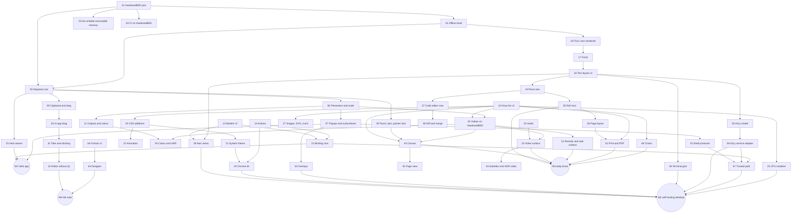

<!-- SPDX-License-Identifier: AGPL-3.0-or-later -->
# FUSE build plan for the ParanoidBSD app suite

By Odin Loch

Everything that must be built in the FUSE repo so the Qt-free app suite in `Apps/` can run on FUSE UI on ParanoidBSD (HardenedBSD 15-STABLE). Planning only. Nothing in this file has been built, tested or proved.

## 1. Purpose, scope and how to read this
| Item | Statement |
|---|---|
| Purpose | One ordered list of FUSE work, traced to the platform gaps (`PLATFORM.md` section 13), the 78 apps (`CATALOGUE.md`) and the suite milestones M0–M5 (`ROADMAP.md`). |
| In scope | The FUSE repo: `Source/FUSE/UI`, the platform layer in `Source/FUSE/Core`, `Source/FUSE/Audio`, `Source/FUSE/Renderer` where UI touches it, `Source/FUSE/EditorShell`, `cmake/`, `vendor/`, CI. |
| Out of scope | The ForgeScript language and engine (FORGE plan), the app host binary, session bus, system services and portals (platform plan), the compositor (`pbsd/compositor`), codecs and document parsers (helper services owned by apps). This plan states the FUSE side of each seam. |
| Sources read | `PLATFORM.md`, `DESIGN_SYSTEM.md`, `CATALOGUE.md`, `ROADMAP.md`; the FUSE clone (docs and headers cited below); `FORGE_BUILD_PLAN.md` (sections on FORGE-WP-12, FORGE-WP-13 and every line naming FUSE); the 21 app specs that existed at the last pass on 12 Nov 2026: SH01, SH02, SY01, SY02, AD01, SE01, VM01, OF01, OF02, OF05, CO01, IN01, ME03, CR01, DV01, DV06, AI01, UT01, UT02, AX01, AX02. Their sections 5.7 and gap tables were read; five (SH02, SY02, OF02, DV01, AX02) had no section 5.7 heading yet. The other 57 apps had no spec; their rows in section 7 come from `CATALOGUE.md` and `ROADMAP.md` only. |

Labels:

- **Verified**: read in a repo. Cited as `FUSE:path[:line]` or `PBSD:path`. Verified means "the text is there", not "it works".
- **Proposed**: design in this plan. Nothing built.
- **Unverified**: could not be read or was not run.
- **Observed**: seen in this session on 12 Nov 2026, on Linux, not on HardenedBSD. Only two observations exist (section 2.7).

IDs: requirements are `FUSE-R-nnn` (section 3). Work packages are `FUSE-WP-nn` and tasks `FUSE-WP-nn.k` (section 4). Epics are lettered A–P. IDs are stable; retired IDs are never reused.

Every work package is one table with the same rows: Goal, Owns (directories), Design, Tasks, Gates (new ctest names and what each checks), Budgets, Tier and PRISM (proof tier target and what a PRISM job would check), Accept (acceptance criteria), Deps / Size / Risks. Sizes: S about 2 weeks, M about 6 weeks, L about 3 months, XL 6 months or more, for one engineer. Proof tiers follow `PLATFORM.md` section 11: T1 proof of correctness, T2 proved absence of runtime errors, T3 safe subset plus sanitisers and fuzzing, T4 none. Every tier is a target.

Repo conventions every package follows (Verified: `FUSE:docs/coding-standards.md`, `FUSE:docs/ui/README.md`): ISO C++23; handles not owning pointers; `std::expected`, no exceptions; one owner thread per `UiContext`, other threads `post()`; zero heap allocation in steady-state frames; a CPU reference for every GPU path; new behaviour gets a `ctest` named `fuse_*`; a stub says it is a stub. Layout: `Source/FUSE/UI/<Module>/{include/fuse/ui/<module>,src}`, tests in `Source/FUSE/UI/tests/test_<name>.cpp`, third-party code in `vendor/<name>` with a `VERSION` pin.

## 2. Baseline: what FUSE provides today
### 2.1 Modules (Verified)
| Module | Target | Provides today | Source |
|---|---|---|---|
| Text | `fuse_text` | Fonts (glyf outlines), UTF-8, UAX 29 graphemes, `ITextShaper` with `MinimalShaper` and (FULL) `HarfBuzzShaper`, wrap and ellipsis layout, fallback chains, COLRv0 colour glyphs, one 8-bit glyph atlas page, `TextEditBuffer` (flat string, default cap 4096 bytes, undo log). Profiles MINIMAL (default), FULL, COOKED (not built). | `FUSE:Source/FUSE/UI/Text/include/fuse/text/text.hpp:1-10,69,232,258-262` |
| Core | `fuse_ui_core` | `UiContext`: handle tree, CSS-subset cascade, six layouts, events (capture, target, bubble), focus, signals, timers, animation of 4 properties, a 256-slot `post()` queue, draw list, CPU rasteriser, a11y snapshot, immediate-mode front end, OS-popup surfaces. No dependency on `fuse_core`. | `FUSE:Source/FUSE/UI/Core/include/fuse/ui/ui.hpp:1-8,266-282,338-344,470` |
| Widgets | `fuse_ui_widgets` | 46 widget entry points in tiers A–D (list in `PLATFORM.md` V3), default dark theme, `ItemModel` function table, `SortFilterProxy`, cell paint delegates, dock save and restore. | `FUSE:Source/FUSE/UI/Widgets/include/fuse/ui/widgets/widgets.hpp` |
| Doc | `fuse_ui_doc`, `fuse_ui_cook` | `.fuseui` JSON (`"fuseui": 1`), `{expr}` and `{=two-way}` bindings to stack bytecode, `Model` of named numbers and strings, hot reload keeping node identity, cooked binary documents and style sheets, widget registration list. | `FUSE:Source/FUSE/UI/Doc/include/fuse/ui/doc/document.hpp:1-21`, `.../cook.hpp:29-43` |
| Script | `fuse_ui_script` | Lua 5.2 `ui` table: `find`, `setText`, `setValue`, `setChecked`, `setDisabled`, `on`, `set`, `get`, `load`, `loadFile`, `refresh`, `create`, `destroy`, `addClass`, `css`. Handles cross as doubles. | `FUSE:Source/FUSE/UI/Script/include/fuse/ui/script/lua_ui.hpp:1-13,45-49` |
| Render | `fuse_ui_render`, `fuse_ui_vk` | Draw-list packing; one Vulkan compute kernel `ui.draw_list` (rects, AA, gradients, shadows, glyph coverage, scissor); 4 external-texture slots; render-graph pass in tree. The GPU kernel skips backdrop blur. | `FUSE:Source/FUSE/UI/Render/include/fuse/ui/render/ui_vk.hpp:28,47-51`, `FUSE:docs/plans/FUSE_UI_PLAN.md:485` |
| App | `fuse_app`, `fuse_app_native` | `Application`, `AppWindow`, on-demand loop, flat `key=value` settings file, command line, single-instance lock, headless presenter; native windows on X11 (libX11 loaded with `dlopen`) and Win32; Vulkan swapchain presenter (`VK_KHR_xlib_surface` on Unix), GDI fallback on Win32; OS popups as override-redirect windows. | `FUSE:Source/FUSE/UI/App/include/fuse/app/app.hpp:50-73,164-176`, `.../native.hpp:1-4,25-34,59-61`, `FUSE:Source/FUSE/UI/App/src/native.cpp:173`, `.../vk_present.cpp:28,153,495` |
| A11y | `fuse_ui_a11y` | `Bridge`: snapshot, diff, action queue (Focus, Click, Increment, Decrement, SetValue). Optional AccessKit AT-SPI `UnixAdapter` when `FUSE_UI_ACCESSKIT_DIR` points at a prebuilt accesskit-c. | `FUSE:Source/FUSE/UI/A11y/include/fuse/ui/a11y/a11y.hpp:19-24,56-78`, `FUSE:Source/FUSE/UI/CMakeLists.txt:115-131` |
| Sql | `fuse_ui_sql` | `SqliteModel`, an `ItemModel` over a query with a windowed row cache. | `FUSE:Source/FUSE/UI/Sql/include/fuse/ui/sql/sqlite_model.hpp` |
| Video | `fuse_ui_video` | Theora `.ogv` decode from memory into a `VideoSource`; random access by keyframe. No audio sync. | `FUSE:Source/FUSE/UI/Video/CMakeLists.txt:1-8`, `widgets.hpp:373-382` |
| Game | `fuse_ui_game` | HUD widgets, world panels, gamepad navigation, input arbitration, `StringTable` locale tables, subtitles, dialogue. | `FUSE:docs/ui/README.md` (Game UI) |
| Designer | `fuse_ui_designer_lib`, `fuse_ui_designer` | Prototype: lossless `.fuseui` load and save, palette, outline, canvas, property grid, style panel, undo. | `FUSE:Source/FUSE/UI/Designer/include/fuse/ui/designer/designer.hpp`, `FUSE:docs/plans/FUSE_UI_PLAN.md:488` |
| Platform | `fuse_core` | `events_v2.hpp` (keys with scancode and repeat, wheel, touch down/move/up, DPI change, theme change, text input, composition); `text_services.hpp` (clipboard text, text-input session, caret area: Win32 and X11 only); `WindowWsiKind` = Null, Glfw, Win32, X11. | `FUSE:Source/FUSE/Core/include/fuse/platform/events_v2.hpp:139-146`, `.../text_services.hpp:1-9`, `.../window_wsi.hpp:11-18` |
| Audio | `fuse_audio` | Software spatial mixer to one output stream. Backends: Null and OpenAL (system or vendored openal-soft). Vorbis and FLAC codecs. No capture call (`alcCapture*`) found under `Source/FUSE/Audio`. | `FUSE:Source/FUSE/Audio/include/fuse/audio/audio_backend.hpp:12,30-44`, `FUSE:Source/FUSE/Audio/CMakeLists.txt:81-104` |
| Editor shell | `fuse_editor_controller`, `fuse_editor_fuse` | Qt-free `EditorController` and a FUSE UI editor shell built only with `-DFUSE_EDITOR_SHELL=fuse`; default is `qt`. | `FUSE:Source/FUSE/EditorShell/CMakeLists.txt:1-4,39` |

### 2.2 Limits of today's widgets that the suite hits (Verified from headers)
| Widget or area | What it does today | What it cannot do today | Source |
|---|---|---|---|
| `codeEdit` | Line gutter, keyword colouring for Plain, Lua, Cpp, Css, one caret, selection, auto-indent, vertical scroll. Undo stores whole-document snapshots, capped at 128. | Piece table, multi-cursor, column mode, folding, grammars, minimap, soft wrap, find, huge files, IME details, diff. | `widgets.hpp:348-360`, `FUSE:Source/FUSE/UI/Widgets/src/widgets_tier_d2.cpp:683-688,813-814` |
| `tableView` | Virtualised rows, header click sort, column resize, single row selection, per-column paint delegate. | Multi-select, cell selection, inline editors, column reorder or chooser, frozen panes, merged cells, typed roles, change notifications (only `tableModelChanged`), more than `u32` rows. | `widgets.hpp:125-132,151-159,171-178` |
| `treeView` | Tab-indented text lines; rows 0–63 can collapse (64-bit mask). | Model-backed trees, columns, lazy children, more than 64 collapsible rows, drag reorder, inline rename. | `widgets.hpp:91-97` |
| `listView`, `gridView` | Virtualised, single selection. | Multi-select, type-ahead, drag, sections, variable row height. | `widgets.hpp:85-89,204-209` |
| `chart` | Line, bar, area, scatter over a shared x index, `f32` values. | Real axes (time, log), legends, stacking, pie, heat map, candlestick, zoom and pan, 3D, data table for a11y. | `widgets.hpp:242-247` |
| `markdownView` | Headings 1–3, paragraphs, bullets, numbers, code blocks, quotes as label children. Inline `**` and backticks are stripped. | Bold, italic, links, images, tables, selection, anchors. | `widgets.hpp:249-252` |
| `videoWidget` | Pulls RGBA8 frames by index from a function table on the UI thread. | Audio, A/V sync, YUV or GPU frames, HDR, subtitles, out-of-process decode. | `widgets.hpp:373-392` |
| `fileDialog` | In-process directory listing by path. | Portal model: the suite forbids apps listing arbitrary paths (`PLATFORM.md` section 6). | `widgets.hpp:264-275` |
| `timeline`, `nodeGraph`, `curveEditor` | Clips on tracks with playhead and snap; typed pins and bezier links; one float curve. | Keyframe lanes, trimming, multi-select, groups, comments, minimap, several curves, tangents. | `widgets.hpp:277-320` |
| `dockArea` | Left, right, bottom, centre regions; stacking; text save and restore. | Floating docks, tab tear-off to OS windows, nested splits, drop guides. | `widgets.hpp:115-123,163-168` |
| `dialog`, popups | In-window overlay; OS popups on X11 and Win32 only. | `xdg_popup`, sheets, popovers, toasts. | `widgets.hpp:55-83`, `native.hpp:59-61` |
| Missing widgets | — | Not in `widgets.hpp`: rich text, terminal, canvas, spreadsheet, header bar, sidebar, status bar, toolbar, toast, popover, sheet, command palette, breadcrumb, tag input, search field, hex, diff, treemap, map, page view, waveform, scheduler. | `widgets.hpp` (whole file) |
| Input model | `ui::Key` has letters, digits, F1–F12, navigation keys, two brackets and `Other`; three mouse buttons; no touch or pen event type. | Punctuation and numpad keys as shortcuts, scancodes, pen pressure and tilt, touch, gestures in `ui::Event`. | `ui.hpp:32-51` |
| A11y model | 22 roles; node has name, bounds, focus, checked, disabled, value and range. | Tree, table, cell, menu, dialog, heading roles; text ranges; live regions; descriptions; relations. | `ui.hpp:86-101` |
| Style | Selectors, tokens, properties listed in section 4 (FUSE-WP-20). Tokens are global. Inherited: `color`, `font-size`, `text-align`. | Transitions, attribute selectors, `:nth-child`, scoped tokens, font family and weight, media queries. | `FUSE:Source/FUSE/UI/Core/include/fuse/ui/style.hpp:3-10`, `FUSE:docs/ui/README.md` (Styling) |
| Draw list | Rect, Shadow, Glyph, Image (RGBA8), Line, PushClip, PopClip, Backdrop. | Paths, transforms, radial or multi-stop gradients, dashed strokes, wide-gamut or HDR colour. | `FUSE:Source/FUSE/UI/Core/include/fuse/ui/draw_list.hpp:15-24` |

### 2.3 Test gates that exist (Verified: `FUSE:Source/FUSE/UI/tests/CMakeLists.txt`, `FUSE:docs/ui/README.md`)
| Group | Gates |
|---|---|
| Core nine | `fuse_ui_layout_conformance`, `fuse_ui_style_cascade`, `fuse_ui_event_routing`, `fuse_ui_focus_order`, `fuse_ui_cpu_raster_golden`, `fuse_ui_zero_alloc_steady` (0 allocations over 50 frames), `fuse_ui_bench_10k` (≤ 0.5 ms median, 1.0 ms FULL), `fuse_ui_single_thread_parity`, `fuse_ui_a11y_tree_dump` |
| Text | `fuse_ui_text_basics`, `fuse_ui_text_full`, `fuse_text_edit_ops`, `fuse_text_fallback`, `fuse_ui_text_input` |
| Widgets | `fuse_ui_widget_interaction`, `fuse_ui_tier_b`, `fuse_ui_tier_b2`, `fuse_ui_tier_c`, `fuse_ui_tier_d`, `fuse_ui_widget_{font_picker,file_dialog,node_graph,curve_timeline,viewport,code_edit,datetime_edit,video}`, `fuse_ui_dock_layout_roundtrip`, `fuse_ui_modelview_1m_rows`, `fuse_ui_backdrop_blur`, `fuse_ui_platform_feel` |
| Doc and script | `fuse_ui_doc_load`, `fuse_ui_lua_bindings`, `fuse_ui_markup_roundtrip`, `fuse_ui_binding_bytecode`, `fuse_ui_style_cooked`, `fuse_ui_hot_reload_identity`, `fuse_ui_inspector`, `fuse_ui_cooked_registration`, `fuse_ui_markup_fuzz` |
| App | `fuse_app_idle_zero_frames`, `fuse_app_multiwindow`, `fuse_app_hello_startup` (≤ 150 ms), `fuse_app_settings`, `fuse_app_native_window`, `fuse_app_os_popups` (both need Xvfb or skip 77) |
| GPU | `fuse_ui_vk_parity`; in tree `fuse_scene_renderer_vk_fuse_ui_t0`, `fuse_ui_hudless_history_invariant` (lavapipe path hard-coded to `/usr/share/vulkan/icd.d/lvp_icd.json`, `FUSE:Source/FUSE/UI/CMakeLists.txt:258`) |
| Other | `fuse_ui_a11y_bridge`, `fuse_ui_sql_model`, `fuse_ui_theora_video`, `fuse_ui_designer_roundtrip`, game gates, `ctest -L fuse_editor_ui` (45 editor twin gates per `FUSE:docs/ui/README.md`) |

Not in tree: any coverage-guided fuzzer target for UI code (`fuse_ui_markup_fuzz` is a plain ctest), any Wayland gate, any FreeBSD or HardenedBSD CI job (workflows are Linux, Windows, Android, iOS only: `FUSE:.github/workflows/`).

### 2.4 Third-party dependencies that matter to the suite (Verified: `FUSE:THIRD_PARTY.md`, CMake files)
| Component | Licence | In `vendor/`? | Network at configure? | Note |
|---|---|---|---|---|
| stb (image, truetype) | MIT / public domain | yes | no | MINIMAL text, PNG write |
| Open Sans; Noto Sans Hebrew, Arabic, Devanagari, Symbols 2; Twemoji (COLRv0) | Apache-2.0; OFL; see `vendor/fonts/twemoji/LICENSE.md` | yes | no | `FUSE:vendor/fonts/` |
| HarfBuzz 10.1.0 | MIT ("Old MIT") | **no** | **yes** (`FetchContent`, git) | `FUSE:Source/FUSE/UI/CMakeLists.txt:54-60` |
| FreeType 2.13.3 | FTL or GPLv2 | **no** | **yes** | same |
| SheenBidi v2.7 | Apache-2.0 | **no** | **yes** | `CMakeLists.txt:62-67` |
| libunibreak 6.1 | zlib | **no** | **yes** | same |
| Lua 5.2.3 | MIT | yes | no | games keep it; apps do not use it |
| SQLite | public domain (per upstream) | yes | no | `fuse_ui_sql` |
| libtheora 1.2.0, libogg 1.3.6, vorbis, FLAC, opus | BSD-3-Clause | yes (archives, sha256-pinned, extracted at configure) | no | `FUSE:Source/FUSE/UI/Video/CMakeLists.txt:9-38`, `FUSE:cmake/FuseXiph.cmake` |
| OpenAL Soft | LGPL-2.0+ | yes | no (system copy preferred when found) | `FUSE:Source/FUSE/Audio/CMakeLists.txt:83-102` |
| VMA, volk, Khronos headers | MIT; Apache-2.0 OR MIT | yes | no | Vulkan |
| Slang compiler | Apache-2.0 WITH LLVM-exception | pin only | **yes** when `FUSE_SLANG=AUTO` and `FUSE_SLANG_DOWNLOAD=ON` (default) | `FUSE:cmake/FuseSlang.cmake:45,149`; prebuilt binary, no FreeBSD build known (Unverified) |
| glslangValidator | — | no | no; optional tool, a checked-in SPIR-V fixture is used when absent | `FUSE:Source/FUSE/UI/CMakeLists.txt:203-215` |
| AccessKit (accesskit-c 0.22.3) | MIT / Apache-2.0 | **no** | prebuilt needed; building needs Rust | `FUSE:docs/plans/FUSE_UI_PLAN.md:483` |
| X11 (libX11) | MIT | no | no; loaded at run time | `native.cpp:173` |
| Qt 6 | LGPL/GPL/commercial | no | system package | section 2.5 |
| SDL (full tree in `vendor/sdl`) | zlib | yes, not built | no | Decision D1 in the FUSE UI plan adopts SDL3 for Wayland; no SDL3 backend is in tree |

### 2.5 Qt dependencies today (Verified)
| # | Where | What | Source |
|---|---|---|---|
| QT-01 | Root option | `FUSE_BUILD_EDITOR` "Build fuse_editor Qt 6 desktop shell", default OFF | `FUSE:CMakeLists.txt:27` |
| QT-02 | Root option | `FUSE_ENABLE_QT_PRESENT`, default OFF; defines `FUSE_ENABLE_QT_PRESENT=1` on `fuse_rhi` | `FUSE:CMakeLists.txt:31`, `FUSE:Source/FUSE/Renderer/CMakeLists.txt:244-245` |
| QT-03 | `fuse_editor_api` | With `FUSE_BUILD_VULKAN`, `find_package(Qt6 QUIET COMPONENTS Gui)`; when found it compiles `viewport_vulkan_surface_qt.cpp` and links `Qt6::Gui` privately. This happens even when `FUSE_BUILD_EDITOR` is OFF. | `FUSE:Source/FUSE/Editor/CMakeLists.txt:128-143` |
| QT-04 | `fuse_editor_qt`, `fuse_editor` | `Qt6::Widgets`, `Qt6::Gui`, AUTOMOC, two `qt_add_resources` (fonts, branding) | `FUSE:Source/FUSE/Editor/CMakeLists.txt:151-245` |
| QT-05 | Qt shell sources | 39 files in `Source/FUSE/Editor/src/qt/` | `FUSE:Source/FUSE/Editor/src/qt/` |
| QT-06 | Qt gates | `Qt6::Test`; `fuse_editor_qt_gates`, console transport, shell and e20 gates | `FUSE:Source/FUSE/Editor/tests/qt/CMakeLists.txt:33-147`, `.../e20_qt_tests.cmake:7` |
| QT-07 | Editor shell switch | `FUSE_EDITOR_SHELL` default `qt` | `FUSE:Source/FUSE/EditorShell/CMakeLists.txt:3` |
| QT-08 | Presets | `fuse-editor-debug`, `fuse-editor-qt` set `FUSE_BUILD_EDITOR=ON` | `FUSE:CMakePresets.json:60-81` |
| QT-09 | Lint | `fuse_lint_b6_editor_qt6_only` checks the editor links only Qt 6 | `FUSE:cmake/FuseLintGates.cmake:124-125,155` |
| QT-10 | CI | Job `fuse-editor-qt` in the Linux workflow | `FUSE:docs/building.md:176`, `FUSE:.github/workflows/fuse-umbrella-linux.yml` |
| QT-11 | Present gate naming | `desktopQtPresentRuntimeReady`, Qt wording in the swapchain utilities | `FUSE:docs/editor.md` (Track B gate), `FUSE:Source/FUSE/Renderer/src/vk/present_path.cpp` |
| QT-12 | Docs and policy | README, architecture, roadmap, coding standards and `docs/editor.md` state "Qt owns chrome" | `FUSE:README.md`, `FUSE:docs/coding-standards.md` (Editor) |

`Tools/FUSE` has no Qt link: the only Qt mention is the lint tool that checks QT-09 (`FUSE:Tools/FUSE/Lint/fuse_lint.cpp`). No Qt include exists under `Source/FUSE/UI` code paths (comments only).

### 2.6 Status of the Qt-free editor shell (Verified: `FUSE:docs/ui/README.md`, `FUSE:docs/plans/FUSE_EDITOR_QT_FIRST_PLAN.md` section 11, `FUSE:docs/plans/FUSE_UI_PLAN.md:490,582-592`)
| Item | State in the docs |
|---|---|
| Panels | All ten panels plus Navigation and Terrain, New Project wizard, Preferences with shortcut rebinding, view modes, gizmo, play frame, multi-viewport, zero-copy live viewport (`--gpu-viewport`). |
| Gates | 45 twin gates `fuse_editor_ui_*`; the docs record them passing on X11 and under Wine. Not re-run here. |
| Default | Qt stays the default shell "until sign-off". |
| Stated conditions to remove Qt | Every `fuse_editor_qt_*` gate has a `fuse_editor_ui_*` twin; desktop accessibility adapters are in; the owner signs off. |
| Not present | A Wayland window for the shell; a HardenedBSD build; a11y adapter without Rust. |

### 2.7 Observations in this session (Observed 12 Nov 2026, Linux, not HardenedBSD)
| # | Observation | Consequence |
|---|---|---|
| O1 | Configuring `Source/FUSE/UI` standalone printed "FUSE UI: no Vulkan loader found, fuse_ui_vk skipped (CPU raster only)" (message at `FUSE:Source/FUSE/UI/CMakeLists.txt:264`). | The loader search paths are Linux-specific (`/usr/lib/x86_64-linux-gnu`, `/usr/lib64`, `/usr/lib`; `CMakeLists.txt:183`). FreeBSD keeps ports libraries under `/usr/local/lib`. FUSE-WP-01.4. |
| O2 | Compiling `Source/FUSE/UI/Text/src/text.cpp` with clang 18.1.3 against libstdc++ 13 failed with "no template named 'expected' in namespace 'std'". | `std::expected` is not available in that pairing. HardenedBSD uses clang with libc++, which is a different pairing and was not tried. clang + libc++ must be a CI target (FUSE-WP-04). |

Nothing else was configured, built or run. All performance numbers quoted from FUSE docs are the docs' own records.

### 2.8 Portability facts read in the code (Verified)
| Fact | Source | Consequence |
|---|---|---|
| Any non-Apple, non-Windows Unix is given the "Linux desktop" profile. | `FUSE:cmake/FusePlatforms.cmake:21-22` | FreeBSD is silently treated as Linux. FUSE-WP-01.1. |
| Cooperative fibres use `ucontext` only when `__linux__` or `__APPLE__`; other systems fall to a condition-variable fallback. | `FUSE:Source/FUSE/Core/src/platform/fiber_posix.cpp:5-9` | FreeBSD gets the slow fallback unless enabled. Fibre stacks are `std::vector<char>` (line 47), so they are heap memory with no guard page. FUSE-WP-01.3. |
| No `PROT_EXEC`, `MAP_JIT` or `mprotect` call was found in `Source/FUSE` outside `Relight`. | grep on 12 Nov 2026 | No writable-executable mapping was found in FUSE's own code. Third-party code (FreeType, HarfBuzz, Lua, openal-soft, Vulkan drivers) is not covered by that grep. FUSE-WP-03. |
| No `__FreeBSD__` or HardenedBSD reference exists in `Source/` or `cmake/`. | grep on 12 Nov 2026 | The port has not been started. |
| The PBSD compositor tree has module files named for xdg-shell, layer-shell, fractional scale, viewporter, text-input-v3, data device, primary selection, cursor shape, pointer constraints, relative pointer, tablet v2, idle inhibit, foreign toplevel, ext-workspace, xdg-activation, xdg-decoration, linux-dmabuf, presentation time, colour management, security context, subcompositor. No session-lock module was seen. | `PBSD:pbsd/compositor/pbsd.compositor.wayland.*.cppm` | File names only. Behaviour is Unverified. A missing protocol is a compositor task, noted per work package. |

## 3. Requirements matrix
One row per thing the suite needs from FUSE. "Gap" is a `PLATFORM.md` section 13 ID. "Needed by" gives app IDs, spec feature IDs, spec gap IDs, or a foundation section (PL = `PLATFORM.md`, DS = `DESIGN_SYSTEM.md`, RM = `ROADMAP.md`). All rows are Proposed requirements; the evidence that FUSE lacks each is in section 2.

| ID | Requirement | Gap | Needed by | WP |
|---|---|---|---|---|
| FUSE-R-001 | Build with clang and libc++ on HardenedBSD 15-STABLE, amd64 first | G-18 | all; RM M0 | 01 |
| FUSE-R-002 | Configure and build with no network; every dependency vendored and pinned | G-18, G-03 | all; PL 6 rule 5 | 02, 16 |
| FUSE-R-003 | No writable-executable memory, no executable stack, PIE, full RELRO, in FUSE and everything it links | G-18, G-05 | all; PL 4 | 03 |
| FUSE-R-004 | All `fuse_ui_*` and `fuse_app_*` gates run on HardenedBSD in CI | G-18 | RM M0 exit test | 04 |
| FUSE-R-005 | Wayland toplevel windows (xdg-shell) with decoration policy | G-01 | all | 05, 07 |
| FUSE-R-006 | Layer-shell surfaces: layer, anchor, exclusive zone, margin, keyboard interactivity | G-01 | SH01-F001, F006, F069, F100; SH02; SH03 | 10 |
| FUSE-R-007 | Fractional scale and viewporter; crisp at 100–300% | G-01 | SH01-F133; DS 7 | 06 |
| FUSE-R-008 | text-input-v3 with pre-edit, commit, surrounding text, caret rectangle | G-01 | AX04; all text | 59 |
| FUSE-R-009 | Clipboard, primary selection, typed offers | G-01 | all; PL 9; OF01-F032 | 09 |
| FUSE-R-010 | Drag and drop between apps with typed offers and portal handles | G-01 | SH01-F099, F063, F083; OF01-F058; SY02 | 09, 33 |
| FUSE-R-011 | Menus, combo lists, tooltips and popovers as `xdg_popup` | G-01 | all; SH01-F118 | 07 |
| FUSE-R-012 | Subsurfaces for embedded out-of-process content | G-01 | SH01-F120; ME03; IN01 | 07, 51 |
| FUSE-R-013 | Foreign toplevel list and window management requests | G-01 | SH01-F045, F049; SH01-GAP-1; SH05 | 10 |
| FUSE-R-014 | Activation tokens for launch feedback and focus hand-over | G-01 | SH01-F036; PL 9 intents | 10 |
| FUSE-R-015 | Multi-output tracking: add, remove, mode, scale, transform | G-01 | SH01-F130–F136 | 11 |
| FUSE-R-016 | Session lock surfaces | G-01 | SH03 | 10 |
| FUSE-R-017 | Workspace protocol client | G-01 | SH01-F066; SH05 | 10 |
| FUSE-R-018 | Window thumbnails come from the compositor, never from the app; screen capture only through portals | — | SH01-F052; SH01-GAP-2; ME05; AX01-F097 | 10, 67 |
| FUSE-R-019 | Idle inhibit and keyboard-shortcut inhibit | G-01 | ME03 (sleep inhibit); VM01; VM04; SY03 | 10 |
| FUSE-R-020 | Pen tablet input: pressure, tilt, eraser, buttons | G-12 | CR01; OF08; OF03 | 08 |
| FUSE-R-021 | Touch and gestures (tap, long press, pan, pinch) | G-01 | AX03; DS 2 touch density; IN04 | 08 |
| FUSE-R-022 | Pointer lock, confine and relative motion | G-01 | CR04; GM01; VM01; VM04 | 08 |
| FUSE-R-023 | Cursor shapes by name | G-01 | all | 08 |
| FUSE-R-024 | Colour-managed and HDR surfaces; display profile from the compositor | — | ME03-GAP-1; ME01; CR01; CR02 | 11, 26 |
| FUSE-R-025 | Presentation timing and refresh hints | — | ME03-GAP-2; ME03 A/V sync | 06, 53 |
| FUSE-R-026 | ForgeScript binding with the surface in PL 5 and parity with the Lua binding | G-02 | all | 12 |
| FUSE-R-027 | Typed handles and batched property updates; no JSON on per-frame paths | G-02 | all; PL 5 | 12 |
| FUSE-R-028 | Observable view models; `.fuseui` bindings resolve against them | G-02 | all | 13 |
| FUSE-R-029 | Script-backed and SQLite-backed item models for list, tree, table, grid | G-02 | all; PL 5 | 13, 28 |
| FUSE-R-030 | One action table for menus, toolbars, palette, shortcuts | G-02 | all; SH01-F107; DS 5 | 14 |
| FUSE-R-031 | Embedding API for the app host: context, windows, loop integration, no ambient file access | G-07 | all; PL 4 | 15 |
| FUSE-R-032 | Pluggable settings backend (to `svc.settings`) | G-07, G-09 | all; PL 8 | 15 |
| FUSE-R-033 | Single instance and activation through the host, not a lock file | G-07 | PL 12 `single_instance` | 15 |
| FUSE-R-034 | Window state save and restore per document | G-07 | DS 3; PL 11 Recovery | 15 |
| FUSE-R-035 | Crash reattach of windows by session token | G-07 | PL 4; SH01-F142; AX01-F134 | 15 |
| FUSE-R-036 | FULL text profile as the default, built offline | G-03 | all text | 16 |
| FUSE-R-037 | Shaping for all scripts, bidi, UAX 14 line breaking | G-03 | OF01-F144, F162; PL 11 Languages | 16, 18 |
| FUSE-R-038 | System font discovery, family and style matching, per-script fallback | G-03 | UT03; all | 17 |
| FUSE-R-039 | Colour emoji in every common format | G-03 | AX04; CO05; OF02 | 17 |
| FUSE-R-040 | Variable fonts and OpenType features (ligature switch, tabular figures) | G-03 | OF01-F155; DS 2 Type | 17 |
| FUSE-R-041 | Text selection and copy in every text-bearing widget | — | all; AX01-F085 | 18 |
| FUSE-R-042 | Decoration hook for spell-check underlines | G-17 | OF01; OF04; CO01; OF02 | 18 |
| FUSE-R-043 | Hyphenation hook in line breaking | G-17 | OF04; OF06 | 18 |
| FUSE-R-044 | Text buffer and layout that stay fast on 16 GiB files and 10 000-grapheme lines | — | OF01-F110–F119 | 19, 37 |
| FUSE-R-045 | Rich text editor: styled runs, paragraphs, lists, tables, inline objects, undo, IME | G-10 | OF04; OF02; CO01; CO05; OF06 | 35 |
| FUSE-R-046 | Page layout engine: pages, sections, columns, headers, footnotes, floats | G-10 | OF04; OF06 | 36 |
| FUSE-R-047 | Code editor core: piece table, multi-cursor, folding, grammars, minimap | — | OF01-F030–F162; DV01; DV02; OF02; OF09; AI04; DV06 | 37 |
| FUSE-R-048 | Diff and merge view | — | OF01 (two-way diff); DV03; DV01; DV04; AX01-F089 | 38 |
| FUSE-R-049 | Terminal grid widget | G-13 | SY03; DV01; VM01; VM02; VM04; AX01-F086 | 39 |
| FUSE-R-050 | Spreadsheet grid: millions of rows, frozen panes, cell editors, merged cells | — | OF05; OF09; AX01-F093 | 40 |
| FUSE-R-051 | Hex view | — | DV04; DV05; DV07 | 41 |
| FUSE-R-052 | Markdown and restricted HTML view with links, images, tables | G-14 (restricted path) | UT05; OF02; CO01; AI01; AX01-F094 | 42 |
| FUSE-R-053 | Tree, table, list, grid upgrades: columns, multi-select, inline edit, drag reorder, type-ahead, 10M rows | — | DS 5; SY02; AD04; AD05; SY04; AX01-F044, F045; SH01-F025 | 28 |
| FUSE-R-054 | 2D canvas: tiles, zoom and pan, layers, pen, GPU compositing | G-12 | CR01; OF08; IN04; OF03; ME05; OF06 | 43 |
| FUSE-R-055 | Image view with colour management | — | ME01; SY02 preview; ME05 | 44 |
| FUSE-R-056 | PDF and page view | G-12, G-16 | OF03; UT06; OF04 print preview | 45 |
| FUSE-R-057 | Chart and plot library, with 3D plots and a data table for assistive tools | — | OF05; OF07; AI03; AI04; SY04; OF09; AX01-F096 | 46 |
| FUSE-R-058 | Treemap and sunburst | — | UT04; SY04; AD02 | 47 |
| FUSE-R-059 | Map view | G-12 | IN04; IN05; ME01 | 48 |
| FUSE-R-060 | Waveform and spectrogram | — | ME06; CR03; CR02; ME02 | 49 |
| FUSE-R-061 | Timeline, node graph and curve editor at editor quality | — | CR02; CR03; CR04; OF06 | 50 |
| FUSE-R-062 | Web content surface embedding | G-14 | IN01; CO01; IN02; UT05 | 51 |
| FUSE-R-063 | Calendar and scheduler views | — | CO02; CO04; SH02 | 34 |
| FUSE-R-064 | Date/time, colour, font and file pickers at product quality; file picker is a portal client | — | SH04; all; UT03 | 32 |
| FUSE-R-065 | Window chrome kit: header bar, sidebar, inspector, status bar, toolbar, split view, breadcrumb, search field, tag input | — | DS 3, 4; all | 29 |
| FUSE-R-066 | Toasts, popovers, sheets, command palette, badges, inline banners | — | DS 5; all; SH02 | 30 |
| FUSE-R-067 | Tabs with reorder and tear-off; docking at IDE quality | — | DS 3; OF01-F140–F143; DV01; DV07; CR02; CR04 | 31 |
| FUSE-R-068 | Drag and drop inside an app (items, tabs, text) | — | DS 5; OF01-F058; SH01-F010, F024, F062 | 33 |
| FUSE-R-069 | Print or export any view to PDF | G-16 | all documents; UT06; SH04 | 61 |
| FUSE-R-070 | SVG subset rendering and an icon system that re-rasterises per scale | — | PL 3 assets; SH01-F133; all | 27 |
| FUSE-R-071 | Animation system with transitions; reduced motion honoured everywhere | — | DS 2 Motion; SH01-F147 | 22 |
| FUSE-R-072 | Design-system tokens, scoped tokens, dark, light, high contrast | — | DS 2; all | 21 |
| FUSE-R-073 | Three densities (rows 24, 32, 44) | — | DS 2; SH01-F146 | 21 |
| FUSE-R-074 | CSS subset additions the design system uses | — | DS 2–5; OF01-F156 | 20 |
| FUSE-R-075 | Right-to-left mirroring of layouts | G-03 | DS 7; PL 11 | 20 |
| FUSE-R-076 | Responsive breakpoints (640, 1100) | — | DS 3 | 20 |
| FUSE-R-077 | Vulkan presenter on HardenedBSD | G-18 | all | 24 |
| FUSE-R-078 | CPU rasteriser good enough to be the only renderer (installer, VM, no GPU) | G-18 | AD01; SH03; all | 25 |
| FUSE-R-079 | Damage-only redraw on CPU and GPU; zero frames and zero wake-ups at idle | — | PL 11 Idle | 06, 24, 70 |
| FUSE-R-080 | Backdrop blur on the GPU for shell surfaces | — | DS 2; SH01-F013 | 24 |
| FUSE-R-081 | Image decode runs out of process; FUSE takes pixels through a provider hook | — | RM 4 (image codecs); SH01-F072; ME01 | 27 |
| FUSE-R-082 | Vector paths, transforms and richer gradients in the draw list | G-12 | OF08; charts; SVG; canvas | 23 |
| FUSE-R-083 | Accessibility adapter with no Rust at build time | G-04 | AX01; AX02; AX03; AX06 | 56 |
| FUSE-R-084 | A11y model: tree, table, cell, heading, menu, dialog roles; text ranges and attributes; live regions; descriptions | G-04 | AX01-GAP-1; AX01-F044, F045, F069, F071, F085 | 55 |
| FUSE-R-085 | A11y service protocol: tree updates, events, actions, announce, secure-surface restriction | G-04, G-09 | AX01-F073–F083, F139; AX02; AX03; AX06 | 56, 67 |
| FUSE-R-086 | Gates: every control has role, name, state; every function reachable by keyboard | — | PL 11; DS 6, 7 | 57 |
| FUSE-R-087 | Focus, caret and pointer tracking events for the magnifier | G-04 | AX02 | 56 |
| FUSE-R-088 | Audio output and input for apps | G-11 | ME02; ME06; CO05; AX01; AX06; ME03 | 52 |
| FUSE-R-089 | Video surface fed by a sandboxed pipeline; A/V sync; zero-copy frames | G-11 | ME03; ME04; ME05; CR02; CO05; IN02 | 53 |
| FUSE-R-090 | Subtitle overlay from cue records and glyph bitmaps; HDR video; hardware decode import | G-11 | ME03 (4.3, 4.5) | 54 |
| FUSE-R-091 | FUSE editor with no Qt in the default build | — | CR04; PL V9 | 62 |
| FUSE-R-092 | UI designer as a product | — | DV02 | 63 |
| FUSE-R-093 | Versioned `.fuseui` format with migration | — | DV02; all bundles | 64 |
| FUSE-R-094 | Fuzzers on every untrusted-input parser in FUSE UI | — | PL 11 Tests; RM 6 | 65 |
| FUSE-R-095 | FUSE UI passes the memory-safe subset check | — | PL 2 | 66 |
| FUSE-R-096 | Trusted-path surfaces apps cannot imitate or overlay | — | DS 1; SH03; SH04; AX01-F073–F075, F103 | 67 |
| FUSE-R-097 | Keyboard layouts, compose, dead keys, full key set, rebindable shortcuts | — | AX04; DS 6; SY01 | 58 |
| FUSE-R-098 | On-screen keyboard hooks and input-method client | — | AX03; AX04 | 59 |
| FUSE-R-099 | Locale: string tables with plurals, numbers, dates, units | — | DS 7; PL 3 `locale/` | 60 |
| FUSE-R-100 | First frame ≤ 150 ms cold for a small app on the Wayland path | — | PL 11 Start; SH01-F021 (100 ms open) | 70 |
| FUSE-R-101 | Golden renders and scripted UI tests driven through the a11y tree | — | PL 11 Tests | 69 |
| FUSE-R-102 | Secret field: hidden by default, reveal on hold, excluded from a11y text and capture | — | DS 5; SE04; SH03 | 29, 67 |
| FUSE-R-103 | Voice control can list and invoke actions by name | — | AX06 | 14, 56 |
| FUSE-R-104 | Stable, versioned binding API so bundles declare `depends_on` | — | PL 12 | 68 |
| FUSE-R-105 | Notification and badge widgets drawn by the shell from data | — | SH02; SH01-F056, F126 | 30 |
| FUSE-R-106 | Virtual keyboard support: text fields report type, purpose and caret rectangle | — | AX03; AX04 | 59 |

Spec gap IDs (`<APPID>-GAP-n`) raised by the specs are mapped to work packages in section 7.3.

## 4. Work packages
Sixteen epics, seventy work packages, all Proposed. Each gate named here is new unless marked "existing". "Existing" means the test is defined in the FUSE tree; it does not mean it was run for this plan.

### Epic A — Portability and build
#### FUSE-WP-01 HardenedBSD and FreeBSD port (clang + libc++)
| Row | Content |
|---|---|
| Goal | FUSE UI, `fuse_app` and the platform pieces they need compile, link and pass their gates on HardenedBSD 15-STABLE amd64 with the base clang and libc++. |
| Owns | `cmake/FusePlatforms.cmake`, `cmake/toolchains/hardenedbsd-amd64.cmake` (new), `cmake/FuseCxx23Probe.cmake` (new), `Source/FUSE/Core/src/platform/`, `Source/FUSE/UI/CMakeLists.txt`, `CMakePresets.json` (preset `pbsd-app`). |
| Design | Add profile `FUSE_PLATFORM_FREEBSD` (today FreeBSD falls into the Linux profile, section 2.8). Code tests `FUSE_OS_FREEBSD`, never `__linux__`, for shared POSIX paths. A configure probe compiles one file that uses every standard-library facility FUSE UI relies on (`std::expected`, `std::span`, `std::format`, `std::from_chars` for floats, `<atomic>` wait) and stops with a named missing feature. Preset `pbsd-app` builds only `fuse_text`, `fuse_ui_core`, `fuse_ui_widgets`, `fuse_ui_doc`, `fuse_ui_render`, `fuse_ui_vk`, `fuse_app`, `fuse_ui_a11y` and the new modules of this plan: `fuse_ui_core` does not depend on `fuse_core` (Verified, `FUSE:docs/ui/README.md`), so apps do not pull the engine. Vulkan loader and ICD search gain `/usr/local/lib`, `/usr/local/include`, `/usr/local/share/vulkan/icd.d` (paths Unverified on HardenedBSD). File watching uses `kqueue` where the code uses inotify. |
| Tasks | FUSE-WP-01.1 Platform profile and `FUSE_OS_*` macros.<br>FUSE-WP-01.2 C++23 library probe; fix each failure (O2 shows the class of problem).<br>FUSE-WP-01.3 Fibres on FreeBSD: enable `ucontext` or keep the fallback; move fibre stacks to `mmap` with a guard page, never executable.<br>FUSE-WP-01.4 Vulkan loader, header and ICD discovery (fixes O1 on FreeBSD paths); remove the hard-coded lavapipe path from test properties.<br>FUSE-WP-01.5 Audit every `__linux__` site (`crash_handler.cpp`, `window_wsi.cpp`, `fiber_posix.cpp`, `gamepad.hpp`, `shader_watch.cpp`, `uaisk_file_watch_os.cpp`, `a11y_accesskit.cpp`) and add FreeBSD branches or explicit "unsupported" errors.<br>FUSE-WP-01.6 Preset `pbsd-app`; engine-wide preset `pbsd-engine` later for CR04.<br>FUSE-WP-01.7 Warning-clean under base clang with `-Wconversion`. |
| Gates | `fuse_cxx23_stdlib_probe`: the probe file compiles and runs with the toolchain in use.<br>`fuse_platform_freebsd_profile`: profile macro, page size, monotonic clock and `kqueue` wrappers behave.<br>Existing: all section 2.3 gates on the new platform, both text profiles. |
| Budgets | Clean build of `pbsd-app` ≤ 5 min on 8 cores (to be measured, then held within +10%). |
| Tier and PRISM | T3. PRISM job: bounded check of the platform wrappers (poll, kqueue, shm) for unchecked return values and out-of-range indices. |
| Accept | `ctest -L fuse_ui` and the `fuse_app_*` gates run to completion on HardenedBSD with results stored by FUSE-WP-04. No `__linux__` test remains in the app-profile sources without a FreeBSD branch. |
| Deps / Size / Risks | Deps: none. Size M. Risks: libc++ in base lags a C++23 library feature (probe names it; fallback shims live in `Source/FUSE/UI/Core/include/fuse/ui/compat.hpp`); engine modules outside the app profile take much longer (kept off the critical path). |
#### FUSE-WP-02 Offline, vendored, reproducible configure
| Row | Content |
|---|---|
| Goal | `cmake` configure and build never open a socket. Every input is in the tree, pinned by version and hash. |
| Owns | `vendor/` (new trees listed in FUSE-WP-05, FUSE-WP-16), `vendor/MANIFEST.sha256` (new), `cmake/FuseOffline.cmake` (new), `cmake/FuseSlang.cmake`, `cmake/FuseVendor.cmake`, `THIRD_PARTY.md`, `Tools/FUSE/Lint`. |
| Design | Option `FUSE_OFFLINE` (ON in every `pbsd-*` preset) sets `FETCHCONTENT_FULLY_DISCONNECTED`, forces `FUSE_SLANG_DOWNLOAD=OFF`, and makes any `FetchContent_Declare` with a URL or `file(DOWNLOAD)` a fatal configure error. The four FULL-text libraries move from `FetchContent` to `vendor/` (FUSE-WP-16). Shaders ship as checked-in SPIR-V fixtures, the pattern `ui_draw_list.comp.spv` already uses (Verified, `FUSE:Source/FUSE/UI/CMakeLists.txt:208-215`). The existing `fuse_lint vendored-pins` check (Verified, `FUSE:THIRD_PARTY.md`) is extended to require `VERSION`, a licence file and a manifest hash per vendored tree, and to emit an SPDX SBOM. Builds set `SOURCE_DATE_EPOCH` and `-ffile-prefix-map`. |
| Tasks | FUSE-WP-02.1 `FuseOffline.cmake` and the fatal guards.<br>FUSE-WP-02.2 `vendor/MANIFEST.sha256` and lint extension.<br>FUSE-WP-02.3 SPIR-V fixtures for every UI shader, with a freshness check when a compiler is present.<br>FUSE-WP-02.4 SBOM output per target.<br>FUSE-WP-02.5 Reproducible-build flags and check.<br>FUSE-WP-02.6 Update `THIRD_PARTY.md` and `docs/building.md` with the offline recipe. |
| Gates | `fuse_build_offline`: CI configures and builds `pbsd-app` in a jail with no network interface; any failure is a gate failure.<br>`fuse_lint_no_network_fetch`: no unguarded `FetchContent_Declare`, `ExternalProject_Add` or `file(DOWNLOAD` in the product CMake.<br>`fuse_lint_vendored_pins` (existing, extended).<br>`fuse_spirv_fixture_fresh`: regenerated SPIR-V equals the fixture.<br>`fuse_build_reproducible`: two builds in different directories give byte-identical static libraries. |
| Budgets | Vendored source added for the app profile ≤ 60 MB (to be measured). |
| Tier and PRISM | T4 (build system). No PRISM job. |
| Accept | The offline job is green with FULL text and Wayland enabled; the SBOM lists every linked third-party component with licence. |
| Deps / Size / Risks | Deps: FUSE-WP-16 for the text trees. Size M. Risks: Slang has no vendored source and no known FreeBSD binary (Unverified): the app profile must not need it; engine shaders for CR04 need a separate answer (Q-09). |
#### FUSE-WP-03 W^X, PaX and ASLR compliance
| Row | Content |
|---|---|
| Goal | No process built from the app profile ever has memory that is writable and executable, at any time. Binaries are PIE with full RELRO and a non-executable stack. |
| Owns | `cmake/FuseHardening.cmake` (new), `Tools/FUSE/Lint` (new rule), `Source/FUSE/UI/tests/test_wx_runtime_maps.cpp` (new), `scripts/fuse-elf-audit.sh` (new). |
| Design | Hardening flags in one module: `-fPIE -pie`, `-Wl,-z,relro,-z,now`, `-Wl,-z,noexecstack`, `-fstack-protector-strong`, `-ftrivial-auto-var-init=zero`; CFI and SafeStack as options once the toolchain support on HardenedBSD is confirmed (Unverified). Source rule: `PROT_EXEC`, `MAP_JIT`, executable `mprotect`, and `dlopen` of non-system paths are banned in app-profile sources (none found today, section 2.8). Third-party audit, one line each in `THIRD_PARTY.md`: FreeType and HarfBuzz (interpreters only, no code generation: to confirm by reading), openal-soft, libwayland, xkbcommon. Known conflict: software Vulkan drivers that compile shaders to native code at run time need executable memory and are expected to fail under PaX MPROTECT (Unverified). Policy: the CPU rasteriser (FUSE-WP-25) is the only software fallback on PBSD; a software Vulkan driver is used only in a CI jail with the restriction relaxed, and never ships. |
| Tasks | FUSE-WP-03.1 Hardening module applied to every app-profile target.<br>FUSE-WP-03.2 ELF audit script.<br>FUSE-WP-03.3 Run-time mapping test using `kinfo_getvmmap` on FreeBSD and `/proc/self/maps` on Linux.<br>FUSE-WP-03.4 Lint rule for executable allocation.<br>FUSE-WP-03.5 Third-party audit notes.<br>FUSE-WP-03.6 Decide and document the Vulkan driver policy with the graphics-stack owner. |
| Gates | `fuse_wx_elf_audit`: every built ELF is PIE, has `BIND_NOW`, no `TEXTREL`, no executable stack, no load segment with W and X.<br>`fuse_wx_runtime_maps`: `hello_app` (headless, CPU presenter, and GPU presenter when a device exists) inspects its mappings after start, after the first frame and after a popup; fails on any W+X mapping.<br>`fuse_wx_enforced_run`: the samples run with PaX MPROTECT and ASLR forced on for the binary and exit 0.<br>`fuse_lint_no_exec_alloc`. |
| Budgets | Hardening flags may cost ≤ 3% on `fuse_ui_bench_10k` (to be measured). |
| Tier and PRISM | T2 target for the property "no call requests W+X". PRISM job: whole-program scan of `mmap`, `mprotect`, `shm_open` call sites with constant propagation of the protection argument. |
| Accept | The M0 exit test in `ROADMAP.md` has its FUSE half: a stored audit output shows no executable page is writable in a FUSE UI process. |
| Deps / Size / Risks | Deps: FUSE-WP-01. Size M. Risks: a GPU driver maps W+X inside our process (then GPU present moves behind Q-04); `makecontext` fibres under SafeStack (app profile does not use fibres). |
#### FUSE-WP-04 CI on HardenedBSD
| Row | Content |
|---|---|
| Goal | Every merge to FUSE `main` runs the UI gates on HardenedBSD with clang + libc++, offline. |
| Owns | `.github/workflows/fuse-ui-hardenedbsd.yml` (new) or the PBSD builder's job files, `scripts/ci/` (new), `docs/building.md`. |
| Design | A self-hosted HardenedBSD 15-STABLE runner (bhyve guest or jail on the PBSD build host; hosted runners do not offer it). Jobs: `ui-hbsd-release` (preset `pbsd-app`, both text profiles), `ui-hbsd-asan-ubsan`, `ui-hbsd-offline` (FUSE-WP-02), `ui-hbsd-wx` (FUSE-WP-03), `ui-wayland-headless` (FUSE-WP-05 test compositor), and a cheap pre-check `ui-linux-clang-libcxx` on Linux so the O2 class of failure is caught before the BSD runner. Each job uploads gate logs, golden diffs and the W^X audit as artefacts stored beside the commit. |
| Tasks | FUSE-WP-04.1 Runner image recipe (packages, no network at build).<br>FUSE-WP-04.2 Job definitions and artefact layout.<br>FUSE-WP-04.3 Linux clang + libc++ pre-check job.<br>FUSE-WP-04.4 Nightly: fuzzers (FUSE-WP-65), performance (FUSE-WP-70), TSan.<br>FUSE-WP-04.5 Status badge and a "known failing" list that must be empty to merge. |
| Gates | The jobs themselves. `fuse_ci_gate_inventory`: fails if a `fuse_ui_*` test exists in CMake but is not run by any HardenedBSD job, or is skipped (exit 77) without an entry in an allow list. |
| Budgets | Pull-request pipeline ≤ 25 min wall time; nightly ≤ 3 h. |
| Tier and PRISM | T4. PRISM jobs for other packages run from the nightly. |
| Accept | Thirty consecutive green runs on `main`; skips are listed and justified. |
| Deps / Size / Risks | Deps: FUSE-WP-01. Size M. Risks: no GPU in the runner (GPU gates then run on a second machine weekly); runner maintenance cost. |

### Epic B — Windowing on Wayland
#### FUSE-WP-05 Wayland core backend for `fuse_app`
| Row | Content |
|---|---|
| Goal | An `AppWindow` appears as an `xdg_toplevel` in the PBSD compositor and receives keyboard and pointer input. This is gap G-01's core. |
| Owns | `Source/FUSE/UI/App/src/wayland/` (new), `Source/FUSE/UI/App/include/fuse/app/wayland.hpp` (new), `Source/FUSE/UI/App/tools/fuse_wl_gen/` (new), `vendor/wayland`, `vendor/wayland-protocols`, `vendor/libxkbcommon` (new), `Source/FUSE/UI/tests/wl/` (new test compositor). Target `fuse_app_wayland`, linked into `fuse_app_native`. |
| Design | `NativePlatform` picks Wayland when the host passes a connected socket (`WAYLAND_SOCKET`) or `WAYLAND_DISPLAY` is set; X11 stays for other platforms. The client library is linked statically in the app profile: no `dlopen`. Protocol XML is vendored; `fuse_wl_gen` turns it into C++ tables at build time. The display fd joins the existing `EventSource::pump` wait (Verified seam, `app.hpp:172-176`); redraw is driven by `wl_surface.frame` callbacks, never by a timer. Keyboard: xkb keymap from the compositor fd, repeat from `repeat_info`, modifiers and layout group tracked. Pointer: enter, leave, motion, button, `axis_value120`, frame grouping. Windows are addressed by handle, see sketch. The compositor advertises globals; `WlCaps` records them so every later package can degrade cleanly. |
| Tasks | FUSE-WP-05.1 Vendor the client library, protocol XML and xkbcommon with pins.<br>FUSE-WP-05.2 `fuse_wl_gen` and generated bindings.<br>FUSE-WP-05.3 Connection, registry, `WlCaps`, error and "display lost" paths.<br>FUSE-WP-05.4 `xdg_wm_base`, `xdg_surface`, `xdg_toplevel`: configure and ack, states, min and max size, title, `app_id` = bundle id, close.<br>FUSE-WP-05.5 Seat: keyboard and pointer.<br>FUSE-WP-05.6 Loop integration and frame callbacks.<br>FUSE-WP-05.7 In-tree test compositor (headless, scripted) for gates.<br>FUSE-WP-05.8 Sample: `hello_app` runs unchanged on Wayland. |
| Gates | `fuse_app_wl_toplevel`: configure/ack order, title, app id, size and close against the test compositor.<br>`fuse_app_wl_input`: scripted key, repeat, modifier, pointer and axis events reach the `UiContext` with the right values.<br>`fuse_app_wl_idle_zero_frames`: 10 s idle gives 0 commits, 0 frame requests, 0 wake-ups.<br>`fuse_app_wl_display_lost`: compositor exit gives a clean error, no crash.<br>`fuse_app_wl_event_fuzz`: hostile event streams (bad ids, lengths, fds) never crash the client. |
| Budgets | Connect to first commit ≤ 20 ms. Event to `UiContext` ≤ 0.1 ms. 0 allocations per input event after warm-up. |
| Tier and PRISM | T3; T2 target for the generated dispatch and the window handle table. PRISM job: every event handler checks object id, argument count, array length and fd before use. |
| Accept | M1 exit test's FUSE half: a signed bundle's window opens in the PBSD compositor through `fuse_app`. |
| Deps / Size / Risks | Deps: FUSE-WP-01, FUSE-WP-02. Size L. Risks: client library choice (Q-02); compositor protocol behaviour is Unverified (section 2.8). |
```cpp
namespace fuse::app {                                   // sketch, FUSE-WP-05 to FUSE-WP-11
struct WindowHandle { u32 index = 0, generation = 0; }; // generation-checked, like NodeHandle
enum class SurfaceRole : u8 { Toplevel, Dialog, Popup, Layer, Lock, Subsurface };
struct WlCaps { bool fractionalScale, viewporter, textInputV3, layerShell, cursorShape, tabletV2,
                     colorManagement, activation, foreignToplevel, sessionLock, primarySelection; };
enum class AppError : u8 { NoDisplay, DisplayLost, ProtocolMissing, ProtocolError, OutOfMemory };
std::expected<WindowHandle, AppError> openSurface(NativePlatform&, AppWindow&, const SurfaceDesc&);
const WlCaps& caps(const NativePlatform&);              // what the compositor offered
}
```
#### FUSE-WP-06 Presenters on Wayland, fractional scale, frame pacing
| Row | Content |
|---|---|
| Goal | Software and Vulkan presenters on Wayland, sharp at any fractional scale, repainting only damage, doing nothing when idle or hidden. |
| Owns | `Source/FUSE/UI/App/src/wayland/wl_shm_present.cpp`, `wl_scale.cpp` (new), `Source/FUSE/UI/App/src/vk_present.cpp`, `Source/FUSE/UI/Core` (`UiContext::setScale`). |
| Design | Software: a pool of `wl_shm` buffers on anonymous shared memory; buffer age tracked so only `UiContext::damage()` is re-rasterised; `wl_surface.damage_buffer` carries the same rectangles. Vulkan: add `VK_KHR_wayland_surface` beside the xlib path (today xlib only, section 2.1) and use `VK_KHR_incremental_present` when offered. Scale: `wp_fractional_scale_v1` gives a scale in 120ths; the buffer is `round(logical × scale)` and `wp_viewport` sets the logical destination. `UiContext` gains a device scale so layout stays in logical pixels and paint snaps once to device pixels (the rule in `FUSE:docs/plans/FUSE_UI_PLAN.md` section 4.5). Without the protocol, integer `set_buffer_scale`. Pacing: one frame callback per commit; `wp_presentation` feedback feeds a latency probe and the video clock (FUSE-WP-53). A suspended or fully occluded toplevel requests no frames. |
| Tasks | FUSE-WP-06.1 Shm buffer pool and release tracking.<br>FUSE-WP-06.2 Damage and buffer-age repaint.<br>FUSE-WP-06.3 Wayland Vulkan surface and swapchain.<br>FUSE-WP-06.4 Fractional scale, viewporter, `UiContext` device scale, glyph and icon re-rasterisation on scale change.<br>FUSE-WP-06.5 Presentation feedback and refresh hints.<br>FUSE-WP-06.6 Resize: every buffer matches the acked configure.<br>FUSE-WP-06.7 `PresenterKind::WaylandShm`, `WaylandVulkan` and the selection policy (Q-04).<br>FUSE-WP-06.8 Suspended and occluded handling. |
| Gates | `fuse_app_wl_shm_present`: pixels received by the test compositor equal the CPU raster, max error 0.<br>`fuse_app_wl_vk_present`: same for GPU draw and CPU upload (skip 77 without a device).<br>`fuse_app_wl_fractional_scale`: buffer size, viewport and a golden at 1.25, 1.5, 1.75, 2.25.<br>`fuse_app_wl_damage`: one dirty label damages no more than its bounds plus 1 px.<br>`fuse_app_wl_resize_exact`: no buffer of the wrong size is ever committed.<br>`fuse_app_wl_occluded_idle`: 0 frames while suspended. |
| Budgets | Full 1920×1080 software present ≤ 8 ms. Damage present of 200×40 px ≤ 0.3 ms. GPU present ≤ 2 ms CPU time. Input to commit ≤ 1 frame. |
| Tier and PRISM | T3. PRISM job: buffer pool indices and stride arithmetic cannot overflow for sizes up to 16384×16384. |
| Accept | `hello_app` and `notes_app` are pixel-exact against the CPU reference at four scales on both presenters. |
| Deps / Size / Risks | Deps: FUSE-WP-05, FUSE-WP-24 for GPU. Size L. Risks: text sharpness at odd scales (snap rules need goldens); Vulkan WSI availability on HardenedBSD is Unverified. |
#### FUSE-WP-07 Popups, dialogs, subsurfaces, multi-window, decorations
| Row | Content |
|---|---|
| Goal | Menus, combo lists, tooltips and popovers are `xdg_popup`s; dialogs are real child toplevels; embedded surfaces are subsurfaces; an app can own many windows; decorations follow one policy. |
| Owns | `Source/FUSE/UI/App/src/wayland/wl_popup.cpp`, `wl_subsurface.cpp`, `wl_decoration.cpp` (new), `Source/FUSE/UI/Core` (`PopupSurface`), `Source/FUSE/UI/Widgets/src/widgets_tier_b.cpp`. |
| Design | The existing OS-popup seam (`UiContext::setOsPopups`, `PopupSurface`, Verified `ui.hpp:266-282`) is kept; `PopupSurface` gains anchor rectangle, gravity, constraint adjustment and a grab flag, which map onto `xdg_positioner`. Menus take an explicit grab with the serial of the triggering input; `popup_done` closes the popup scope and returns focus. Tooltips are non-grabbing popups. Dialogs use `set_parent` and `xdg_dialog_v1` modality; in-window overlay dialogs remain for sheets. Window icon through `xdg_toplevel_icon_v1`. Subsurfaces (sync and desync) carry the video surface (FUSE-WP-53) and the web surface (FUSE-WP-51). Embedding a surface owned by another process (SH01-F120 applets) cannot use `wl_subsurface`, which works inside one client only: it needs a compositor embedding protocol (Q-05). Decorations: suite apps draw the header bar themselves (DS 3) and call `xdg_toplevel.move`, `.resize` and `.show_window_menu`; the compositor still draws the security label border so an app cannot forge it (FUSE-WP-67). `xdg-decoration` is used to state that choice. |
| Tasks | FUSE-WP-07.1 `xdg_popup` and positioner mapping.<br>FUSE-WP-07.2 Grabs, nested submenus, dismissal.<br>FUSE-WP-07.3 Tooltips and popovers.<br>FUSE-WP-07.4 Child toplevel dialogs and modality.<br>FUSE-WP-07.5 Multi-window lifecycle, per-window damage and idle.<br>FUSE-WP-07.6 Subsurface API.<br>FUSE-WP-07.7 Client-side move, resize, window menu, maximise and fullscreen requests, hit regions.<br>FUSE-WP-07.8 Decoration policy negotiation. |
| Gates | `fuse_app_wl_popup_position`: twelve anchor and gravity cases, with flip and slide at output edges.<br>`fuse_app_wl_popup_grab`: outside click closes, focus returns to the owner.<br>`fuse_app_wl_submenu`: three nested levels.<br>`fuse_app_wl_dialog_modal`: parent takes no input while the dialog is open.<br>`fuse_app_wl_multiwindow`: three toplevels, independent damage and idle.<br>`fuse_app_wl_subsurface`: position and stacking, synchronised commit.<br>`fuse_app_wl_csd`: move, resize and state requests carry valid serials. |
| Budgets | Menu open: first popup commit ≤ 16 ms after the click. |
| Tier and PRISM | T3. PRISM job: popup tree handle lifetime (no use of a destroyed popup's handle). |
| Accept | Every Tier B popup test (`fuse_ui_tier_b`) has a Wayland twin that passes. |
| Deps / Size / Risks | Deps: FUSE-WP-05, FUSE-WP-06. Size L. Risks: cross-process embedding (Q-05); decoration policy (Q-03). |
#### FUSE-WP-08 Pointer kinds: touch, pen, gestures, pointer lock, cursors
| Row | Content |
|---|---|
| Goal | Touch, pen and gesture input reach widgets with full data; games and remote sessions can lock the pointer; cursors are set by name. |
| Owns | `Source/FUSE/UI/Core/include/fuse/ui/ui.hpp` (`Event`), `Source/FUSE/UI/Core/src/gestures.cpp` (new), `Source/FUSE/UI/App/src/wayland/wl_touch.cpp`, `wl_tablet.cpp`, `wl_pointer_ext.cpp` (new), `vendor/cursors` (new, SVG). |
| Design | `ui::Event` gains `PointerKind { Mouse, Touch, Pen, Eraser }`, `pointerId`, `pressure`, `tiltX`, `tiltY`, `twist`, a button mask, and back and forward buttons. Capture is per pointer id. Recognisers in the core turn raw streams into Tap, DoubleTap, LongPress, Pan, Pinch, Rotate signals; a pan never clicks (the rule `kineticScrollArea` already follows, Verified `FUSE:docs/ui/README.md`). Wayland sources: `wl_touch`, `tablet-v2`, `pointer-gestures`, `pointer-constraints` with `relative-pointer` behind `UiContext::requestPointerLock(NodeHandle)`, `cursor-shape-v1` with a fallback to cursor surfaces rasterised from vendored SVG. Pen samples are never coalesced away. |
| Tasks | FUSE-WP-08.1 Event model extension, v1 mapping kept.<br>FUSE-WP-08.2 Gesture recognisers.<br>FUSE-WP-08.3 Touch backend.<br>FUSE-WP-08.4 Tablet backend.<br>FUSE-WP-08.5 Pointer lock, confine and relative motion.<br>FUSE-WP-08.6 Cursor shapes and fallback theme.<br>FUSE-WP-08.7 Touch-density hit targets (44 px) honoured by hit testing. |
| Gates | `fuse_ui_pointer_kinds`: routing, capture per id, pen data intact.<br>`fuse_ui_gestures`: recognisers on scripted streams; no click after a pan.<br>`fuse_app_wl_touch`, `fuse_app_wl_tablet`, `fuse_app_wl_pointer_lock`, `fuse_app_wl_cursor_shape`: protocol twins against the test compositor. |
| Budgets | Pen event to canvas stroke segment ≤ 1 ms. 0 allocations per pointer event. |
| Tier and PRISM | T3. PRISM job: recogniser state machines have no unreachable or stuck state for streams up to 10 pointers. |
| Accept | The canvas (FUSE-WP-43) records pressure and tilt from a scripted tablet stream without loss. |
| Deps / Size / Risks | Deps: FUSE-WP-05. Size M. Risks: tablet hardware variety cannot be covered by a scripted compositor. |
#### FUSE-WP-09 Clipboard, primary selection, drag and drop between apps
| Row | Content |
|---|---|
| Goal | Typed, lazy, bounded data exchange with other apps, with no blocking on the UI thread. |
| Owns | `Source/FUSE/UI/App/src/wayland/wl_data.cpp`, `wl_primary.cpp` (new), `Source/FUSE/UI/Core/include/fuse/ui/data_exchange.hpp` (new), `ui.hpp` (`ClipboardHooks`). |
| Design | Today the clipboard hook is text only (Verified, `ui.hpp:66-72`). New model: an offer is a list of MIME types plus a provider that writes one type to a pipe on demand. Transfers are non-blocking state machines in the event loop with a size cap, a timeout and cancel. Drag and drop uses the same offers plus actions (copy, move, link, ask) and a drag icon surface. `PLATFORM.md` section 9 requires one open format beside the native one: `OfferBuilder` refuses an offer that has only private types. Portal handles and sensitivity flags travel as opaque MIME types defined by the platform plan; FUSE passes them through. The clipboard-manager protocol (data control) is not in the normal API: only a host-approved build for AX05 links it. |
| Tasks | FUSE-WP-09.1 Offer and transfer model in the core.<br>FUSE-WP-09.2 `wl_data_device` clipboard.<br>FUSE-WP-09.3 Primary selection.<br>FUSE-WP-09.4 Drag source and drop target, action negotiation, drag icon.<br>FUSE-WP-09.5 Text widgets: rich copy (plain plus HTML or Markdown), paste as plain.<br>FUSE-WP-09.6 Restricted data-control client for AX05. |
| Gates | `fuse_app_wl_clipboard_roundtrip`: text, PNG and a custom type between two test clients; providers run only on paste.<br>`fuse_app_wl_primary_selection`.<br>`fuse_app_wl_dnd_between_clients`: negotiation, cancel leaves no state.<br>`fuse_app_wl_offer_hostile`: a peer that closes early, never reads, or sends 1 GiB cannot hang or grow the client past the cap.<br>`fuse_app_wl_paste_nonblocking`: the UI thread never waits more than 1 ms on a slow source. |
| Budgets | 1 MiB text paste ≤ 10 ms. Transfer cap default 256 MiB, set per offer. |
| Tier and PRISM | T2 target for the transfer state machine. PRISM job: every pipe read and write is bounded; every fd is closed on all paths. |
| Accept | Copy in one sample app and paste in another works for text and images under the PBSD compositor. |
| Deps / Size / Risks | Deps: FUSE-WP-05. Size M. Risks: the sensitivity and portal MIME types depend on the platform plan. |
#### FUSE-WP-10 Shell protocols: layer shell, toplevel list, lock, activation, inhibitors
| Row | Content |
|---|---|
| Goal | The shell apps (SH01–SH05) can build panels, launchers, lock screens and task bars on FUSE. Ordinary apps cannot reach these calls. |
| Owns | `Source/FUSE/UI/AppShell/{include/fuse/app/shell,src}` (new), target `fuse_app_shell`. |
| Design | A separate library so the app host links it only for bundles whose manifest is allowed shell surfaces. Layer shell: `LayerDesc { layer, anchor edges, exclusive zone, margins, keyboard: None / OnDemand / Exclusive, output, namespace }`; popups can be parented to a layer surface. Toplevel list: `ext_foreign_toplevel_list_v1` rows exposed as an `ItemModel` (title, app id, identifier); activate, minimise and close need a management protocol the compositor must offer (SH01-GAP-1). Workspaces: `ext_workspace_v1`. Lock: `ext_session_lock_v1`, one lock surface per output; the client state machine never unlocks except from the host's authentication callback. No session-lock module was seen in the compositor tree (section 2.8). Activation: `xdg_activation_v1` tokens requested with the input serial and handed to the launched app. Inhibitors: idle inhibit, keyboard-shortcuts inhibit, idle notify. Screen capture: FUSE ships no screencopy client. Thumbnails and captures arrive from a portal as buffers and are shown as external images. |
| Tasks | FUSE-WP-10.1 `fuse_app_shell` library and host gating.<br>FUSE-WP-10.2 Layer surfaces and their popups.<br>FUSE-WP-10.3 Foreign toplevel list model and management requests.<br>FUSE-WP-10.4 Workspace model.<br>FUSE-WP-10.5 Session lock client.<br>FUSE-WP-10.6 Activation tokens (both sides: requester and activated app).<br>FUSE-WP-10.7 Idle inhibit, shortcuts inhibit, idle notify.<br>FUSE-WP-10.8 External-buffer image for portal thumbnails. |
| Gates | `fuse_app_wl_layer_surface`: layer, anchor, zone, margin and keyboard mode reach the compositor; configure sizes are honoured.<br>`fuse_app_wl_layer_hotplug`: output removal closes the surface cleanly; it returns on add.<br>`fuse_app_wl_foreign_toplevel`: add, update, remove become model rows.<br>`fuse_app_wl_session_lock`: a surface exists on every output before "locked" is reported; no unlock without the callback.<br>`fuse_app_wl_activation_token`.<br>`fuse_app_wl_inhibitors`.<br>`fuse_lint_no_screencopy`: no capture protocol name is present in app-profile binaries. |
| Budgets | Panel first frame ≤ 50 ms after output add. Launcher open ≤ 100 ms (SH01-F021). |
| Tier and PRISM | T1 target for the lock client state machine; T3 for the rest. PRISM job: model check that `unlock_and_destroy` is unreachable unless the authenticated flag was set by the host callback. |
| Accept | A sample panel (bottom, 40 px, exclusive zone) and a sample lock screen run under the PBSD compositor. |
| Deps / Size / Risks | Deps: FUSE-WP-05, FUSE-WP-07. Size L. Risks: compositor lacks a management or lock protocol (compositor work, tracked as Q-06). |
#### FUSE-WP-11 Outputs, colour management and HDR surfaces
| Row | Content |
|---|---|
| Goal | Apps know the displays, follow mixed scales, and can tag a surface's colour space or HDR state. |
| Owns | `Source/FUSE/UI/App/src/wayland/wl_output.cpp`, `wl_color.cpp` (new), `Source/FUSE/UI/App/include/fuse/app/display.hpp` (new). |
| Design | `Display { id, name, description, logical rect, scale, refresh in mHz, transform }` from `wl_output` and `xdg-output`, exposed as an `ItemModel` and as change signals. A window reports the outputs it is on and its preferred scale. Colour: `wp_color_manager_v1` image descriptions (primaries, transfer function, luminance range) set per surface and the output's preferred description read back, feeding FUSE-WP-26. Content-type hints (`wp_content_type_v1`) for video, photo and game. Tearing control for games only. |
| Tasks | FUSE-WP-11.1 Output tracking and display model.<br>FUSE-WP-11.2 Per-surface output enter and leave, preferred scale.<br>FUSE-WP-11.3 Colour description set and query.<br>FUSE-WP-11.4 HDR static metadata on a surface.<br>FUSE-WP-11.5 Content-type and tearing hints. |
| Gates | `fuse_app_wl_outputs_hotplug`: add, remove, mode and scale changes within one frame (SH01-F130).<br>`fuse_app_wl_mixed_scale`: moving between a 1.0 and a 1.5 output re-rasterises once; a golden at each.<br>`fuse_app_wl_color_description`: sRGB, Display P3 and BT.2020 PQ descriptions are sent; the preferred one is read.<br>`fuse_app_wl_content_type`. |
| Budgets | Scale change to sharp frame ≤ 2 frames. |
| Tier and PRISM | T3. PRISM job: none beyond FUSE-WP-05's dispatch check. |
| Accept | The video and image widgets can ask for the display profile and present tagged content. |
| Deps / Size / Risks | Deps: FUSE-WP-05, FUSE-WP-06. Size M. Risks: the colour protocol's behaviour in the compositor is Unverified; HDR needs driver and display support that cannot be tested in CI. |

### Epic C — Script binding and app host seams
#### FUSE-WP-12 Binding core and the ForgeScript binding (retire Lua for apps)
| Row | Content |
|---|---|
| Goal | App logic in ForgeScript drives FUSE UI through typed handles and batched updates, with at least the surface the Lua binding has today and the surface in `PLATFORM.md` section 5. Gap G-02, FUSE half. The FORGE half is FORGE-WP-12 (typed foreign-function interface) and FORGE-WP-13 (`ui::` module, view models, loop bridge) in `FORGE_BUILD_PLAN.md`. |
| Owns | `Source/FUSE/UI/Bind/{include/fuse/ui/bind,src,schema}` (new), target `fuse_ui_bind` (no FORGE dependency); `Source/FUSE/UI/Bind/forge/` (new), target `fuse_ui_forge`, built only when `FUSE_FORGE_FFI_DIR` points at FORGE's `ffi.hpp`; `Source/FUSE/UI/tests/test_bind_*.cpp`. |
| Design | Two layers. **Core** (`fuse_ui_bind`), language-neutral: (1) a handle table whose reference is 64 bits, 32-bit slot plus 32-bit generation, with the kind as a type tag checked on use. This is the layout FORGE-WP-12.2 states and the layout `NodeHandle` already has (Verified, `lua_ui.hpp:45-49`), so no translation is needed. A stale or wrong-kind reference is an error value, never a crash (the Lua binding already treats stale handles as nil, `lua_ui.hpp:12-13`). (2) A numbered operation set with typed arguments; no JSON on any path (`PLATFORM.md` V15). (3) Batches: records of (operation, handle, property id, value), applied whole at the start of the next `update()`, so one style pass and one layout pass cover any number of changes. The record layout is the one FORGE-WP-12.5 defines for `ffi::batch`; FUSE mirrors it in a generated header and the adapter asserts the two are identical. (4) Events: signals become plain records in a ring; the host drains them after `update()` and FORGE runs the callbacks, so no script runs inside layout or paint. (5) One API description, `schema/ui_api.fbind`, generates the C++ dispatch table, the property ids and the FORGE-side `ffi::signature` list, so the two cannot drift; it carries `major.minor` and bundles pin it (FUSE-WP-68). **Adapter** (`fuse_ui_forge`): registers every `ui::` native through FORGE's `define_typed`, using only `ffi.hpp`. FORGE must not depend on FUSE and FUSE's core must not depend on FORGE; the shipped host links both in the ParanoidBSD repo (the FORGE plan's Q1, option c). Binding expressions: FUSE keeps its own expression bytecode for documents used with no engine (designer preview, tests, cooked documents); an expression outside that subset is handed to the engine through an `ExprHost` hook (FORGE-WP-13.3). Lua stays for games; the `pbsd-app` preset sets `FUSE_BUILD_UI_SCRIPT=OFF`. |
| Tasks | FUSE-WP-12.1 API description format and the C++ generator; review with FORGE-WP-12.1.<br>FUSE-WP-12.2 Handle table with kinds Node, Model, ItemModel, Action, Window, Timer, Connection, Image.<br>FUSE-WP-12.3 Operation set covering every Lua function (`find`, `setText`, `setValue`, `setChecked`, `setDisabled`, `on`, `set`, `get`, `load`, `refresh`, `create`, `destroy`, `addClass`, `css`).<br>FUSE-WP-12.4 Batch record mirror and `apply`.<br>FUSE-WP-12.5 Event ring and connection lifetime.<br>FUSE-WP-12.6 Operations for `ui::dialog`, `ui::menu`, `ui::toast`, `ui::drag`, `ui::drop`, `ui::clipboard`, `ui::post`, windows and timers.<br>FUSE-WP-12.7 `fuse_ui_forge` adapter on `ffi.hpp`; `ExprHost` hook.<br>FUSE-WP-12.8 Parity gate against Lua; Lua off in the app profile.<br>FUSE-WP-12.9 Reference docs generated from the description.<br>FUSE-WP-12.10 Painter command batches for `customPaint` nodes (FUSE-WP-23.9). |
| Gates | `fuse_ui_bind_parity`: one scripted scenario through Lua and through `Binding` gives the same layout dump, draw-list hash and a11y dump.<br>`fuse_ui_bind_stale_handles`: every operation with stale, wrong-kind or random references returns an error.<br>`fuse_ui_bind_batch_1k`: 1000 property sets in one batch cause one style pass and one layout pass.<br>`fuse_ui_bind_zero_alloc`: steady frames with 100 batched updates allocate nothing.<br>`fuse_ui_bind_api_frozen`: the description's hash equals the committed lock file; a change needs a version bump.<br>`fuse_ui_bind_batch_fuzz`: hostile batch records never crash.<br>`fuse_ui_forge_conformance`: the conformance test the FORGE plan says FORGE owns, run in FUSE's CI against the adapter. |
| Budgets | Per-operation overhead on the FUSE side ≤ 50 ns. 10 000 batched property sets applied ≤ 1 ms before layout (the FORGE plan's figure for the flush). Event delivery within the same frame. |
| Tier and PRISM | T2 target for the batch reader and handle table; T1 target for the generation check. PRISM job: the reader never reads past the batch; every reference is validated before use; index arithmetic cannot wrap. |
| Accept | `notes_app` rewritten against the binding core (driven by a C++ harness standing in for the engine) behaves the same as the Lua version. Both plans accept `ui_api.fbind` 1.0 and one `ffi.hpp`. |
| Deps / Size / Risks | Deps: FUSE-WP-13, FUSE-WP-14; FORGE-WP-12, FORGE-WP-13. Size L. Risks: the two plans drift (Q-01; the FORGE plan lists the same risk as RK-07); API churn while widgets are still being added. |
```cpp
namespace fuse::ui::bind {                                  // sketch
enum class Kind : u8 { Node, Model, ItemModel, Action, Window, Timer, Connection, Image };
struct Ref { u32 slot = 0, generation = 0; };               // same 64 bits as FORGE's handle value
enum class BindError : u8 { StaleHandle, WrongKind, UnknownProp, BadValue, QueueFull, Denied };
struct BatchRecord { u16 op; u16 prop; Ref target; u64 value; };   // mirror of FORGE's ffi::batch record
struct EventRecord { Ref connection, node; f64 value; u32 flags; u32 textOffset, textLength; };
class Binding {                                             // one per UiContext; owner thread only
public:
    explicit Binding(UiContext& ui);
    std::expected<Ref, BindError> find(std::string_view id) const;
    std::expected<void, BindError> apply(std::span<const BatchRecord> batch); // before update()
    std::span<const EventRecord> drainEvents();             // valid until the next update()
    static constexpr u32 kApiMajor = 1, kApiMinor = 0;
};
} // namespace fuse::ui::bind
```

| Concern | FUSE (this plan) | FORGE plan | Host (ParanoidBSD repo) |
|---|---|---|---|
| `ui_api.fbind` description and version | Owns (FUSE-WP-12.1) | Reviews; consumes generated signatures | Pins the version per bundle |
| `ffi.hpp`: slots, handles, buffers, callbacks, batch records | Uses; mirrors the batch record | Owns (FORGE-WP-12) | — |
| `ui::` natives (`load`, `find`, `set`, `get`, `connect`, dialogs, menus, drag and drop, clipboard), all widget behaviour | Owns (`fuse_ui_forge`) | — | Links them |
| `ui::model<T>`, reactivity, item models over script containers | Slots, dirty marks, `ItemModel2` windows (FUSE-WP-13) | Owns (FORGE-WP-13.1, 13.2) | — |
| Binding expressions | Own bytecode for the built-in subset | `compile_expr`, `eval_expr` for the rest (FORGE-WP-13.3) | — |
| Loop | `Application::step()`, wake sources (FUSE-WP-15) | `engine::pump`, `next_wakeup` (FORGE-WP-13.4) | Owns the wait |
| Action table | Table, dispatch, menus, palette (FUSE-WP-14) | Script-side type (FORGE-WP-13.5) | — |
| Running callbacks; mapping errors to script errors | — | Owns (FORGE-WP-12.4, 12.6) | Routes events |
| Capability checks on clipboard, drag, windows | None; FUSE trusts its caller | Policy from the manifest (FORGE-WP-08) | Enforces |
| Reading bundle files | Accepts bytes only in host mode (FUSE-WP-15) | Bundle loader (FORGE-WP-09) | — |
| Scripted UI tests | Driver operations (FUSE-WP-69) | `uitest::` API (FORGE-WP-35.4) | — |
#### FUSE-WP-13 View models and item models v2
| Row | Content |
|---|---|
| Goal | Bindings and views work over typed, observable data that script or SQLite supplies, with change notifications and lazy fetch. |
| Owns | `Source/FUSE/UI/Doc` (`Model`), `Source/FUSE/UI/Widgets/include/fuse/ui/widgets/item_model.hpp` (new), `Source/FUSE/UI/Sql`, `Source/FUSE/UI/Bind`. |
| Design | Today `doc::Model` holds named numbers and strings with a per-slot version, and `ItemModel` returns strings by `(row, col)` with `u32` rows and no notifications (section 2.2). `Model` v2 adds typed slots (bool, i64, f64, string, colour, list, record) and dotted paths; list slots feed the `repeat` construct of FUSE-WP-64. `ItemModel2` is still a function table: `rowCount(parent) -> u64`, `columnCount`, `data(index, Role, Value&)`, `flags(index)`, `setData`, `parent`, `hasChildren`, `fetchMore`, and a `ModelEvents` sink (`rowsInserted`, `rowsRemoved`, `rowsMoved`, `dataChanged(range, roles)`, `reset`). Roles: Display, Edit, Icon, Decoration, ToolTip, CheckState, SortKey, A11yText. Rows have stable ids so selection and scroll anchor survive inserts. A script-backed model is called for windows of rows (`fetch(first, count)`), never per cell per frame. The old `ItemModel` gets an adapter. Scroll positions are 64-bit so 10M rows cannot overflow. |
| Tasks | FUSE-WP-13.1 `Model` v2 typed slots and paths.<br>FUSE-WP-13.2 `ItemModel2` table, roles, flags.<br>FUSE-WP-13.3 `ModelEvents` and selection or anchor preservation.<br>FUSE-WP-13.4 Windowed script-backed model in the binding.<br>FUSE-WP-13.5 Tree models with lazy children.<br>FUSE-WP-13.6 `SqliteModel` and `SortFilterProxy` on v2; multi-column sort; incremental filter.<br>FUSE-WP-13.7 Adapter for the old table. |
| Gates | `fuse_ui_model_notifications`: insert, remove, move keep selection and scroll anchor.<br>`fuse_ui_model_script_window`: 1M script-backed rows, at most one fetch per scroll frame.<br>`fuse_ui_model_tree_lazy`: children fetched on first expand only.<br>`fuse_ui_model_roles`: each role reaches the view and the a11y tree.<br>`fuse_ui_modelview_10m_rows`: 10M rows, constant node count and memory.<br>Existing: `fuse_ui_modelview_1m_rows`, `fuse_ui_sql_model`. |
| Budgets | 10M rows continuous scroll: frame ≤ 4 ms CPU. Model reset of 10 000 visible-window rows ≤ 1 ms. |
| Tier and PRISM | T2 target for index and offset arithmetic. PRISM job: row-to-pixel and pixel-to-row conversions cannot overflow or go negative for 2^40 rows. |
| Accept | Table, tree, list and grid views (FUSE-WP-28) run only on `ItemModel2`. |
| Deps / Size / Risks | Deps: none. Size L. Risks: notification order bugs corrupt selection (differential tests against a naive model). |
#### FUSE-WP-14 Action system
| Row | Content |
|---|---|
| Goal | One action table per app feeds menus, toolbars, context menus, the command palette, shortcut dispatch and shortcut settings (`PLATFORM.md` section 5 `ui::action`). |
| Owns | `Source/FUSE/UI/Core/include/fuse/ui/actions.hpp`, `Source/FUSE/UI/Core/src/actions.cpp` (new), `Source/FUSE/UI/Widgets` (menu and toolbar builders). |
| Design | `ActionDesc { stable id, label key, icon, default shortcuts, category, checkable, scope }`; state (enabled, checked, disabled reason) lives in the table and is bindable. Scopes: application, window, panel, widget; the innermost focused scope wins. Chords and sequences are supported. Rebinding is stored through the settings backend (FUSE-WP-15) with live conflict detection. The reserved keys of DS 6 ship as defaults; shell-reserved keys (`Super`, `Super+L`) cannot be bound by an app. A disabled item shows its reason as a tooltip (DS 5). The editor shell already builds menus, toolbar and shortcut rebinding from an action table in its controller (Verified, `FUSE:docs/ui/README.md` Editor shell); this package moves that pattern into the toolkit. Actions are listed in the a11y tree so voice control can invoke them by name. |
| Tasks | FUSE-WP-14.1 `ActionTable`, scopes, dispatch.<br>FUSE-WP-14.2 Key sequence parser and printer, locale-aware labels.<br>FUSE-WP-14.3 Menu, context menu and toolbar builders from action ids.<br>FUSE-WP-14.4 Rebinding store and conflict detection.<br>FUSE-WP-14.5 Reserved-key policy.<br>FUSE-WP-14.6 A11y and palette exposure.<br>FUSE-WP-14.7 Move the editor shell onto it.<br>FUSE-WP-14.8 Shortcut settings page parts on `keySequenceEdit` (FUSE-WP-58.7; AX01-GAP-3, SY01-GAP-2). |
| Gates | `fuse_ui_actions_dispatch`: scope resolution, chords, disabled actions.<br>`fuse_ui_actions_rebind_conflict`.<br>`fuse_ui_actions_menu_sync`: menu, toolbar and palette show the same label, shortcut and state.<br>`fuse_ui_actions_reserved`: an app cannot take a shell key. |
| Budgets | Key to action dispatch ≤ 5 µs with 2000 actions. |
| Tier and PRISM | T3. PRISM job: the key-sequence parser has no out-of-range access. |
| Accept | A sample app has every command reachable from the palette and every shortcut rebindable (DS principle 3). |
| Deps / Size / Risks | Deps: FUSE-WP-58 for the full key set. Size M. Risks: none major. |
#### FUSE-WP-15 App host integration points
| Row | Content |
|---|---|
| Goal | The shared app host can embed FUSE with no ambient authority: FUSE opens no file, socket or library by itself once the host has started it. |
| Owns | `Source/FUSE/UI/App/include/fuse/app/host.hpp`, `Source/FUSE/UI/App/src/host.cpp` (new), `app.hpp`, `app.cpp`. |
| Design | `AppDesc` gains a `HostServices` function table: `settings` (get, set, subscribe; the flat-file `Settings`, Verified `app.hpp:50-73`, stays for standalone tools), `resources` (bundle resource name to bytes; `AppWindow::load(path)` is refused in host mode, only bytes or cooked blobs load), `instance` (a second launch forwards its arguments and handles to the first; today this is a per-user lock, `app.hpp:168`), `session` (save and restore an opaque state blob per window), `log`, `clock`. The loop: the host owns the wait and calls `Application::step()` (Verified seam, `app.hpp:207-209`); `addWakeSource(fd)` lets the bus socket share the wait. Session restore: size, state, panel sizes, dock layout, scroll and focus go in the blob; position is the compositor's. Crash reattach (host side: FORGE-WP-11): a Wayland surface cannot move to a new process, so "reattach by session token" (`PLATFORM.md` section 4) is done as: the new process sends the same session token in `SurfaceDesc`, the compositor restores placement (needs a session-management protocol, Q-06), and FUSE restores the blob. A checkpoint of the blob is written through `session` at most once a second when dirty. After start-up FUSE must run in Capsicum capability mode. |
| Tasks | FUSE-WP-15.1 `HostServices` and host mode.<br>FUSE-WP-15.2 Settings backend switch.<br>FUSE-WP-15.3 Resource provider; remove path loads in host mode.<br>FUSE-WP-15.4 Activation messages for single instance.<br>FUSE-WP-15.5 State blob format (versioned) and restore.<br>FUSE-WP-15.6 External wake sources.<br>FUSE-WP-15.7 Session token plumbed to the surface.<br>FUSE-WP-15.8 Capability-mode audit: fonts, shaders, cursors and themes all come from pre-opened handles. |
| Gates | `fuse_app_host_services`: with mocked services, FUSE makes no direct file call (checked by an interposing shim).<br>`fuse_app_capsicum_frame`: after `cap_enter()`, loading documents from bytes, opening popups and presenting frames all succeed (FreeBSD only; skipped elsewhere).<br>`fuse_app_session_restore`: blob round trip restores panels, dock layout, scroll, focus.<br>`fuse_app_external_fd_wake`: an external fd wakes the loop; idle stays at zero frames.<br>`fuse_app_second_instance_activate`.<br>`fuse_app_state_blob_fuzz`. |
| Budgets | Host-mode start to first frame ≤ 150 ms with cooked documents (existing gate `fuse_app_hello_startup`). State blob save ≤ 1 ms for a 50-panel window. |
| Tier and PRISM | T2 target for the state blob reader. PRISM job: blob reader bounds; no path string reaches an OS call in host mode. |
| Accept | The M1 "hello app" runs with an empty capability list: FUSE needs nothing beyond the display socket and the handles it was given. |
| Deps / Size / Risks | Deps: FUSE-WP-05. Size M. Risks: a GPU driver opening files after `cap_enter()` (then device setup must happen before entering capability mode; Unverified). |

### Epic D — Text
#### FUSE-WP-16 FULL text profile, vendored and offline
| Row | Content |
|---|---|
| Goal | FULL text (HarfBuzz, FreeType, bidi, line breaking) builds with no network and is the default for the suite. Gap G-03. |
| Owns | `vendor/harfbuzz`, `vendor/freetype`, `vendor/sheenbidi`, `vendor/libunibreak`, `vendor/unicode-tests` (new), `Source/FUSE/UI/CMakeLists.txt` (lines 39–80 today), `Source/FUSE/UI/Text`. |
| Design | Replace the four `FetchContent` blocks with vendored, sha256-pinned archives extracted at configure, the way Theora and Ogg are handled (Verified, `FUSE:Source/FUSE/UI/Video/CMakeLists.txt:12-38`). Keep today's versions (HarfBuzz 10.1.0, FreeType 2.13.3, SheenBidi 2.7, libunibreak 6.1) so the FULL goldens stay valid. `FUSE_UI_TEXT=FULL` becomes the default in `pbsd-*` presets; MINIMAL stays the repo default for games. Add the conformance gates the FUSE UI plan names but lists as not done (`FUSE:docs/plans/FUSE_UI_PLAN.md:482,529`), using vendored Unicode test files. |
| Tasks | FUSE-WP-16.1 Vendor the four archives with pins and licence files.<br>FUSE-WP-16.2 CMake: extract, build static, no optional dependencies.<br>FUSE-WP-16.3 Vendor Unicode conformance files (bidi, line break, grapheme).<br>FUSE-WP-16.4 Conformance gates.<br>FUSE-WP-16.5 Per-script shaping goldens (Latin, Cyrillic, Greek, Arabic, Hebrew, Devanagari, Thai, CJK, emoji).<br>FUSE-WP-16.6 Record binary size and start-up cost of FULL. |
| Gates | `fuse_text_full_offline`: FULL configures and builds in the no-network jail.<br>`fuse_text_bidi_conformance`, `fuse_text_linebreak_conformance`, `fuse_text_grapheme_conformance`: Unicode test files pass, with any exclusion listed by line.<br>`fuse_text_shaping_scripts`: goldens per script.<br>Existing: `fuse_ui_text_full`, both goldens. |
| Budgets | `fuse_ui_bench_10k` ≤ 1.0 ms in FULL (existing budget). The FUSE UI plan records the sample growing from 0.44 MB to 2.46 MB with FULL (`FUSE_UI_PLAN.md:479`); hold within +10% of the new measurement. |
| Tier and PRISM | T3 for our code; the four libraries are third-party C and C++ outside the safe subset (see FUSE-WP-65 for containment). PRISM job: our wrapper `text_full.cpp` only. |
| Accept | M0 exit: FULL text gates run offline on HardenedBSD. |
| Deps / Size / Risks | Deps: FUSE-WP-02. Size M. Risks: FreeType's licence choice (FTL is the compatible option to record); vendored size. |
#### FUSE-WP-17 Fonts: discovery, matching, fallback, colour emoji, variable fonts
| Row | Content |
|---|---|
| Goal | Any installed font can be found and matched; every script falls back to a face that has it; colour emoji and variable fonts render; rasterisation options are explicit. |
| Owns | `Source/FUSE/UI/Text/include/fuse/text/font_db.hpp`, `Source/FUSE/UI/Text/src/font_db.cpp`, `color_glyph.cpp`, `atlas.cpp` (new), `vendor/fonts`. |
| Design | `FontDatabase` scans directories the host hands it (no fontconfig, no ambient path search) and builds an index: family, style, weight 1–1000, width, slant, scripts (from `OS/2` and `cmap`), variation axes, colour formats. The host stores the index in the cache directory. Matching follows the CSS font-matching steps. Fallback chains are per script and per language (Han variants by locale); emoji presentation follows variation selectors. Formats: CFF and collections through FreeType; variable fonts (`fvar`, `gvar`, `HVAR`) with HarfBuzz variations; COLRv1 paint graphs lowered to draw-list paths and gradients (needs FUSE-WP-23); CBDT and sbix bitmaps into an RGBA atlas page. Today only COLRv0 exists and "CBDT / sbix bitmap and COLRv1 colour fonts, system font discovery" are listed as not done (Verified, `FUSE_UI_PLAN.md:482`). OpenType features and variations are set from CSS (FUSE-WP-20). Rasterisation: greyscale with subpixel positioning (quarter-pixel buckets exist, `text.hpp:236`), hinting none or light, gamma-correct blending and stem darkening. LCD subpixel antialiasing is a stated non-goal of the FUSE UI plan (`FUSE_UI_PLAN.md:58`); see Q-10. Atlas: several pages with per-glyph LRU instead of today's full reset (`text.hpp:230-231`). A monospace family must be vendored: none is in `vendor/fonts` today (Q-11). |
| Tasks | FUSE-WP-17.1 Font index format and scanner.<br>FUSE-WP-17.2 Matching and `FontSet` handles.<br>FUSE-WP-17.3 Script and language fallback tables.<br>FUSE-WP-17.4 Variable fonts and feature settings.<br>FUSE-WP-17.5 COLRv1, CBDT, sbix.<br>FUSE-WP-17.6 Multi-page atlas with LRU and an RGBA page.<br>FUSE-WP-17.7 Rasterisation options and gamma.<br>FUSE-WP-17.8 Vendor UI and monospace families and wider Noto coverage. |
| Gates | `fuse_text_font_db_match`: a table of 60 family, weight and style queries.<br>`fuse_text_font_db_scan_hostile`: corrupt and truncated fonts are skipped; scan time is bounded.<br>`fuse_text_fallback_scripts`: a 30-script corpus renders with no missing glyph.<br>`fuse_text_color_emoji_formats`: goldens for COLRv0, COLRv1, CBDT, sbix.<br>`fuse_text_variable_axes`: weight, width and optical size instances; advances match.<br>`fuse_text_features`: ligatures on and off; tabular digits have equal advances.<br>`fuse_text_atlas_multipage`: 10 000 glyphs without a full reset; zero allocation on hits.<br>Existing: `fuse_text_fallback`. |
| Budgets | Cold index of 500 fonts ≤ 300 ms; cached load ≤ 5 ms. Atlas hit ≤ 30 ns. Glyph miss at 13 px ≤ 50 µs. |
| Tier and PRISM | T2 target for the index reader and table lookups written here; T3 for the rest. PRISM job: font table offsets are checked before every read in our own parsers. |
| Accept | UT03 Fonts can list, preview and inspect every installed face using only this API. |
| Deps / Size / Risks | Deps: FUSE-WP-16, FUSE-WP-23. Size L. Risks: hostile fonts are a classic attack surface (FUSE-WP-65 decides in-process or helper parsing, Q-07). |
#### FUSE-WP-18 Text layout v2: spans, selection everywhere, decoration and hyphenation hooks
| Row | Content |
|---|---|
| Goal | One layout object serves labels, editors and rich text: attributed runs, exact hit testing, selection in every text widget, and hooks for spell-check underlines and hyphenation. |
| Owns | `Source/FUSE/UI/Text/include/fuse/text/layout2.hpp`, `spans.hpp`, `Source/FUSE/UI/Text/src/layout2.cpp`, `segment.cpp` (new), `Source/FUSE/UI/Core/src/text_selection.cpp` (new). |
| Design | Today a layout has one font size, one colour and three alignments (Verified, `text.hpp:176-191`). `Spans` carry family set, size, weight, slant, colours, underline and strike styles, baseline shift, letter spacing, features, language, link id and inline-object placeholders. Paragraph style adds justify, line height, indents, tab stops, direction, maximum lines and start, middle or end elision. Results expose `hitTest(point)`, `caretRect(offset, affinity)`, `selectionRects(range)` split by bidi run, and line lookup. Relayout is per paragraph. `DecorationProvider` supplies ranges with a kind (spelling, grammar, search hit, diagnostic, composition, link); the spell-check service (G-17) fills it; FUSE holds no dictionaries. `HyphenationProvider` returns break offsets for a word and language; soft hyphens are honoured. A shared selection controller gives every text widget drag, double and triple click (UAX 29 words and sentences, to be added: only graphemes exist today, `text.hpp:39-48`), keyboard selection and copy. |
| Tasks | FUSE-WP-18.1 Span and paragraph style model.<br>FUSE-WP-18.2 Layout v2 with visual-order runs and cluster maps.<br>FUSE-WP-18.3 Hit testing, caret and selection geometry.<br>FUSE-WP-18.4 UAX 29 word and sentence segmentation.<br>FUSE-WP-18.5 Decoration provider and painters.<br>FUSE-WP-18.6 Hyphenation provider and justification.<br>FUSE-WP-18.7 Selection controller; `selectable` on label, markdown view and table cells; one selection across several text nodes in a scroll area (AI01-GAP-3).<br>FUSE-WP-18.8 Inline objects and tab stops.<br>FUSE-WP-18.9 Port `lineEdit` and labels to layout v2. |
| Gates | `fuse_text_layout2_hit_test`: caret-to-point round trips on bidi and ligature text.<br>`fuse_text_selection_rects`: bidi selections match a reference.<br>`fuse_text_decorations`: squiggle, search and composition goldens.<br>`fuse_text_hyphenation_hook`: provider called once per word per width; breaks honoured.<br>`fuse_text_word_sentence_conformance`: Unicode test files.<br>`fuse_ui_text_selectable`: select and copy in label, markdown and table cell.<br>`fuse_text_layout2_zero_alloc`: unchanged paragraphs relayout with no allocation.<br>`fuse_text_inline_objects`, `fuse_text_justify`. |
| Budgets | 1000-grapheme paragraph: first layout ≤ 0.5 ms, cached ≤ 20 µs. Hit test ≤ 1 µs. |
| Tier and PRISM | T2 target for cluster maps and range arithmetic. PRISM job: every offset returned lies on a grapheme boundary inside the text. |
| Accept | All text widgets use layout v2; `fuse_ui_cpu_raster_golden` is regenerated once and reviewed. |
| Deps / Size / Risks | Deps: FUSE-WP-16, FUSE-WP-17. Size XL. Risks: this is the base of FUSE-WP-35 and FUSE-WP-37; a late change is costly, so the header is reviewed before code. |
#### FUSE-WP-19 Large-document text buffer
| Row | Content |
|---|---|
| Goal | A piece-tree buffer and line index that keep editing fast at 16 GiB and with very long lines (OF01-F110–F119). |
| Owns | `Source/FUSE/UI/Text/include/fuse/text/piece_tree.hpp`, `line_index.hpp`, `Source/FUSE/UI/Text/src/piece_tree.cpp`, `line_index.cpp` (new). |
| Design | The header already names a piece table as the intended structure; today's buffer is a flat string (Verified, `text.hpp:258-262`). The piece tree is a balanced tree of pieces over a read-only original (a file mapped read-only from a handle the host passes) and an append-only add buffer. Each node caches byte length and line-break count, so offset-to-line and edits are O(log n). Roots are immutable snapshots: search, save and the line indexer read a snapshot on a job while editing continues. Undo is a log of edit operations grouped by the caller, not document copies. The line index is sparse (every 1024th break, OF01-F112) and built in the background. A `Transcoder` hook (supplied by the host from FORGE's text library) decodes non-UTF-8 windows; undecodable bytes are kept as opaque atoms (OF01-F125). Lines over 10 000 graphemes are chunked for layout. Layout results are cached for the visible range plus two screens. |
| Tasks | FUSE-WP-19.1 Piece tree with cached metrics.<br>FUSE-WP-19.2 Snapshots and readers.<br>FUSE-WP-19.3 Edit log and grouped undo with a memory cap.<br>FUSE-WP-19.4 Sparse line index job.<br>FUSE-WP-19.5 Transcoder hook and opaque atoms.<br>FUSE-WP-19.6 Long-line chunking and layout cache.<br>FUSE-WP-19.7 "Original changed" detection and freeze signal.<br>FUSE-WP-19.8 Streaming save and search iterators. |
| Gates | `fuse_text_piece_tree_ops`: 1M random edits match a naive string model.<br>`fuse_text_piece_tree_fuzz`.<br>`fuse_text_piece_tree_4g`: on a sparse 4 GiB file, first screen and edits meet the budgets.<br>`fuse_text_long_line`: a 10 MiB single line scrolls within budget; no quadratic step.<br>`fuse_text_snapshot_isolation`: a background reader sees one consistent version during edits.<br>`fuse_text_undo_grouping`. |
| Budgets | Open to first screen ≤ 100 ms at any size. Edit ≤ 50 µs. Memory above the map ≤ 64 MiB for a 4 GiB file with 100 000 edits. Scroll frame ≤ 4 ms. |
| Tier and PRISM | T1 target for the tree invariants (balance, length and line sums); T2 for offsets. PRISM job: prove insert, delete and rotation keep the invariants; no overflow up to 2^44 bytes. |
| Accept | OF01's section 4.5 limits are reachable with this buffer under the code editor (FUSE-WP-37). |
| Deps / Size / Risks | Deps: none (pure data structure). Size L. Risks: mapped file truncated by another process causes a fault (the host must pass a private snapshot or the buffer must copy on first touch; Q-08). |

### Epic E — Styling and theming
#### FUSE-WP-20 CSS subset additions, right-to-left mirroring, breakpoints
| Row | Content |
|---|---|
| Goal | The style engine can express the whole design system. Layouts mirror for right-to-left. Narrow, medium and wide breakpoints work. |
| Owns | `Source/FUSE/UI/Core/include/fuse/ui/style.hpp`, `Source/FUSE/UI/Core/src/style.cpp`, `ui.cpp` (layout), `Source/FUSE/UI/Doc/src/cook.cpp`. |
| Design | Each missing item is in the table below with its design-system reason. `ComputedStyle` is trivially copyable and deduplicated today (Verified, `style.hpp:53-85`); it is split into layout, paint and text groups, each deduplicated, so new fields do not bloat every node. Scoped tokens: custom properties declared on any rule inherit down the subtree; resolution is cached per (node scope, token) and invalidated by scope. Media queries are evaluated per window from `ThemeState` and viewport width. Mirroring: with `direction: rtl`, box, grid, anchor and flow layouts swap start and end, and logical properties resolve per direction; icons marked directional flip. Unknown properties stay diagnostics, never silent (existing behaviour, `style.hpp:188-191`). |
| Tasks | FUSE-WP-20.1 Split `ComputedStyle`; registry entries for new properties.<br>FUSE-WP-20.2 Text properties (family, weight, style, line height, spacing, features, decoration, overflow).<br>FUSE-WP-20.3 Selectors: structural, attribute, `:not`, new state pseudo-classes.<br>FUSE-WP-20.4 Scoped tokens.<br>FUSE-WP-20.5 Media queries and breakpoints.<br>FUSE-WP-20.6 Borders per side, outline, multiple and inset shadows, gradients.<br>FUSE-WP-20.7 Transform, z-index, sticky, aspect ratio, object fit, cursor.<br>FUSE-WP-20.8 Grid rows, `repeat`, `minmax`, more than 8 tracks.<br>FUSE-WP-20.9 Logical properties, `direction`, mirroring in every layout.<br>FUSE-WP-20.10 `calc`, `min`, `max`, `clamp`, `em`, `rem`, `ch`; `color-mix`.<br>FUSE-WP-20.11 `@import` and `@font-face` limited to bundle resources.<br>FUSE-WP-20.12 Cooker and designer support for all of it. |
| Gates | `fuse_ui_style_css_subset2`: parse, cascade and computed value for every new property and selector.<br>`fuse_ui_style_scoped_tokens`: inheritance, override, invalidation.<br>`fuse_ui_style_media_queries`.<br>`fuse_ui_layout_rtl_mirror`: every layout model's dump equals the mirrored left-to-right dump.<br>`fuse_ui_layout_breakpoints`: 639/640 and 1099/1100 px transitions.<br>`fuse_ui_style_zero_alloc`: a state change restyles with no allocation.<br>Existing: `fuse_ui_style_cascade`, `fuse_ui_layout_conformance`, `fuse_ui_style_cooked`. |
| Budgets | `fuse_ui_bench_10k` stays ≤ 0.5 ms. Full restyle of 10 000 nodes ≤ 5 ms. Style memory per node not above today's (to be measured first). |
| Tier and PRISM | T2 target for the CSS tokeniser and value parsers. PRISM job: parser reads stay inside the input; selector chains and track counts respect their fixed capacities. |
| Accept | The system style sheet of FUSE-WP-21 is written with no workaround and no inline `setCss`. |
| Deps / Size / Risks | Deps: FUSE-WP-23 for transforms and gradients. Size XL. Risks: scope creep towards full CSS (the table below is the whole list; additions need an owner decision). |

| Missing today | Design-system need | Evidence it is missing |
|---|---|---|
| `font-family`, `font-weight`, `font-style` | DS 2 Type: system face and monospace face | `ComputedStyle` has only `fontSize` (`style.hpp:78`) |
| `line-height`, `letter-spacing`, `font-feature-settings`, `font-variation-settings` | DS 2: line height 1.4, tabular figures; OF01-F155 | not in the property list (`style.hpp:88-95`) |
| `text-decoration`, `text-overflow` (start, middle, end), `white-space`, `max-lines` | links; SH01-F048 middle elision | same |
| `transition` | DS 2 Motion: 80, 140, 200 ms ease-out | "Not yet: transitions" (`style.hpp:10`) |
| `@media` for `prefers-reduced-motion`, `prefers-contrast`, `prefers-color-scheme`, `min-width`, `max-width` | DS 2, DS 3 breakpoints, DS 7 | no at-rule support |
| Scoped custom properties | DS 2 density per region; theme preview | "scoped tokens are deferred" (`FUSE:docs/ui/README.md` Styling) |
| `:first-child`, `:last-child`, `:nth-child()`, `:not()`, `:empty` | row stripes, separators | "Not yet: … :nth-child" (`style.hpp:10`) |
| Attribute selectors | trust badge states verified, unverified, tampered (DS 5) | "Not yet: … attribute selectors" (`style.hpp:10`) |
| `:focus-within`, `:read-only`, `:invalid`, `:indeterminate`, `:dir()`, `:drop-target`, `:dragging` | input errors (DS 5), drag and drop | seven state bits only (`style.hpp:134-142`) |
| `outline`, `outline-offset` | DS 6: 2 px `--accent` focus ring that does not move layout | not in the property list |
| Per-side border width, colour, style (solid, dashed) | separators, drop markers, 3 px security bar (SH01-F058) | one `borderWidth`, one `borderColor` (`style.hpp:74-76`) |
| Multiple and inset `box-shadow` | DS 2 elevation 0–3 | one shadow (`style.hpp:81`) |
| `radial-gradient`, multi-stop and angled `linear-gradient` | wallpaper gradient (SH01-F070), pickers | two stops, vertical or horizontal (`style.hpp:48,74`) |
| `transform`, `transform-origin` | drag ghosts, vertical panels (SH01-F002), launch pulse (SH01-F036) | no transform in style or draw list |
| `z-index`, `position: sticky` | overlays, sticky headers, OF01-F153 | paint order is tree order |
| `cursor` | every interactive control | not in the property list |
| `aspect-ratio`, `object-fit`, `object-position` | thumbnails, video, wallpaper fit modes (SH01-F071) | not in the property list |
| `grid-template-rows`, `repeat()`, `minmax()`, `auto-fill`, more than 8 tracks | launcher grid, settings forms | `kMaxGridTracks = 8`, columns only (`style.hpp:51,68`) |
| Logical properties (`margin-inline-start`, `inset-inline-end`, …), `direction` | DS 7 mirroring | physical sides only (`style.hpp:89-93`) |
| `calc()`, `min()`, `max()`, `clamp()`; units `em`, `rem`, `ch` | density-scaled spacing, ruler columns | units are px, %, fr (`style.hpp:23`) |
| `color-mix()` and an alpha modifier | hover and pressed shades derived from tokens | colours are hex, `rgb()`, `rgba()` (`style.hpp:6`) |
| `user-select`, `visibility`, `scrollbar-width` | FUSE-R-041; overlay scroll bars | not in the property list |
| `@import`, `@font-face` (bundle resources only) | `style/*.css` in bundles (`PLATFORM.md` section 3) | no at-rule support |
| Host switch limiting `backdrop-blur` to shell surfaces | DS 2: "backdrop blur only on shell surfaces" | `backdrop-blur` exists for all (`style.hpp:82`) |
#### FUSE-WP-21 System theme: tokens, light, dark, high contrast, density
| Row | Content |
|---|---|
| Goal | The design system exists as style sheets: four colour themes, three densities, live switching. |
| Owns | `Source/FUSE/UI/Theme/{include/fuse/ui/theme,src,css}` (new), target `fuse_ui_theme`; `Source/FUSE/UI/Widgets/src/theme.cpp` stays as the game default. |
| Design | Token sheets `tokens.dark.css`, `tokens.light.css`, `tokens.hc-dark.css`, `tokens.hc-light.css` hold exactly the DS 2 values (14 colour tokens; type 11, 12, 13, 15, 18, 24; spacing 2–48; radius 4, 8, 12; elevation 0–3; motion 80, 140, 200 ms). One component sheet styles every widget using `var()` only. Density sheets set scoped tokens (`--row-h` 24, 32, 44 and matching paddings). `ThemeState { scheme, contrast, density, accent, textScale, reducedMotion }` comes from the host; applying it re-resolves tokens and never rebuilds the tree. `fuse_ui_cook --lint-tokens` rejects literal colours in app sheets (DS 2: apps never hard-code values). A contrast tool computes ratios for token pairs against DS 2 (4.5:1 text, 3:1 controls, 7:1 high contrast). |
| Tasks | FUSE-WP-21.1 Token sheets from DS 2.<br>FUSE-WP-21.2 Component sheet for all existing widgets.<br>FUSE-WP-21.3 Density sheets.<br>FUSE-WP-21.4 `ThemeState` and live apply.<br>FUSE-WP-21.5 Token lint in the cooker.<br>FUSE-WP-21.6 Contrast tool.<br>FUSE-WP-21.7 Widget gallery sample used by goldens. |
| Gates | `fuse_ui_theme_tokens_match_design`: sheet values equal a checked-in copy of the DS 2 table.<br>`fuse_ui_theme_contrast`: required ratios hold in all four themes.<br>`fuse_ui_theme_goldens`: gallery golden for 4 themes × 3 densities.<br>`fuse_ui_theme_switch_live`: handles, focus and scroll survive a switch.<br>`fuse_ui_theme_no_literal_colour`: the component sheet has no literal colour.<br>`fuse_ui_theme_status_not_colour_only`: status widgets carry an icon and a word. |
| Budgets | Theme switch on 10 000 nodes ≤ 8 ms. |
| Tier and PRISM | T4 (data). No PRISM job. |
| Accept | Every sample and every new widget is styled only through tokens. |
| Deps / Size / Risks | Deps: FUSE-WP-20. Size M. Risks: the DS 2 colour values have not been checked for contrast; the gate may force token changes (owner decision). |
#### FUSE-WP-22 Animation system and reduced motion
| Row | Content |
|---|---|
| Goal | Any animatable property can transition; enter and exit are animated; reduced motion is enforced in one place. |
| Owns | `Source/FUSE/UI/Core/include/fuse/ui/animation.hpp`, `Source/FUSE/UI/Core/src/animation.cpp` (new), `ui.cpp`. |
| Design | Today `animate()` covers Opacity, OffsetX, OffsetY and Value with three easings (Verified, `ui.hpp:338-341`); the registry already marks properties animatable (`style.hpp:104`). New: animation of any registered animatable property, CSS transitions, keyframe tracks, springs, cubic-bezier easing, enter and exit (a node stays alive until its exit ends), and move animations for list items. Time comes from frame callbacks. `reducedMotion` turns every positional, scale and transform animation into an instant change and caps fades at 80 ms; widgets cannot bypass it. Animations pause while a window is hidden and never leave a context "needing update" after they end. The cooker warns on durations above 200 ms (DS principle 4). |
| Tasks | FUSE-WP-22.1 Generic property tracks.<br>FUSE-WP-22.2 Transitions wired to style changes.<br>FUSE-WP-22.3 Easing set and springs.<br>FUSE-WP-22.4 Enter, exit and list move.<br>FUSE-WP-22.5 Reduced-motion enforcement.<br>FUSE-WP-22.6 Hidden-window pause and idle rule.<br>FUSE-WP-22.7 Duration lint. |
| Gates | `fuse_ui_anim_transitions`: values at 0, half and end; interruption retargets from the current value.<br>`fuse_ui_anim_reduced_motion`: no positional animation runs; final state in one frame.<br>`fuse_ui_anim_idle_after_end`: `needsUpdate()` is false one frame after the last animation.<br>`fuse_ui_anim_exit`: node destroyed after exit.<br>`fuse_ui_anim_zero_alloc`: 100 running animations allocate nothing per frame.<br>`fuse_ui_anim_hidden_paused`. |
| Budgets | 100 concurrent animations ≤ 0.2 ms per frame. |
| Tier and PRISM | T3. PRISM job: interpolation never produces NaN or out-of-range values for clamped properties. |
| Accept | The motion tokens of DS 2 drive every built-in widget transition. |
| Deps / Size / Risks | Deps: FUSE-WP-20. Size M. Risks: none major. |

### Epic F — Rendering
#### FUSE-WP-23 Draw list v2 and `Painter`: paths, transforms, gradients, layers
| Row | Content |
|---|---|
| Goal | Widgets can draw vector paths, transformed content, rich gradients and opacity groups, on CPU and GPU, with the CPU rasteriser as the specification. |
| Owns | `Source/FUSE/UI/Core/include/fuse/ui/draw_list.hpp`, `painter.hpp` (new), `Source/FUSE/UI/Core/src/draw_list.cpp`, `raster_path.cpp` (new), `Source/FUSE/UI/Render`. |
| Design | Today there are eight operations and no path or transform (section 2.2). New operations: `Path` (move, line, quadratic, cubic, close; non-zero and even-odd fill; stroke with width, join, cap, mitre limit, dash), `PushTransform` / `PopTransform` (2×3 affine), `PushLayer` / `PopLayer` (group opacity, a small set of blend modes, clip to path), gradient paints (linear, radial, conic, N stops), `ImageEx` (source rectangle, nearest or linear or mip sampling, nine-slice, tint, colour-space tag, external slot), `GlyphRun` (many glyphs sharing font, size and colour). Path points, stops and runs live in side arenas owned by the list and reused each frame. `Painter` is the recording API for custom widgets (`moveTo`, `lineTo`, `cubicTo`, `fill`, `stroke`, `drawImage`, `drawText`, `save`, `restore`, `setTransform`); the FUSE UI plan proposes it (`FUSE_UI_PLAN.md` section 4.9) and no painter header is in tree. CPU paths use analytic coverage. Also: per-node cached command ranges, so one dirty node re-records only its own commands (today the list is rebuilt when anything is paint-dirty, Verified `ui.hpp:6-8`). |
| Tasks | FUSE-WP-23.1 Operation and arena layout; hash and `translate` updated.<br>FUSE-WP-23.2 CPU path fill and stroke.<br>FUSE-WP-23.3 Transforms and layers on CPU.<br>FUSE-WP-23.4 Gradient paints.<br>FUSE-WP-23.5 `ImageEx` and `GlyphRun`.<br>FUSE-WP-23.6 `Painter`.<br>FUSE-WP-23.7 GPU packing and kernel support for each new operation.<br>FUSE-WP-23.8 Per-node command cache.<br>FUSE-WP-23.9 `customPaint` node: a widget whose content is a recorded `Painter` command list, settable through the binding (UT02-GAP-1). |
| Gates | `fuse_ui_draw_paths_golden`: fill rules, joins, caps, dashes, self-intersection.<br>`fuse_ui_draw_transform_golden`, `fuse_ui_draw_gradients_golden`, `fuse_ui_draw_layers_golden` (group opacity differs from per-primitive opacity).<br>`fuse_ui_painter_api`.<br>`fuse_ui_draw_list_fuzz`: random command streams never write outside the target.<br>`fuse_ui_paint_cache_partial`: one dirty node of 10 000 re-records only its commands.<br>Existing, extended: `fuse_ui_vk_parity`, `fuse_ui_cpu_raster_golden`, `fuse_ui_zero_alloc_steady`. |
| Budgets | 10 000 path segments filled at 1080p ≤ 2 ms CPU. Re-record for one dirty node ≤ 50 µs. |
| Tier and PRISM | T2 target for the CPU rasteriser. PRISM job: every pixel write lies inside the target and the scissor; arena indices are in range. |
| Accept | Charts, canvas, SVG icons and COLRv1 glyphs draw through these operations only. |
| Deps / Size / Risks | Deps: none. Size XL. Risks: GPU path quality against the CPU reference (parity policy per operation: exact for rects and glyphs, FLIP threshold for paths). |
#### FUSE-WP-24 Vulkan backend on HardenedBSD: GPU text, damage, blur, external images
| Row | Content |
|---|---|
| Goal | The GPU presenter works on HardenedBSD's graphics stack, repaints only damage, blurs backdrops for shell surfaces, and shows external buffers without a copy. |
| Owns | `Source/FUSE/UI/Render/{include/fuse/ui/render,src,src/shaders}`, `Source/FUSE/UI/App/src/vk_present.cpp`. |
| Design | In tree today: one compute kernel and a swapchain presenter. Listed as not done: SDF-quad path, GPU backdrop blur, custom shaders, damage-driven incremental GPU present (Verified, `FUSE_UI_PLAN.md:485`). Work: device selection that never needs a software driver (FUSE-WP-03 policy); kernel support for FUSE-WP-23 operations; multi-page glyph atlas with an RGBA page uploaded incrementally; a persistent canvas image and dispatch limited to damaged tiles; a separable blur pass between kernel segments, enabled only when the host marks the surface as a shell surface; device-loss recovery that falls back to the CPU presenter within one frame; one device shared by all windows of an app; external images imported from dmabuf (`VK_EXT_external_memory_dma_buf`, `VK_EXT_image_drm_format_modifier`) with YCbCr sampling for video. Shaders ship as SPIR-V fixtures (FUSE-WP-02). No pipeline cache is written except through a host handle. |
| Tasks | FUSE-WP-24.1 Bring-up on the PBSD graphics stack; record driver and extension list.<br>FUSE-WP-24.2 Kernel support for new draw operations.<br>FUSE-WP-24.3 Atlas pages and colour glyphs on GPU.<br>FUSE-WP-24.4 Damage-driven dispatch and incremental present.<br>FUSE-WP-24.5 Backdrop blur pass.<br>FUSE-WP-24.6 Device loss and fallback.<br>FUSE-WP-24.7 Shared device for multi-window.<br>FUSE-WP-24.8 dmabuf import and YCbCr external images.<br>FUSE-WP-24.9 Validation-clean run in CI. |
| Gates | `fuse_ui_vk_damage`: tiles dispatched are bounded by the damage; pixels outside are untouched.<br>`fuse_ui_vk_validation_clean`: 0 validation messages over the gallery.<br>`fuse_ui_vk_zero_alloc`.<br>`fuse_ui_vk_backdrop_blur`: GPU blur against the CPU reference within a FLIP threshold (existing CPU gate: `fuse_ui_backdrop_blur`).<br>`fuse_ui_vk_device_lost`: simulated loss, CPU presenter takes over, no crash.<br>`fuse_ui_vk_dmabuf_import`: zero-copy external image (skip 77 without the extensions).<br>`fuse_ui_vk_budget`: timings below.<br>Existing: `fuse_ui_vk_parity`, `fuse_app_native_window`. |
| Budgets | 300-node view at 1440p ≤ 0.5 ms GPU time (the FUSE UI plan's HUD budget, section 6). Typical app frame ≤ 2 ms. Idle: 0 submits. |
| Tier and PRISM | T3. PRISM job: packed draw-data offsets and sizes stay inside the uploaded buffers. |
| Accept | Gallery and samples match the CPU reference on a real GPU on HardenedBSD (recorded by FUSE-WP-04). |
| Deps / Size / Risks | Deps: FUSE-WP-01, FUSE-WP-06, FUSE-WP-23. Size L. Risks: driver availability and W^X behaviour on HardenedBSD are Unverified; compute-only kernel may be slow on integrated GPUs (measure before optimising). |
#### FUSE-WP-25 CPU rasteriser as a production renderer
| Row | Content |
|---|---|
| Goal | With no GPU (installer, virtual machine, lock screen fallback) the CPU path is fast and looks the same. |
| Owns | `Source/FUSE/UI/Core/src/draw_list.cpp`, `raster_simd_*.cpp`, `raster_tiles.cpp` (new), `Source/FUSE/UI/Core/include/fuse/ui/task_runner.hpp` (new). |
| Design | The editor plan records opaque fast paths cutting a 1600×900 raster from 201 ms to 10 ms (Verified text, `FUSE:docs/plans/FUSE_EDITOR_QT_FIRST_PLAN.md` section 11); that is a single-thread full repaint. Work: 64×64 tiles rendered on a small worker set through a `TaskRunner` function table the host supplies (`fuse_ui_core` has no job system of its own); single-thread mode stays for goldens. SIMD variants (baseline and wider) are separate translation units chosen once at start by a function pointer: no generated code. Scroll becomes a blit plus a repaint of the exposed strip. Static subtrees can be cached as layers. Text blending is gamma-correct; gradients are dithered. Scalar, SIMD and threaded results must be bit-identical. |
| Tasks | FUSE-WP-25.1 Tile scheduler and `TaskRunner`.<br>FUSE-WP-25.2 SIMD span fills, glyph blits, image scaling.<br>FUSE-WP-25.3 Scroll blit.<br>FUSE-WP-25.4 Layer cache.<br>FUSE-WP-25.5 Gamma-correct text and dithering (goldens regenerated once).<br>FUSE-WP-25.6 Benchmarks at 1080p and 4K. |
| Gates | `fuse_ui_cpu_simd_parity`: scalar and each SIMD path are bit-identical.<br>`fuse_ui_cpu_tiles_parity`: 1 thread and N threads are bit-identical.<br>`fuse_ui_cpu_bench_1080p`: budgets below.<br>`fuse_ui_cpu_scroll_blit`: a one-row scroll repaints only the exposed area and overlays.<br>`fuse_ui_cpu_layer_cache`.<br>Existing: `fuse_ui_cpu_raster_golden`, `fuse_ui_single_thread_parity`. |
| Budgets | Full 1080p gallery repaint ≤ 6 ms on 4 threads, ≤ 16 ms on 1. 4K repaint of 10% damage ≤ 4 ms. Scroll frame of a text view ≤ 3 ms. |
| Tier and PRISM | T2 target together with FUSE-WP-23. PRISM job: tile and span bounds; SIMD loads and stores stay inside rows. |
| Accept | The installer and lock screen meet 60 frames per second on the CPU path at 1080p on the reference low-end machine (to be named by the owner). |
| Deps / Size / Risks | Deps: FUSE-WP-23. Size L. Risks: 4K full-screen animation on CPU will not reach 60 fps (design system keeps motion small; documented limit). |
#### FUSE-WP-26 Colour management and HDR in the UI pipeline
| Row | Content |
|---|---|
| Goal | Images, video and canvas content are converted to the display's colour description; UI chrome stays correct on HDR and wide-gamut outputs. |
| Owns | `Source/FUSE/UI/Core/include/fuse/ui/color_space.hpp`, `Source/FUSE/UI/Core/src/color_transform.cpp` (new), `Source/FUSE/UI/Render`. |
| Design | Today output is premultiplied RGBA8 "in display space" (Verified, `draw_list.hpp:3-4`). Chrome stays sRGB. Images and external textures carry `ColorSpace { primaries, transfer, range }` and may carry a transform handle. `ColorTransform` is a matrix plus 1D curves or a 3D LUT, with CPU and GPU implementations. ICC profiles are untrusted bytes: the image helper turns a profile into a LUT out of process and FUSE receives only the LUT (Q-07). Surface formats: 8-bit sRGB by default, 10-bit or 16-bit float when the surface description is wide or HDR (FUSE-WP-11). On an HDR surface, chrome is drawn at a paper-white level set by the host (the FUSE UI plan names this, section 4.9). Tone-mapping operators belong to the media pipeline; FUSE provides the stage they plug into. |
| Tasks | FUSE-WP-26.1 Colour-space tags on images and external slots.<br>FUSE-WP-26.2 `ColorTransform` on CPU and GPU.<br>FUSE-WP-26.3 LUT hand-over format from the helper.<br>FUSE-WP-26.4 10-bit and float surface paths.<br>FUSE-WP-26.5 Paper-white handling for chrome.<br>FUSE-WP-26.6 Token colours optionally tagged wide-gamut. |
| Gates | `fuse_ui_color_transform_parity`: CPU and GPU within 1/255.<br>`fuse_ui_color_p3_roundtrip`.<br>`fuse_ui_color_hdr_surface_format`: a PQ description gets a 10-bit or float surface; chrome sits at paper white.<br>`fuse_ui_color_untagged_is_srgb`.<br>`fuse_ui_color_lut_fuzz`: hostile LUT blobs are rejected. |
| Budgets | 4K image through a 33³ LUT ≤ 1 ms on GPU, ≤ 12 ms on CPU with 4 threads. |
| Tier and PRISM | T2 target for the LUT reader. PRISM job: LUT index arithmetic and interpolation stay in range. |
| Accept | ME01 and ME03 can show a tagged image and frame correctly on a profiled display (visual check by the owner; CI covers the maths only). |
| Deps / Size / Risks | Deps: FUSE-WP-11, FUSE-WP-23, FUSE-WP-24. Size L. Risks: no HDR display in CI. |
#### FUSE-WP-27 Image pipeline hooks, SVG subset, icon system
| Row | Content |
|---|---|
| Goal | FUSE shows images it did not decode, renders a strict SVG subset, and has an icon system that is sharp at every scale. |
| Owns | `Source/FUSE/UI/Core/include/fuse/ui/image_provider.hpp` (new), `Source/FUSE/UI/Svg/{include/fuse/ui/svg,src}` (new, target `fuse_ui_svg`), `Source/FUSE/UI/Icons/` (new, target `fuse_ui_icons`), `Source/FUSE/UI/Doc/tools/fuse_ui_cook.cpp`. |
| Design | `ImageProvider` is a function table: `request(ImageKey{source, target size, scale})` returns an `ImageHandle` that is Pending, Ready or Failed; pixels arrive as shared memory or dmabuf from the decode helper. Widgets paint a placeholder and never change layout when the size was declared. A byte-budgeted LRU cache holds decoded images and mip levels. Bundle assets are cooked at build time to `.fuseimg` (a fixed header plus premultiplied pixels and mips), so the app profile links no general image decoder; today `stb_image` is available in tree (section 2.4). SVG: one parser for a strict subset (paths, basic shapes, groups, transforms, solid, linear and radial paint, opacity, `viewBox`; no script, no external reference, no text, no filters, no entity expansion). It is used by the cooker, by a helper for untrusted SVG, and in process only for signed bundle assets. Icons: `IconSet` of cooked vector icons addressed by name; symbolic icons take `color`; each is rasterised at the exact device size and cached in the atlas; a flag mirrors directional icons for right-to-left. |
| Tasks | FUSE-WP-27.1 `ImageProvider`, handles, placeholder rules.<br>FUSE-WP-27.2 Image cache with budget and mips.<br>FUSE-WP-27.3 `.fuseimg` and cooker support.<br>FUSE-WP-27.4 SVG subset parser to draw-list paths.<br>FUSE-WP-27.5 `.fuseicon` sets, cooker, name registry.<br>FUSE-WP-27.6 `icon` widget and icon support in buttons, menus, lists.<br>FUSE-WP-27.7 Base icon set for the suite (drawn for the project; licence recorded).<br>FUSE-WP-27.8 Window and app icons from bundle assets at 16–512 px. |
| Gates | `fuse_ui_image_provider_async`: placeholder to ready with no layout shift; cancel on destroy.<br>`fuse_ui_image_cache_budget`.<br>`fuse_ui_fuseimg_fuzz`, `fuse_ui_svg_fuzz`.<br>`fuse_ui_svg_subset_golden`: a corpus of the subset.<br>`fuse_ui_svg_reject`: script, external reference, entity bomb, deep nesting and huge sizes are refused with an error.<br>`fuse_ui_icon_scales`: goldens at 1, 1.25, 1.5, 2.<br>`fuse_ui_icon_rtl_flip`.<br>`fuse_lint_no_inprocess_decoder`: the app profile links no general image decoder. |
| Budgets | 24 px icon: miss ≤ 20 µs, hit ≤ 50 ns. Upload of a decoded 4K image ≤ 4 ms. |
| Tier and PRISM | T2 target for the `.fuseimg`, `.fuseicon` and SVG parsers. PRISM job: all reads bounded; recursion depth bounded; numeric conversions checked. |
| Accept | SH01 wallpaper (SH01-F072) and every app icon render with pixels supplied from outside the process. |
| Deps / Size / Risks | Deps: FUSE-WP-23. Size L. Risks: an icon set is design work, not code (owner supplies or commissions). |

### Epic G — Widgets: views, chrome, overlays
#### FUSE-WP-28 Item views: list, tree, table, grid upgrades
| Row | Content |
|---|---|
| Goal | The four item views meet DS 5: virtualised, multi-select, type-ahead, column chooser, sortable headers, inline rename, context menus, at 10M rows. |
| Owns | `Source/FUSE/UI/Widgets/include/fuse/ui/widgets/item_views.hpp`, `Source/FUSE/UI/Widgets/src/item_views/` (new). The Tier B and C views stay until callers move. |
| Design | `listView2`, `treeView2` (tree-table), `tableView2`, `gridView2`, all on `ItemModel2`: e.g. `NodeHandle tableView2(UiContext&, NodeHandle parent, ModelRef, const TableDesc& = {}, std::string_view id = {})`. A shared `SelectionModel` stores ranges, not per-row bits, with modes single, multi, extended, and row, cell or column units; "current" is separate from "selected". Type-ahead is prefix search with a 1 s reset and a collation hook. Inline edit creates an editor delegate on demand (text, combo, spin, date, check) with commit, cancel and validation. Columns: resize, drag reorder, chooser, multi-column sort marks, auto-size on visible rows, pinned columns. Rows: fixed height fast path, or variable height with estimated extents and measured anchors. Sticky group headers; empty-state and loading slots; drop indicators for FUSE-WP-33; both axes virtualised. Tree: lazy children, indent guides. Grid: sections, rubber-band selection. Keyboard: arrows, Home, End, Page keys, `Ctrl+A`, Space, `F2`, `Shift+F10`. A11y: table, tree, row, cell roles with indices (FUSE-WP-55). |
| Tasks | FUSE-WP-28.1 `SelectionModel`.<br>FUSE-WP-28.2 Shared virtualisation core (64-bit extents, anchors).<br>FUSE-WP-28.3 `tableView2` with header and column model.<br>FUSE-WP-28.4 `treeView2`.<br>FUSE-WP-28.5 `listView2` and `gridView2`.<br>FUSE-WP-28.6 Editor delegates and validation.<br>FUSE-WP-28.7 Type-ahead and keyboard matrix.<br>FUSE-WP-28.8 Column and sort state persistence.<br>FUSE-WP-28.9 Port `propertyGrid`, the designer and the editor shell.<br>FUSE-WP-28.10 Miller column view (chained lists with a preview column) and emblem overlays on grid tiles (SY02-GAP-2, SY02-GAP-4). |
| Gates | `fuse_ui_view_selection_models`, `fuse_ui_view_typeahead`, `fuse_ui_view_inline_edit`, `fuse_ui_view_columns` (resize, reorder, hide, pin, persist), `fuse_ui_view_variable_rows`, `fuse_ui_view_tree_table`, `fuse_ui_view_keyboard` (the full key matrix), `fuse_ui_view_grid_rubberband`, `fuse_ui_view_a11y_table` (roles and indices in the dump). Each is a behaviour test with a golden. Plus `fuse_ui_modelview_10m_rows` (FUSE-WP-13). |
| Budgets | 10M rows: scroll frame ≤ 4 ms; select all ≤ 10 µs; node count constant. 1000 columns: horizontal scroll frame ≤ 4 ms. |
| Tier and PRISM | T3; T2 target for the virtualisation arithmetic. PRISM job: visible-range computation cannot index outside the model. |
| Accept | SY02 Files' list, AD04 Logs' table and AD05's lineage tree can be built with no custom view code. |
| Deps / Size / Risks | Deps: FUSE-WP-13, FUSE-WP-18. Size XL. Risks: variable-height virtualisation at scale (anchor drift); mitigated by the fixed-height fast path. |
#### FUSE-WP-29 Window chrome kit
| Row | Content |
|---|---|
| Goal | The window anatomy of DS 3 exists as widgets, so every app has the same header bar, sidebar, inspector, toolbar and status bar. |
| Owns | `Source/FUSE/UI/Widgets/include/fuse/ui/widgets/chrome.hpp`, `Source/FUSE/UI/Widgets/src/chrome/` (new), `Source/FUSE/UI/Theme/templates/standard_window.fuseui` (new). |
| Design | Widgets, each a registered class in the existing function-table style: `headerBar` (menu button, title and document name, search slot, capability badge slot filled by the host, window buttons, drag region), `sidebar` (220 px, collapses to icons, overlay under 640 px), `inspector` (280 px, becomes a sheet under 640 px), `statusBar` (chips that are buttons, progress slot), `toolBar` (built from actions, overflow menu), `splitView` (persisted sizes, collapse thresholds), `breadcrumb`, `searchField` (clear, scope chips, history, debounce), `tagInput`, `segmented`, `emptyState`, `inlineBanner`, `trustBadge` (verified, unverified, tampered; icon and word), `secretField`, `form` rows (label above, hint and error below, validation on blur), `wizard` with a step rail that shows validation state (AD01-GAP-1). `secretField`: hidden by default, reveal while held, no value in the a11y tree, input purpose "password" to the input method, copy only through an action that flags the clipboard entry as secret. The capability badges are data from the host; an app cannot remove them from its own header (FUSE-WP-67). |
| Tasks | FUSE-WP-29.1 `headerBar` and window controls.<br>FUSE-WP-29.2 `sidebar`, `inspector`, `splitView`, breakpoints.<br>FUSE-WP-29.3 `toolBar`, `statusBar`.<br>FUSE-WP-29.4 `breadcrumb`, `searchField`, `tagInput`, `segmented`.<br>FUSE-WP-29.5 `form`, `emptyState`, `inlineBanner`, `trustBadge`, `wizard`.<br>FUSE-WP-29.6 `secretField`.<br>FUSE-WP-29.7 Standard window template wired to `F4`, `F9`, `F10`, `F11`.<br>FUSE-WP-29.8 `qrCode` draw widget (AD01-GAP-3).<br>FUSE-WP-29.9 `urlField`: a line edit that emphasises the registrable domain and never elides it (IN01-GAP-2). |
| Gates | `fuse_ui_widget_<name>` for each widget (the convention in `FUSE_UI_PLAN.md:566`): behaviour, golden, a11y dump, right-to-left golden.<br>`fuse_ui_chrome_breakpoints`: sidebar and inspector change form at 640 px.<br>`fuse_ui_secret_field`: no value in the a11y dump or the selection clipboard; reveal only while held. |
| Budgets | Standard window with 300 nodes: first layout ≤ 1 ms. |
| Tier and PRISM | T3. PRISM job: none specific. |
| Accept | The standard window template reproduces the DS 3 wireframe at narrow, medium and wide widths. |
| Deps / Size / Risks | Deps: FUSE-WP-14, FUSE-WP-20, FUSE-WP-21, FUSE-WP-27. Size L. Risks: decoration policy (Q-03) changes the header bar's job. |
#### FUSE-WP-30 Overlays: toasts, popovers, sheets, command palette, notifications and badges
| Row | Content |
|---|---|
| Goal | The transient surfaces of DS 5 exist once, behave the same everywhere, and are safe to fill with untrusted strings. |
| Owns | `Source/FUSE/UI/Widgets/include/fuse/ui/widgets/overlays.hpp`, `Source/FUSE/UI/Widgets/src/overlays/` (new). |
| Design | `toast` (bottom centre, 5 s, optional Undo, errors stay with "Details", queue of 3, polite or assertive live region), `popover` (anchored; an `xdg_popup` on Wayland), `sheet` (window-modal panel inside the window), `commandPalette` (fuzzy search over the action table and provider rows; ranking prefix, then substring, then fuzzy, with frequency and recency, the same rule SH01-F029 states, as one shared `fuzzyRank` function), `messageDialog` (title is the question, buttons are verbs, Esc cancels, a destructive button is never the default), `badge` (count or dot), `notificationCard` and `osd` (drawn by the shell from data records; apps never supply a surface), rich `tooltip` showing the shortcut and the disabled reason. All text from other processes is treated as hostile: length caps, control and bidi-override characters neutralised, no markup. |
| Tasks | FUSE-WP-30.1 `toast` and queue.<br>FUSE-WP-30.2 `popover` and `sheet`.<br>FUSE-WP-30.3 `fuzzyRank` and `commandPalette`.<br>FUSE-WP-30.4 `messageDialog` builder.<br>FUSE-WP-30.5 `badge`, `notificationCard`, `osd`.<br>FUSE-WP-30.6 Rich tooltip.<br>FUSE-WP-30.7 Hostile-string sanitiser shared by all of them.<br>FUSE-WP-30.8 Range-pick mode: a dialog collapses to a bar while another widget in the window supplies a selection (OF05-GAP-3). |
| Gates | `fuse_ui_widget_toast`: timing on a virtual clock, Undo, sticky errors, queue.<br>`fuse_ui_widget_popover`, `fuse_ui_widget_sheet`.<br>`fuse_ui_widget_command_palette`: ranking table; 5000 actions.<br>`fuse_ui_widget_message_dialog`: Esc cancels; destructive is not default.<br>`fuse_ui_widget_notification_card`: 1 MiB titles, bidi overrides and control characters are clipped or neutralised.<br>`fuse_ui_toast_live_region`: the a11y tree announces it. |
| Budgets | Palette filter over 5000 actions ≤ 2 ms per key. Toast show ≤ 1 frame. |
| Tier and PRISM | T3; T2 target for the sanitiser. PRISM job: sanitiser output length is bounded and contains no code point from the deny list. |
| Accept | SH02 can draw every notification from data with these widgets. |
| Deps / Size / Risks | Deps: FUSE-WP-07, FUSE-WP-14, FUSE-WP-22. Size M. Risks: none major. |
#### FUSE-WP-31 Tab view with tear-off; docking at IDE quality
| Row | Content |
|---|---|
| Goal | Tabs reorder, split and tear off into windows; docks nest, float and restore, as an IDE needs. |
| Owns | `Source/FUSE/UI/Widgets/include/fuse/ui/widgets/tabs_docks.hpp`, `Source/FUSE/UI/Widgets/src/docking/` (new). |
| Design | `tabView`: drag reorder, close, pin, overflow list, preview tab, modified mark, drop on an edge to split (DS 3), up to 8 panes (OF01-F141). Tear-off: each window is its own `UiContext` (Verified, `app.hpp:96-103`) and nodes cannot move between contexts, so a torn tab is rebuilt in the target window from its view-state blob while the model object stays alive; the drag uses the toplevel-drag protocol when the compositor offers it, otherwise a drag offer and a new toplevel at the drop point. `dockArea2`: a split tree with tab groups at any node, floating docks as toplevels, five-way drop guides, auto-hide edges, maximise a pane, named layouts, layout lock. The layout format becomes `fusedock 2`; `fusedock 1` blobs still load (the v1 rule "a malformed blob changes nothing" is kept, Verified `widgets.hpp:163-168`). Keyboard: `Ctrl+Tab` most-recent order, `Ctrl+1..8` focus pane, move and resize panes by keys. |
| Tasks | FUSE-WP-31.1 `tabView` with reorder, pin, overflow.<br>FUSE-WP-31.2 Split-on-drop and pane management.<br>FUSE-WP-31.3 View-state blob contract for tear-off.<br>FUSE-WP-31.4 Tear-off and re-dock across windows.<br>FUSE-WP-31.5 `dockArea2` split tree and tab groups.<br>FUSE-WP-31.6 Floating docks and drop guides.<br>FUSE-WP-31.7 Layout v2, migration, named layouts.<br>FUSE-WP-31.8 Keyboard operation.<br>FUSE-WP-31.9 Move the editor shell to `dockArea2`. |
| Gates | `fuse_ui_tabs_reorder_tearoff`: reorder, tear to a window, re-dock; caret and scroll survive.<br>`fuse_ui_dock2_layout_roundtrip`: nested and floating layouts; v1 blobs load.<br>`fuse_ui_dock2_drop_guides`.<br>`fuse_ui_dock2_keyboard`.<br>`fuse_ui_dock2_layout_fuzz`: malformed blobs change nothing.<br>Existing: `fuse_ui_dock_layout_roundtrip`. |
| Budgets | Drag frame with 30 docks ≤ 4 ms. Restore of a 50-dock layout ≤ 5 ms. |
| Tier and PRISM | T2 target for the layout reader. PRISM job: split-tree invariants (no empty split, sizes sum to parent). |
| Accept | DV01's workbench and OF01's splits are built on these widgets with no private docking code. |
| Deps / Size / Risks | Deps: FUSE-WP-07, FUSE-WP-33. Size XL. Risks: tear-off depends on a compositor protocol that is Unverified; the fallback path must be good enough alone. |
#### FUSE-WP-32 Pickers: date and time, colour, font, file
| Row | Content |
|---|---|
| Goal | Product-quality pickers; the file picker becomes a portal client plus a chooser view that only the portal app uses. |
| Owns | `Source/FUSE/UI/Widgets/include/fuse/ui/widgets/pickers.hpp`, `Source/FUSE/UI/Widgets/src/pickers/` (new), `Source/FUSE/UI/App/include/fuse/app/portal_client.hpp` (new). |
| Design | Date and time: `datePicker`, `timePicker`, `dateRangePicker`, locale week start and formats, time zones through a host hook (today's `dateTimeEdit` is civil time with no zone, Verified `widgets.hpp:362-365`). Colour: `colorPicker2` with HSV, RGB and hex entry, alpha, token swatches, recents, contrast read-out, and an eyedropper that only calls the screen portal. Font: `fontPicker2` on `FontDatabase` with styles, variation axes, feature switches, per-script preview and search (today's picker lists bundled faces by default, `widgets.hpp:258-259`). File: apps call `portal::requestOpen`, `requestSave`, `requestFolder` and get handles back asynchronously; they never list directories. `fileChooserView` (places, breadcrumb, list and grid, preview, filters, new folder, type to filter, save name with overwrite check) runs on an `ItemModel2` that SH04's own helper supplies. The in-process `fileDialog` stays for standalone tools and is refused in host mode. |
| Tasks | FUSE-WP-32.1 Date, time and range pickers.<br>FUSE-WP-32.2 Time-zone hook and DST-safe arithmetic.<br>FUSE-WP-32.3 `colorPicker2`.<br>FUSE-WP-32.4 `fontPicker2`.<br>FUSE-WP-32.5 Portal client API (transport supplied by the host).<br>FUSE-WP-32.6 `fileChooserView`.<br>FUSE-WP-32.7 Host-mode refusal of `fileDialog`.<br>FUSE-WP-32.8 Gradient stop editor (CR01-GAP-2).<br>FUSE-WP-32.9 Time-zone picker on a static vector map (SY01-GAP-3). |
| Gates | `fuse_ui_widget_date_picker`: locale matrix.<br>`fuse_ui_widget_time_zone_edit`: DST gaps and overlaps.<br>`fuse_ui_widget_color_picker2`, `fuse_ui_widget_font_picker2`.<br>`fuse_ui_file_portal_client`: mock portal; cancel, multi-select, handle delivery; the app process reads no directory.<br>`fuse_ui_widget_file_chooser_view`.<br>`fuse_ui_file_dialog_refused_in_host_mode`. |
| Budgets | Chooser view with a 100 000-entry folder: first rows ≤ 50 ms, scroll frame ≤ 4 ms. |
| Tier and PRISM | T3. PRISM job: date arithmetic has no overflow for years 1–9999. |
| Accept | SH04 can build the file chooser, colour picker and print dialog pages from these widgets. |
| Deps / Size / Risks | Deps: FUSE-WP-17, FUSE-WP-28, FUSE-WP-29. Size L. Risks: only the Gregorian calendar is planned (others need an owner decision). |
#### FUSE-WP-33 Drag and drop inside an app
| Row | Content |
|---|---|
| Goal | Items, tabs, text and files drag within and between an app's windows with clear indicators and a keyboard alternative. |
| Owns | `Source/FUSE/UI/Core/include/fuse/ui/drag.hpp`, `Source/FUSE/UI/Core/src/drag.cpp` (new). |
| Design | A `DragController` in the core: start after 4 px of movement or a long press; payload is the offer model of FUSE-WP-09 with an in-process fast path that carries ids, not pointers. The ghost is a snapshot of the source at elevation 3 (DS 2). Targets answer `DropProposal { none, copy, move, link; indicator on, before, after, into }`. Auto-scroll near edges; spring-loading after 500 ms hover (SH01-F063); Esc cancels and restores. States `:dragging` and `:drop-target` style both ends. Every drag has a keyboard route (cut and paste-move, or a "Move to…" action). Leaving the app's windows hands the session to the Wayland data device. |
| Tasks | FUSE-WP-33.1 Controller, thresholds, cancel.<br>FUSE-WP-33.2 Ghost rendering.<br>FUSE-WP-33.3 Target protocol and indicators.<br>FUSE-WP-33.4 Auto-scroll and spring-loading.<br>FUSE-WP-33.5 Cross-window and hand-over to FUSE-WP-09.<br>FUSE-WP-33.6 Keyboard alternative helper. |
| Gates | `fuse_ui_dnd_inapp`: reorder, move between views, cancel restores.<br>`fuse_ui_dnd_autoscroll`, `fuse_ui_dnd_spring_load`.<br>`fuse_ui_dnd_keyboard_alternative`.<br>`fuse_ui_dnd_ghost_golden`.<br>`fuse_ui_dnd_cross_window`. |
| Budgets | Drag frame ≤ 2 ms above the idle frame cost. |
| Tier and PRISM | T3. PRISM job: controller state machine has no stuck state after cancel or source destruction. |
| Accept | SH01 panel edit mode (SH01-F010) and task-bar reorder (SH01-F062) work with it. |
| Deps / Size / Risks | Deps: FUSE-WP-08, FUSE-WP-09. Size M. Risks: none major. |
#### FUSE-WP-34 Calendar and scheduler views
| Row | Content |
|---|---|
| Goal | Month, week, day, agenda and year views for CO02, CO04 and the shell's calendar popover. |
| Owns | `Source/FUSE/UI/Widgets/include/fuse/ui/widgets/scheduler.hpp`, `Source/FUSE/UI/Widgets/src/scheduler/` (new). |
| Design | `monthView` (event chips, "+n more"), `weekView` and `dayView` (time grid, all-day row, column layout for overlaps, drag to create, move and resize with 5 or 15 minute snap, second time-zone axis, "now" line), `agendaView` (virtualised, sticky day headers), `yearView`, and an upgraded `calendar` (range selection, week numbers, locale first day). Data is an `ItemModel2` of events (start, end, all-day, colour token, title, flags); recurrence is expanded by the app. Day length comes from the host time-zone hook so 23 and 25 hour days draw correctly. |
| Tasks | FUSE-WP-34.1 Time-grid layout and overlap columns.<br>FUSE-WP-34.2 `weekView`, `dayView` with direct manipulation.<br>FUSE-WP-34.3 `monthView`, `yearView`.<br>FUSE-WP-34.4 `agendaView`.<br>FUSE-WP-34.5 Keyboard and a11y (grid roles, spoken date and time).<br>FUSE-WP-34.6 `calendar` upgrade. |
| Gates | `fuse_ui_widget_week_view`: six overlap patterns as goldens.<br>`fuse_ui_widget_month_view`.<br>`fuse_ui_sched_drag_resize`: snapping; DST days.<br>`fuse_ui_sched_10k_events`: frame budget.<br>`fuse_ui_sched_keyboard_a11y`. |
| Budgets | 10 000 events in range: frame ≤ 4 ms. |
| Tier and PRISM | T3. PRISM job: overlap layout terminates and assigns every event a column. |
| Accept | CO02's main views need no custom drawing. |
| Deps / Size / Risks | Deps: FUSE-WP-13, FUSE-WP-32. Size L. Risks: none major. |

### Epic H — Widgets: documents and editors
#### FUSE-WP-35 Rich text editor
| Row | Content |
|---|---|
| Goal | A rich text widget with styled runs, paragraphs, lists, tables, inline images and objects, undo and IME. Gap G-10. Shared engine for OF04, OF02, OF06, CO01, CO05 (`ROADMAP.md` section 4). |
| Owns | `Source/FUSE/UI/RichText/{include/fuse/ui/richtext,src}` (new), target `fuse_ui_richtext`. |
| Design | Data: `RichDoc` is a tree of blocks (Paragraph, Heading, ListItem, Table → Row → Cell → blocks, Quote, CodeBlock, Rule, Object, PageBreak, Section). Text is stored per story in a piece tree (FUSE-WP-19) with a parallel interval tree of character attributes (named style plus overrides); paragraph attributes are keyed by paragraph id; named paragraph and character styles inherit. Anchors (comments, bookmarks, change marks) are stable positions that survive edits. All change goes through a closed set of invertible operations (`InsertText`, `DeleteRange`, `SetCharAttr`, `SetParaAttr`, `SplitPara`, `JoinPara`, `InsertObject`, `TableInsertRow`, `TableInsertColumn`, `MergeCells`, …); undo, redo, change tracking and sync are built on the operation log by the apps. API: `NodeHandle richTextEdit(UiContext&, NodeHandle parent, DocHandle, const RichEditDesc& = {}, std::string_view id = {})` and `std::expected<void, RichError> apply(DocHandle, std::span<const RichOp>)`. Layout is per block through layout v2; this package gives continuous flow, FUSE-WP-36 gives pages. Editing: caret with affinity, selection across blocks and table cell ranges, pre-edit drawn inline keeping the run's attributes, list numbering, Tab through table cells, links, drag text, find iterator, decoration and autocorrect hooks, object callbacks for charts, formulas and drawings. Formats in process: plain text, Markdown writer, and a native binary format. HTML, ODF and OOXML are converted in helpers, never parsed here. A read-only mode serves viewers. |
| Tasks | FUSE-WP-35.1 Document model, styles, anchors.<br>FUSE-WP-35.2 Operation set with inverses and transactions.<br>FUSE-WP-35.3 Block layout on layout v2: paragraphs, headings, quotes, code.<br>FUSE-WP-35.4 Lists and numbering.<br>FUSE-WP-35.5 Tables: layout, cell selection, merge, resize.<br>FUSE-WP-35.6 Inline and block objects, images through `ImageProvider`.<br>FUSE-WP-35.7 Caret, selection, keyboard matrix, IME.<br>FUSE-WP-35.8 Clipboard and native format reader and writer.<br>FUSE-WP-35.9 A11y text ranges and attributes.<br>FUSE-WP-35.10 Read-only mode and the standard formatting actions. |
| Gates | `fuse_ui_rich_ops_invertible`: 1M random operations, each followed by its inverse, give an identical document hash.<br>`fuse_ui_rich_undo_redo`.<br>`fuse_ui_rich_layout_golden`: styles, five list levels, merged-cell tables, inline images, bidi paragraphs.<br>`fuse_ui_rich_caret_matrix`: movement across blocks, cells and bidi runs.<br>`fuse_ui_rich_ime`: pre-edit inside a styled run; commit is one undo step.<br>`fuse_ui_rich_anchor_stability`.<br>`fuse_ui_rich_native_format_fuzz`.<br>`fuse_ui_rich_100k_paragraphs`: budgets below.<br>`fuse_ui_rich_a11y_ranges`. |
| Budgets | Key to paint ≤ 4 ms in a 100 000-paragraph document. First screen of a 1000-page document ≤ 150 ms. Only edited paragraphs relayout. Frames with only a caret blink allocate nothing. |
| Tier and PRISM | T1 target for operation inverses and anchor mapping; T2 for the native format reader. PRISM job: for each operation, `inverse(op)` restores the pre-state; anchors never leave the document. |
| Accept | A sample "mini writer" edits styles, lists, tables and images with full undo, by keyboard only. |
| Deps / Size / Risks | Deps: FUSE-WP-18, FUSE-WP-19, FUSE-WP-27. Size XL. Risks: the largest widget in the plan; table editing and bidi caret rules are where schedules slip. |
#### FUSE-WP-36 Page layout engine
| Row | Content |
|---|---|
| Goal | Paginate a `RichDoc`: pages, sections, columns, headers and footers, footnotes, floats, table splitting. Needed by OF04 and OF06 and by printing. |
| Owns | `Source/FUSE/UI/RichText/include/fuse/ui/richtext/page_layout.hpp`, `Source/FUSE/UI/RichText/src/pagination/` (new). |
| Design | Input: document plus page styles (size, margins, orientation, columns, first, odd and even headers and footers, numbering). Rules: widows and orphans, keep-with-next, keep-together, break-before, tables split with repeated header rows, footnote area with continuation, anchored frames with square or top-and-bottom wrap, column balancing, fields such as "page n of m" (two passes). Layout is incremental: after an edit, pages are redone from the edited paragraph until a page boundary matches the old layout; a background job finishes the tail. The result must be deterministic for the same document and fonts, whatever the thread count. Output is a list of `PageBox`es, each a draw list, used by the page view (FUSE-WP-45) and printing (FUSE-WP-61). Slides use fixed pages holding only frames. An object too large for any page is clipped under a stated rule, so layout always terminates. |
| Tasks | FUSE-WP-36.1 Page and section styles.<br>FUSE-WP-36.2 Line-level page breaking and keep rules.<br>FUSE-WP-36.3 Table splitting.<br>FUSE-WP-36.4 Footnotes.<br>FUSE-WP-36.5 Frames and wrap.<br>FUSE-WP-36.6 Columns and balancing.<br>FUSE-WP-36.7 Fields and two-pass numbering.<br>FUSE-WP-36.8 Incremental and background layout.<br>FUSE-WP-36.9 Frame-only pages for slides. |
| Gates | `fuse_ui_page_break_rules`, `fuse_ui_page_table_split`, `fuse_ui_page_footnotes`, `fuse_ui_page_floats_wrap`: case tables with goldens.<br>`fuse_ui_page_incremental`: an edit on page 3 of 500 redoes a bounded number of pages and equals a full relayout.<br>`fuse_ui_page_deterministic`: identical page hashes across runs and thread counts.<br>`fuse_ui_page_golden_corpus`: 20 documents.<br>`fuse_ui_page_oversize_terminates`. |
| Budgets | Typing in a 500-page document: key to paint ≤ 8 ms. One page ≤ 3 ms. Full 500 pages ≤ 2 s in the background. |
| Tier and PRISM | T3; T2 target for termination and bounds. PRISM job: the page loop makes progress on every iteration. |
| Accept | Print output and screen pages are the same boxes. |
| Deps / Size / Risks | Deps: FUSE-WP-35. Size XL. Risks: fidelity expectations against other word processors are unbounded (scope is the rule list above). |
#### FUSE-WP-37 Code editor core
| Row | Content |
|---|---|
| Goal | One code editor engine for OF01, DV01, DV02, OF02, OF09, AI04, DV06: piece table, multi-cursor, folding, grammars, minimap, huge files. |
| Owns | `Source/FUSE/UI/CodeEdit/{include/fuse/ui/codeedit,src,grammars}` (new), target `fuse_ui_codeedit`. Today's `codeEdit` becomes a wrapper. |
| Design | Buffer: the piece tree of FUSE-WP-19, addressed by `BufferHandle`; any number of views per buffer, each with its own carets, scroll, folds and wrap (OF01-F142): `NodeHandle codeView(UiContext&, NodeHandle parent, BufferHandle, const CodeViewDesc& = {}, std::string_view id = {})`. `SelectionSet` holds up to 10 000 sorted, merged carets and rectangular selections with virtual space (OF01-F075, F078); an edit at all carets is one transaction. Grammars are declarative files (`.fusegrammar`: regular-expression rules with a state stack). They run on a linear-time matcher written here (no back-references), so a hostile grammar or input cannot stall typing; user search with back-references comes from a host `RegexProvider`. Tokenising is incremental: each line caches its end state; re-tokenising stops when the state converges; the rest runs in 2 ms slices. Token classes map to CSS classes (OF01-F156). Also: folding by indent and markers, soft wrap with wrap indent, gutter lanes, a decoration API (ranges to squiggles, backgrounds, inline widgets, phantom text) used for search hits, diagnostics and spelling, bracket matching, indent guides, rulers, visible whitespace, highlighting of bidi control and invisible characters (OF01-F063), overwrite mode, IME, and a minimap drawn from token colours into cached tiles. Hooks only (not features) for completion, hover and debugger marks. |
| Tasks | FUSE-WP-37.1 Buffer and view handles; old API wrapper.<br>FUSE-WP-37.2 `SelectionSet`, multi-caret edits, column mode.<br>FUSE-WP-37.3 Linear-time matcher and grammar loader.<br>FUSE-WP-37.4 Incremental tokeniser and theme classes.<br>FUSE-WP-37.5 Line layout cache, soft wrap, long-line chunks.<br>FUSE-WP-37.6 Folding and sticky scope hooks.<br>FUSE-WP-37.7 Gutter, decorations, bracket match, guides, whitespace.<br>FUSE-WP-37.8 Minimap and scroll-bar marks.<br>FUSE-WP-37.9 Find iterator over snapshots.<br>FUSE-WP-37.10 IME and a11y text ranges.<br>FUSE-WP-37.11 Base grammars: plain, ForgeScript, C++, CSS, JSON, Markdown, shell.<br>FUSE-WP-37.12 Read-only ranges, inline cards, end-of-line text, code-lens rows, ghost text; a caret-anchored rectangle for popovers (DV06-GAP-1, DV01-GAP-3, DV01-GAP-5). |
| Gates | `fuse_ui_code_multicursor`: 10 000 carets typing gives the model's content and one undo step.<br>`fuse_ui_code_column_select`.<br>`fuse_ui_code_grammar_incremental`: after 100 000 random edits, incremental tokens equal a full pass.<br>`fuse_ui_code_grammar_time_bound`: pathological input stays linear.<br>`fuse_ui_code_grammar_fuzz`: hostile grammar files are refused or bounded.<br>`fuse_ui_code_folding`, `fuse_ui_code_wrap`, `fuse_ui_code_two_views`, `fuse_ui_code_minimap_golden`, `fuse_ui_code_ime`.<br>`fuse_ui_code_bidi_controls_visible`.<br>`fuse_ui_code_bench_typing`, `fuse_ui_code_4g_scroll`.<br>Existing: `fuse_ui_widget_code_edit`. |
| Budgets | Key to paint ≤ 4 ms at any file size. Scroll frame ≤ 4 ms. 10 000-caret insert ≤ 30 ms. Background tokenising ≥ 20 MiB/s. (To be aligned with OF01 section 10 when it is written.) |
| Tier and PRISM | T2 target for the matcher and `SelectionSet`; T3 for the rest. PRISM job: matcher steps are bounded by input length × rule count; selections stay sorted and inside the buffer. |
| Accept | OF01 Phase 1 features in its sections 4.2, 4.3, 4.5 and 4.7 need no editor code outside this engine. |
| Deps / Size / Risks | Deps: FUSE-WP-18, FUSE-WP-19. Size XL. Risks: grammar format lock-in (version field from day one); expectations set by mature editors. |
#### FUSE-WP-38 Diff and merge view
| Row | Content |
|---|---|
| Goal | Two-way and three-way comparison of text buffers with apply and revert, for OF01, DV03, DV01. |
| Owns | `Source/FUSE/UI/CodeEdit/include/fuse/ui/codeedit/diff.hpp`, `Source/FUSE/UI/CodeEdit/src/diff/` (new). |
| Design | Engine: line diff by the O(ND) method with a histogram option, then word and character diff inside changed lines; options to ignore whitespace and case; a time bound with a flagged heuristic fallback for very large inputs; runs on a job over buffer snapshots. View: `diffView` side by side or unified, synchronised scrolling with filler lines, change navigation, overview ruler, apply or revert a hunk, editable sides. Three-way: base, ours, theirs and a result buffer with a conflict model. Byte diff for FUSE-WP-41. Each change carries a kind in the a11y tree (AX01-F089). |
| Tasks | FUSE-WP-38.1 Line diff engine.<br>FUSE-WP-38.2 Intra-line diff; word-level mode for prose (AI01-GAP-2).<br>FUSE-WP-38.3 Side-by-side and unified views with sync scroll.<br>FUSE-WP-38.4 Hunk apply and revert.<br>FUSE-WP-38.5 Three-way merge model and view.<br>FUSE-WP-38.6 Byte diff. |
| Gates | `fuse_ui_diff_engine_correct`: applying the diff of A and B to A gives B, on a corpus and random pairs.<br>`fuse_ui_diff_minimal_small`: minimal edit scripts under 2000 lines.<br>`fuse_ui_diff_time_bound`: 1M lines each within the bound or flagged.<br>`fuse_ui_merge3_cases`: a table of conflict cases.<br>`fuse_ui_diff_view_golden`, `fuse_ui_diff_sync_scroll`, `fuse_ui_diff_fuzz`. |
| Budgets | 10 000-line files: diff ≤ 20 ms. Scroll frame ≤ 4 ms. |
| Tier and PRISM | T1 target for "patch(A, diff(A, B)) = B"; T2 for bounds. PRISM job: that property for bounded sizes; index ranges. |
| Accept | DV03's change review can be built on it. |
| Deps / Size / Risks | Deps: FUSE-WP-37. Size L. Risks: none major. |
#### FUSE-WP-39 Terminal grid widget
| Row | Content |
|---|---|
| Goal | A terminal emulator core and grid widget. Gap G-13. Shared by SY03, DV01, VM01, VM02, VM04. |
| Owns | `Source/FUSE/UI/Terminal/{include/fuse/ui/terminal,src}` (new), target `fuse_ui_terminal`. |
| Design | Three layers. `VtParser`: the standard escape-sequence state machine (ground, escape, CSI, OSC, DCS, ignore states), bounded parameters (32 values, each clamped), OSC and DCS length caps, no allocation per byte. `TermScreen`: primary and alternate grids; a cell holds a grapheme cluster reference, foreground and background (default, 256-colour, RGB), attributes, hyperlink id and width 1 or 2; a byte-capped scrollback ring; modes, margins, tab stops, character sets, reflow on resize, synchronised output. `terminalGrid` widget: repaints only dirty rows, fixed cell metrics, box-drawing and block characters drawn as geometry so they join exactly, selection (character, word, line, block), search, hyperlinks that show their real target, mouse reporting, bracketed paste, pre-edit at the cursor, cursor blink that stops when unfocused. FUSE does not own the pty: bytes come in through `feed(std::span<const u8>)` and leave through a signal; the app's helper owns the process. Security defaults: no title reporting, no clipboard write by escape sequence, no status echo; replies are bounded; all three can be changed only by host policy. A11y: the grid as lines, plus "new output" events (AX01-F086, F087). Inline images are out of scope for the first version. |
| Tasks | FUSE-WP-39.1 `VtParser`.<br>FUSE-WP-39.2 `TermScreen` cell and line storage, scrollback.<br>FUSE-WP-39.3 Control functions and modes (cursor, erase, scroll regions, SGR, DECSET list).<br>FUSE-WP-39.4 Unicode width, combining marks, emoji sequences.<br>FUSE-WP-39.5 Resize and reflow.<br>FUSE-WP-39.6 Widget rendering with row damage and glyph cache.<br>FUSE-WP-39.7 Selection, search, hyperlinks, copy.<br>FUSE-WP-39.8 Keyboard and mouse encoding.<br>FUSE-WP-39.9 IME and a11y.<br>FUSE-WP-39.10 Policy switches and reply limits. |
| Gates | `fuse_ui_term_vt_conformance`: scripted streams against expected screens for cursor, erase, regions, modes, wrap.<br>`fuse_ui_term_differential`: the same streams through a slow, independent model in the tests give equal grids.<br>`fuse_ui_term_parser_fuzz`: no crash, bounded memory, valid state.<br>`fuse_ui_term_unicode_width`, `fuse_ui_term_reflow`, `fuse_ui_term_scrollback_cap`.<br>`fuse_ui_term_damage_rows`: one changed row repaints one row.<br>`fuse_ui_term_no_unsafe_replies`: report and clipboard sequences produce no output by default.<br>`fuse_ui_term_throughput`, `fuse_ui_term_idle` (unfocused and quiet gives zero frames), `fuse_ui_term_a11y_lines`. |
| Budgets | Parse ≥ 100 MiB/s plain text and ≥ 30 MiB/s mixed sequences on one core. 200×60 full repaint ≤ 2 ms GPU, ≤ 6 ms CPU. Memory bounded by the scrollback cap whatever the input. |
| Tier and PRISM | T1 target for the parser state machine; T2 for screen operations. PRISM job: for every byte sequence, the cursor stays in the grid, no cell write is out of range, parameter storage is bounded. |
| Accept | SY03 Phase 1 runs a shell, a full-screen editor and a pager correctly in the widget. |
| Deps / Size / Risks | Deps: FUSE-WP-17, FUSE-WP-18. Size XL. Risks: the long tail of terminal behaviour; mitigated by the conformance table growing with each bug. |
#### FUSE-WP-40 Spreadsheet grid
| Row | Content |
|---|---|
| Goal | A cell grid for OF05 and OF09: a million rows and more, frozen panes, merged cells, cell editors. |
| Owns | `Source/FUSE/UI/Sheet/{include/fuse/ui/sheet,src}` (new), target `fuse_ui_sheet`. |
| Design | `sheetGrid` reads a sparse `SheetModel` function table: dimensions (rows to 2^31, columns to 2^16), `cells(rect, sink)` for one batched read of the visible range, style records by id, `mergesIn(rect)`, `nextNonEmpty` for `Ctrl+arrow`. Row heights and column widths are prefix-sum trees, so pixel-to-index is O(log n) with hidden and grouped rows. Frozen rows and columns give four viewports sharing scroll axes. Selection: several ranges, active cell, fill handle, copy outline. Editing: in-cell editor on layout v2, typed editors (list, check, date), a formula-bar binding, range colouring through decorations. Painting: text overflow into empty neighbours, per-edge borders with conflict rules, style-run batching, cell delegates for data bars and sparklines, a floating layer for charts and images anchored to cells. Zoom 10–400%. Clipboard: tab-separated text plus a native type. A11y: cell address, content, headers (AX01-F093). |
| Tasks | FUSE-WP-40.1 `SheetModel` contract.<br>FUSE-WP-40.2 Geometry trees, hidden and grouped rows.<br>FUSE-WP-40.3 Viewports and frozen panes.<br>FUSE-WP-40.4 Cell painting, overflow, borders, merges.<br>FUSE-WP-40.5 Selection, fill handle, keyboard matrix.<br>FUSE-WP-40.6 Editors and formula-bar binding.<br>FUSE-WP-40.7 Headers: resize, hide, autofit.<br>FUSE-WP-40.8 Floating object layer.<br>FUSE-WP-40.9 A11y. |
| Gates | `fuse_ui_sheet_geometry`: pixel and index round trips with hidden rows at 2^31 rows.<br>`fuse_ui_sheet_frozen_panes`, `fuse_ui_sheet_merged_cells` (merges across freeze lines and viewport edges), `fuse_ui_sheet_text_overflow`, `fuse_ui_sheet_borders_golden`.<br>`fuse_ui_sheet_selection_ranges`, `fuse_ui_sheet_editor`, `fuse_ui_sheet_keyboard`.<br>`fuse_ui_sheet_bench_1m`: 1 048 576 × 16 384 sparse sheet within budget, one model call per frame.<br>`fuse_ui_sheet_a11y`. |
| Budgets | Scroll frame ≤ 4 ms. Row resize in a 1M-row sheet ≤ 1 ms. Memory independent of sheet size. |
| Tier and PRISM | T2 target for the geometry trees. PRISM job: prefix sums and searches cannot overflow or return an index outside the sheet. |
| Accept | OF05 can show a real workbook sheet with frozen headers and merged titles using only this widget. |
| Deps / Size / Risks | Deps: FUSE-WP-18, FUSE-WP-23. Size XL. Risks: none beyond size. |
#### FUSE-WP-41 Hex view
| Row | Content |
|---|---|
| Goal | A byte grid with 64-bit offsets, editing, annotations and comparison, for DV04, DV05, DV07. |
| Owns | `Source/FUSE/UI/Widgets/include/fuse/ui/widgets/hex_view.hpp`, `Source/FUSE/UI/Widgets/src/hex_view.cpp` (new). |
| Design | `hexView` reads a `ByteSource` function table (`size() -> u64`, windowed `read`), shows offset, grouped hex (1, 2, 4, 8 bytes) and a text column. Editing is overwrite or insert through the piece tree in byte mode. Annotation layers are named, coloured, nestable ranges (structure templates). Selection ranges, bookmarks, search hits, go-to offset, a side strip for an app-supplied overview image (entropy), and a compare mode over two sources using the byte diff of FUSE-WP-38. |
| Tasks | FUSE-WP-41.1 `ByteSource` and virtualised layout.<br>FUSE-WP-41.2 Editing on the byte piece tree.<br>FUSE-WP-41.3 Annotation layers and inspector hook.<br>FUSE-WP-41.4 Compare mode.<br>FUSE-WP-41.5 Keyboard and a11y. |
| Gates | `fuse_ui_widget_hex_view`: golden, navigation, offsets near 2^64.<br>`fuse_ui_hex_edit_ops`: against a naive model.<br>`fuse_ui_hex_annotations`.<br>`fuse_ui_hex_bench_scroll`: a 64 GiB sparse source. |
| Budgets | Scroll frame ≤ 3 ms at any size. |
| Tier and PRISM | T2 target for offset arithmetic. PRISM job: no 64-bit overflow in row and offset maths. |
| Accept | DV04's main view needs no custom drawing. |
| Deps / Size / Risks | Deps: FUSE-WP-19, FUSE-WP-38. Size M. Risks: none major. |
#### FUSE-WP-42 Markdown view and the restricted rich-content path
| Row | Content |
|---|---|
| Goal | Markdown renders fully (links, images, tables, code), with selection and a11y. Sanitised HTML from mail and help shows through the same view without an HTML parser in the app. |
| Owns | `Source/FUSE/UI/RichText/include/fuse/ui/richtext/markdown.hpp`, `Source/FUSE/UI/RichText/src/markdown.cpp` (new); `markdownView` in `widgets.hpp` becomes a wrapper. |
| Design | A CommonMark parser written here, plus tables, task lists, strike-through and footnotes, builds a read-only `RichDoc`. Raw HTML inside Markdown is shown as text. Code fences are coloured by the tokeniser of FUSE-WP-37. Links emit `LinkActivated`; the view never opens anything itself, shows the real target, and applies a host scheme allow-list. Images go through `ImageProvider`; remote images are not requested unless the host allows it. Heading anchors feed an outline model. Maths spans go to an object callback. Restricted HTML: a helper converts sanitised HTML to the native rich format of FUSE-WP-35 and the same view shows it. This is the "restricted HTML renderer" route `ROADMAP.md` names beside G-14. |
| Tasks | FUSE-WP-42.1 Block and inline parser.<br>FUSE-WP-42.2 `RichDoc` builder and outline model.<br>FUSE-WP-42.3 Link policy and target display.<br>FUSE-WP-42.4 Images and code colouring.<br>FUSE-WP-42.5 Wrapper for the old `markdownView` API.<br>FUSE-WP-42.6 Help-page sample with search.<br>FUSE-WP-42.7 Streaming append that does not relayout earlier blocks (AI01-GAP-1). |
| Gates | `fuse_ui_md_commonmark_spec`: the specification's examples as expected trees; exclusions listed by number.<br>`fuse_ui_md_fuzz`: deep nesting stays linear.<br>`fuse_ui_md_view_golden`.<br>`fuse_ui_md_links_policy`: script, file and data schemes never activate; spoofed link text is flagged.<br>`fuse_ui_md_no_remote_fetch`. |
| Budgets | 1 MiB of Markdown parsed ≤ 30 ms. Scroll frame ≤ 4 ms. |
| Tier and PRISM | T2 target for the parser. PRISM job: bounded reads; bounded nesting; termination. |
| Accept | UT05 Help and in-app `help/*.md` render with working links, tables and images. |
| Deps / Size / Risks | Deps: FUSE-WP-35. Size M. Risks: none major. |

### Epic I — Widgets: graphics, data and embedded content
#### FUSE-WP-43 2D canvas
| Row | Content |
|---|---|
| Goal | A zoomable, tiled, layered canvas with pen input and GPU compositing. Gap G-12. Shared by OF08, CR01, OF03, IN04, ME05, OF06. |
| Owns | `Source/FUSE/UI/Canvas/{include/fuse/ui/canvas,src}` (new), target `fuse_ui_canvas`. |
| Design | `NodeHandle canvasView(UiContext&, NodeHandle parent, const CanvasSource*, std::string_view id = {})`. `CanvasSource` is a function table in the style of `ItemModel` and `VideoSource`: layer count and info, `requestTile(TileKey{layer, level, x, y}, TileSink&)`, `paintVector(layer, viewRect, Painter&)`. Raster layers are 256×256 tile pyramids supplied asynchronously as CPU images or GPU external textures; requests cover the view plus one ring, ordered by distance from the centre, cancelled when they leave. Vector layers are painted through `Painter` with culling. The layer stack has opacity, the separable blend modes, visibility, masks and groups; layers composite on the GPU with a CPU reference. Tiles may be 8-bit, 16-bit or float and are colour managed. View: pan, zoom 1%–6400%, view rotation, pixel grid at high zoom, rulers and guides; document coordinates are 64-bit floats, rendering is relative to the view. Input arrives in document coordinates at full device rate with pressure and tilt. A "wet ink" overlay draws the stroke from input in the same frame while the app commits tiles. Screen-space overlay for handles and outlines; helper widgets for transform boxes and curve handles; region export at any scale for printing. |
| Tasks | FUSE-WP-43.1 `CanvasSource`, view transform, 64-bit coordinates.<br>FUSE-WP-43.2 Tile cache, request scheduler, budgets.<br>FUSE-WP-43.3 Vector layers and culling.<br>FUSE-WP-43.4 Layer compositing: CPU reference.<br>FUSE-WP-43.5 Layer compositing: GPU.<br>FUSE-WP-43.6 Input: pen, touch gestures, wheel zoom at the cursor.<br>FUSE-WP-43.7 Wet-ink overlay.<br>FUSE-WP-43.8 Rulers, guides, snapping hooks, handle toolkit.<br>FUSE-WP-43.9 Region export.<br>FUSE-WP-43.10 Rectangle-arrangement helper with snapping and keyboard moves (SY01-GAP-1). |
| Gates | `fuse_ui_canvas_tiles`: request set, order and cancellation.<br>`fuse_ui_canvas_zoom_pan_golden`: nine zoom levels; exact pixels at 100%.<br>`fuse_ui_canvas_blend_modes`: CPU against the formulas; GPU parity.<br>`fuse_ui_canvas_layers_mask`.<br>`fuse_ui_canvas_pen_latency`: a 1 kHz scripted pen stream arrives complete and in order; ink is painted in the same frame.<br>`fuse_ui_canvas_cache_budget`.<br>`fuse_ui_canvas_f64_precision`: no jitter above 0.01 px at an offset of 10^9 px.<br>`fuse_ui_canvas_bench`. |
| Budgets | Pan or zoom frame with 20 layers at a 4K view ≤ 4 ms GPU. Pen sample to screen ≤ 1 frame. Tile cache default 512 MiB. |
| Tier and PRISM | T3; T2 target for tile index maths. PRISM job: tile keys and pyramid levels stay in range for documents up to 2^31 px. |
| Accept | A sample paint app and a sample diagram app run on it with no drawing code outside `CanvasSource`. |
| Deps / Size / Risks | Deps: FUSE-WP-08, FUSE-WP-23, FUSE-WP-24, FUSE-WP-26. Size XL. Risks: GPU memory limits with float tiles; CPU-only compositing of many layers will be slow (documented limit). |
#### FUSE-WP-44 Image view with colour management
| Row | Content |
|---|---|
| Goal | Show one image correctly: fit modes, zoom, rotation, colour profile, HDR, animation. For ME01, SY02 preview, ME05. |
| Owns | `Source/FUSE/UI/Widgets/include/fuse/ui/widgets/image_view.hpp`, `Source/FUSE/UI/Widgets/src/image_view.cpp` (new). |
| Design | `imageView` takes an `ImageHandle` (FUSE-WP-27); huge images use canvas tiles. Fit, fill, 1:1, zoom at the pointer, smooth pan, rotate and flip from orientation data the helper supplies. The image's colour space is converted to the surface's (FUSE-WP-26); HDR images are tone mapped or passed through. Alpha is shown on a checkerboard. Animated images use a frame provider and stop when hidden; with reduced motion they start paused. Compare mode splits or swipes two images. A pixel inspector hook reports values in the image's own space. |
| Tasks | FUSE-WP-44.1 Fit, zoom, pan, rotate.<br>FUSE-WP-44.2 Colour-managed draw path.<br>FUSE-WP-44.3 Huge images through tiles.<br>FUSE-WP-44.4 Animated frames and idle rules.<br>FUSE-WP-44.5 Compare mode and inspector hook. |
| Gates | `fuse_ui_widget_image_view`: fit-mode goldens.<br>`fuse_ui_image_view_color_managed`: expected pixel values for a tagged image on a different display description.<br>`fuse_ui_image_view_animated_idle`: hidden gives zero frames; reduced motion gives paused.<br>`fuse_ui_image_view_huge`: 30 000 × 30 000 px within the memory budget. |
| Budgets | Zoom or pan frame ≤ 4 ms. |
| Tier and PRISM | T3. PRISM job: none specific. |
| Accept | ME01's viewer page is this widget plus chrome. |
| Deps / Size / Risks | Deps: FUSE-WP-26, FUSE-WP-27, FUSE-WP-43. Size M. Risks: none major. |
#### FUSE-WP-45 Page view (PDF and other paged documents)
| Row | Content |
|---|---|
| Goal | View paged documents whose pages are rendered elsewhere: by a sandboxed helper (PDF, DjVu, XPS) or by the page layout engine. |
| Owns | `Source/FUSE/UI/Widgets/include/fuse/ui/widgets/page_view.hpp`, `Source/FUSE/UI/Widgets/src/page_view/` (new). |
| Design | `pageView` reads a `PageSource` function table: page count and sizes, `requestRender(page, scale, tileRect) -> ImageHandle`, `textLayer(page)` (glyph boxes and text for selection, search and a11y), links, annotations. Layouts: single, continuous, two-up, book, horizontal. Zoom is progressive: old tiles are scaled until sharp ones arrive, so no frame is blank. Requests are cancelled when pages leave the view. Text selection runs across pages on the text layer. An overlay layer holds highlights, ink (canvas input) and notes; form fields are real FUSE widgets placed over the page. Thumbnail and outline models feed the sidebar. Everything from the helper is treated as hostile: sizes are clamped, counts capped, late or missing answers tolerated. |
| Tasks | FUSE-WP-45.1 `PageSource` and layouts.<br>FUSE-WP-45.2 Tile cache, progressive zoom, cancellation.<br>FUSE-WP-45.3 Text layer selection and search marks.<br>FUSE-WP-45.4 Annotation overlay and form widget overlay.<br>FUSE-WP-45.5 Thumbnails and outline models.<br>FUSE-WP-45.6 A11y reading order and page navigation.<br>FUSE-WP-45.7 Adapter from FUSE-WP-36 page boxes. |
| Gates | `fuse_ui_page_view_layouts`: goldens per layout with a synthetic source.<br>`fuse_ui_page_view_progressive_zoom`: never a blank frame.<br>`fuse_ui_page_view_text_selection`: across a page boundary; bidi.<br>`fuse_ui_page_view_cancel`: fast scroll through 5000 pages keeps outstanding requests bounded.<br>`fuse_ui_page_view_hostile_source`: wrong sizes, silence and huge pages are survived.<br>`fuse_ui_page_view_form_overlay`, `fuse_ui_page_view_a11y`. |
| Budgets | Scroll frame ≤ 4 ms. FUSE-side time to first page ≤ 50 ms. Tile cache default 256 MiB. |
| Tier and PRISM | T2 target for validation of helper records. PRISM job: every size, count and index from the source is checked before use. |
| Accept | OF03 can view, search, select and annotate with this widget and a helper. |
| Deps / Size / Risks | Deps: FUSE-WP-27, FUSE-WP-18, FUSE-WP-43. Size L. Risks: the text-layer contract must suit several formats (reviewed with the OF03 spec). |
#### FUSE-WP-46 Chart and plot library
| Row | Content |
|---|---|
| Goal | One chart library for OF05, OF07, AI03, AI04, SY04, OF09: all common chart types, 3D plots, interaction, streaming, and a data table for assistive tools. |
| Owns | `Source/FUSE/UI/Charts/{include/fuse/ui/charts,src}` (new), target `fuse_ui_charts`. Today's `chart` becomes a wrapper. |
| Design | `ChartSpec` describes data (series over `ItemModel2` or spans of `f64`), scales (linear, log, symmetric log, time with locale ticks, category, band), axes (several y axes, grids, tick formatter hook) and marks. Marks: line (straight, step, spline), area (stacked, normalised), bar (grouped, stacked, horizontal, waterfall), scatter and bubble, pie and doughnut, histogram, box plot, heat map, candlestick, error bars, radar, gauge, sparkline, flame graph, contour, vector field, matrix image, function plot with adaptive sampling, polar axes. Large series are decimated to per-pixel minimum and maximum. 3D plots (surface, scatter, line, bar) are projected to 2D paths with depth sorting, so they run on the CPU path, need no engine renderer and print as vectors. Also: legends, titles, annotations, tooltips and crosshair, brush selection, constrained zoom and pan, linked axes, ring buffers for live series. Colours come from tokens, with a categorical palette checked for colour-vision deficiencies and optional patterns (DS 2: never colour alone). Each chart exposes a summary and its data as a table in the a11y tree (AX01-F096) and points can be walked by keyboard. Layout is deterministic. |
| Tasks | FUSE-WP-46.1 `ChartSpec`, scales and tick generation.<br>FUSE-WP-46.2 Axes, legends, titles, layout.<br>FUSE-WP-46.3 Cartesian marks (line, area, bar, scatter, histogram, box, error bars, candlestick).<br>FUSE-WP-46.4 Pie, doughnut, radar, gauge, polar.<br>FUSE-WP-46.5 Heat map, contour, vector field, matrix image.<br>FUSE-WP-46.6 Function plots.<br>FUSE-WP-46.7 Decimation and streaming buffers.<br>FUSE-WP-46.8 Interaction: tooltip, brush, zoom, pan, linked axes.<br>FUSE-WP-46.9 3D projection plots with orbit control.<br>FUSE-WP-46.10 A11y table and keyboard walk.<br>FUSE-WP-46.11 Flame graph and sparkline; move the editor profiler onto it. |
| Gates | `fuse_ui_chart_types_golden`: one golden per mark type, light and dark.<br>`fuse_ui_chart_scales_ticks`: tick tables over 40 ranges, including time-zone changes.<br>`fuse_ui_chart_decimation`: 10^7 points give at most 4 vertices per pixel column and keep extremes.<br>`fuse_ui_chart_stream`: 16 series at 60 Hz with no steady allocation.<br>`fuse_ui_chart_3d_golden`.<br>`fuse_ui_chart_interaction`.<br>`fuse_ui_chart_a11y_table`.<br>`fuse_ui_chart_nan_inf`: NaN, infinity, empty and single-point data never crash. |
| Budgets | 10^6-point line: first draw ≤ 20 ms, pan frame ≤ 4 ms. 16 live series ≤ 1 ms per frame. 200×200 surface ≤ 16 ms on CPU. |
| Tier and PRISM | T3; T2 target for scale maths. PRISM job: no NaN or out-of-range coordinate reaches the rasteriser. |
| Accept | SY04's dashboards and OF05's chart types are covered without custom painting. |
| Deps / Size / Risks | Deps: FUSE-WP-13, FUSE-WP-18, FUSE-WP-23. Size XL. Risks: the chart-type list keeps growing (the list above is the committed scope). |
#### FUSE-WP-47 Treemap and sunburst
| Row | Content |
|---|---|
| Goal | Space-filling hierarchy views for UT04, SY04 and AD02. |
| Owns | `Source/FUSE/UI/Charts/include/fuse/ui/charts/hierarchy.hpp`, `Source/FUSE/UI/Charts/src/hierarchy.cpp` (new). |
| Design | `treemapView` (squarified layout, nested headers, zoom into a node, labels with elision, small items merged into "other") and `sunburstView` (radial partition with arc labels). Data is a tree `ItemModel2` with a size role (`u64`). Sizes may grow while a scan runs: relayout is throttled to 10 Hz and sibling order is kept stable so rectangles do not jump. Only nodes above a size threshold are laid out. Keyboard moves between parent, child and sibling; the a11y tree gives name, size and share. |
| Tasks | FUSE-WP-47.1 Squarified treemap.<br>FUSE-WP-47.2 Sunburst.<br>FUSE-WP-47.3 Live update stability.<br>FUSE-WP-47.4 Zoom, hit testing, keyboard, a11y. |
| Gates | `fuse_ui_widget_treemap`: aspect-ratio bound and golden.<br>`fuse_ui_widget_sunburst`.<br>`fuse_ui_treemap_1m_nodes`.<br>`fuse_ui_treemap_live_stable`.<br>`fuse_ui_treemap_a11y`. |
| Budgets | 1M nodes: layout ≤ 50 ms, frame ≤ 4 ms. |
| Tier and PRISM | T3. PRISM job: layout rectangles tile the parent with no overlap and no negative size. |
| Accept | UT04's main view is this widget. |
| Deps / Size / Risks | Deps: FUSE-WP-13, FUSE-WP-23. Size M. Risks: none major. |
#### FUSE-WP-48 Map view
| Row | Content |
|---|---|
| Goal | An offline slippy map with raster and vector tiles, labels and overlays, for IN04, IN05, ME01. |
| Owns | `Source/FUSE/UI/Canvas/include/fuse/ui/canvas/map_view.hpp`, `Source/FUSE/UI/Canvas/src/map/` (new). |
| Design | `mapView` sits on the canvas. Tiles are a Web Mercator pyramid (other projections through a hook). Raster tiles come from `ImageProvider`. Vector tiles are parsed by the map helper; FUSE receives draw-ready buffers (polylines, polygons, points, labels with style class ids) and validates every count and index. A small style sheet maps classes to tokens for light and dark. Labels are placed with deterministic collision handling. Fractional zoom, over-zoom, view rotation, kinetic pan, pinch. Overlays: markers with clustering, tracks, polygons, accuracy circle, route line. Scale bar, attribution text, compass. FUSE never fetches a tile; the host's provider does. A list of visible features is the a11y alternative. |
| Tasks | FUSE-WP-48.1 Projection maths and tile addressing.<br>FUSE-WP-48.2 Raster tile layer.<br>FUSE-WP-48.3 Vector tile buffer contract and renderer.<br>FUSE-WP-48.4 Label placement.<br>FUSE-WP-48.5 Overlays and clustering.<br>FUSE-WP-48.6 Controls, keyboard, a11y list. |
| Gates | `fuse_ui_map_projection`: round trips at zoom 0–22 and across the antimeridian.<br>`fuse_ui_map_tiles_requests`.<br>`fuse_ui_map_label_collision_golden`.<br>`fuse_ui_map_vector_tile_hostile`: bad counts and indices are refused.<br>`fuse_ui_map_overlays_golden`.<br>`fuse_ui_map_bench_pan`. |
| Budgets | Pan frame over a dense city tile set at zoom 14 ≤ 6 ms. |
| Tier and PRISM | T2 target for the vector-tile buffer validator. PRISM job: all indices into vertex and label arrays are checked. |
| Accept | IN04 can show an offline region, a route and a track. |
| Deps / Size / Risks | Deps: FUSE-WP-43, FUSE-WP-18. Size L. Risks: map styling is design work; label quality needs iteration. |
#### FUSE-WP-49 Waveform, spectrogram and meters
| Row | Content |
|---|---|
| Goal | Audio displays for ME06, CR03, CR02, ME02. |
| Owns | `Source/FUSE/UI/Widgets/include/fuse/ui/widgets/audio_views.hpp`, `Source/FUSE/UI/Widgets/src/audio_views/` (new). |
| Design | `waveformView` reads a `PeakSource` function table (`peaks(channel, level, first, count, out)` of min, max and RMS) so any length draws in constant time; it zooms down to single samples, has a time ruler (time, samples, bars through a hook), selection ranges, markers and regions, and a playhead that follows the audio clock of FUSE-WP-52. `spectrogramView` draws magnitude tiles computed by the app or helper through a colour-map LUT, with linear, log or mel frequency axes and a cursor read-out. `levelMeter` (peak, RMS, hold) and `spectrumBars`. Recording appends without relayout. |
| Tasks | FUSE-WP-49.1 `PeakSource` and waveform drawing.<br>FUSE-WP-49.2 Rulers, selection, markers.<br>FUSE-WP-49.3 Playhead sync.<br>FUSE-WP-49.4 Spectrogram tiles and axes.<br>FUSE-WP-49.5 Meters. |
| Gates | `fuse_ui_widget_waveform`: goldens at five zoom levels.<br>`fuse_ui_waveform_10h`: ten hours of stereo at 48 kHz within budget and constant memory.<br>`fuse_ui_widget_spectrogram`.<br>`fuse_ui_waveform_live_append`: no steady allocation.<br>`fuse_ui_widget_level_meter`: ballistics on a virtual clock.<br>`fuse_ui_waveform_playhead_sync`: within 1 px of the clock. |
| Budgets | Frame ≤ 3 ms at any length. |
| Tier and PRISM | T3. PRISM job: peak index ranges. |
| Accept | ME06's record and trim screen is built from these widgets. |
| Deps / Size / Risks | Deps: FUSE-WP-23, FUSE-WP-52. Size M. Risks: none major. |
#### FUSE-WP-50 Timeline, node graph and curve editor upgrades
| Row | Content |
|---|---|
| Goal | The three editor widgets reach the level CR02, CR03 and CR04 need. |
| Owns | `Source/FUSE/UI/Widgets/include/fuse/ui/widgets/editor_widgets.hpp`, `Source/FUSE/UI/Widgets/src/timeline2/`, `node_graph2/`, `curve_editor2/` (new). The Tier D versions stay as wrappers. |
| Design | All three become model-backed; today each stores its own data inside the widget (Verified, `widgets.hpp:277-320`). `timeline2`: typed tracks with headers (mute, solo, lock, height), clips with trim handles, gestures that emit intents (move, trim, ripple, roll, slip) for the app to apply, snapping to playhead, markers and edges, marquee and multi-select, transitions, keyframe lanes, thumbnails and waveforms inside clips through providers, markers and regions, ruler formats (timecode with drop frame, frames, seconds, bars), zoom to one frame, 10 000 clips virtualised. `nodeGraph2`: typed coloured ports, marquee, groups and frames, comments, reroute points, collapsed nodes, widgets inside nodes, minimap, search-to-add, level of detail at 5000 nodes, a policy flag for cycles (always refused today, `widgets.hpp:278`). `curveEditor2`: many curves, bezier tangents (unified, broken, auto, flat, weighted), box select and scale, pre and post behaviour (hold, loop, ping-pong), snapping, frame-all, per-curve lock and visibility. |
| Tasks | FUSE-WP-50.1 `TimelineModel` and `timeline2` layout.<br>FUSE-WP-50.2 Timeline gestures, snapping, intents.<br>FUSE-WP-50.3 Clip content providers and ruler formats.<br>FUSE-WP-50.4 `GraphModel` and `nodeGraph2` rendering with level of detail.<br>FUSE-WP-50.5 Graph groups, comments, reroutes, minimap, search.<br>FUSE-WP-50.6 `CurveModel` and `curveEditor2`.<br>FUSE-WP-50.7 Move the editor shell's timeline and material graph users over.<br>FUSE-WP-50.8 Automatic layout (layered and force-directed) for read-only graphs of 2000 nodes (SE01-GAP-2).<br>FUSE-WP-50.9 Timeline lanes with labels and point marks (SE01-GAP-3). |
| Gates | `fuse_ui_timeline2_edit_gestures`: intents and a snapping table.<br>`fuse_ui_timeline2_10k_clips`.<br>`fuse_ui_timeline2_timecode`: drop-frame formatting table.<br>`fuse_ui_node_graph2_5k`.<br>`fuse_ui_node_graph2_groups_comments`.<br>`fuse_ui_curve2_tangents`: evaluation against a reference.<br>`fuse_ui_curve2_multi_select`.<br>Existing: `fuse_ui_widget_node_graph`, `fuse_ui_widget_curve_timeline`. |
| Budgets | Pan or zoom frame ≤ 4 ms for 10 000 clips and for 5000 nodes. |
| Tier and PRISM | T3. PRISM job: curve evaluation stays finite and monotone in time. |
| Accept | CR02's edit page and CR04's animation panel use only these widgets. |
| Deps / Size / Risks | Deps: FUSE-WP-13, FUSE-WP-23, FUSE-WP-33, FUSE-WP-49. Size XL. Risks: three widgets in one package; split when started. |
#### FUSE-WP-51 Remote surfaces and web content embedding
| Row | Content |
|---|---|
| Goal | A widget whose pixels, a11y subtree and popups come from another process: the web engine (G-14), a VM console, a remote desktop, an out-of-process applet or a sandboxed preview. FUSE contains no web engine (a stated non-goal, `FUSE_UI_PLAN.md:53`). |
| Owns | `Source/FUSE/UI/Remote/{include/fuse/ui/remote,src}` (new), target `fuse_ui_remote`. |
| Design | `remoteSurface` is a rectangle fed by a producer process. Frames arrive as shared-memory or dmabuf buffers with damage and are drawn as external images inside FUSE's own surface (FUSE-WP-24), so clipping, rounded corners and FUSE popups above the content all work, and content can never paint outside its rectangle. Resize is a handshake with a serial; at most one buffer is pending. Input (pointer, keys, text, IME state, touch, wheel) is forwarded as records in content coordinates; focus enters and leaves by Tab. The producer may attach an a11y subtree under the widget's node; ids are namespaced and the subtree is validated (size, depth, no cycles). Requests from the producer (cursor shape, context menu, select-list popup, tooltip, find results) are data that FUSE draws with its own widgets. Visibility and occlusion signals let the producer throttle. `webSurface` adds navigation, loading and security-state signals for the browser's header bar. The transport is the host's IPC; FUSE defines the record layouts. |
| Tasks | FUSE-WP-51.1 Frame hand-over and resize handshake.<br>FUSE-WP-51.2 Input forwarding and focus traversal.<br>FUSE-WP-51.3 A11y subtree grafting with validation.<br>FUSE-WP-51.4 Producer requests drawn by FUSE (menus, lists, tooltips, cursors).<br>FUSE-WP-51.5 Visibility and throttle signals.<br>FUSE-WP-51.6 `webSurface` signals.<br>FUSE-WP-51.7 Mock producer for gates and samples. |
| Gates | `fuse_ui_remote_surface_frames`: shared memory and dmabuf; damage; no stretched stale frame for more than one frame after resize.<br>`fuse_ui_remote_surface_input`: coordinates under fractional scale.<br>`fuse_ui_remote_surface_focus`: Tab in and out.<br>`fuse_ui_remote_surface_a11y_graft`: subtree visible; cyclic or huge subtrees refused.<br>`fuse_ui_remote_surface_hostile_producer`: wrong sizes, frame floods and silence leave the UI responsive and memory bounded.<br>`fuse_ui_remote_surface_clip`. |
| Budgets | Zero-copy hand-over on the GPU path. Added latency ≤ 1 frame. One pending buffer per surface. |
| Tier and PRISM | T2 target for record validation. PRISM job: every field of a producer record is range-checked before use. |
| Accept | A mock "engine" process shows scrolling content with working links, a select list and screen-reader text inside a FUSE window. |
| Deps / Size / Risks | Deps: FUSE-WP-24, FUSE-WP-55. Size L. Risks: the record contract must be agreed with the IN01 engine design, which does not exist yet. |

### Epic J — Media
#### FUSE-WP-52 Audio output and input for apps
| Row | Content |
|---|---|
| Goal | Apps can play and record PCM with a clock good enough for A/V sync, without opening an audio device themselves. |
| Owns | `Source/FUSE/Audio/include/fuse/audio/app_stream.hpp`, `Source/FUSE/Audio/src/app_stream.cpp`, `backend_bus.cpp`, `backend_oss.cpp`, `resampler.cpp` (new). |
| Design | Today `fuse_audio` is the engine's spatial mixer with Null and OpenAL backends and no capture (section 2.1). Add a small stream API beside it: `AudioStreamDesc { rate, channels, direction, latency class, role (media, notification, speech, call) }`, a callback on an audio thread, and a device clock (frames played plus timestamp). Backends are function tables: **bus** (PCM goes to `svc.media` through a shared-memory ring passed as a descriptor; the app never touches a device, and `dev.mic` is enforced by the service), **OSS** (direct `/dev/dsp`, for the service itself and standalone tools), OpenAL (games), Null (tests). The existing lock-free ring (`FUSE:Source/FUSE/Audio/include/fuse/audio/spsc_ring.hpp`) is reused. Own windowed-sinc resampler with quality tiers, channel mapping, click-free gain ramps, device-change events, under-run counters in the style of `AudioOutputStats`. UI sounds go through `ui::sound(name)` with the notification role. The app profile does not link openal-soft (LGPL), which keeps the licence set simple. |
| Tasks | FUSE-WP-52.1 Stream API and audio-thread rules.<br>FUSE-WP-52.2 Bus backend against a mock `svc.media`.<br>FUSE-WP-52.3 OSS backend.<br>FUSE-WP-52.4 Capture path.<br>FUSE-WP-52.5 Resampler and channel maps.<br>FUSE-WP-52.6 Device clock and drift report.<br>FUSE-WP-52.7 UI sound hook. |
| Gates | `fuse_audio_stream_null_roundtrip`: a sine through the Null backend is bit-exact.<br>`fuse_audio_stream_clock_monotonic`.<br>`fuse_audio_resampler_quality`: signal-to-noise and pass-band limits for 44.1 kHz to 48 kHz and back.<br>`fuse_audio_stream_underrun`: starvation inserts silence and is counted.<br>`fuse_audio_input_loopback`.<br>`fuse_audio_bus_backend`: back-pressure and service restart.<br>`fuse_audio_rt_no_alloc_no_lock`: the callback path allocates nothing and takes no mutex.<br>`fuse_audio_oss_backend` (FreeBSD only). |
| Budgets | Output latency ≤ 20 ms for media, ≤ 10 ms for the low-latency class. Callback uses ≤ 25% of its period. |
| Tier and PRISM | T3; T2 target for ring and resampler index maths. PRISM job: ring indices wrap safely; resampler never reads outside its history. |
| Accept | A sample plays a tone and records it back through the mock service with a stable clock. |
| Deps / Size / Risks | Deps: FUSE-WP-01. Size L. Risks: the `svc.media` ring contract is platform work; real-time scheduling on HardenedBSD is Unverified. |
#### FUSE-WP-53 Video surface and pipeline client
| Row | Content |
|---|---|
| Goal | A real video widget: frames from a sandboxed decoder, shown in sync with audio, zero-copy where possible. Gap G-11, FUSE side. |
| Owns | `Source/FUSE/UI/Video/include/fuse/ui/video/video_surface.hpp`, `Source/FUSE/UI/Video/src/video_surface.cpp`, `yuv_convert.cpp` (new). |
| Design | Today `videoWidget` pulls RGBA frames by index on the UI thread and has no audio sync (section 2.2). `videoSurface` receives `VideoFrame` records from the media helper: buffer handle (dmabuf preferred, shared memory otherwise), pixel format (NV12, P010, I420, RGBA), size, crop, rotation, colour description, HDR metadata, presentation time, duration. A bounded queue of at most 5 frames feeds a presenter that picks the frame for the next refresh using the master clock (audio clock of FUSE-WP-52, predicted present time from FUSE-WP-06), repeats or drops, and reports offset and drop counts. FUSE does the final scale (bilinear, bicubic, Lanczos), YCbCr conversion and colour transform; filters such as deinterlacing and tone-map curves are the pipeline's job and arrive as finished frames or LUTs. Direct mode: when nothing overlaps the video, the buffer is attached to its own subsurface so the compositor can scan it out; controls and subtitles stay above. The window is in continuous redraw only while playing and visible; paused means zero frames. The old `VideoSource` stays as an adapter; in-process Theora decode is off in the app profile because decoders must be sandboxed. |
| Tasks | FUSE-WP-53.1 `VideoFrame` record and validation.<br>FUSE-WP-53.2 Queue, clock selection, drop and repeat.<br>FUSE-WP-53.3 YCbCr conversion and scaling on GPU.<br>FUSE-WP-53.4 Same on CPU with SIMD.<br>FUSE-WP-53.5 Direct subsurface mode.<br>FUSE-WP-53.6 Redraw policy and idle rules.<br>FUSE-WP-53.7 Statistics for the app's overlay.<br>FUSE-WP-53.8 Adapter for `VideoSource`. |
| Gates | `fuse_ui_video_surface_sync`: with a mock producer and a virtual audio clock, the shown frame is within half a frame of the clock; no drift over ten virtual minutes.<br>`fuse_ui_video_surface_drop_repeat`: cadence table for 24, 25, 30, 50, 60 fps on 60 Hz.<br>`fuse_ui_video_yuv_convert`: NV12, P010, I420 with BT.601, 709, 2020, limited and full range, against reference values; GPU parity.<br>`fuse_ui_video_scale_kernels`.<br>`fuse_ui_video_paused_idle`.<br>`fuse_ui_video_hostile_frames`: bad sizes, strides and formats refused; queue bounded.<br>`fuse_ui_video_direct_subsurface`.<br>Existing: `fuse_ui_widget_video`. |
| Budgets | 4K at 60 fps from dmabuf: UI-thread cost ≤ 1 ms per frame on GPU. 1080p at 30 fps on CPU: convert and scale ≤ 8 ms on 4 threads. |
| Tier and PRISM | T2 target for frame record validation. PRISM job: plane offsets, strides and sizes are checked against the buffer length before any read. |
| Accept | ME03 Phase 1 playback core can be built with this widget, the audio stream and a helper. |
| Deps / Size / Risks | Deps: FUSE-WP-06, FUSE-WP-24, FUSE-WP-26, FUSE-WP-52. Size L. Risks: dmabuf import across driver combinations; the `VideoFrame` contract must match ME03 section 6.5 (not yet written). |
#### FUSE-WP-54 Subtitles, HDR video and hardware-decoded frames
| Row | Content |
|---|---|
| Goal | Subtitles drawn from cue records, HDR shown by tone mapping or passthrough, and decoder output surfaces imported without a copy. |
| Owns | `Source/FUSE/UI/Video/include/fuse/ui/video/subtitle_overlay.hpp`, `Source/FUSE/UI/Video/src/subtitle_overlay.cpp` (new), `video_surface.cpp`. |
| Design | Subtitles: ME03 requires that the app receive "cue records and glyph bitmaps only" from the subtitle helper. `subtitleOverlay` takes (a) bitmap cues: positioned bitmaps with a time range, scaled with the video rectangle; (b) text cues: drawn by FUSE text with a user style (font, size, colour, outline, shadow, box, position, margin), which needs glyph outline and shadow painting added to layout v2. Two tracks at once; placement in the letterbox; timing from the video clock. HDR: PQ and HLG frames are either passed through (HDR surface description from FUSE-WP-11, direct subsurface) or mapped to SDR through a LUT the pipeline supplies (FUSE-WP-26). Hardware decode: FUSE never decodes. It imports the helper's NV12 or P010 dmabufs with their format modifiers and samples them with a YCbCr conversion; a copy path covers a mismatch of devices. |
| Tasks | FUSE-WP-54.1 Bitmap cue overlay.<br>FUSE-WP-54.2 Text cue styling: outline, shadow, box.<br>FUSE-WP-54.3 Two tracks and letterbox placement.<br>FUSE-WP-54.4 HDR LUT path and passthrough description.<br>FUSE-WP-54.5 P010 and modifier import; fallback copy. |
| Gates | `fuse_ui_subtitle_bitmap_overlay`: positions follow the video rectangle; time windows.<br>`fuse_ui_subtitle_text_style`: goldens with outline, shadow, box and a bidi cue.<br>`fuse_ui_subtitle_two_tracks`.<br>`fuse_ui_subtitle_hostile_cues`: 10 000 bitmaps and huge sizes are capped.<br>`fuse_ui_video_hdr_lut_tonemap`: a PQ ramp through a supplied LUT equals the reference.<br>`fuse_ui_video_hdr_passthrough_desc` (skip 77 without the protocol).<br>`fuse_ui_video_p010_import` (skip 77 without the extensions). |
| Budgets | Subtitle overlay adds ≤ 0.2 ms per frame. |
| Tier and PRISM | T2 target for cue record validation. PRISM job: bitmap sizes and positions are clamped before allocation and blit. |
| Accept | ME03's subtitle features in its section 4.5 marked Phase 1 have the FUSE support they need. |
| Deps / Size / Risks | Deps: FUSE-WP-53, FUSE-WP-18, FUSE-WP-26. Size M. Risks: HDR cannot be verified in CI. |

### Epic K — Accessibility
#### FUSE-WP-55 Accessibility model completeness
| Row | Content |
|---|---|
| Goal | The a11y tree can describe every widget in this plan: full role set, states, relations, text ranges, tables, live regions. Closes AX01-GAP-1. |
| Owns | `Source/FUSE/UI/Core/include/fuse/ui/a11y_model.hpp` (new), `ui.hpp`, `ui.cpp`, `Source/FUSE/UI/A11y`. |
| Design | Today there are 22 roles and a snapshot node with name, bounds and a few states; the bridge diffs whole snapshots (Verified, `ui.hpp:86-101`, `a11y.hpp:29-31`). New: roles for application, dialog, alert, menu and items, toolbar, status bar, tab list and panel, tree and tree item, table, row, cell, headers, grid, heading with level, paragraph, document, landmarks, tooltip, log, terminal, canvas, figure, maths, splitter, search box, password field and the rest. Properties: description, value text, placeholder, shortcut, expanded, selected, tri-state checked, pressed, busy, invalid with an error relation, required, read-only, modal, has-popup, level, position in set and set size, row and column index and span, sort direction, orientation, live (polite, assertive). Relations: labelled-by, described-by, controls, flows-to, active descendant. Interfaces: text (content, caret, selections, attribute runs, boundaries from layout v2, range rectangles), table (headers for a cell), value, and a full action list including custom actions from the action table. Events: focus, value, text inserted and deleted, caret, selection, state, structure, live region, announcement. Updates are incremental from an a11y dirty bit per node. Virtualised views expose set size and only realised rows. Flags `a11y-private` and `no-capture` mark secret content. |
| Tasks | FUSE-WP-55.1 Role, state and relation model.<br>FUSE-WP-55.2 Text interface on layout v2.<br>FUSE-WP-55.3 Table and tree interfaces.<br>FUSE-WP-55.4 Actions and custom actions.<br>FUSE-WP-55.5 Event stream and incremental updates.<br>FUSE-WP-55.6 Virtualised view exposure.<br>FUSE-WP-55.7 Mapping for every existing widget; the mapping is part of each new widget's definition of done.<br>FUSE-WP-55.8 Update the AccessKit adapter for other platforms. |
| Gates | `fuse_ui_a11y_roles_complete`: every widget class maps to a role or is listed as a pure container.<br>`fuse_ui_a11y_text_ranges`: boundaries, attributes, caret and selection for line edit, code view, rich text and terminal.<br>`fuse_ui_a11y_table_tree`: headers, level, position, expanded.<br>`fuse_ui_a11y_live_regions`.<br>`fuse_ui_a11y_incremental`: one changed label gives one node update.<br>`fuse_ui_a11y_virtual_rows`.<br>`fuse_ui_a11y_secret`: secret text is never present.<br>Existing: `fuse_ui_a11y_tree_dump`, `fuse_ui_a11y_bridge`. |
| Budgets | No assistive tool attached: zero work in the a11y pass. Attached: one dirty label ≤ 20 µs; first full tree of 10 000 nodes ≤ 5 ms. |
| Tier and PRISM | T3; T2 target for text-range arithmetic. PRISM job: ranges returned lie inside the text and on valid boundaries. |
| Accept | Every feature row in the AX01 spec that cites AX01-GAP-1 has the data it needs. |
| Deps / Size / Risks | Deps: FUSE-WP-18. Size L. Risks: role set must be frozen early because FUSE-WP-56's schema depends on it. |
#### FUSE-WP-56 Accessibility service adapter (no Rust, no AccessKit on PBSD)
| Row | Content |
|---|---|
| Goal | FUSE apps speak the suite's `svc.a11y` protocol directly, so the screen reader, magnifier, on-screen keyboard and voice control work with no Rust toolchain. Gap G-04. |
| Owns | `Source/FUSE/UI/A11y/include/fuse/ui/a11y/service_adapter.hpp`, `Source/FUSE/UI/A11y/src/service_adapter.cpp`, `Source/FUSE/UI/A11y/schema/a11y.v1` (new). |
| Design | **Decision: native adapter, not a vendored AccessKit.** Reasons: (1) AccessKit needs a Rust toolchain or a prebuilt binary (Verified, `FUSE_UI_PLAN.md:483,637`), which breaks the single-toolchain, offline, reproducible build; (2) its Unix adapter targets AT-SPI, which needs D-Bus, and the suite has its own session bus (`PLATFORM.md` section 7); (3) every assistive tool is a suite app, so both ends of the protocol are ours; (4) the suite needs security semantics the common protocols lack (secure-surface restriction AX01-F083, per-tool rights AX01-F082). The AccessKit adapter stays in tree for other platforms and is off in `pbsd-*` presets. The adapter serialises FUSE-WP-55 trees and events into `a11y.v1` records and takes requests back (text query, hit test, perform action, scroll into view, set focus). The transport is a host function table: FUSE opens no socket. Requests run on the UI thread through the existing `Bridge::enqueue` and `drain` (Verified, `a11y.hpp:39-41`). Each request carries a rights mask set by the service (read, act, text, pointer); on a window marked secure (FUSE-WP-67) `act` is refused and secret text never leaves. With no tool attached the adapter is inert. Magnifier support: focus and caret rectangle events with the surface id. Voice control: the action list by name, and a "hints" overlay FUSE draws on request, numbering actionable nodes. The test driver (FUSE-WP-69) uses the same adapter with an in-process transport. |
| Tasks | FUSE-WP-56.1 `a11y.v1` schema with the platform plan.<br>FUSE-WP-56.2 Encoder for full and incremental updates.<br>FUSE-WP-56.3 Request decoder and UI-thread execution.<br>FUSE-WP-56.4 Rights mask and secure-window enforcement.<br>FUSE-WP-56.5 Focus, caret and pointer tracking events.<br>FUSE-WP-56.6 Hints overlay.<br>FUSE-WP-56.7 Rate limits and flood handling.<br>FUSE-WP-56.8 Reference decoder for tests. |
| Gates | `fuse_ui_a11y_service_roundtrip`: encode, decode in the reference decoder, compare with the tree dump.<br>`fuse_ui_a11y_service_incremental`.<br>`fuse_ui_a11y_service_requests`: actions, text queries, hit tests; stale ids refused.<br>`fuse_ui_a11y_service_rights`: `act` refused on secure windows; secret text absent.<br>`fuse_ui_a11y_service_hostile_peer`: malformed requests and floods are bounded.<br>`fuse_ui_a11y_service_detached_zero_cost`.<br>`fuse_ui_a11y_hints_overlay`.<br>`fuse_lint_no_rust_no_dbus`: `pbsd-*` presets link neither. |
| Budgets | Full tree of 10 000 nodes encoded ≤ 5 ms. Request round trip ≤ 1 frame. |
| Tier and PRISM | T2 target for encoder and decoder; T1 target for the rights check. PRISM job: decoder bounds; no `act` request reaches `Bridge::perform` on a secure window. |
| Accept | M2 exit: a mock screen reader walks, reads and operates a FUSE app through the service, using only C++23 code. |
| Deps / Size / Risks | Deps: FUSE-WP-55; the session bus and schema compiler (G-08) for the final transport. Size L. Risks: the owner prefers a vendored AccessKit (Q-12); schema churn while AX01–AX06 specs are unfinished. |
#### FUSE-WP-57 Accessibility and keyboard gates
| Row | Content |
|---|---|
| Goal | Roles, names and states are complete and every function is reachable by keyboard, and CI proves it for FUSE's own widgets and for app documents. |
| Owns | `Source/FUSE/UI/Doc/tools/fuse_ui_audit.cpp` (new), `Source/FUSE/UI/tests/test_a11y_audit.cpp`, `test_keyboard_only.cpp` (new). |
| Design | One rule engine used by ctest and by a command-line tool app teams run on their `.fuseui` files. Rules: every interactive node has a role and a name or a labelled-by relation; images have text or are marked decorative; text contrast ≥ 4.5:1 and control contrast ≥ 3:1 from computed styles (7:1 in high contrast); targets ≥ 24 px, or 44 px in touch density; a visible focus ring on every focusable node; anything with a click handler is focusable and activates with Enter or Space; Tab reaches every focusable node; no focus trap outside a modal scope that Esc leaves; every action is reachable without a pointer; context menus open with `Shift+F10`; no clipped text at 300% scale. The keyboard gate drives the gallery twice, by pointer and by keys only, and requires the same set of signals. |
| Tasks | FUSE-WP-57.1 Rule engine.<br>FUSE-WP-57.2 `fuse_ui_audit` tool with machine-readable output.<br>FUSE-WP-57.3 Keyboard-only driver.<br>FUSE-WP-57.4 Overflow and clipping detector.<br>FUSE-WP-57.5 Wire into every sample and the editor shell. |
| Gates | `fuse_ui_a11y_audit_gallery`: zero violations over the gallery in four themes.<br>`fuse_ui_keyboard_only_gallery`: key-only run emits every signal the pointer run emits.<br>`fuse_ui_focus_ring_visible`, `fuse_ui_target_size`, `fuse_ui_scale_300_no_clip`.<br>`fuse_ui_audit_tool_selftest`: thirty seeded faults in fixture documents are all found.<br>Existing: `fuse_ui_focus_order`. |
| Budgets | Audit of a 5000-node document ≤ 200 ms. |
| Tier and PRISM | T4 (test tooling). No PRISM job. |
| Accept | The quality bars "Keyboard" and "Accessibility" in `PLATFORM.md` section 11 have a tool that checks them. |
| Deps / Size / Risks | Deps: FUSE-WP-21, FUSE-WP-55. Size M. Risks: contrast of translucent or blurred surfaces can only be estimated. |

### Epic L — Internationalisation and input
#### FUSE-WP-58 Keyboard: full key set, layouts, compose, shortcuts across layouts
| Row | Content |
|---|---|
| Goal | Every key is usable; shortcuts work on every layout; dead keys and compose sequences produce text. |
| Owns | `Source/FUSE/UI/Core/include/fuse/ui/keys.hpp` (new), `ui.hpp`, `Source/FUSE/UI/Core/include/fuse/ui/platform_bridge.hpp`, `Source/FUSE/UI/App/src/wayland/wl_keyboard.cpp` (new), `vendor/compose-data` (new). |
| Design | `ui::Key` is a short list ending in `Other` (Verified, `ui.hpp:32-41`); the platform layer's `KeyV2` already carries scancode and repeat (`events_v2.hpp`). The UI key event becomes: logical key (full set with punctuation, numpad, media, input-method keys), physical position (HID usage), text from the keymap, modifiers with left and right and AltGr, lock states, repeat flag, layout group. Shortcut matching: by logical key under the active layout, falling back to the physical position for Latin shortcuts on non-Latin layouts, so `Ctrl+C` works on a Cyrillic layout; AltGr text never fires a `Ctrl+Alt` shortcut. Compose and dead keys run through xkbcommon's compose support with vendored tables. Repeat is done by the client from the compositor's rate and delay. Key labels in menus come from the layout. A `keySequenceEdit` widget records shortcuts (the editor shell has one in Preferences, Verified `FUSE:docs/ui/README.md`). Layout choice and switching belong to the compositor and AX04. |
| Tasks | FUSE-WP-58.1 Key model and lossless mapping from `KeyV2`.<br>FUSE-WP-58.2 Keymap handling and layout groups on Wayland.<br>FUSE-WP-58.3 Shortcut matching policy.<br>FUSE-WP-58.4 Compose and dead keys.<br>FUSE-WP-58.5 Client-side repeat.<br>FUSE-WP-58.6 Localised key labels.<br>FUSE-WP-58.7 `keySequenceEdit`. |
| Gates | `fuse_ui_keys_full_set`: every key class maps both ways.<br>`fuse_ui_keys_layout_shortcuts`: the DS 6 reserved shortcuts fire on six layouts (two Latin variants, Cyrillic, Arabic, Japanese, one AZERTY).<br>`fuse_ui_keys_compose_dead`.<br>`fuse_ui_keys_repeat`: rate, delay, stop on focus loss.<br>`fuse_ui_keys_altgr_text_vs_shortcut`.<br>`fuse_ui_widget_key_sequence_edit`.<br>Existing: `fuse_ui_platform_keys_v2`. |
| Budgets | Key event to dispatch ≤ 20 µs. |
| Tier and PRISM | T3. PRISM job: key tables have no out-of-range index. |
| Accept | The action system's shortcuts behave the same on all tested layouts. |
| Deps / Size / Risks | Deps: FUSE-WP-05. Size M. Risks: compose data licence and size (recorded in `THIRD_PARTY.md`). |
#### FUSE-WP-59 Input methods and on-screen keyboard hooks
| Row | Content |
|---|---|
| Goal | Every text widget works with input methods through text-input-v3, reports what a virtual keyboard needs, and the input-method apps themselves can be built on FUSE. |
| Owns | `Source/FUSE/UI/Core/include/fuse/ui/text_input_client.hpp` (new), `Source/FUSE/UI/App/src/wayland/wl_text_input.cpp` (new), `Source/FUSE/UI/AppShell/src/input_method.cpp` (new). |
| Design | The core already has pre-edit, a text-input session flag and a caret rectangle (Verified, `ui.hpp:301-311`). One `TextInputClient` interface is implemented by line edit, rich text, code view, terminal and the sheet editor: surrounding text, apply commit, apply delete-surrounding, caret rectangle, content type. The Wayland client enables and disables on focus, sends surrounding text (bounded, never from a secret field), content hint and purpose (normal, digits, number, phone, URL, e-mail, name, password, PIN, date, time, terminal), and the cursor rectangle; it applies pre-edit with cursor range and segment styles, commit and delete-surrounding in the order the protocol's serials require. Pre-edit is drawn through the decoration provider. Virtual keyboard support: correct purpose per field, and the focused caret is scrolled into view when the usable area shrinks. For AX03 and AX04, `fuse_app_shell` adds an input-method provider client and a candidate popup surface. |
| Tasks | FUSE-WP-59.1 `TextInputClient` and adoption by all text widgets.<br>FUSE-WP-59.2 text-input-v3 client.<br>FUSE-WP-59.3 Pre-edit segments and rendering.<br>FUSE-WP-59.4 Content purpose on every field widget.<br>FUSE-WP-59.5 Caret-visible rule on resize.<br>FUSE-WP-59.6 Input-method provider and candidate popup in the shell library. |
| Gates | `fuse_app_wl_text_input_v3`: enable and disable on focus; surrounding text, rectangle and content type sent; serial order.<br>`fuse_ui_ime_preedit_all_widgets`: one scripted pre-edit, commit and delete stream gives the same text in every text widget.<br>`fuse_ui_ime_secret_no_surrounding`.<br>`fuse_ui_ime_caret_visible_on_resize`.<br>`fuse_ui_content_purpose_matrix`.<br>`fuse_app_wl_input_method_provider`.<br>Existing: `fuse_ui_text_input`. |
| Budgets | Pre-edit update to paint ≤ 1 frame. |
| Tier and PRISM | T3; T2 target for surrounding-text windowing. PRISM job: byte offsets sent to the compositor lie on code-point boundaries inside the window. |
| Accept | A scripted CJK-style composition session works identically in the line edit, code editor, rich text and terminal. |
| Deps / Size / Risks | Deps: FUSE-WP-05, FUSE-WP-18. Size M. Risks: protocol details for the provider side differ between compositors (ours is the only target). |
#### FUSE-WP-60 Locale: string tables, plurals, formatting
| Row | Content |
|---|---|
| Goal | All UI text comes from tables with plural forms; numbers, dates and units follow the locale; switching language is live. |
| Owns | `Source/FUSE/UI/Doc/include/fuse/ui/doc/strings.hpp`, `Source/FUSE/UI/Doc/src/strings.cpp`, `Source/FUSE/UI/Doc/tools/fuse_ui_strings.cpp` (new). |
| Design | A `StringTable` with `key=value` tables, locale switching and refresh exists in the game library (Verified, `FUSE:docs/ui/README.md` Game UI), and bundles carry `locale/<lang>.tbl` (`PLATFORM.md` section 3). The table moves to `fuse_ui_doc` with a versioned format: escapes, comments, plural variants (`key[one]`, `key[few]`, `key[other]`), select variants, named and typed arguments, fallback chain (language-region, language, English, key), one report per missing key. Formatting and plural categories come from a `LocaleProvider` function table the host fills from FORGE's text and locale layer (`PLATFORM.md` V18; FORGE-WP-23); FUSE ships only a minimal built-in provider for tests. `.fuseui` text may be `"@key"`. A pseudo-locale (accents, 40% longer, bidi marks) is built in for testing. `fuse_ui_strings` extracts keys from documents and scripts and reports missing and unused ones (the FUSE UI plan calls for an extraction tool, `FUSE_UI_PLAN.md:237`). Direction follows the locale (FUSE-WP-20). |
| Tasks | FUSE-WP-60.1 Table format and loader.<br>FUSE-WP-60.2 Plural, select and argument formatting.<br>FUSE-WP-60.3 `LocaleProvider` hook and test provider.<br>FUSE-WP-60.4 `@key` in documents and live switch.<br>FUSE-WP-60.5 Pseudo-locale.<br>FUSE-WP-60.6 Extraction tool.<br>FUSE-WP-60.7 Locale-aware number entry in spin boxes and sheet editor. |
| Gates | `fuse_ui_locale_tbl_parse` and its fuzz smoke test.<br>`fuse_ui_locale_plurals`: a plural table for twelve languages through a mock provider.<br>`fuse_ui_locale_fallback_chain`.<br>`fuse_ui_locale_pseudo`: the gallery in the pseudo-locale has no clipped text.<br>`fuse_ui_locale_switch_live`.<br>`fuse_ui_strings_extract`.<br>`fuse_ui_locale_number_input`. |
| Budgets | Language switch on a 5000-node window ≤ 10 ms. |
| Tier and PRISM | T2 target for the table parser and formatter. PRISM job: argument indices and buffer writes are bounded. |
| Accept | The gallery runs in a left-to-right, a right-to-left and the pseudo locale with no layout defect found by FUSE-WP-57. |
| Deps / Size / Risks | Deps: FUSE-WP-20. Size M. Risks: the split with FORGE's locale layer must be agreed (Q-01). |

### Epic M — Printing
#### FUSE-WP-61 Print and PDF export of any view
| Row | Content |
|---|---|
| Goal | Any view can be printed or exported as PDF with real text. PDF is the spool format (gap G-16, FUSE side). |
| Owns | `Source/FUSE/UI/Print/{include/fuse/ui/print,src}` (new), target `fuse_ui_print`. |
| Design | `PdfWriter` is a third consumer of draw lists beside the CPU rasteriser and the GPU kernel. It writes paths, fills, strokes, shadings, clips, transforms, images and text. Text is real text with subset fonts embedded and a Unicode map, so output is searchable and readable by assistive tools; when a font forbids embedding, glyphs become outlines. Blur and shadows are rasterised at the target resolution. Opacity layers become transparency groups. Output is deterministic (no clock, stable object order) and streamed, so memory does not grow with page count. Compression uses a small deflate encoder written here, to keep a C library out of the app process. `Printable { pageCount(settings), paintPage(i, Painter&, PageRect) }` is implemented by: any node subtree (sliced into pages, tables split with repeated headers, light theme forced, backgrounds optional), rich text and page layout, sheet (print areas, scaling, titles), code view (wrapped listing with line numbers), charts (vector), canvas (region export). Print preview is `pageView` over the same `Printable`. The output sink is a descriptor from the print portal; FUSE opens no file. The print dialog belongs to SH04. PNG export uses the rasteriser at a chosen scale. |
| Tasks | FUSE-WP-61.1 PDF object writer, cross-reference table, streaming.<br>FUSE-WP-61.2 Draw-list operations to content streams.<br>FUSE-WP-61.3 Font subsetting (TrueType and CFF) and Unicode maps.<br>FUSE-WP-61.4 Images, shadings, transparency groups.<br>FUSE-WP-61.5 Deflate encoder.<br>FUSE-WP-61.6 `Printable` and subtree pagination.<br>FUSE-WP-61.7 Printables for sheet, code, chart, canvas.<br>FUSE-WP-61.8 Preview wiring and portal sink. |
| Gates | `fuse_ui_pdf_writer_golden`: byte goldens for 30 draw-list fixtures.<br>`fuse_ui_pdf_reproducible`: two runs are identical.<br>`fuse_ui_pdf_text_extractable`: text recovered through the Unicode map equals the source, including ligatures and bidi text in logical order.<br>`fuse_ui_pdf_font_subset`: the subset parses and holds only used glyphs; a no-embed font becomes outlines.<br>`fuse_ui_print_paginate_subtree`: no row is cut; headers repeat.<br>`fuse_ui_print_preview_matches_output`: preview and printed page come from the same draw list.<br>`fuse_ui_deflate_roundtrip` and its fuzz smoke test.<br>`fuse_ui_pdf_render_compare` (nightly, optional): an independent renderer's output against the CPU raster. |
| Budgets | 100 text pages to PDF ≤ 1 s. Memory ≤ 32 MiB whatever the page count. |
| Tier and PRISM | T2 target for the object writer and the deflate encoder. PRISM job: every cross-reference offset equals the object's real position; stream lengths match. |
| Accept | `Ctrl+P` in the gallery produces a PDF whose text can be selected. |
| Deps / Size / Risks | Deps: FUSE-WP-17, FUSE-WP-23. Size XL. Risks: font subsetting is intricate; an independent PDF renderer for CI on HardenedBSD is Unverified. |

### Epic N — Editor, designer, document format
#### FUSE-WP-62 Finish the Qt-free editor shell; remove Qt from the default build; Studio (CR04)
| Row | Content |
|---|---|
| Goal | The FUSE editor builds and runs with no Qt, on Wayland and HardenedBSD, and can be packaged as the Studio app. |
| Owns | `Source/FUSE/EditorShell/`, `Source/FUSE/Editor/CMakeLists.txt`, root `CMakeLists.txt`, `CMakePresets.json`, `cmake/FuseLintGates.cmake`, `docs/` (editor, architecture, roadmap, coding standards, README). |
| Design | The FUSE UI plan's conditions to drop Qt are: every Qt gate has a twin, desktop accessibility adapters exist, the owner signs off (section 2.6). Steps, numbered against section 2.5: remove the silent Qt probe in `fuse_editor_api` (QT-03) by putting it behind an explicit option that defaults OFF; make `fuse` the default `FUSE_EDITOR_SHELL` (QT-07) and let `FUSE_BUILD_EDITOR` build it (QT-01); move the Qt shell behind a legacy option, then delete its sources, gates, presets and CI job (QT-04 to QT-06, QT-08, QT-10); invert the lint to "no Qt anywhere" (QT-09); rename Qt-named present-gate identifiers (QT-11); rewrite the docs (QT-12). Then move the shell onto this plan's toolkit: `dockArea2`, item views v2, the code editor core, `timeline2`, `nodeGraph2`, `curveEditor2`, charts, the action system, the a11y model. The engine needs its own HardenedBSD work (preset `pbsd-engine`: renderer, shader toolchain, fibres) which is larger than the app profile. Studio opens projects through portal handles, not ambient paths. How a large native editor fits the "ForgeScript first" app model is Q-13. |
| Tasks | FUSE-WP-62.1 Gate-twin audit and lint.<br>FUSE-WP-62.2 Remove QT-03; flip QT-07 and QT-01.<br>FUSE-WP-62.3 Editor shell on Wayland (FUSE-WP-05 to FUSE-WP-07).<br>FUSE-WP-62.4 Editor a11y through FUSE-WP-55 and FUSE-WP-56.<br>FUSE-WP-62.5 Owner sign-off run; delete the Qt shell, gates, presets, CI job.<br>FUSE-WP-62.6 `fuse_lint_no_qt` and doc rewrite.<br>FUSE-WP-62.7 `pbsd-engine` preset and engine port issues list.<br>FUSE-WP-62.8 Adopt the new widgets in the shell.<br>FUSE-WP-62.9 Project access through handles; Studio packaging per Q-13. |
| Gates | `fuse_lint_no_qt`: no `find_package(Qt`, no Qt include, no Qt target in the default and `pbsd-*` link graphs.<br>`fuse_lint_editor_gate_twins` (until deletion): each `fuse_editor_qt_*` gate has a `fuse_editor_ui_*` twin.<br>`fuse_editor_ui_wl_startup`, `fuse_editor_ui_wl_live_present`: Wayland twins.<br>`fuse_editor_ui_a11y_audit`.<br>`fuse_editor_portal_project_open`.<br>Existing: `ctest -L fuse_editor_ui`, and `fuse_editor_ui_frame` at the FUSE UI plan's budget. |
| Budgets | Full nine-dock repaint ≤ 2 ms (the FUSE UI plan's target, section 6). Idle: zero frames. |
| Tier and PRISM | T3. PRISM job: none specific to the shell. |
| Accept | A default configure on a machine with Qt installed links no Qt library. The editor's 45 twin gates run on HardenedBSD. |
| Deps / Size / Risks | Deps: FUSE-WP-05–07, FUSE-WP-24, FUSE-WP-55–56 for sign-off; FUSE-WP-28, 31, 37, 46, 50 for adoption. Size XL. Risks: the engine port (Vulkan renderer, Slang, Q-09) is outside the app-profile critical path and may take longest; this is a P2 app. |
#### FUSE-WP-63 UI designer (DV02)
| Row | Content |
|---|---|
| Goal | The designer prototype becomes the tool app teams use to build `.fuseui` documents and style sheets. |
| Owns | `Source/FUSE/UI/Designer/`, `Source/FUSE/UI/Widgets/include/fuse/ui/widgets/schema.hpp` (new). |
| Design | In tree: lossless load and save, palette, outline, canvas, property grid, style panel, drag-to-place, multi-select, undo (section 2.1). Add a `WidgetSchema` per widget class (properties with type, default, choices and help; signals; a11y mapping). It is the single source for the designer's property grid, cook-time validation, the binding API description (FUSE-WP-12) and the reference docs (FUSE-WP-68). Features: binding editor with model schema and sample data; token picker; CSS editing in the code editor with live diagnostics; state simulation (hover, focus, disabled); preview matrix over theme, density, scale, direction, locale and breakpoint; visual handles for box and grid layout; reusable components (FUSE-WP-64); action wiring by action id; tab-order overlay; a11y audit panel (FUSE-WP-57); transition editing with `curveEditor2`; icon browser; handler stubs generated for the script side; migration prompts for old documents. To fit the app model, the designer core is exposed as a `designCanvas` widget plus `DesignDocument` operations through the binding, with the app logic in ForgeScript. |
| Tasks | FUSE-WP-63.1 `WidgetSchema` for every widget.<br>FUSE-WP-63.2 Schema-driven property grid and validation.<br>FUSE-WP-63.3 Binding editor and sample data.<br>FUSE-WP-63.4 Style tools: tokens, CSS editor, state simulation.<br>FUSE-WP-63.5 Preview matrix.<br>FUSE-WP-63.6 Layout handles and guides.<br>FUSE-WP-63.7 Components, actions, tab order, a11y panel.<br>FUSE-WP-63.8 `designCanvas` widget and binding operations. |
| Gates | `fuse_ui_designer_schema_complete`: every registered class has a schema; every property sets and round-trips.<br>`fuse_ui_designer_preview_matrix`: goldens across the matrix for one fixture.<br>`fuse_ui_designer_binding_validation`.<br>`fuse_ui_designer_undo_fuzz`: undoing a random edit sequence restores the original bytes.<br>`fuse_ui_designer_no_data_loss`: unknown keys and newer minor versions are kept.<br>Existing: `fuse_ui_designer_roundtrip`. |
| Budgets | Edit to preview refresh ≤ 16 ms for a 2000-node document. |
| Tier and PRISM | T3. PRISM job: none specific. |
| Accept | The gallery and one real app window are authored in the designer with no hand-edited JSON. |
| Deps / Size / Risks | Deps: FUSE-WP-12, 20, 21, 37, 57, 64. Size L. Risks: schema upkeep for 100+ widgets (enforced by the completeness gate). |
#### FUSE-WP-64 `.fuseui` format evolution and versioning
| Row | Content |
|---|---|
| Goal | The document format gains what apps need (lists, conditions, components, typed models, string keys) under a clear version and migration policy. |
| Owns | `Source/FUSE/UI/Doc/` (document, cook, json), `Source/FUSE/UI/Doc/schema/fuseui-2.schema.json` (new). |
| Design | Today the format is `"fuseui": 1`: a JSON tree with class, id, classes, style, children, text, value, `on`, a top-level style string, and a cooked binary form that is validated on load (Verified, `document.hpp:1-21,75-76`). Version 2 adds: `repeat` over a list slot or item model with keyed identity; `if` subtrees; `component` definitions with parameters and slots and `include` of bundle-local files; a `model` block declaring variables and types so bindings are checked at cook time; expression growth (ternary, string functions, format specifiers, `tr()`); action ids instead of free action names; an `a11y` block per node; `shortcut`, `tooltip`, `@key` text; a `window` block (title, minimum size 480×320 from DS 3, role); a list of style resources; breakpoint variants. Policy: `major.minor`; a loader accepts its own major up to its minor; unknown keys are an error when cooking and are kept with a warning in tools; `fuse_ui_cook --migrate` upgrades without loss; cooked blobs carry format version, binding API version and a content hash. Limits: depth 64, 1M nodes, 1 MiB per string. A canonical formatter gives stable diffs. |
| Tasks | FUSE-WP-64.1 Version policy and loader gate.<br>FUSE-WP-64.2 `model` block and cook-time binding checks.<br>FUSE-WP-64.3 `repeat` and `if`.<br>FUSE-WP-64.4 Components and includes.<br>FUSE-WP-64.5 Expression additions.<br>FUSE-WP-64.6 `a11y`, actions, shortcuts, `@key`, `window`.<br>FUSE-WP-64.7 Migration tool and canonical formatter.<br>FUSE-WP-64.8 Published schema file and limits. |
| Gates | `fuse_ui_doc_v1_compat`: every v1 fixture gives the same layout and draw hash under the v2 loader.<br>`fuse_ui_doc_migrate_lossless`: migrate, load, compare; migrating twice changes nothing.<br>`fuse_ui_doc_repeat_if`: identity kept across list changes.<br>`fuse_ui_doc_components`.<br>`fuse_ui_doc_model_schema`: an undeclared variable fails at cook time.<br>`fuse_ui_doc_limits`.<br>`fuse_ui_doc_version_refusal`: a newer major is refused with a clear error.<br>Existing: `fuse_ui_markup_roundtrip`, `fuse_ui_markup_fuzz`, `fuse_ui_hot_reload_identity`, `fuse_ui_binding_bytecode`. |
| Budgets | Cooked load of a 5000-node document ≤ 2 ms. No expression compile at cooked load (existing rule, `document.hpp`). |
| Tier and PRISM | T2 target for the JSON parser, cooked loader and expression machine. PRISM job: bounded stack depth; slot indices in range; every length in a cooked blob checked. |
| Accept | The standard window template and all samples are version 2 documents. |
| Deps / Size / Risks | Deps: FUSE-WP-13, FUSE-WP-14. Size L. Risks: format churn before the first apps ship (freeze 2.0 at M1). |

### Epic O — Security hardening of FUSE UI
#### FUSE-WP-65 Untrusted input surfaces and fuzzers
| Row | Content |
|---|---|
| Goal | Every byte FUSE UI parses from outside the signed bundle has a named owner, a limit, a fuzzer and a stated place of parsing. |
| Owns | `Source/FUSE/UI/fuzz/` (new), `Tests/fuzz-corpus/ui/` (new), `Source/FUSE/UI/Core/include/fuse/ui/limits.hpp` (new), `Source/FUSE/UI/Text/src/font_sanitise.cpp` (new), `cmake/FuseSanitizers.cmake`. |
| Design | The surface table is below. Fuzz targets are libFuzzer executables `fuse_ui_fuzz_<name>` built with address and undefined-behaviour sanitisers (the sanitiser module exists, `FUSE:cmake/FuseSanitizers.cmake`); each has a corpus and a ctest smoke run; the nightly runs each for an hour; every crash becomes a corpus file and a unit test. Structure-aware and differential fuzzers cover draw lists (CPU against GPU), batches, terminal streams (against the slow model) and the piece tree (against a string). One header holds all limits (nodes, depth, string length, image size 16384², atlas pages), each with a test. Text denial-of-service caps: run length, combining marks per cluster, bidi depth; text is always clipped to its box. Fonts are the hard case: FreeType and HarfBuzz are outside the safe subset. Plan: a font sanitiser written here checks table directory, offsets, lengths and per-table invariants before a font reaches them; only installed fonts (validated at install time) load in process; fonts embedded in documents, web pages and subtitles are rendered in helpers (ME03 already requires this for subtitles). Q-07. |
| Tasks | FUSE-WP-65.1 Fuzz build mode and CI wiring.<br>FUSE-WP-65.2 Targets for every row of the table.<br>FUSE-WP-65.3 Differential fuzzers.<br>FUSE-WP-65.4 `limits.hpp` and enforcement tests.<br>FUSE-WP-65.5 Font sanitiser.<br>FUSE-WP-65.6 Text denial-of-service caps.<br>FUSE-WP-65.7 Checked-arithmetic helpers and integer sanitiser in debug.<br>FUSE-WP-65.8 Coverage report per parser. |
| Gates | `fuse_ui_fuzz_<name>_smoke` per target: corpus plus 10 s, no crash.<br>`fuse_ui_fuzz_corpus_coverage`: each parser's corpus reaches 80% line coverage of it.<br>`fuse_ui_limits`: each limit gives a clean error.<br>`fuse_ui_text_dos_caps`: 100 000 combining marks and deep bidi nesting finish in ≤ 50 ms and stay clipped.<br>`fuse_text_font_sanitiser`: a seeded corpus of malformed fonts is refused; vendored fonts pass.<br>`fuse_ui_asan_ubsan_all`: the whole `fuse_ui` label under both sanitisers. |
| Budgets | Font sanitise ≤ 2 ms for a 1 MiB font. |
| Tier and PRISM | T2 target for the sanitiser and every parser listed as "in process" below. PRISM job: one bounded-check job per parser entry point. |
| Accept | No parser in the table lacks a fuzzer; thirty nights with no new crash before M2. |
| Deps / Size / Risks | Deps: FUSE-WP-04. Size L, then continuous. Risks: third-party C code remains in process for text (accepted with the sanitiser, or moved out under Q-07). |

| Input | Source of bytes | Parsed where | Fuzz target | Tier target |
|---|---|---|---|---|
| Fonts (installed) | system and user font sets | sanitiser here, then FreeType and HarfBuzz in process | `font_sanitise`, `text_shape` | T2 sanitiser, T3 libraries |
| Fonts (embedded in content) | documents, web, subtitles | helper only | — (helper's) | — |
| Images | any | helper only; `.fuseimg` here | `fuseimg` | T2 |
| `.fuseui` JSON and cooked blobs | bundle (signed), designer files | here | `doc_json`, `doc_cooked`, `binding_expr` | T2 |
| CSS | bundle, user themes | here | `css` | T2 |
| SVG subset, `.fuseicon` | bundle; user files via helper | here (subset parser) | `svg`, `fuseicon` | T2 |
| Markdown | help, notes, messages | here | `markdown` | T2 |
| Grammars | bundle, user | here | `grammar`, `grammar_match` | T2 |
| Rich text native format, state and layout blobs, string tables | app data, clipboard | here | `richtext_native`, `state_blob`, `dock_layout`, `locale_tbl` | T2 |
| Terminal byte stream | programs | here | `term_vt` | T1 parser |
| Wayland events, clipboard and drag data | compositor, other apps | client library plus our dispatch | `wl_events`, `data_offer` | T2 dispatch |
| A11y requests, remote-surface, video, subtitle, page and map records, LUTs | other processes | here (validators) | `a11y_request`, `remote_record`, `video_frame`, `cue_record`, `page_record`, `vector_tile`, `color_lut` | T2 |
| Binding batches | script engine (same process) | here | `bind_batch` | T2 |
| Strings from other apps (notifications, titles) | other apps | sanitiser here | `hostile_text` | T2 |
#### FUSE-WP-66 Memory-safe subset conformance
| Row | Content |
|---|---|
| Goal | FUSE UI's own code passes the suite's memory-safe C++ subset check (`PLATFORM.md` section 2), with third-party C APIs confined to small boundary modules. |
| Owns | `cmake/FuseSafeSubset.cmake` (new), `Source/FUSE/UI/safe-subset-baseline.txt` (new), boundary modules under each `src/boundary/` (new). |
| Design | The MathScript Clang plugin was not read for this plan (Unverified); the design is a ratchet that works whatever its exact rules are. CI runs the plugin over the app-profile sources and records violations per file in a baseline; the count may only fall; modules on a "must be clean" list (binding core, terminal parser, piece tree, document loader, CSS parser, a11y adapter, PDF writer, validators) start at zero. Patterns in today's code that a strict subset is likely to reject, seen while reading: `void* user` plus function-pointer tables in public APIs (`ItemModel`, `Presenter`, `EventSource`, `VideoSource`, `ClipboardHooks`), raw owning state pointers (`Font::m_state`, Verified `text.hpp:125`), raw atlas and pixel pointers in the rasteriser (`draw_list.hpp:100`). Plan: public tables move to `InlineFn` callables (already in tree, `FUSE:Source/FUSE/UI/Core/include/fuse/ui/inline_fn.hpp`) and handles; pixel access goes through `std::span`; C libraries (FreeType, HarfBuzz, Wayland client, xkbcommon, Vulkan) are wrapped in audited boundary files, the only places allowed to include their headers. Interim gates that need no plugin: clang's unsafe-buffer-usage warning as an error in the clean modules, and all gates run with libc++ hardening. |
| Tasks | FUSE-WP-66.1 Read the plugin's rules; write the mapping to FUSE patterns.<br>FUSE-WP-66.2 Baseline and ratchet job.<br>FUSE-WP-66.3 Boundary modules for each C dependency.<br>FUSE-WP-66.4 `InlineFn` and handle migration of public tables.<br>FUSE-WP-66.5 Span-based pixel and atlas access.<br>FUSE-WP-66.6 Hardened libc++ run and cost measurement.<br>FUSE-WP-66.7 Store PRISM outputs beside the code as they appear. |
| Gates | `fuse_ui_safe_subset_ratchet`: violations per file ≤ baseline; zero in the clean list.<br>`fuse_ui_unsafe_buffer_usage`: the warning is an error in the clean list.<br>`fuse_ui_hardened_libcxx`: every gate passes with library hardening on.<br>`fuse_lint_boundary_modules`: third-party C headers are included only in boundary files.<br>`fuse_ui_prism_outputs_present`: a package whose docs claim a tier as reached has a stored PRISM output; otherwise the docs say "target". |
| Budgets | Hardened library mode costs ≤ 5% on `fuse_ui_bench_10k` (to be measured). |
| Tier and PRISM | This package is the T3 floor for everything else. PRISM job: none of its own. |
| Accept | New modules of this plan are subset-clean from their first commit; the baseline shrinks every milestone. |
| Deps / Size / Risks | Deps: FUSE-WP-04. Size L. Risks: the subset forbids a pattern FUSE UI depends on (owner decision, Q-14); refactoring public tables touches every widget. |
#### FUSE-WP-67 Trusted-path rendering support
| Row | Content |
|---|---|
| Goal | The shell can draw prompts, lock screens and security indicators that an app cannot imitate, cover or drive; apps cannot remove their own capability badges. |
| Owns | `Source/FUSE/UI/Core/include/fuse/ui/protected.hpp`, `Source/FUSE/UI/Core/src/protected.cpp`, `Source/FUSE/UI/Text/include/fuse/text/security_display.hpp`, `Source/FUSE/UI/AppShell/src/secure_surface.cpp` (new). |
| Design | Most of the guarantee is the compositor's and the shell's; FUSE supplies four things. (1) Secure surfaces: `SurfaceDesc::secure` exists only in `fuse_app_shell`; it asks the compositor for a trusted surface (protocol to be defined, Q-06). Inside one, FUSE refuses foreign pixels (remote surfaces, video, unsigned images), refuses a11y `act` requests, sets no-capture, and passes every outside string through the sanitiser. (2) Anti-clickjacking: buttons on a secure surface ignore input for 500 ms after the surface is shown, focused or changed, and whenever the compositor reports it obscured; the dangerous choice is never the default. (3) Protected nodes: the host can create nodes (header-bar badges, trust badge) flagged protected. The binding cannot find, change, restyle or destroy them (`BindError::Denied`); bundle style sheets cannot match them; they are painted last in a reserved region, so `z-index`, transforms, margins or overlays cannot cover them. This works because apps are script on the shared host and helpers hold no display socket. (4) Text safety helpers: detection of bidi controls, invisible characters and confusable strings; middle elision that always keeps the end of a file name or host name. |
| Tasks | FUSE-WP-67.1 Secure surface request in the shell library.<br>FUSE-WP-67.2 Foreign-pixel and a11y restrictions on secure surfaces.<br>FUSE-WP-67.3 Activation delay and obscured-state handling.<br>FUSE-WP-67.4 Protected nodes in tree, style, paint and binding.<br>FUSE-WP-67.5 Security display text helpers.<br>FUSE-WP-67.6 Prompt widget kit (capability prompt, authentication prompt) with goldens.<br>FUSE-WP-67.7 Threat-model document for app and shell authors. |
| Gates | `fuse_ui_protected_nodes`: binding operations return Denied; a hostile sheet using `z-index`, transforms, negative margins and overlays leaves the badge visible in the golden.<br>`fuse_ui_secure_activation_delay`: clicks before 500 ms are ignored; a content change resets the delay.<br>`fuse_ui_secure_no_foreign_pixels`.<br>`fuse_ui_secure_a11y_no_act`.<br>`fuse_ui_security_display_text`: bidi override, zero-width and look-alike fixtures are flagged; the real file ending stays visible.<br>`fuse_app_wl_secure_surface_request`: present in the shell library; absent from the ordinary one (link test).<br>`fuse_ui_secure_prompt_goldens`. |
| Budgets | Protected-node checks add ≤ 1% to `fuse_ui_bench_10k`. |
| Tier and PRISM | T1 target for the protected-node access check and the activation-delay automaton (`ROADMAP.md` section 6 names trusted-path state machines as T1). PRISM job: no binding operation path mutates a protected node; the automaton cannot accept input before the delay. |
| Accept | SH04's capability prompt and SH03's lock screen are built on the prompt kit; a test app trying ten listed spoofing tricks fails each. |
| Deps / Size / Risks | Deps: FUSE-WP-10, 12, 20, 56. Size L. Risks: the compositor protocol for trusted surfaces does not exist yet (Q-06); without it only items 2–4 can be done. |

### Epic P — Documentation, API stability, test and performance infrastructure
#### FUSE-WP-68 Documentation, samples, API stability and versioning
| Row | Content |
|---|---|
| Goal | App teams can learn, rely on and pin the toolkit. |
| Owns | `docs/ui/` (guide, widget, style and binding references, security notes, HardenedBSD and Wayland notes), `Samples/ui/` (new), `Source/FUSE/UI/api/fuse_ui.api` (new lock file), `Tools/FUSE/ApiDiff/` (new). |
| Design | References are generated, not written: widgets from `WidgetSchema`, style from the property registry (`propInfo`, Verified `style.hpp:107-110`), binding from `ui_api.fbind`. Samples are small bundles: `hello`, `gallery`, `mini-files`, `mini-writer`, `mini-term`, `mini-paint`, `dashboard`, `panel-demo`, `lock-demo`; each has a screenshot golden, an a11y audit and an idle check. Versioning: separate `major.minor` for the binding API, the `.fuseui` format and the CSS property set; C++ headers promise source compatibility within a major, with one minor of deprecation, and no binary interface promise because the host links statically. An API diff tool compares public declarations with the lock file and fails on an unannounced break. A changelog is required for any lock-file change. |
| Tasks | FUSE-WP-68.1 Generators for the three references.<br>FUSE-WP-68.2 User guide and porting notes from the Lua binding.<br>FUSE-WP-68.3 Nine samples with gates.<br>FUSE-WP-68.4 API lock file and diff tool.<br>FUSE-WP-68.5 Version macros, `fuse::ui::version()`, changelog rule.<br>FUSE-WP-68.6 Security notes for app authors. |
| Gates | `fuse_ui_docs_generated_fresh`: generated references equal the committed ones.<br>`fuse_ui_docs_snippets_compile`: C++ blocks in `docs/ui` compile.<br>`fuse_app_sample_<name>` for each sample.<br>`fuse_ui_api_diff`.<br>`fuse_ui_version_consistent`: CMake, headers, lock file and docs agree. |
| Budgets | None. |
| Tier and PRISM | T4. No PRISM job. |
| Accept | A new engineer builds `mini-files` from the guide alone. |
| Deps / Size / Risks | Deps: FUSE-WP-12, FUSE-WP-63 (schema). Size M, then continuous. Risks: docs drift (the freshness gate). |
#### FUSE-WP-69 Golden-test infrastructure and UI test driver
| Row | Content |
|---|---|
| Goal | Goldens scale from four images to thousands; UI tests are scripted through the a11y tree, as `PLATFORM.md` section 11 requires. |
| Owns | `Source/FUSE/UI/tests/golden_tool.hpp`, `Source/FUSE/UI/tests/golden/` (layout), `Source/FUSE/UI/Core/include/fuse/ui/test_driver.hpp`, `Source/FUSE/UI/Core/src/test_driver.cpp` (new). |
| Design | Today there are four golden images, regenerated with `FUSE_UI_UPDATE_GOLDEN=1` (Verified, `FUSE:docs/ui/README.md`). New: one helper for image, layout-dump and a11y-dump goldens; names `golden/<suite>/<case>@<profile>-<theme>-<scale>`; exact compare for CPU output, a FLIP threshold for GPU and path output (FLIP is vendored, `FUSE:THIRD_PARTY.md`); on failure CI uploads expected, actual and difference images with an index page; updating goldens needs a reviewer. Goldens use only vendored fonts. CPU goldens must be identical on Linux with GCC, Linux with clang and libc++, and HardenedBSD; the raster sources get the no-contraction floating-point flag the repo already has (`FUSE:cmake/FuseCxx23.cmake`). The FUSE UI plan names a `UiTestDriver`; no public header for it was found. `test_driver.hpp` provides: find by id, role or name; click, type, key, drag, scroll, gesture; a virtual clock; wait until idle; dumps and screenshots. It is reachable from the binding so app tests are scripts (the script API is FORGE-WP-35.4). Sessions can be recorded and replayed. Tests never sleep. |
| Tasks | FUSE-WP-69.1 Golden helper and naming.<br>FUSE-WP-69.2 Difference artefacts and CI upload.<br>FUSE-WP-69.3 Cross-platform determinism work.<br>FUSE-WP-69.4 Public test driver.<br>FUSE-WP-69.5 Driver operations in the binding.<br>FUSE-WP-69.6 Record and replay.<br>FUSE-WP-69.7 End-to-end mode on the Wayland test compositor. |
| Gates | `fuse_ui_golden_tool_selftest`: a seeded one-pixel change is caught and artefacts are written.<br>`fuse_ui_golden_cross_platform`: hash lists are equal across the CI jobs.<br>`fuse_ui_test_driver_api`: queries by role and name; driver actions give the same signals as raw input.<br>`fuse_ui_replay_deterministic`: a recorded session replays to identical draw-list hashes.<br>`fuse_lint_tests_no_sleep`. |
| Budgets | Whole `fuse_ui` label ≤ 10 min on the CI runner. |
| Tier and PRISM | T4. No PRISM job. |
| Accept | Every widget package in this plan lands with goldens made by this tool. |
| Deps / Size / Risks | Deps: FUSE-WP-04, FUSE-WP-55. Size M. Risks: floating-point differences between compilers in path rasterisation (fixed-point coverage if needed). |
#### FUSE-WP-70 Performance CI
| Row | Content |
|---|---|
| Goal | Every budget in this plan is measured on each merge, with regression limits; start-up, idle wake-ups, memory and size are gated. |
| Owns | `Source/FUSE/UI/tests/bench/` (new), `scripts/ci/perf/` (new). |
| Design | Each benchmark writes a record (median, 95th percentile, allocations, peak memory). On a pinned runner a result more than 10% above the rolling baseline fails; the budgets in this plan and in the FUSE UI plan's section 6 are hard caps. Start-up is measured on the Wayland path with FULL text and the system theme. Idle: zero frames, zero timers armed, zero wake-ups over 10 s; with a focused text field the caret blink may cost at most 2 wake-ups a second and stops when the window is inactive. Memory: resident size of `hello`, per-window overhead, and a glyph atlas shared across an app's windows (today each `UiContext` owns a 1024² atlas, Verified `ui.hpp:174,401`). Binary size gates named in the FUSE UI plan (`fuse_app_binary_size`) are added. Scripted scenarios (scroll a 10M-row table, type in the code editor, resize a window continuously) record frame-time histograms. |
| Tasks | FUSE-WP-70.1 Benchmark harness and record format.<br>FUSE-WP-70.2 Baseline store and regression rule.<br>FUSE-WP-70.3 Start-up, idle, memory and size gates.<br>FUSE-WP-70.4 Shared glyph atlas across windows.<br>FUSE-WP-70.5 Scenario benchmarks.<br>FUSE-WP-70.6 Report page per commit. |
| Gates | `fuse_ui_bench_suite`: runs every `fuse_ui_bench_*` and emits records.<br>`fuse_ui_bench_regression`.<br>`fuse_app_wl_hello_startup`: first frame ≤ 150 ms cold.<br>`fuse_app_idle_wakeups`.<br>`fuse_app_hello_rss`, `fuse_app_binary_size`: measured once, then held within +10%.<br>`fuse_app_resize_bench`.<br>`fuse_app_shared_atlas`.<br>Existing: `fuse_ui_bench_10k`, `fuse_ui_zero_alloc_steady`, `fuse_app_idle_zero_frames`, `fuse_app_hello_startup`. |
| Budgets | The gates above are the budgets. Continuous resize at 1080p: frame ≤ 8 ms on the CPU path. |
| Tier and PRISM | T4. No PRISM job. |
| Accept | A regression in any budget blocks the merge that caused it. |
| Deps / Size / Risks | Deps: FUSE-WP-04. Size M. Risks: noisy runners (pinned hardware, medians over 30 runs). |

## 5. Sequencing
### 5.1 Dependency graph
Main edges only; each work package's own "Deps" row is the full list.



### 5.2 Work packages against suite milestones
| Milestone (`ROADMAP.md`) | FUSE work packages that must be done | FUSE exit evidence |
|---|---|---|
| M0 Foundations | 01, 02, 03, 04, 16; start 65, 66, 69, 70 | UI gates run on HardenedBSD in CI, offline, FULL text; W^X audit output stored. |
| M1 Hello app | 05, 06, 07 (toplevel and popups), 09 (clipboard), 12, 13, 14, 15, 58, 64 (2.0 frozen), 21 (tokens) | A bundle's window opens through `fuse_app` on Wayland in capability mode, driven through the binding core. |
| M2 Self-hosting desktop | 07 (rest), 08, 10, 11, 17, 18, 19, 20, 22, 23, 24, 25, 27, 28, 29, 30, 31, 32, 33, 37 (phase 1), 38, 39, 42, 55, 56, 57, 59, 60, 65, 67, 68, 69, 70 | Shell apps, Terminal, Text Editor, Files and Settings have every widget they list; a11y service works without Rust; trusted-path gates exist. |
| M3 Daily driver | 26, 34, 35, 36, 37 (rest), 40, 43, 44, 45, 46, 51, 52, 53, 54, 61, 66 (clean list at zero) | Rich text, canvas, media, charts, web surface and print are in. |
| M4 Full suite | 41, 47, 48, 49, 50, 62, 63 | Editor has no Qt; designer ships; remaining widgets in. |
| M5 Extras | Phase 3 items inside 46 (3D plots), 54 (HDR passthrough), 31 (toplevel-drag tear-off), 17 (COLRv1 polish) | — |

### 5.3 Critical path
| Path | Chain | Why it is critical |
|---|---|---|
| To M1 | FUSE-WP-01 → 05 → 06 → 07 → 15, with FUSE-WP-13 and 14 → 12 beside it | No app can show a window or run script-driven UI before these. |
| To M2 | FUSE-WP-16 → 17 → 18 → 28 and 39; FUSE-WP-07 → 10 → 67; FUSE-WP-55 → 56 | The shell needs layer surfaces and trusted path; every app needs text layout v2 and item views; Terminal needs the grid. |
| To M3 (longest chain in the plan) | FUSE-WP-16 → 18 → 19 → 35 → 36 → 61 | Writer and printing sit at the end of five XL or L packages. Start FUSE-WP-18 and FUSE-WP-19 during M1. |
| Second M3 chain | FUSE-WP-23 → 24 → 43 → 45, and FUSE-WP-52 → 53 → 54 | Canvas and media both need the draw-list and GPU work first. |

### 5.4 What can run in parallel
| Track | Packages | Needs only |
|---|---|---|
| A Build and CI | 01, 02, 03, 04, 66, 69, 70 | a HardenedBSD machine |
| B Wayland | 05 → 06 → 07 → 08, 09, 10, 11, 59 | track A started |
| C Binding and models | 13, 14, 12, 15, 64 | headless core (exists) |
| D Text | 16 → 17 → 18 → 19, 58, 60 | headless core |
| E Rendering | 23 → 25, 24, 26, 27 | headless core; a GPU for 24 |
| F Styling and chrome | 20 → 21, 22 → 29, 30 | track E for transforms |
| G Views and editors | 28, 31, 33, 37, 38, 39, 40, 41 | tracks C and D |
| H Documents and graphics | 35, 36, 42, 43, 44, 45, 46, 47, 48, 49, 50 | tracks D and E |
| I Media and remote | 52, 53, 54, 51 | track E |
| J Accessibility and security | 55, 56, 57, 65, 67 | tracks C and D |
| K Editor and designer | 62, 63 | most of the above |

Tracks C, D and E need no Wayland and no HardenedBSD machine: they can start on day one on the headless core with the existing gates.

### 5.5 Suggested first 20 tasks
| # | Task | Why first |
|---|---|---|
| 1 | FUSE-WP-01.2 C++23 library probe | Turns observation O2 into a named list of fixes. |
| 2 | FUSE-WP-04.3 Linux clang + libc++ pre-check job | Cheapest way to keep the HardenedBSD toolchain pairing green. |
| 3 | FUSE-WP-01.1 Platform profile and `FUSE_OS_*` macros | Everything else on HardenedBSD hangs off it. |
| 4 | FUSE-WP-04.1 HardenedBSD runner image | Needed to record any result at all. |
| 5 | FUSE-WP-16.1 Vendor the four FULL-text archives | Removes the only configure-time network use in FUSE UI. |
| 6 | FUSE-WP-02.1 `FuseOffline.cmake` and fatal guards | Makes "offline" checkable. |
| 7 | FUSE-WP-03.2 ELF audit script | First half of the M0 exit evidence. |
| 8 | FUSE-WP-03.3 Run-time mapping test | Second half of the M0 exit evidence. |
| 9 | FUSE-WP-01.4 Vulkan loader and ICD discovery | Fixes O1; decides whether GPU gates can run. |
| 10 | FUSE-WP-12.1 `ui_api.fbind` format, reviewed with FORGE-WP-12.1 | Both plans block on one agreed interface (Q-01). |
| 11 | FUSE-WP-13.2 `ItemModel2` table, roles, flags | Views, binding and a11y all build on it. |
| 12 | FUSE-WP-05.1 Vendor the Wayland client library, protocols and xkbcommon | After Q-02 is decided. |
| 13 | FUSE-WP-05.7 In-tree test compositor | Every Wayland gate needs it. |
| 14 | FUSE-WP-05.3 Connection, registry, `WlCaps` | First code against the real compositor; records which protocols it offers. |
| 15 | FUSE-WP-18.1 Span and paragraph style model (header review) | Longest chain in the plan starts here. |
| 16 | FUSE-WP-19.1 Piece tree with cached metrics | Pure data structure; a T1 target; unblocks 35 and 37. |
| 17 | FUSE-WP-23.1 Draw-list v2 operation and arena layout | Unblocks rendering, CSS transforms, charts, canvas, print. |
| 18 | FUSE-WP-55.1 Role, state and relation model | The a11y schema and AX01–AX06 specs wait on it. |
| 19 | FUSE-WP-69.1 Golden helper and naming | Every later package lands with goldens. |
| 20 | FUSE-WP-66.1 Read the safe-subset plugin's rules | Finds a Q-14 conflict before much new code exists. |

## 6. Risk register and open questions
### 6.1 Risks
| ID | Risk | Likelihood | Impact | Mitigation |
|---|---|---|---|---|
| RK-01 | GPU drivers on HardenedBSD map writable-executable memory or are missing | medium | high | CPU renderer is a first-class presenter (FUSE-WP-25); run-time mapping gate with the GPU presenter; Q-04. |
| RK-02 | The PBSD compositor lacks or mis-implements a protocol (management, lock, session, trusted surface, embedding) | high | high | `WlCaps` degrades cleanly; in-tree test compositor defines the expected behaviour; Q-05, Q-06. |
| RK-03 | Binding interface drifts between this plan and the FORGE plan | medium | high | One description file, one `ffi.hpp`, one conformance test run in both CIs (FUSE-WP-12; FORGE RK-07). |
| RK-04 | Text layout v2 is late and blocks rich text, code editor, terminal and a11y text | medium | high | Header review first (task 15 above); start in M1; keep `lineEdit` on the old layout until the port is green. |
| RK-05 | Scope of rich text and page layout grows without limit | high | medium | The operation set and rule list in FUSE-WP-35 and FUSE-WP-36 are the scope; additions need an owner decision. |
| RK-06 | Third-party C code (FreeType, HarfBuzz, Wayland client, xkbcommon) stays in every app process | certain | medium | Font sanitiser, boundary modules, fuzzing, embedded fonts only in helpers (FUSE-WP-65, 66); Q-02, Q-07. |
| RK-07 | The memory-safe subset rejects FUSE UI's function-table style | medium | high | Read the rules first (FUSE-WP-66.1); ratchet, not a flag day; Q-14. |
| RK-08 | Performance budgets were set from Linux and lavapipe records in the FUSE docs | high | medium | Every budget is re-measured on HardenedBSD by FUSE-WP-70 before it becomes a hard cap. |
| RK-09 | Goldens differ between compilers or platforms | medium | medium | No-contraction flag, fixed-point coverage if needed, cross-platform hash gate (FUSE-WP-69). |
| RK-10 | No HDR display, tablet or GPU variety in CI | certain | low | Maths and protocol gates in CI; a manual hardware checklist per release. |
| RK-11 | Qt removal waits on sign-off while both shells need upkeep | medium | medium | Gate-twin lint; delete promptly after sign-off (FUSE-WP-62). |
| RK-12 | Seventy packages, many XL, for a small team | certain | high | Tracks in section 5.4; M2 scope is the cut line; P2 and P3 widgets wait. |
| RK-13 | App specs are still being written; requirements will move | certain | medium | Section 7 is regenerated when specs change; work package IDs are stable. |
| RK-14 | Licence set: FUSE is AGPL-3.0; openal-soft is LGPL; fonts under OFL and Apache-2.0 | low | medium | App profile avoids openal-soft; SBOM gate (FUSE-WP-02); licence review of each new vendored tree. |
| RK-15 | The design-system colours fail the contrast gate | medium | low | Contrast tool reports; owner adjusts tokens (FUSE-WP-21). |
| RK-16 | Idle wake-ups creep in through timers (caret blink, animations, polling) | medium | medium | `fuse_app_idle_wakeups` on every merge. |

### 6.2 Decisions the owner must make
| ID | Question | Options | Recommendation |
|---|---|---|---|
| Q-01 | Binding interface: handle layout, batch record, who evaluates `.fuseui` expressions, where locale formatting lives | (a) FORGE's `ffi.hpp` is the single source and FUSE mirrors it; (b) FUSE defines its own and FORGE adapts; (c) a third neutral header | (a) for handles and batches (the 32+32 layout already matches `NodeHandle`). Expressions: FUSE's bytecode for the built-in subset, FORGE for the rest. Locale: FORGE provides, FUSE calls a hook. Settle before FUSE-WP-12.2. |
| Q-02 | Wayland client implementation | (a) vendor the reference C client library; (b) write the wire protocol client in the safe C++ subset; (c) SDL3, as the FUSE UI plan's D1 chose | (a) now, behind a seam, because the Vulkan surface extension takes that library's objects. Revisit (b) with dmabuf presentation later. Not (c): it adds a large C tree for one platform. |
| Q-03 | Who draws window decorations | (a) apps draw the header bar, compositor draws only the security border; (b) compositor draws title bars; (c) both by setting | (a): it matches DS 3 and keeps the unforgeable part in the compositor. |
| Q-04 | Default presenter on PBSD | (a) GPU when a hardware Vulkan driver passes the mapping audit, else CPU; (b) CPU everywhere, GPU opt-in per app; (c) GPU only | (a), with (b) as the safe launch setting until FUSE-WP-03's audit has run on real drivers. |
| Q-05 | Embedding another process's surface (panel applets, web, VM consoles) | (a) buffers handed to the embedder and drawn by FUSE (FUSE-WP-51); (b) a compositor embed protocol with tokens; (c) run everything in process | (a) for web, VM and previews; (b) only if applet isolation needs compositor-level input routing. Never (c) for third-party code. |
| Q-06 | Compositor protocols FUSE needs that were not seen in `pbsd/compositor`: toplevel management, session lock, session management, trusted surface, window thumbnails | (a) adopt existing public protocols where they exist; (b) define PBSD protocols; (c) do without | (a) where one exists, (b) for trusted surface and thumbnails. Schedule compositor work with FUSE-WP-10 and FUSE-WP-67. |
| Q-07 | Where hostile fonts and colour profiles are parsed | (a) in process after a sanitiser, installed fonts only; embedded fonts and ICC in helpers; (b) a font service process for all shaping and rasterising; (c) in process with no sanitiser | (a). (b) costs latency and a large protocol; (c) is not acceptable for this OS. |
| Q-08 | Mapped files for huge buffers when the file can change underneath | (a) host passes a ZFS-snapshot or private copy handle; (b) editor copies on first touch; (c) accept a fault handler | (a) where the file is on ZFS, (b) otherwise. No signal-handler recovery. |
| Q-09 | Shader toolchain for the engine (Slang is download-only today) | (a) ship precompiled SPIR-V for the engine as for the UI; (b) build Slang from source on HardenedBSD; (c) port engine shaders to GLSL with a vendored compiler | (a) for PBSD builds; it only affects Studio (CR04), not the app profile. |
| Q-10 | LCD subpixel text | (a) keep greyscale only (the FUSE UI plan's non-goal); (b) opt-in LCD filtering at scale 1.0 | (a). It also serves the magnifier (AX02-GAP-3). |
| Q-11 | Fonts to vendor: UI family, monospace family, wider script coverage | (a) keep Open Sans, add a monospace and more Noto faces; (b) choose a new variable UI family | (a) for M1; decide (b) with the design owner before FUSE-WP-21 goldens are made. |
| Q-12 | Accessibility adapter | (a) native adapter on `svc.a11y` (FUSE-WP-56); (b) pinned, vendored AccessKit with a Rust toolchain in the build | (a), for the four reasons in FUSE-WP-56. |
| Q-13 | How Studio (CR04) and the designer fit the "ForgeScript first" app model | (a) native editor process as a declared helper that owns its windows; (b) rewrite editor logic in ForgeScript; (c) widget-plus-binding split | (a) for Studio, (c) for the designer (FUSE-WP-63). |
| Q-14 | If the safe subset forbids opaque `void* user` tables | (a) migrate public tables to `InlineFn` and handles; (b) allow a checked opaque reference type in the subset; (c) exempt FUSE UI | (a), staged by the ratchet. Not (c). |

## 7. Traceability
### 7.1 Platform gap → FUSE work packages
| Gap | FUSE work packages | Note |
|---|---|---|
| G-01 Wayland backend | 05, 06, 07, 08, 09, 10, 11, 59 | plus compositor work (Q-05, Q-06) |
| G-02 ForgeScript binding | 12, 13, 14 | FORGE-WP-12, FORGE-WP-13 on the other side |
| G-03 FULL text offline, all scripts | 16, 17, 18, 02 | |
| G-04 Accessibility adapter without Rust | 55, 56, 57 | |
| G-05 No native code from ForgeScript | 03 (FUSE's own W^X evidence only) | owned by FORGE-WP-01, FORGE-WP-02 |
| G-06 Capsicum tested on HardenedBSD | 15 (`fuse_app_capsicum_frame`) | owned by FORGE-WP-04 |
| G-07 App host and bundles | 15, 12, 64 (cooked documents in bundles) | host is platform and FORGE work |
| G-08 Session bus and schema compiler | 56 (a11y schema), 51 (record layouts) | FUSE defines records; transport is not FUSE's |
| G-09 System services | 15 (settings backend), 32 (portal client), 52 (audio bus backend), 56 | clients only |
| G-10 Rich text widget | 35, 36, 42, 18, 19 | |
| G-11 Video and audio pipeline | 52, 53, 54, 24 (dmabuf import), 26 | decoders are helpers, not FUSE |
| G-12 2D canvas | 43, 23, 08, 44, 45, 48 | |
| G-13 Terminal grid | 39 | |
| G-14 Web content engine | 51 (surface only), 42 (restricted path) | the engine itself is IN01's helper |
| G-15 Model, GPU, serving bindings | none | FORGE work |
| G-16 Print and scan | 61, 45, 36 | scan is a portal and helper |
| G-17 Spell check and hyphenation | 18 (decoration and hyphenation hooks) | the service is platform work |
| G-18 FUSE on HardenedBSD | 01, 02, 03, 04, 24, 25, 62 (engine) | |

### 7.2 App → FUSE work packages it is blocked on
**BASE** is needed by every app and is not repeated: FUSE-WP-01, 02, 03, 05, 06, 07, 09, 12, 13, 14, 15, 16, 17, 18, 20, 21, 25, 27, 28, 29, 30, 55, 56, 58, 59, 60. The column lists what each app needs beyond BASE. Apps without a spec are mapped from `CATALOGUE.md` and are provisional.

| App | Beyond BASE | App | Beyond BASE |
|---|---|---|---|
| SH01 Desktop Shell | 10, 11, 22, 24, 33, 67 | SH02 Notifications | 10, 22, 24, 34, 52, 67 |
| SH03 Login, Lock | 10, 67 | SH04 Portals | 10, 32, 45, 61, 67 |
| SH05 Window Management | 08, 10, 11, 22, 67 | SY01 Settings | 11, 32, 43, 46, 49, 50 |
| SY02 Files | 31, 32, 33, 41, 42, 44 | SY03 Terminal | 39, 31, 10 (shortcut inhibit) |
| SY04 System Monitor | 46, 47, 31 | SY05 Software | 42 |
| AD01 Installer | 23, 32, 42 | AD02 Disks | 23, 46, 47 |
| AD03 Backup | 32, 46 | AD04 Logs | 46 |
| AD05 Permissions | 50 | SE01 Security Centre | 38, 42, 46, 50 |
| SE02 Firewall | 46, 50 | SE03 Anonymity | 46 |
| SE04 Passwords and Keys | 32, 67 | SE05 Vault | 32 |
| VM01 Virtual Machines | 08, 10 (shortcut inhibit), 37, 39, 46, 51 | VM02 Jails | 39, 46 |
| VM03 Compatibility | 39, 51 | VM04 Remote Desktop | 08, 10 (shortcut inhibit), 39, 51 |
| VM05 Devices | none | OF01 Text Editor | 19, 31, 37, 38, 42, 61 |
| OF02 Notes | 19, 31, 33, 35, 37, 42, 61 | OF03 Document Viewer | 23, 26, 43, 45, 61 |
| OF04 Writer | 19, 31, 35, 36, 45, 46, 61 | OF05 Sheets | 31, 35, 37, 40, 46, 61 |
| OF06 Slides | 11, 22, 35, 36, 43, 45, 46, 61 | OF07 Calculator | 23, 37, 46 |
| OF08 Draw | 08, 23, 26, 43, 61 | OF09 Data Studio | 37, 40, 46 |
| CO01 Mail | 31, 32, 35, 42, 51 (optional), 61 | CO02 Calendar | 32, 34, 61 |
| CO03 Contacts | 32, 44 | CO04 Tasks | 33, 34, 35 |
| CO05 Messenger | 35, 42, 44, 52, 53 | IN01 Web Browser | 24, 26, 31, 51, 52, 53, 61, 67 |
| IN02 Feeds | 42, 51, 52 | IN03 Transfers | 46 |
| IN04 Maps | 08, 43, 48, 61 | IN05 Weather | 46, 48 |
| ME01 Photos | 24, 26, 43, 44, 48, 61 | ME02 Music | 49, 52 |
| ME03 Video | 11, 24, 26, 52, 53, 54 | ME04 Camera | 44, 52, 53 |
| ME05 Screen Capture | 10 (portal buffers), 23, 43, 44, 53 | ME06 Sound Recorder | 49, 52 |
| CR01 Image Editor | 08, 11, 24, 26, 31, 32, 43, 46, 50 | CR02 Video Editor | 24, 26, 31, 43, 49, 50, 52, 53 |
| CR03 Audio Editor | 31, 49, 50, 52 | CR04 Studio | 08, 24, 31, 37, 46, 50, 62 |
| DV01 IDE | 19, 31, 37, 38, 39, 42, 46 | DV02 UI Designer | 37, 50, 63, 64 |
| DV03 Version Control | 23, 37, 38 | DV04 Hex Editor | 19, 38, 41, 46 |
| DV05 Packet Analyser | 41, 46, 50 | DV06 Proof Workbench | 31, 37, 38, 42, 46, 47, 50 |
| DV07 Reverse Engineering | 31, 37, 41, 50 | AI01 Assistant | 35, 38, 42, 46, 52 |
| AI02 Model Manager | 42, 46 | AI03 Forecast | 46 |
| AI04 Notebook | 23, 35, 37, 42, 46 | AI05 Kodai | not mapped (no spec; `CATALOGUE.md` marks it Unverified) |
| UT01 Archives | 41, 42, 44 | UT02 Clocks | 23, 46, 52 |
| UT03 Fonts and Characters | 23, 32 | UT04 Disk Usage | 46, 47 |
| UT05 Help | 42, 61 | UT06 Printers and Scanners | 32, 45, 61 |
| AX01 Screen Reader | 37, 42, 52 | AX02 Magnifier | 11 |
| AX03 On-Screen Keyboard | 08, 10 (input-method provider) | AX04 Input Methods | 10 (input-method provider) |
| AX05 Clipboard | 42, 44 (and task FUSE-WP-09.6) | AX06 Voice | 52 |
| GM01 Games | 08, 22, 23, 52 | | |

### 7.3 Spec gap IDs → FUSE work packages
Gap IDs come from the specs' own tables as read on 12 Nov 2026. "Not FUSE" means the gap belongs to the compositor, the platform services or FORGE.

| Spec | Gaps that are FUSE work | Gaps that are not FUSE work |
|---|---|---|
| SH01 | GAP-1 → FUSE-WP-10.3 (client side); GAP-2 → FUSE-WP-10.8; GAP-3 → FUSE-WP-30, FUSE-WP-28; GAP-4 → FUSE-WP-07, FUSE-WP-51 (Q-05) | GAP-1 and GAP-2 compositor side; GAP-5, GAP-6 |
| SH02 | GAP-6 capture-exclusion flag → FUSE-WP-67 (client flag) | GAP-1 to GAP-5; GAP-6 indicator dot |
| SY01 | GAP-1 → FUSE-WP-43.10; GAP-2 → FUSE-WP-58.7, FUSE-WP-14.8; GAP-3 → FUSE-WP-32.9; GAP-4 → FUSE-WP-49.5 | — |
| SY02 | GAP-1 → FUSE-WP-29.4; GAP-2, GAP-4 → FUSE-WP-28.10; GAP-3 → FUSE-WP-29.4 | — |
| AD01 | GAP-1 → FUSE-WP-29.5; GAP-2 → FUSE-WP-29.6; GAP-3 → FUSE-WP-29.8 | GAP-4, GAP-5, GAP-6 |
| SE01 | GAP-1 → FUSE-WP-46.5; GAP-2 → FUSE-WP-50.8; GAP-3 → FUSE-WP-50.9 | — |
| VM01 | GAP-2 → FUSE-WP-51.1; GAP-3 → FUSE-WP-08.5, FUSE-WP-10.7 | GAP-1, GAP-4 |
| OF01 | none (its needs are FUSE-WP-19, 37, 38, 31, 28, 29, 30, 42) | GAP-1, GAP-2 |
| OF05 | GAP-1 → FUSE-WP-40; GAP-2 → FUSE-WP-46; GAP-3 → FUSE-WP-30.8 | — |
| CO01 | GAP-1 → FUSE-WP-29.4 (`tagInput`); GAP-2 → FUSE-WP-29.4 (`searchField`); GAP-3 → FUSE-WP-35.10, FUSE-WP-42 | — |
| IN01 | GAP-1 → FUSE-WP-51 (the contract; the producer is the engine's); GAP-2 → FUSE-WP-29.9, FUSE-WP-67.5 | GAP-3, GAP-4, GAP-5 |
| ME03 | GAP-1 → FUSE-WP-11, FUSE-WP-26, FUSE-WP-54; GAP-2 → FUSE-WP-06.5 (client hints) | GAP-1 and GAP-2 compositor side; GAP-3, GAP-4, GAP-5 |
| CR01 | GAP-1 → FUSE-WP-46.3, FUSE-WP-49; GAP-2 → FUSE-WP-32.8; GAP-3 → FUSE-WP-24.8 | — |
| DV01 | GAP-1 → FUSE-WP-46.11; GAP-3, GAP-5 → FUSE-WP-37.12, FUSE-WP-30.2; GAP-4 → FUSE-WP-29.4 | GAP-2 |
| DV06 | GAP-1 → FUSE-WP-37.12 | GAP-2 to GAP-5 |
| AI01 | GAP-1 → FUSE-WP-42.7; GAP-2 → FUSE-WP-38.2; GAP-3 → FUSE-WP-18.7 | — |
| UT01 | GAP-2 → FUSE-WP-29.6 | GAP-1 |
| UT02 | GAP-1 → FUSE-WP-23.9, FUSE-WP-12.10 | GAP-2 (owned by SH01) |
| AX01 | GAP-1 → FUSE-WP-55; GAP-3 → FUSE-WP-58.7, FUSE-WP-14.8; GAP-4 → FUSE-WP-56.4 (client side) | GAP-2 (`svc.media`; FUSE-WP-52 is the client), GAP-5 |
| AX02 | GAP-3 → FUSE-WP-06.4, FUSE-WP-17.7; GAP-4 → FUSE-WP-55.5, FUSE-WP-56.5 | GAP-1, GAP-2, GAP-5 |

Could not be verified for this plan: anything on HardenedBSD (nothing was run there); the behaviour of the PBSD compositor's protocol modules (file names only); the MathScript Clang plugin's rules; PRISM; the FORGE repo itself (only `PLATFORM.md` facts V10–V18 and `FORGE_BUILD_PLAN.md` were used); whether the gates the FUSE docs record as passing still pass; the 57 app specs not yet written.
